# Project: UnivRPA.xlsb
## Overview
- **Export Date:** 2026-07-02 19:19:46
- **Total Modules:** 36
- **Total LoC:** 9072 lines

## Guidelines
- **Role:** You are a senior VBA architect specializing in clean, modular code.
- **Source Respect:** Use the `API Reference` and `Dependency Graph` to avoid redundant logic.
- **Global Sync:** Refer to `Global Definitions` for Enums/Constants before hardcoding.
- **Conventions:** Follow existing naming patterns and modular structure found in the source code.

---

## Architecture
### External Dependencies
- VBA (Visual Basic For Applications)
- Excel (Microsoft Excel 16.0 Object Library)
- stdole (OLE Automation)
- Office (Microsoft Office 16.0 Object Library)
- MSForms (Microsoft Forms 2.0 Object Library)

## [3] ??? Module Dependency Graph
> 프로젝트 내 모듈 및 클래스 간의 참조/호출 관계를 나타내는 구조도입니다.

```mermaid
graph TD;
    N1["현재_통합_문서"];
    N2["modFilterUtils"];
    N3["clsCommandsAction"];
    N4["clsCommandsFlow"];
    N5["clsCommandsMemory"];
    N6["clsCommandsSystem"];
    N7["clsCommandsVision"];
    N8["clsInstruction"];
    N9["clsScriptProgram"];
    N10["clsScriptProgramAnalysis"];
    N11["clsScriptProgramIndex"];
    N12["clsScriptProgramSource"];
    N13["clsSelectBlock"];
    N14["clsTableSnapshot"];
    N15["CmdDef"];
    N16["frmCapture"];
    N17["frmRPAStatus"];
    N18["ICommand"];
    N19["LogShim"];
    N20["modActions"];
    N21["modCmdRegistry"];
    N22["modCondition"];
    N23["modContext"];
    N24["modDevTools"];
    N25["modEngine"];
    N26["modHelper"];
    N27["modScriptAssist"];
    N28["modTableSource"];
    N29["modTester"];
    N30["modWinAPI"];
    N31["ParamSpec"];
    classDef depSolid stroke:#111827,stroke-width:2px;
    classDef depType stroke:#2563eb,stroke-width:2px,stroke-dasharray:6 4;
    classDef depMeta stroke:#7c3aed,stroke-width:2px,stroke-dasharray:2 4;
    classDef depConst stroke:#6b7280,stroke-width:1px;
    N1 e1@--> N27;
    N3 e2@-.-> N20;
    N3 e3@--> N20;
    N3 e4@-.-> N18;
    N3 e5@--> N21;
    N4 e6@-.-> N25;
    N4 e7@--> N19;
    N4 e8@--> N20;
    N4 e9@--> N23;
    N4 e10@--> N25;
    N4 e11@--> N28;
    N4 e12@-.-> N14;
    N4 e13@-.-> N18;
    N4 e14@--> N21;
    N5 e15@-.-> N23;
    N5 e16@--> N20;
    N5 e17@--> N23;
    N5 e18@--> N30;
    N5 e19@-.-> N18;
    N5 e20@--> N21;
    N6 e21@-.-> N20;
    N6 e22@--> N20;
    N6 e23@-.-> N18;
    N6 e24@--> N21;
    N7 e25@-.-> N20;
    N7 e26@--> N20;
    N7 e27@-.-> N18;
    N7 e28@--> N21;
    N8 e29@-.-> N15;
    N9 e30@-.-> N12;
    N9 e31@--> N10;
    N9 e32@--> N11;
    N9 e33@--> N12;
    N9 e34@--> N25;
    N9 e35@-.-> N8;
    N9 e36@-.-> N10;
    N9 e37@-.-> N11;
    N9 e38@-.-> N12;
    N9 e39@-.-> N13;
    N10 e40@-.-> N21;
    N10 e41@--> N21;
    N10 e42@--> N22;
    N10 e43@-.-> N11;
    N10 e44@-.-> N12;
    N10 e45@-.-> N13;
    N10 e46@-.-> N15;
    N10 e47@-.-> N31;
    N10 e48@--> N21;
    N11 e49@-.-> N21;
    N11 e50@--> N21;
    N11 e51@--> N13;
    N11 e52@--> N25;
    N11 e53@-.-> N12;
    N11 e54@-.-> N13;
    N11 e55@-.-> N15;
    N11 e56@--> N21;
    N12 e57@-.-> N21;
    N12 e58@--> N21;
    N12 e59@--> N8;
    N12 e60@--> N25;
    N12 e61@-.-> N8;
    N12 e62@--> N21;
    N14 e63@--> N2;
    N15 e64@-.-> N21;
    N15 e65@-.-> N21;
    N15 e66@-.-> N31;
    N17 e67@--> N30;
    N20 e68@--> N22;
    N20 e69@--> N30;
    N20 e70@--> N30;
    N21 e71@-.-> N15;
    N21 e72@--> N3;
    N21 e73@--> N4;
    N21 e74@--> N5;
    N21 e75@--> N6;
    N21 e76@--> N7;
    N21 e77@--> N15;
    N21 e78@--> N31;
    N21 e79@-.-> N15;
    N21 e80@-.-> N18;
    N21 e81@-.-> N31;
    N23 e82@--> N19;
    N23 e83@--> N21;
    N24 e84@-.-> N21;
    N24 e85@--> N21;
    N24 e86@--> N22;
    N24 e87@--> N27;
    N24 e88@--> N9;
    N24 e89@-.-> N9;
    N24 e90@-.-> N15;
    N24 e91@-.-> N21;
    N24 e92@-.-> N31;
    N24 e93@--> N21;
    N25 e94@-.-> N21;
    N25 e95@--> N19;
    N25 e96@--> N20;
    N25 e97@--> N21;
    N25 e98@--> N22;
    N25 e99@--> N23;
    N25 e100@--> N26;
    N25 e101@--> N30;
    N25 e102@--> N9;
    N25 e103@-.-> N8;
    N25 e104@-.-> N9;
    N25 e105@-.-> N13;
    N25 e106@-.-> N18;
    N25 e107@-.-> N31;
    N25 e108@--> N21;
    N25 e109@--> N30;
    N26 e110@--> N30;
    N26 e111@-.-> N16;
    N26 e112@-.-> N17;
    N26 e113@-.-> N30;
    N26 e114@--> N30;
    N27 e115@-.-> N21;
    N27 e116@--> N21;
    N27 e117@--> N24;
    N27 e118@--> N28;
    N27 e119@-.-> N15;
    N27 e120@-.-> N21;
    N27 e121@-.-> N31;
    N27 e122@--> N21;
    N28 e123@--> N14;
    N28 e124@-.-> N14;
    N29 e125@-.-> N25;
    N29 e126@--> N20;
    N29 e127@--> N21;
    N29 e128@--> N22;
    N29 e129@--> N23;
    N29 e130@--> N24;
    N29 e131@--> N25;
    N29 e132@--> N27;
    N29 e133@--> N30;
    N29 e134@--> N9;
    N29 e135@--> N14;
    N29 e136@-.-> N9;
    N29 e137@-.-> N13;
    N29 e138@-.-> N14;
    N29 e139@-.-> N15;
    N29 e140@-.-> N18;
    N29 e141@--> N21;
    N31 e142@-.-> N21;
    N31 e143@-.-> N21;
    N31 e144@--> N21;
    class e1 depSolid;
    class e2 depMeta;
    class e3 depSolid;
    class e4 depType;
    class e5 depConst;
    class e6 depMeta;
    class e7 depSolid;
    class e8 depSolid;
    class e9 depSolid;
    class e10 depSolid;
    class e11 depSolid;
    class e12 depType;
    class e13 depType;
    class e14 depConst;
    class e15 depMeta;
    class e16 depSolid;
    class e17 depSolid;
    class e18 depSolid;
    class e19 depType;
    class e20 depConst;
    class e21 depMeta;
    class e22 depSolid;
    class e23 depType;
    class e24 depConst;
    class e25 depMeta;
    class e26 depSolid;
    class e27 depType;
    class e28 depConst;
    class e29 depType;
    class e30 depMeta;
    class e31 depSolid;
    class e32 depSolid;
    class e33 depSolid;
    class e34 depSolid;
    class e35 depType;
    class e36 depType;
    class e37 depType;
    class e38 depType;
    class e39 depType;
    class e40 depMeta;
    class e41 depSolid;
    class e42 depSolid;
    class e43 depType;
    class e44 depType;
    class e45 depType;
    class e46 depType;
    class e47 depType;
    class e48 depConst;
    class e49 depMeta;
    class e50 depSolid;
    class e51 depSolid;
    class e52 depSolid;
    class e53 depType;
    class e54 depType;
    class e55 depType;
    class e56 depConst;
    class e57 depMeta;
    class e58 depSolid;
    class e59 depSolid;
    class e60 depSolid;
    class e61 depType;
    class e62 depConst;
    class e63 depSolid;
    class e64 depMeta;
    class e65 depType;
    class e66 depType;
    class e67 depSolid;
    class e68 depSolid;
    class e69 depSolid;
    class e70 depConst;
    class e71 depMeta;
    class e72 depSolid;
    class e73 depSolid;
    class e74 depSolid;
    class e75 depSolid;
    class e76 depSolid;
    class e77 depSolid;
    class e78 depSolid;
    class e79 depType;
    class e80 depType;
    class e81 depType;
    class e82 depSolid;
    class e83 depConst;
    class e84 depMeta;
    class e85 depSolid;
    class e86 depSolid;
    class e87 depSolid;
    class e88 depSolid;
    class e89 depType;
    class e90 depType;
    class e91 depType;
    class e92 depType;
    class e93 depConst;
    class e94 depMeta;
    class e95 depSolid;
    class e96 depSolid;
    class e97 depSolid;
    class e98 depSolid;
    class e99 depSolid;
    class e100 depSolid;
    class e101 depSolid;
    class e102 depSolid;
    class e103 depType;
    class e104 depType;
    class e105 depType;
    class e106 depType;
    class e107 depType;
    class e108 depConst;
    class e109 depConst;
    class e110 depSolid;
    class e111 depType;
    class e112 depType;
    class e113 depType;
    class e114 depConst;
    class e115 depMeta;
    class e116 depSolid;
    class e117 depSolid;
    class e118 depSolid;
    class e119 depType;
    class e120 depType;
    class e121 depType;
    class e122 depConst;
    class e123 depSolid;
    class e124 depType;
    class e125 depMeta;
    class e126 depSolid;
    class e127 depSolid;
    class e128 depSolid;
    class e129 depSolid;
    class e130 depSolid;
    class e131 depSolid;
    class e132 depSolid;
    class e133 depSolid;
    class e134 depSolid;
    class e135 depSolid;
    class e136 depType;
    class e137 depType;
    class e138 depType;
    class e139 depType;
    class e140 depType;
    class e141 depConst;
    class e142 depMeta;
    class e143 depType;
    class e144 depConst;
```



**Legend:** solid = call/New/module reference, dashed = type declaration, dotted = @depends metadata, thin = enum/constant use.


### Module Inventory
| Module | Type | Lines |
|---|---|---|
| `현재_통합_문서` | Document | 96 |
| `Sheet3` | Document | 0 |
| `Sheet1` | Document | 0 |
| `Sheet2` | Document | 0 |
| `modFilterUtils` | Standard | 42 |
| `Sheet4` | Document | 0 |
| `clsCommandsAction` | Class | 46 |
| `clsCommandsFlow` | Class | 276 |
| `clsCommandsMemory` | Class | 90 |
| `clsCommandsSystem` | Class | 49 |
| `clsCommandsVision` | Class | 37 |
| `clsInstruction` | Class | 24 |
| `clsScriptProgram` | Class | 260 |
| `clsScriptProgramAnalysis` | Class | 661 |
| `clsScriptProgramIndex` | Class | 591 |
| `clsScriptProgramSource` | Class | 105 |
| `clsSelectBlock` | Class | 38 |
| `clsTableSnapshot` | Class | 526 |
| `CmdDef` | Class | 48 |
| `frmCapture` | UserForm | 75 |
| `frmRPAStatus` | UserForm | 56 |
| `ICommand` | Class | 11 |
| `LogShim` | Standard | 112 |
| `modActions` | Standard | 504 |
| `modCmdRegistry` | Standard | 230 |
| `modCondition` | Standard | 110 |
| `modContext` | Standard | 421 |
| `modDevTools` | Standard | 707 |
| `modEngine` | Standard | 735 |
| `modHelper` | Standard | 119 |
| `modScriptAssist` | Standard | 686 |
| `modTableSource` | Standard | 178 |
| `modTester` | Standard | 1903 |
| `modWinAPI` | Standard | 312 |
| `ParamSpec` | Class | 24 |
| `Sheet9` | Class | 0 |

---

## Global Definitions
> Enums, Constants, and Types used across the project.

- `[clsInstruction]` Public RuntimeLine As Long
- `[clsInstruction]` Public sheetRow As Long
- `[clsInstruction]` Public rawCmd As String
- `[clsInstruction]` Public cmd As String
- `[clsInstruction]` Public p1 As String
- `[clsInstruction]` Public p2 As String
- `[clsInstruction]` Public p3 As String
- `[clsInstruction]` Public def As CmdDef
- `[CmdDef]` Public Canonical As String      ' 명령어 정식명 (레지스트리 키)
- `[CmdDef]` Public IsPattern As Boolean     ' 패턴/별칭 여부 (예약 슬롯)
- `[CmdDef]` Public Category As eCategory    ' FLOW/ACTION/VISION/MEMORY/SYSTEM (1단 디스패치 키)
- `[CmdDef]` Public BlockRole As eBlockRole  ' STARTER/ENDER/MIDBLOCK/NOBLOCK
- `[CmdDef]` Public BlockGroup As String     ' IF/WHILE/REPEAT/SELECT/"" (검증·필터 용도)
- `[CmdDef]` Public ColorGroup As eColorGroup  ' clrFLOW/clrACTION/clrVISION/clrSYSTEM
- `[CmdDef]` Public PaintScope As ePaintScope  ' FULLROW / CMDCELL
- `[CmdDef]` Public p1 As ParamSpec
- `[CmdDef]` Public p2 As ParamSpec
- `[CmdDef]` Public p3 As ParamSpec
- `[modCmdRegistry]` Public Enum eCategory
- `[modCmdRegistry]` Public Enum eBlockRole
- `[modCmdRegistry]` Public Enum eColorGroup
- `[modCmdRegistry]` Public Enum ePaintScope
- `[modCmdRegistry]` Public Enum eResolveMode
- `[modCmdRegistry]` Public Enum eDataType
- `[modCmdRegistry]` Public Const CMD_NEXT_LINE As Long = 0   ' 성공 -> 다음 줄
- `[modCmdRegistry]` Public Const CMD_ERROR As Long = -1      ' 실패 -> 중단
- `[modCmdRegistry]` Public Const CMD_HALT As Long = -2       ' 의도된 종료
- `[modTester]` Public Enum eRunResult
- `[modWinAPI]` Public Type POINTAPI
- `[modWinAPI]` Public Type KEYBDINPUT
- `[modWinAPI]` Public Type GENERALINPUT
- `[modWinAPI]` Public Const INPUT_KEYBOARD = 1
- `[modWinAPI]` Public Const INPUT_MOUSE = 0
- `[modWinAPI]` Public Const KEYEVENTF_EXTENDEDKEY = &H1
- `[modWinAPI]` Public Const KEYEVENTF_KEYUP = &H2
- `[modWinAPI]` Public Const KEYEVENTF_UNICODE = &H4
- `[modWinAPI]` Public Const VK_LBUTTON = &H1
- `[modWinAPI]` Public Const VK_RBUTTON = &H2
- `[modWinAPI]` Public Const VK_CONTROL = &H11
- `[modWinAPI]` Public Const VK_SHIFT = &H10
- `[modWinAPI]` Public Const VK_MENU = &H12 ' ALT key
- `[modWinAPI]` Public Const VK_PAUSE = &H13
- `[modWinAPI]` Public Const VK_ESCAPE = &H1B
- `[modWinAPI]` Public Const VK_SPACE = &H20
- `[modWinAPI]` Public Const VK_RETURN = &HD
- `[modWinAPI]` Public Const VK_PAUSE_RESUME = &H13
- `[modWinAPI]` Public Const VK_CAPITAL = &H14  ' Caps Lock 키 코드
- `[modWinAPI]` Public Const MOUSEEVENTF_MOVE = &H1
- `[modWinAPI]` Public Const MOUSEEVENTF_LEFTDOWN = &H2
- `[modWinAPI]` Public Const MOUSEEVENTF_LEFTUP = &H4
- `[modWinAPI]` Public Const MOUSEEVENTF_RIGHTDOWN = &H8
- `[modWinAPI]` Public Const MOUSEEVENTF_RIGHTUP = &H10
- `[modWinAPI]` Public Const MOUSEEVENTF_ABSOLUTE = &H8000
- `[modWinAPI]` Public Const GW_HWNDNEXT = 2
- `[modWinAPI]` Public Const SW_RESTORE = 9
- `[modWinAPI]` Public Const MB_ICONINFO = &H40
- `[modWinAPI]` Public Const MB_TOPMOST = &H40000
- `[modWinAPI]` Public Const MB_SETFOREGROUND = &H10000
- `[modWinAPI]` Public Const CF_UNICODETEXT = 13
- `[modWinAPI]` Public Const GMEM_MOVEABLE = &H2
- `[modWinAPI]` Public Const GMEM_ZEROINIT = &H40
- `[modWinAPI]` Public Const SM_CXSCREEN = 0        ' 주 모니터 가로 해상도
- `[modWinAPI]` Public Const SM_CYSCREEN = 1        ' 주 모니터 세로 해상도
- `[modWinAPI]` Public Const SM_CXVIRTUALSCREEN = 78 ' 전체 모니터(가상) 가로 해상도
- `[modWinAPI]` Public Const SM_CYVIRTUALSCREEN = 79 ' 전체 모니터(가상) 세로 해상도
- `[ParamSpec]` Public Meaning As String        ' 사람용 의미 힌트 (예: "좌변", "연산자")
- `[ParamSpec]` Public DataType As eDataType    ' DT_STR / DT_NUM
- `[ParamSpec]` Public ResolveMode As eResolveMode  ' RESOLVE(토큰 치환) / RAW(원본 유지)
- `[ParamSpec]` Public Required As Boolean      ' 필수 슬롯 여부

---

## API Reference
> Detailed procedure signatures for each module.

### 현재_통합_문서
- `Private Sub Workbook_Open()`
- `Private Sub Workbook_Activate()`
- `Private Sub Workbook_Deactivate()`
- `Private Sub Workbook_BeforeClose(Cancel As Boolean)`
- `Private Sub Workbook_SheetSelectionChange(ByVal Sh As Object, ByVal Target As Range)`
- `Private Sub Workbook_SheetBeforeDoubleClick(ByVal Sh As Object, ByVal Target As Range, Cancel As Boolean)`
- `Private Sub Workbook_SheetChange(ByVal Sh As Object, ByVal Target As Range)`

### Sheet3
- *(No routines)*

### Sheet1
- *(No routines)*

### Sheet2
- *(No routines)*

### modFilterUtils
- `Public Function GetSafeFormattedText(ByVal vVal As Variant, ByVal sFmt As String) As String`

### Sheet4
- *(No routines)*

### clsCommandsAction
- `Private Function ICommand_Execute(ByVal cmd As String, ByVal R As Long, ByRef args() As String) As Long`

### clsCommandsFlow
- `Private Function ExecuteIfBranch(ByVal R As Long, ByRef args() As String) As Long`
- `Private Function NextIfBranchTarget(ByVal R As Long) As Long`
- `Private Function ICommand_Execute(ByVal cmd As String, ByVal R As Long, ByRef args() As String) As Long`

### clsCommandsMemory
- `Private Function ICommand_Execute(ByVal cmd As String, ByVal R As Long, ByRef args() As String) As Long`
- `Private Function ParseLValue(ByVal rawP1 As String, ByRef kind As String, ByRef key As String) As Boolean`
- `Private Function ReadSlot(ByVal kind As String, ByVal key As String) As String`
- `Private Sub WriteSlot(ByVal kind As String, ByVal key As String, ByVal val As String)`

### clsCommandsSystem
- `Private Function ICommand_Execute(ByVal cmd As String, ByVal R As Long, ByRef args() As String) As Long`

### clsCommandsVision
- `Private Function ICommand_Execute(ByVal cmd As String, ByVal R As Long, ByRef args() As String) As Long`

### clsInstruction
- `Public Sub Init(ByVal runtimeLineValue As Long, ByVal sheetRowValue As Long, _`

### clsScriptProgram
- `Private Sub Class_Initialize()`
- `Private Sub WireInternals()`
- `Public Sub LoadFromRange(ByVal sourceRange As Range)`
- `Public Sub LoadFromArray(ByVal sourceArray As Variant, Optional ByVal firstSheetRow As Long = 1)`
- `Public Property Get totalLines() As Long`
- `Public Function RawCmdAt(ByVal lineNo As Long) As String`
- `Public Function CmdAt(ByVal lineNo As Long) As String`
- `Public Function P1At(ByVal lineNo As Long) As String`
- `Public Function P2At(ByVal lineNo As Long) As String`
- `Public Function P3At(ByVal lineNo As Long) As String`
- `Public Function IsBlankLine(ByVal lineNo As Long) As Boolean`
- `Public Function IsCommentLine(ByVal lineNo As Long) As Boolean`
- `Public Function IsSkippable(ByVal lineNo As Long) As Boolean`
- `Public Function SheetRowFromRuntimeLine(ByVal lineNo As Long) As Long`
- `Public Function RuntimeLineFromSheetRow(ByVal sheetRow As Long) As Long`
- `Public Function InstructionAt(ByVal lineNo As Long) As clsInstruction`
- `Public Function FindBlockPair(ByVal startLine As Long, ByVal group As String, Optional ByVal Direction As Long = 1) As Long`
- `Public Sub BuildStructureIndex()`
- `Public Function SelectBlock(ByVal SelectLine As Long) As clsSelectBlock`
- `Public Function EndSelectOfCase(ByVal caseLine As Long) As Long`
- `Public Function EndIfOf(ByVal lineNo As Long) As Long`
- `Public Sub BuildLabelIndex()`
- `Public Function LabelRoleAt(ByVal lineNo As Long) As String`
- `Public Function LabelRoleAtSheetRow(ByVal sheetRow As Long) As String`
- `Public Function LabelRoleWarningAt(ByVal lineNo As Long) As String`
- `Public Function LabelRoleWarningAtSheetRow(ByVal sheetRow As Long) As String`
- `Public Function IsCallTargetLabelAt(ByVal lineNo As Long) As Boolean`
- `Public Function IsCallTargetLabelAtSheetRow(ByVal sheetRow As Long) As Boolean`
- `Public Function IsJumpTargetMissingAt(ByVal lineNo As Long) As Boolean`
- `Public Function IsJumpTargetMissingAtSheetRow(ByVal sheetRow As Long) As Boolean`
- `Public Function ResolveJumpTargetSheetRow(ByVal Target As String) As Long`
- `Public Function FirstCallSourceLineForLabel(ByVal labelName As String) As Long`
- `Public Function FirstCallSourceSheetRowForLabel(ByVal labelName As String) As Long`
- `Public Function DisplayDepthAt(ByVal lineNo As Long) As Long`
- `Public Function DisplayDepthAtSheetRow(ByVal sheetRow As Long) As Long`
- `Public Function StyleDepthAt(ByVal lineNo As Long) As Long`
- `Public Function StyleDepthAtSheetRow(ByVal sheetRow As Long) As Long`
- `Public Function IsSubroutineStartAt(ByVal lineNo As Long) As Boolean`
- `Public Function IsSubroutineStartAtSheetRow(ByVal sheetRow As Long) As Boolean`
- `Public Function IsSubroutineEndAt(ByVal lineNo As Long) As Boolean`
- `Public Function IsSubroutineEndAtSheetRow(ByVal sheetRow As Long) As Boolean`
- `Public Function IsFlowInvalidAt(ByVal lineNo As Long) As Boolean`
- `Public Function IsFlowInvalidAtSheetRow(ByVal sheetRow As Long) As Boolean`
- `Public Function VariableErrorAt(ByVal lineNo As Long) As String`
- `Public Function VariableErrorAtSheetRow(ByVal sheetRow As Long) As String`
- `Public Function VariableWarningAt(ByVal lineNo As Long) As String`
- `Public Function VariableWarningAtSheetRow(ByVal sheetRow As Long) As String`
- `Public Function HasLabel(ByVal name As String) As Boolean`
- `Public Function LabelLine(ByVal name As String) As Long`
- `Public Function ResolveJumpTarget(ByVal Target As String) As Long`
- `Public Function LoopDepthAt(ByVal lineNo As Long) As Long`
- `Public Function SubAreaIdAt(ByVal lineNo As Long) As Long`
- `Public Function IsGotoAllowed(ByVal sourceLine As Long, ByVal targetLine As Long) As Boolean`
- `Public Function HasDuplicateLabels() As Boolean`
- `Public Function DuplicateLabels() As String`
- `Public Function ValidateStructure() As Boolean`
- `Public Function ValidateLabels() As Boolean`
- `Public Function ValidationErrors() As String`
- `Public Function ValidateLineRange(ByVal lineNo As Long) As Boolean`

### clsScriptProgramAnalysis
- `Private Sub Class_Initialize()`
- `Public Sub Init(ByVal Source As clsScriptProgramSource, ByVal index As clsScriptProgramIndex)`
- `Private Sub ResetAnalysis()`
- `Public Sub BuildStaticAnalysis()`
- `Public Function DisplayDepthAt(ByVal lineNo As Long) As Long`
- `Public Function StyleDepthAt(ByVal lineNo As Long) As Long`
- `Public Function IsSubroutineStartAt(ByVal lineNo As Long) As Boolean`
- `Public Function IsSubroutineEndAt(ByVal lineNo As Long) As Boolean`
- `Public Function IsFlowInvalidAt(ByVal lineNo As Long) As Boolean`
- `Public Function VariableErrorAt(ByVal lineNo As Long) As String`
- `Public Function VariableWarningAt(ByVal lineNo As Long) As String`
- `Public Function ValidateStructure() As Boolean`
- `Public Function ValidateLabels() As Boolean`
- `Public Function ValidationErrors() As String`
- `Private Sub BuildIfStructureAnalysis(ByVal reportValidation As Boolean)`
- `Private Sub ValidateElseIfParams(ByVal lineNo As Long, ByVal reportValidation As Boolean)`
- `Private Sub MarkIfStructureIssue(ByVal lineNo As Long, ByVal message As String, ByVal reportValidation As Boolean)`
- `Private Sub BuildDisplayDepths()`
- `Private Sub BuildSubroutineFlowAnalysis()`
- `Private Sub MarkMissingJumpTargets()`
- `Private Function FindSubroutineReturnLineForFlow(ByVal startLine As Long) As Long`
- `Private Function HasFlowBreakBefore(ByVal lineNo As Long) As Boolean`
- `Private Sub BuildVariableAnalysis()`
- `Private Sub ValidateJumpTargets()`
- `Private Function IsFormatBlockStarter(ByVal cmd As String) As Boolean`
- `Private Function IsFormatBlockEnder(ByVal cmd As String) As Boolean`
- `Private Sub CollectUserVarsFromText(ByVal text As String, ByVal result As Collection)`
- `Private Function IsUserVariableToken(ByVal inner As String) As Boolean`
- `Private Function MemoryLValueName(ByVal rawP1 As String) As String`
- `Private Sub AddDefRow(ByVal defRows As Object, ByVal varName As String, ByVal lineNo As Long)`
- `Private Sub AddRowMessage(ByVal rows As Object, ByVal lineNo As Long, ByVal message As String)`
- `Private Function UndefinedVarMessage(ByVal varName As String, ByVal candidates As Variant) As String`
- `Private Function ClosestName(ByVal Target As String, ByVal candidates As Variant) As String`
- `Private Function LevenshteinDistance(ByVal leftText As String, ByVal rightText As String) As Long`
- `Private Function Min3Long(ByVal firstValue As Long, ByVal secondValue As Long, ByVal thirdValue As Long) As Long`
- `Private Sub ClearValidationErrors()`
- `Private Sub AddValidationError(ByVal message As String)`

### clsScriptProgramIndex
- `Private Sub Class_Initialize()`
- `Public Sub Init(ByVal Source As clsScriptProgramSource)`
- `Private Sub ResetIndexes()`
- `Public Property Get SelectBlocks() As Object`
- `Public Function FindBlockPair(ByVal startLine As Long, ByVal group As String, Optional ByVal Direction As Long = 1) As Long`
- `Public Sub BuildStructureIndex()`
- `Public Function SelectBlock(ByVal SelectLine As Long) As clsSelectBlock`
- `Public Function EndSelectOfCase(ByVal caseLine As Long) As Long`
- `Public Function EndIfOf(ByVal lineNo As Long) As Long`
- `Public Sub BuildLabelIndex()`
- `Public Sub BuildStateCoordinates()`
- `Public Function LabelRoleAt(ByVal lineNo As Long) As String`
- `Public Function LabelRoleWarningAt(ByVal lineNo As Long) As String`
- `Public Function IsCallTargetLabelAt(ByVal lineNo As Long) As Boolean`
- `Public Function IsJumpTargetMissingAt(ByVal lineNo As Long) As Boolean`
- `Public Function FirstCallSourceLineForLabel(ByVal labelName As String) As Long`
- `Public Function HasLabel(ByVal name As String) As Boolean`
- `Public Function LabelLine(ByVal name As String) As Long`
- `Public Function ResolveJumpTarget(ByVal Target As String) As Long`
- `Public Function LoopDepthAt(ByVal lineNo As Long) As Long`
- `Public Function SubAreaIdAt(ByVal lineNo As Long) As Long`
- `Public Function IsGotoAllowed(ByVal sourceLine As Long, ByVal targetLine As Long) As Boolean`
- `Public Function HasDuplicateLabels() As Boolean`
- `Public Function DuplicateLabels() As String`
- `Public Function NormalizeLabelName(ByVal name As String) As String`
- `Public Function ContainsTokenSyntax(ByVal value As String) As Boolean`
- `Private Sub BuildLabelReferenceIndex()`
- `Private Sub AddLabelReferenceRow(ByVal lineNo As Long)`
- `Private Sub AddJumpReferenceTarget(ByVal targets As Object, ByVal rawTarget As String)`
- `Private Sub AddCallSourceRow(ByVal rawTarget As String, ByVal lineNo As Long)`
- `Private Sub BuildLabelRoles()`
- `Private Sub BuildLoopCoordinates()`
- `Private Sub BuildSubAreaCoordinates()`
- `Private Function FindSubroutineReturnLine(ByVal startLine As Long) As Long`
- `Private Sub MarkSubArea(ByVal startLine As Long, ByVal endLine As Long, ByVal areaId As Long)`
- `Private Sub BuildIfEndIndex()`
- `Private Sub BuildSelectBlock(ByVal SelectLine As Long)`
- `Private Function IsStaticLabelSymbol(ByVal value As String) As Boolean`
- `Private Function IsLoopStarter(ByVal cmd As String) As Boolean`
- `Private Function IsLoopEnder(ByVal cmd As String) As Boolean`
- `Private Function LoopGroupOf(ByVal cmd As String) As String`
- `Private Function IsLoopTransferAllowed(ByVal sourceLine As Long, ByVal targetLine As Long) As Boolean`
- `Private Function InnermostLoopRangeAt(ByVal lineNo As Long) As Variant`
- `Private Function JoinDictionaryKeys(ByVal dict As Object) As String`

### clsScriptProgramSource
- `Private Sub Class_Initialize()`
- `Public Sub LoadFromArray(ByVal sourceArray As Variant, Optional ByVal firstSheetRow As Long = 1)`
- `Public Property Get totalLines() As Long`
- `Public Function RawCmdAt(ByVal lineNo As Long) As String`
- `Public Function CmdAt(ByVal lineNo As Long) As String`
- `Public Function P1At(ByVal lineNo As Long) As String`
- `Public Function P2At(ByVal lineNo As Long) As String`
- `Public Function P3At(ByVal lineNo As Long) As String`
- `Public Function IsBlankLine(ByVal lineNo As Long) As Boolean`
- `Public Function IsCommentLine(ByVal lineNo As Long) As Boolean`
- `Public Function IsSkippable(ByVal lineNo As Long) As Boolean`
- `Public Function SheetRowFromRuntimeLine(ByVal lineNo As Long) As Long`
- `Public Function RuntimeLineFromSheetRow(ByVal sheetRow As Long) As Long`
- `Public Function InstructionAt(ByVal lineNo As Long) As clsInstruction`
- `Public Function ValidateLineRange(ByVal lineNo As Long) As Boolean`
- `Public Function ValueAt(ByVal lineNo As Long, ByVal columnNo As Long) As String`
- `Private Sub BuildInstructionCache()`

### clsSelectBlock
- `Private Sub Class_Initialize()`
- `Public Property Get SelectLine() As Long`
- `Public Property Let SelectLine(ByVal value As Long)`
- `Public Property Get EndSelectLine() As Long`
- `Public Property Let EndSelectLine(ByVal value As Long)`
- `Public Property Get CaseCount() As Long`
- `Public Function CaseLineAt(ByVal index As Long) As Long`
- `Public Sub AddCaseLine(ByVal lineNo As Long)`

### clsTableSnapshot
- `Private Sub Class_Initialize()`
- `Private Sub Class_Terminate()`
- `Public Sub LoadFromSheet(ByVal vSource As Variant, Optional ByVal visibleOnly As Boolean = False)`
- `Private Function GetAutoFilterRange(ByVal ws As Worksheet) As Range`
- `Private Function ClampToUsedRange(ByVal rngSource As Range) As Range`
- `Private Function SnapshotVisibleText(ByVal rngTarget As Range, ByVal visibleOnly As Boolean) As Variant`
- `Private Function IsSnapshotRowIncluded(ByVal sourceRowIndex As Long, ByVal rngRow As Range, ByVal visibleOnly As Boolean) As Boolean`
- `Private Function IsWorksheetRowVisible(ByVal rngRow As Range) As Boolean`
- `Private Function HeaderText(ByVal cell As Range) As String`
- `Private Function CellHasValue(ByVal cell As Range) As Boolean`
- `Private Function IsOverflowText(ByVal textValue As String) As Boolean`
- `Private Function GetSafeFormattedText(ByVal vVal As Variant, ByVal sFmt As String) As String`
- `Private Function GetRealUsedRange(ByVal ws As Worksheet, Optional ByVal rngStart As Range = Nothing) As Range`
- `Public Sub LoadFromArray(ByVal vArr As Variant, Optional ByVal bHasHeader As Boolean = True)`
- `Public Sub Clear()`
- `Public Function GetValue(ByVal lRow As Long, ByVal sColName As String) As Variant`
- `Public Function GetRecord(ByVal lRow As Long) As Variant`
- `Public Function GetIndex(ByVal sColName As String) As Object`
- `Public Function GetIndexByIndex(ByVal lCol As Long) As Object`
- `Public Function SelectRows(ByVal sColName As String, ByVal vValue As Variant) As Collection`
- `Public Function SelectRowsByIndex(ByVal lCol As Long, ByVal vValue As Variant) As Collection`
- `Public Function GetUniqueKeys(ByVal sColName As String) As Variant`
- `Public Function GetUniqueKeysByIndex(ByVal lCol As Long) As Variant`
- `Public Property Get RowCount() As Long`
- `Public Property Get FirstDataRow() As Long`
- `Public Property Get ColCount() As Long`
- `Public Property Get headers() As Object`
- `Public Property Get RawArray() As Variant`

### CmdDef
- `Public Function Init(ByVal vCanon As String, ByVal vCat As eCategory, ByVal vRole As eBlockRole, _`
- `Public Function Param(ByVal idx As Long) As ParamSpec`

### frmCapture
- `Public Sub Prepare()`
- `Public Function IsAutoMode() As Boolean`
- `Public Function IsPixelIfMode() As Boolean`
- `Public Function ModeCaption() As String`
- `Public Sub RenderScanning(ByVal x As Long, ByVal y As Long, ByVal colorValue As Long, ByVal hexColor As String)`
- `Public Sub RenderAutoFilled(ByVal x As Long, ByVal y As Long, ByVal hexColor As String)`
- `Public Sub RenderCopied()`
- `Private Sub PrepareSnippetMode()`
- `Private Function SelectedSnippetMode() As String`

### frmRPAStatus
- `Private Sub UserForm_Initialize()`
- `Public Sub Prepare(ByVal total As Long)`
- `Public Sub RenderProgress(ByVal curLine As Long, ByVal detailText As String, _`

### ICommand
- `Public Function Execute(ByVal cmd As String, ByVal R As Long, ByRef args() As String) As Long`

### LogShim
- `Public Sub LogD(level As String, msg As String)`
- `Public Sub LogJ(eventName As String, dataJson As String)`
- `Public Sub Reset()`
- `Public Sub LogEvent(eventName As String, keys As Variant, vals As Variant)`
- `Private Function ShimJsonVal(v As Variant) As String`
- `Private Function ShimEscape(s As String) As String`
- `Private Function EnsureEnabled() As Boolean`

### modActions
- `Private Function WaitIfPaused() As Boolean`
- `Public Sub BetterWait(ByVal totalWait As Long)`
- `Public Sub Action_InputText(ByVal txt As String, ByVal delayMs As Long)`
- `Public Sub Action_SmartType(delayParam As Long, text As String)`
- `Public Sub Action_PressKey(ByVal vKey As Variant)`
- `Public Sub Action_PressCombo(k1 As Variant, k2 As Variant)`
- `Private Function ParseKeyCode(ByVal vKey As Variant) As Long`
- `Public Sub MoveAndSettle(ByVal x As Long, ByVal y As Long)`
- `Public Sub FireClick(Optional ByVal isRightClick As Boolean = False)`
- `Public Sub Action_MouseClick(ByVal x As Long, ByVal y As Long, Optional ByVal isRightClick As Boolean = False)`
- `Public Sub Action_MouseMove(ByVal x As Long, ByVal y As Long)`
- `Public Function Action_ClickSync(ByVal x As Long, ByVal y As Long) As Boolean`
- `Public Function Action_Wait(sType As String, x As Long, y As Long, hexColor As String) As Boolean`
- `Public Function Action_WaitForColor(ByVal x As Long, ByVal y As Long, ByVal hexColor As String, ByVal TimeoutSec As Long) As Boolean`
- `Public Function Action_Assert(x As Long, y As Long, condition As String) As Boolean`
- `Public Function Action_FocusWindow(ByVal partialTitle As String) As Boolean`
- `Public Function Action_CheckCondition(ByVal v1 As String, ByVal op As String, ByVal v2 As String) As Boolean`
- `Public Function IsConditionOperator(ByVal op As String) As Boolean`
- `Public Sub Action_ShowNotification(ByVal msg As String, Optional ByVal durationSec As Long = 2)`
- `Public Sub Action_Notify(ByVal durationMs As Long, ByVal iconType As Long, ByVal msg As String)`

### modCmdRegistry
- `Public Function GetCmdDef(ByVal rawCmd As String) As CmdDef`
- `Public Function NormalizeCommand(ByVal rawCmd As Variant) As String`
- `Public Sub EnsureRegistry()`
- `Public Sub RebuildRegistry()`
- `Public Function AllCommands() As Variant`
- `Public Function handler(ByVal cat As eCategory) As ICommand`
- `Private Sub EnsureHandlers()`
- `Private Sub Reg(ByVal canon As String, ByVal cat As eCategory, ByVal role As eBlockRole, _`
- `Private Function P(ByVal Meaning As String, ByVal dtype As eDataType, _`
- `Private Sub BuildRegistry()`

### modCondition
- `Public Function EvaluateCondition(ByVal v1 As String, ByVal op As String, ByVal v2 As String) As Boolean`
- `Public Function IsConditionOperator(ByVal op As String) As Boolean`
- `Public Function NormalizeComparable(ByVal value As String, ByRef isQuoted As Boolean) As String`
- `Public Function TryCoerceNumber(ByVal s1 As String, ByVal s2 As String, _`

### modContext
- `Public Sub InitContext()`
- `Public Sub ResetContext()`
- `Public Sub SetVar(ByVal key As String, ByVal val As String)`
- `Public Function GetVar(ByVal key As String) As String`
- `Public Function HasVar(ByVal key As String) As Boolean`
- `Public Function TryGetVar(ByVal key As String, ByRef value As String) As Boolean`
- `Public Function DefinedVarNames() As Variant`
- `Public Sub PushStack(ByVal returnRow As Long, Optional ByVal loopDepthAtCall As Long = -1)`
- `Public Function PopStack(Optional ByRef loopDepthRestored As Long = -1) As Long`
- `Public Function GetStackDepth() As Long`
- `Public Sub LogStatus(ByVal msg As String)`
- `Public Function CheckRunningState() As Boolean`
- `Public Sub LoopReset()`
- `Public Function LoopDepth() As Long`
- `Public Sub LoopPush(ByVal kind As String, ByVal headerLine As Long, ByVal endLine As Long, ByVal maxCount As Long)`
- `Public Sub LoopPop(Optional ByVal reason As String = "end")`
- `Public Function GetActiveLoopIteration() As Long`
- `Public Sub LoopIncrement()`
- `Public Sub LoopPushForeach(ByVal headerLine As Long, ByVal endLine As Long, ByVal tbl As Object)`
- `Public Function ForeachAdvance() As Boolean`
- `Public Function GetActiveForeachOrdinal() As Long`
- `Public Function GetActiveForeachTotalRows() As Long`
- `Public Function GetActiveForeachHeaderLine() As Long`
- `Public Function ActiveForeachRow() As Long`
- `Public Function ActiveForeachTable() As Object`
- `Public Function LoopTopKind() As String`
- `Public Function LoopTopHeader() As Long`
- `Public Function LoopTopEnd() As Long`
- `Public Function LoopTopMax() As Long`
- `Private Function ForeachTotalRowsAt(ByVal stackIndex As Long) As Long`
- `Private Sub LogForeachProgress(ByVal eventName As String, ByVal stackIndex As Long)`
- `Public Function ReconcileLoopStackForJump(ByVal targetLine As Long, ByVal targetStaticLoopDepth As Long) As Long`
- `Public Sub IfBranchReset()`
- `Public Function IfBranchDepth() As Long`
- `Public Sub IfBranchPush(ByVal headerLine As Long, ByVal endIfLine As Long)`
- `Public Sub IfBranchPop()`
- `Public Function IfBranchPeekEnd() As Long`
- `Public Function ReconcileIfBranchStackForJump(ByVal targetLine As Long) As Long`

### modDevTools
- `Public Sub FormatRPAScript()`
- `Public Sub EnsureHeaders(ws As Worksheet)`
- `Public Function ValidateLine(cmd As String, p1 As Variant, p2 As Variant, p3 As Variant) As Boolean`
- `Public Function LastValidationMessage() As String`
- `Public Function LastValidationWarning() As String`
- `Private Function ValidateParamSlot(ByVal def As CmdDef, ByVal idx As Long, ByVal rawValue As Variant) As Boolean`
- `Private Function ValidateParamShift(ByVal def As CmdDef, ByVal p1 As Variant, ByVal p2 As Variant, ByVal p3 As Variant) As Boolean`
- `Private Function ParamText(ByVal rawValue As Variant) As String`
- `Private Function ContainsTokenSyntax(ByVal text As String) As Boolean`
- `Private Function IsConditionOperatorSlot(ByVal def As CmdDef, ByVal idx As Long) As Boolean`
- `Private Function IsMemoryLValueSlot(ByVal def As CmdDef, ByVal idx As Long) As Boolean`
- `Private Function IsJumpTargetSlot(ByVal def As CmdDef, ByVal idx As Long) As Boolean`
- `Private Function IsWritableLValue(ByVal rawP1 As String) As Boolean`
- `Private Sub SetValidationError(ByVal msg As String)`
- `Public Function ValidateSheetFlowAt(ByVal ws As Worksheet, ByVal rowNum As Long) As Boolean`
- `Public Function ValidateSheetVariablesAt(ByVal ws As Worksheet, ByVal rowNum As Long, Optional ByVal preserveExistingWarning As Boolean = False) As Boolean`
- `Public Function ResolveLabelTargetRow(ByVal ws As Worksheet, ByVal targetName As String) As Long`
- `Public Function ResolveFirstCallSourceRow(ByVal ws As Worksheet, ByVal labelName As String) As Long`
- `Public Function RefreshLabelRoleDisplay(ByVal ws As Worksheet, ByVal rowNum As Long) As Boolean`
- `Public Sub ClearLabelRoleDisplay(ByVal ws As Worksheet, ByVal rowNum As Long)`
- `Private Function ProgramSnapshotFromSheet(ByVal ws As Worksheet, ByVal lastRow As Long) As clsScriptProgram`
- `Private Function HasLabelRoleWarning(ByVal program As clsScriptProgram, ByVal sheetRow As Long) As Boolean`
- `Public Sub ApplyUnifiedStyle(rng As Range, cmd As String, depth As Long, Optional isValid As Boolean = True, Optional isComment As Boolean = False, Optional hasWarning As Boolean = False)`
- `Private Function ColorOf(ByVal cg As eColorGroup) As Long`
- `Private Sub ApplySubroutineBoundaryStyle(ByVal rng As Range, ByVal isStart As Boolean, _`
- `Private Sub ApplyJumpTargetLinkStyle(ByVal targetCell As Range, ByVal cmd As String)`
- `Private Sub ApplyLabelRoleDisplay(ByVal ws As Worksheet, ByVal rowNum As Long, ByVal cmd As String, _`
- `Private Sub ApplyEditorLinkStyle(ByVal targetCell As Range)`
- `Private Sub ClearEditorLinkStyle(ByVal targetCell As Range, Optional ByVal resetColor As Boolean = False)`
- `Private Function PureCommandAt(ByVal ws As Worksheet, ByVal rowNum As Long) As String`
- `Private Function IsCommentRow(ByVal ws As Worksheet, ByVal rowNum As Long) As Boolean`
- `Private Function FormatCommandText(ByVal cmd As String, ByVal depth As Long) As String`
- `Private Function FormatCommentCommandText(ByVal rawCmd As Variant, ByVal depth As Long) As String`

### modEngine
- `Sub RunRPA()`
- `Private Sub UpdateStatusBarProgress(ByVal curLine As Long, ByVal totalLines As Long, _`
- `Private Function ForeachResumeHint() As String`
- `Private Function ForeachHintSuffix() As String`
- `Private Sub LogForeachResumeHint(ByVal eventName As String)`
- `Private Function CheckControlSignals() As eControlSignal`
- `Private Function NextPointer(ByVal curLine As Long, ByVal retCode As Long) As Long`
- `Public Function ActiveProgram() As clsScriptProgram`
- `Public Function LastRuntimeError() As String`
- `Public Sub LoadProgramFromArray(ByVal sourceArray As Variant, Optional ByVal firstSheetRow As Long = 1)`
- `Public Function ExecuteSmartAction(ByVal R As Long) As Long`
- `Private Function DecodeSlot(ByVal spec As ParamSpec, ByVal rawVal As String) As String`
- `Public Function ResolveJumpTarget(ByVal Target As String) As Long`
- `Public Function ResolveGotoTarget(ByVal sourceLine As Long, ByVal Target As String, ByRef framesPopped As Long) As Long`
- `Public Function ResolveCallTarget(ByVal sourceLine As Long, ByVal Target As String) As Long`
- `Private Function ResolveParam(ByVal rawVal As String) As String`
- `Private Function ResolveToken(ByVal inner As String) As String`
- `Private Function UndefinedVarMessage(ByVal key As String, ByVal candidates As Variant) As String`
- `Private Function ClosestName(ByVal Target As String, ByVal candidates As Variant) As String`
- `Private Function LevenshteinDistance(ByVal leftText As String, ByVal rightText As String) As Long`
- `Private Function Min3Long(ByVal firstValue As Long, ByVal secondValue As Long, ByVal thirdValue As Long) As Long`
- `Private Function ResolveRowToken(ByVal colName As String, ByVal originalInner As String) As String`
- `Private Function ResolvePixelToken(ByVal coordText As String) As String`
- `Public Function FindBlockPair(ByVal startLine As Long, ByVal SearchType As String, Optional ByVal Direction As Long = 1) As Long`
- `Public Function CheckIfSyntax(ByVal v1 As String, ByVal op As String, ByVal v2 As String) As Boolean`
- `Public Function CmdAt(ByVal R As Long) As String`
- `Public Function ResolveSelectTarget(ByVal R As Long, ByVal selVal As String) As Long`

### modHelper
- `Public Sub StartHUD()`
- `Public Sub RunCaptureHud(ByVal view As frmCapture)`
- `Public Sub ShowRpaStatus(ByVal view As frmRPAStatus, ByVal totalLines As Long)`
- `Public Sub UpdateRpaStatus(ByVal view As frmRPAStatus, ByVal curLine As Long, ByVal detailText As String, _`
- `Public Sub CloseRpaStatus(ByVal view As frmRPAStatus)`
- `Private Function CaptureSnippet(ByVal view As frmCapture, ByVal x As Long, ByVal y As Long, ByVal hexColor As String) As String`
- `Private Sub FillActiveCell(ByVal view As frmCapture, ByVal x As Long, ByVal y As Long, ByVal hexColor As String)`
- `Private Function IsFormVisible(ByVal view As Object) As Boolean`
- `Private Function ShouldStopCapture(ByVal view As Object) As Boolean`
- `Private Function WaitCaptureInterval(ByVal view As Object, ByVal totalMs As Long) As Boolean`

### modScriptAssist
- `Public Function ResolveCmdCol(ByVal Sh As Worksheet) As Long`
- `Public Function IsScriptSheet(ByVal Sh As Worksheet) As Boolean`
- `Public Sub SetupScriptSheet(ByVal Sh As Worksheet)`
- `Public Sub RegisterScriptAssistHotkeys()`
- `Public Sub UnregisterScriptAssistHotkeys()`
- `Public Sub ShutdownScriptAssist()`
- `Public Sub ToggleSelectedCommandComment()`
- `Public Sub ValidateCommandCell(ByVal Target As Range)`
- `Public Sub ShowParamHint(ByVal Target As Range)`
- `Public Function HandleBeforeDoubleClick(ByVal Target As Range) As Boolean`
- `Private Function HandleJumpParamDoubleClick(ByVal Target As Range, ByVal cmd As String) As Boolean`
- `Private Function HandleLabelParamDoubleClick(ByVal Target As Range) As Boolean`
- `Private Function RecentCallSourceRow(ByVal ws As Worksheet, ByVal cmdCol As Long, ByVal labelName As String) As Long`
- `Private Sub ScrollActiveWindowToRow(ByVal rowNum As Long)`
- `Private Function NormalizeLabelText(ByVal rawValue As Variant) As String`
- `Private Sub ClearLastCallNavigation()`
- `Public Function GetClosestCommand(ByVal rawCmd As Variant) As String`
- `Public Sub ApplyErrorNote(ByVal Target As Range, ByVal rawCmd As Variant, ByVal suggestion As String)`
- `Public Sub ApplyWarningNote(ByVal Target As Range, ByVal warning As String)`
- `Public Sub ApplyLabelRoleNote(ByVal Target As Range, ByVal roleName As String, ByVal warning As String)`
- `Public Sub ClearLabelRoleNote(ByVal Target As Range)`
- `Public Sub ClearAssistNote(ByVal Target As Range)`
- `Public Sub ClearAssistState(ByVal Target As Range)`
- `Public Function IsBlankCommand(ByVal rawCmd As Variant) As Boolean`
- `Public Function IsCommentCommand(ByVal rawCmd As Variant) As Boolean`
- `Public Function NormalizeCmd(ByVal rawCmd As Variant) As String`
- `Private Sub ClearStatusBar()`
- `Private Function AssistCommandCell(ByVal Target As Range) As Range`
- `Private Function CommandRangeFromSelection(ByVal ws As Worksheet, ByVal selectedRange As Range, ByVal cmdCol As Long) As Range`
- `Private Function CommentCommandText(ByVal rawCmd As Variant) As String`
- `Private Function UncommentCommandText(ByVal rawCmd As Variant) As String`
- `Private Function CommentMarkerPos(ByVal text As String) As Long`
- `Private Function IsAssistNote(ByVal note As Comment) As Boolean`
- `Private Function IsLabelRoleNote(ByVal note As Comment) As Boolean`
- `Private Function BuildErrorMessage(ByVal rawCmd As Variant, ByVal suggestion As String) As String`
- `Private Function FormatParamHint(ByVal def As CmdDef) As String`
- `Private Function DataTypeLabel(ByVal DataType As eDataType) As String`
- `Private Function LevenshteinDistance(ByVal leftText As String, ByVal rightText As String) As Long`
- `Private Function Min3Long(ByVal firstValue As Long, ByVal secondValue As Long, ByVal thirdValue As Long) As Long`
- `Private Function SafeText(ByVal value As Variant) As String`

### modTableSource
- `Public Function SnapshotSource(ByVal pWorkbook As String, ByVal pSource As String, Optional ByVal pMode As String = "") As clsTableSnapshot`
- `Private Function ParseSnapshotMode(ByVal modeText As String) As Boolean`
- `Public Function OpenWorkbookHint(ByVal filterText As String) As String`
- `Public Function ResolveWorkbook(ByVal workbookSpec As String, ByRef openedHere As Boolean) As Workbook`
- `Public Function ResolveTableSourceSpec(ByVal wb As Workbook, ByVal sourceSpec As String) As Object`
- `Public Function FindWorkbooksByPartialName(ByVal filterText As String) As Collection`
- `Private Function IsPathSpec(ByVal value As String) As Boolean`
- `Private Function FileNameFromPath(ByVal value As String) As String`
- `Private Function UnquoteSheetName(ByVal value As String) As String`
- `Private Function JoinWorkbookFullNames(ByVal matches As Collection) As String`

### modTester
- `Public Sub Run_Flow_Diagnosis()`
- `Public Sub Run_All()`
- `Public Function RunProgram(ByRef arr As Variant, ByVal firstRow As Long, ByVal maxSteps As Long, _`
- `Private Function RunProgramFromLine(ByRef arr As Variant, ByVal firstRow As Long, ByVal startLine As Long, _`
- `Public Function Step1(ByRef arr As Variant, ByVal R As Long) As Long`
- `Sub Run_System_SelfDiagnosis()`
- `Public Function Test_RegistryDispatchSync() As Long`
- `Private Sub AssertCond(ByVal name As String, ByVal v1 As String, ByVal op As String, _`
- `Private Sub AssertElseIfOperator(ByVal name As String, ByVal v1 As String, ByVal op As String, _`
- `Private Function Test_RunProgramSmoke() As Long`
- `Private Function Test_FlowHappyPaths() As Long`
- `Private Function Test_TableSnapshotReadOnly() As Long`
- `Private Function Test_ForeachRowExecution() As Long`
- `Private Function Test_FlowNestedInteractions() As Long`
- `Private Function Test_FlowNegativePaths() As Long`
- `Private Function Test_MemoryResolverHeadless() As Long`
- `Private Function Test_ParamSpecValidation() As Long`
- `Private Function Test_StaticVariableAnalysis() As Long`
- `Private Function Test_ScriptAssistFormatterRegression() As Long`
- `Private Sub MakeCmd(ByRef arr As Variant, R As Long, cmd As String, p1 As Variant, p2 As Variant, p3 As String)`
- `Private Function ExecuteArrayLine(ByRef arr As Variant, ByVal R As Long) As Long`
- `Private Sub AppendTrace(ByRef trace() As Long, ByVal traceCount As Long, ByVal lineNo As Long)`
- `Private Function Test_ScriptProgramModel() As Long`
- `Private Sub ExpectLong(ByVal testName As String, ByVal expected As Long, ByVal actual As Long, ByRef failCount As Long)`
- `Private Sub ExpectText(ByVal testName As String, ByVal expected As String, ByVal actual As String, ByRef failCount As Long)`
- `Private Sub ExpectBool(ByVal testName As String, ByVal expected As Boolean, ByVal actual As Boolean, ByRef failCount As Long)`
- `Private Sub ExpectVar(ByVal name As String, ByVal expected As String, ByRef failCount As Long)`
- `Private Sub ExpectStackDepth(ByVal expected As Long, ByRef failCount As Long)`
- `Private Sub ExpectLoopDepth(ByVal expected As Long, ByRef failCount As Long)`
- `Private Sub ExpectIfBranchDepth(ByVal expected As Long, ByRef failCount As Long)`
- `Private Sub ExpectTerminal(ByVal expected As eRunResult, ByVal actual As eRunResult, ByRef failCount As Long)`
- `Private Sub ExpectVisits(ByRef trace() As Long, ByVal lineNo As Long, ByVal expected As Long, ByRef failCount As Long)`
- `Private Sub ExpectTrace(ByRef trace() As Long, ByVal expected As Variant, ByRef failCount As Long)`
- `Private Function TraceLength(ByRef trace() As Long) As Long`
- `Private Function RunResultName(ByVal result As eRunResult) As String`
- `Private Sub LogPass(testName As String)`
- `Private Sub LogFail(testName As String, expected As String, actual As String)`

### modWinAPI
- `Public Function GetColorHexAt(x As Long, y As Long) As String`
- `Public Function GetColorAt(ByVal x As Long, ByVal y As Long) As Long`
- `Public Function IsKeyDown(ByVal vKey As Long) As Boolean`
- `Public Function IsToggleKeyOn(ByVal vKey As Long) As Boolean`
- `Public Sub MoveFormToWorkAreaTopLeftTopMost(ByVal formView As Object)`
- `Public Function GetClipboardText() As String`
- `Public Sub SetClipboardText(ByVal text As String)`
- `Public Sub SendKey_Click(ByVal vKey As Integer)`
- `Public Sub SendKey_Down(ByVal vKey As Integer)`
- `Public Sub SendKey_Up(ByVal vKey As Integer)`
- `Public Sub SendKeyboardInput(ByVal wVk As Integer, ByVal wScan As Integer, ByVal dwFlags As Long)`

### ParamSpec
- `Public Function Init(ByVal vMeaning As String, ByVal vType As eDataType, _`
- `Public Property Get IsRaw() As Boolean`

### Sheet9
- *(No routines)*

---

## Source Code

### File: `현재_통합_문서`
```vba
Private Const MAX_VALIDATE_CELLS As Long = 500

Private Sub Workbook_Open()
    modScriptAssist.RegisterScriptAssistHotkeys
End Sub

Private Sub Workbook_Activate()
    modScriptAssist.RegisterScriptAssistHotkeys
End Sub

Private Sub Workbook_Deactivate()
    modScriptAssist.ShutdownScriptAssist
End Sub

Private Sub Workbook_BeforeClose(Cancel As Boolean)
    modScriptAssist.ShutdownScriptAssist
End Sub

Private Sub Workbook_SheetSelectionChange(ByVal Sh As Object, ByVal Target As Range)
    If Target Is Nothing Then
        Application.StatusBar = False
        Exit Sub
    End If

    If Not TypeOf Sh Is Worksheet Then
        Application.StatusBar = False
        Exit Sub
    End If

    Dim ws As Worksheet
    Set ws = Sh

    Dim cmdCol As Long
    cmdCol = modScriptAssist.ResolveCmdCol(ws)
    If cmdCol = 0 Then
        Application.StatusBar = False
        Exit Sub
    End If

    If Target.Cells.count <> 1 Or Target.Column < cmdCol Or Target.Column > cmdCol + 3 Then
        Application.StatusBar = False
        Exit Sub
    End If

    modScriptAssist.ShowParamHint Target
End Sub

Private Sub Workbook_SheetBeforeDoubleClick(ByVal Sh As Object, ByVal Target As Range, Cancel As Boolean)
    If Target Is Nothing Then Exit Sub
    If Not TypeOf Sh Is Worksheet Then Exit Sub
    If Target.Cells.CountLarge <> 1 Then Exit Sub

    Cancel = modScriptAssist.HandleBeforeDoubleClick(Target)
End Sub

Private Sub Workbook_SheetChange(ByVal Sh As Object, ByVal Target As Range)
    If Target Is Nothing Then Exit Sub
    If Not TypeOf Sh Is Worksheet Then Exit Sub

    Dim ws As Worksheet
    Set ws = Sh

    Dim cmdCol As Long
    cmdCol = modScriptAssist.ResolveCmdCol(ws)
    If cmdCol = 0 Then Exit Sub

    Dim assistChanges As Range
    Set assistChanges = Intersect(Target, ws.Range(ws.Columns(cmdCol), ws.Columns(cmdCol + 3)))
    If assistChanges Is Nothing Then Exit Sub
    Set assistChanges = Intersect(assistChanges, ws.UsedRange)
    If assistChanges Is Nothing Then Exit Sub
    If assistChanges.Cells.CountLarge > MAX_VALIDATE_CELLS Then Exit Sub

    Dim rowsToValidate As Object
    Set rowsToValidate = CreateObject("Scripting.Dictionary")

    Dim cell As Range
    For Each cell In assistChanges.Cells
        If cell.Row > 1 Then rowsToValidate(CStr(cell.Row)) = True
    Next cell

    Dim key As Variant
    For Each key In rowsToValidate.keys
        modScriptAssist.ValidateCommandCell ws.Cells(CLng(key), cmdCol)
    Next key
End Sub


```

### File: `Sheet3`
```vba
' (Empty)
```

### File: `Sheet1`
```vba
' (Empty)
```

### File: `Sheet2`
```vba
' (Empty)
```

### File: `modFilterUtils`
```vba
Option Explicit

' Applies an Excel number format with graceful fallback for narrow-column "####" snapshots.
Public Function GetSafeFormattedText(ByVal vVal As Variant, ByVal sFmt As String) As String
    Dim sResult As String
    Dim bSuccess As Boolean

    If IsError(vVal) Then
        GetSafeFormattedText = CStr(vVal)
        Exit Function
    End If
    If IsEmpty(vVal) Or IsNull(vVal) Then
        GetSafeFormattedText = ""
        Exit Function
    End If

    If sFmt <> "" Then
        On Error Resume Next
        sResult = Application.WorksheetFunction.text(vVal, sFmt)
        bSuccess = (Err.Number = 0)
        Err.Clear
        On Error GoTo 0
    End If

    If Not bSuccess And sFmt <> "" Then
        On Error Resume Next
        sResult = Format(vVal, sFmt)
        bSuccess = (Err.Number = 0)
        Err.Clear
        On Error GoTo 0
    End If

    If Not bSuccess Then
        If IsDate(vVal) Then
            sResult = Format(vVal, "yyyy-mm-dd")
        Else
            sResult = CStr(vVal)
        End If
    End If

    GetSafeFormattedText = sResult
End Function
```

### File: `Sheet4`
```vba
' (Empty)
```

### File: `clsCommandsAction`
```vba
' @desc 입력 액션 명령어(마우스/키보드) 6종 디스패치 실행 담당
' @depends modActions, modCmdRegistry, ICommand
Option Explicit

Implements ICommand

' @desc 입력 명령어와 디코드된 args 받아 동작 수행 후 다음 줄/에러 코드 반환
Private Function ICommand_Execute(ByVal cmd As String, ByVal R As Long, ByRef args() As String) As Long
    On Error GoTo ErrHandler

    Dim p1 As Long, p2 As Long
    p1 = CLng(val(args(1)))
    p2 = CLng(val(args(2)))

    ICommand_Execute = CMD_NEXT_LINE

    Select Case cmd
        Case "MOVE":   modActions.Action_MouseMove p1, p2
        Case "CLICK":  modActions.Action_MouseClick p1, p2, False
        Case "RCLICK": modActions.Action_MouseClick p1, p2, True
        Case "KEY":    modActions.Action_PressKey args(1)
        Case "COMBO":  modActions.Action_PressCombo args(1), args(2)
        Case "TYPE"
            ' P1 = 딜레이ms, P3 = 텍스트
            modActions.Action_SmartType CLng(val(args(1))), args(3)
        Case Else
            ICommand_Execute = CMD_ERROR
            GoTo CleanUp
    End Select

    ' [사후 대기] MOVE/CLICK/RCLICK/KEY/COMBO 만 P3에 대기시간(ms)을 가질 수 있음
    '   (TYPE=텍스트 이므로 제외)
    If IsNumeric(args(3)) And val(args(3)) > 0 Then
        Select Case cmd
            Case "MOVE", "CLICK", "RCLICK", "KEY", "COMBO"
                modActions.BetterWait CLng(val(args(3)))
        End Select
    End If

CleanUp:
    Exit Function
ErrHandler:
    modActions.Action_ShowNotification "[에러] ACTION " & cmd & ": " & Err.Description, 3
    ICommand_Execute = CMD_ERROR
    Resume CleanUp
End Function
```

### File: `clsCommandsFlow`
```vba
' @desc 흐름제어 명령어(분기/반복/점프) 19종 디스패치 실행 담당
' @depends modEngine, modContext, modCmdRegistry, ICommand
Option Explicit

Implements ICommand

Private Function ExecuteIfBranch(ByVal R As Long, ByRef args() As String) As Long
    Dim endIfLine As Long
    endIfLine = modEngine.ActiveProgram().EndIfOf(R)
    If endIfLine <= 0 Then
        ExecuteIfBranch = CMD_ERROR
        Exit Function
    End If

    If modEngine.CheckIfSyntax(args(1), args(2), args(3)) Then
        modContext.IfBranchPush R, endIfLine
        ExecuteIfBranch = CMD_NEXT_LINE
    Else
        ExecuteIfBranch = NextIfBranchTarget(R)
    End If
End Function

Private Function NextIfBranchTarget(ByVal R As Long) As Long
    Dim targetLine As Long
    targetLine = modEngine.ActiveProgram().FindBlockPair(R, "IF", 1)
    If targetLine <= 0 Then
        NextIfBranchTarget = CMD_ERROR
        Exit Function
    End If

    Select Case modEngine.ActiveProgram().CmdAt(targetLine)
        Case "ELSE"
            NextIfBranchTarget = targetLine + 1
        Case "ELSE_IF", "END_IF"
            NextIfBranchTarget = targetLine
        Case Else
            NextIfBranchTarget = targetLine
    End Select
End Function

' @desc 흐름제어 명령어와 디코드된 args 받아 다음 줄/점프/에러 코드 반환
Private Function ICommand_Execute(ByVal cmd As String, ByVal R As Long, ByRef args() As String) As Long
    On Error GoTo ErrHandler

    ' args(1)=좌변(해석) · args(2)=연산자(RAW) · args(3)=우변/대상(해석)
    ICommand_Execute = CMD_NEXT_LINE

    Select Case cmd
         Case "LABEL": ' Pass (라벨은 clsScriptProgram에서 사전 인덱싱됨)

         Case "GOTO"
            Dim gotoFramesPopped As Long
            Dim gotoTarget As Long
            Dim gotoDepthBefore As Long
            gotoDepthBefore = modContext.LoopDepth()
            gotoTarget = modEngine.ResolveGotoTarget(R, args(3), gotoFramesPopped)
            If gotoTarget > 0 Then
                LogShim.LogEvent "jump.taken", _
                    Array("line", "cmd", "target", "to", "subAreaId", "loopDepth_before", "loopDepth_after", "framesPopped"), _
                    Array(R, cmd, args(3), gotoTarget, modEngine.ActiveProgram().SubAreaIdAt(gotoTarget), gotoDepthBefore, modContext.LoopDepth(), gotoFramesPopped)
                ICommand_Execute = gotoTarget
            Else
                ICommand_Execute = CMD_ERROR
            End If

         Case "CALL"
            Dim callTarget As Long
            callTarget = modEngine.ResolveCallTarget(R, args(3))
            If callTarget > 0 Then
                modContext.PushStack R + 1, modContext.LoopDepth()
                LogShim.LogEvent "call.push", _
                    Array("line", "target", "to", "returnRow", "stackDepth_after", "loopDepth_at_call"), _
                    Array(R, args(3), callTarget, R + 1, modContext.GetStackDepth(), modContext.LoopDepth())
                ICommand_Execute = callTarget
            Else
                ICommand_Execute = CMD_ERROR
            End If

         Case "RETURN"
            Dim retLine As Long
            Dim restoredDepth As Long
            retLine = modContext.PopStack(restoredDepth)
            If retLine > 0 Then
                modContext.ReconcileIfBranchStackForJump retLine
                LogShim.LogEvent "return.pop", _
                    Array("line", "returnRow", "stackDepth_after", "loopDepth_restored"), _
                    Array(R, retLine, modContext.GetStackDepth(), restoredDepth)
                ICommand_Execute = retLine
            Else
                ICommand_Execute = CMD_ERROR
            End If

         Case "IF"
            ICommand_Execute = ExecuteIfBranch(R, args)

         Case "ELSE_IF"
            Dim elseIfEnd As Long
            elseIfEnd = modEngine.ActiveProgram().EndIfOf(R)
            If elseIfEnd <= 0 Then
                ICommand_Execute = CMD_ERROR
            ElseIf modContext.IfBranchPeekEnd() = elseIfEnd Then
                ICommand_Execute = elseIfEnd
            Else
                ICommand_Execute = ExecuteIfBranch(R, args)
            End If

         Case "ELSE"
            ICommand_Execute = modEngine.ActiveProgram().FindBlockPair(R, "IF", 1)

         Case "END_IF"
            If modContext.IfBranchPeekEnd() = R Then modContext.IfBranchPop
            ICommand_Execute = CMD_NEXT_LINE

         Case "END_SELECT"
            ICommand_Execute = CMD_NEXT_LINE

         '--- [Loop] WHILE / END_WHILE (활성 루프 스택) ---
         Case "WHILE"
            Dim whileEnd As Long
            If modEngine.CheckIfSyntax(args(1), args(2), args(3)) Then
                whileEnd = modEngine.ActiveProgram().FindBlockPair(R, "WHILE", 1)
                If whileEnd <= 0 Then
                    ICommand_Execute = CMD_ERROR
                    GoTo CleanUp
                End If
                ' 참: 첫 진입이면 PUSH, 백엣지 재진입(top.header=R)이면 회차+1
                If modContext.LoopDepth() > 0 And modContext.LoopTopHeader() = R Then
                    modContext.LoopIncrement
                Else
                    modContext.LoopPush "WHILE", R, whileEnd, 0
                End If
                ICommand_Execute = CMD_NEXT_LINE
            Else
                ' 거짓: 활성 프레임이 이 WHILE이면 POP 후 탈출
                If modContext.LoopDepth() > 0 And modContext.LoopTopHeader() = R Then modContext.LoopPop "end"
                whileEnd = modEngine.ActiveProgram().FindBlockPair(R, "WHILE", 1)
                If whileEnd > 0 Then ICommand_Execute = whileEnd + 1 Else ICommand_Execute = CMD_ERROR
            End If

         Case "END_WHILE"
            ' 헤더로 백점프. POP은 WHILE 거짓 갈래가 담당 (백엣지 동안 {$LOOP} 유지)
            Dim wHead As Long: wHead = modEngine.ActiveProgram().FindBlockPair(R, "WHILE", -1)
            If wHead > 0 Then ICommand_Execute = wHead Else ICommand_Execute = CMD_ERROR

         '--- [Loop] REPEAT / END_REPEAT (N회 또는 무한 반복) ---
         Case "REPEAT"
            Dim repeatArg As String: repeatArg = Trim$(args(1))
            Dim maxCnt As Long
            Dim rEndRepeat As Long: rEndRepeat = modEngine.ActiveProgram().FindBlockPair(R, "REPEAT", 1)
            If rEndRepeat <= 0 Then
                ICommand_Execute = CMD_ERROR
                GoTo CleanUp
            End If

            If Len(repeatArg) = 0 Then
                ' 빈 반복횟수 -> 무한 반복 (BREAK/ESC로 종료)
                maxCnt = 0
                modContext.LoopPush "REPEAT", R, rEndRepeat, maxCnt
                ICommand_Execute = CMD_NEXT_LINE
            Else
                maxCnt = CLng(val(repeatArg))
                If maxCnt <= 0 Then
                    ' 0 이하 -> 무한 반복 (반복을 끄려면 REPEAT 블록을 주석 처리)
                    maxCnt = 0
                    modContext.LoopPush "REPEAT", R, rEndRepeat, maxCnt
                    ICommand_Execute = CMD_NEXT_LINE
                Else
                    modContext.LoopPush "REPEAT", R, rEndRepeat, maxCnt
                    ICommand_Execute = CMD_NEXT_LINE
                End If
            End If

         Case "END_REPEAT"
            Dim rHead As Long: rHead = modEngine.ActiveProgram().FindBlockPair(R, "REPEAT", -1)
            If rHead > 0 And modContext.LoopDepth() > 0 And _
               modContext.LoopTopKind() = "REPEAT" And modContext.LoopTopHeader() = rHead Then
                If modContext.LoopTopMax() = 0 Then
                    modContext.LoopIncrement
                    ICommand_Execute = rHead + 1   ' 무한 반복: 본문 재실행
                ElseIf modContext.GetActiveLoopIteration() < modContext.LoopTopMax() Then
                    modContext.LoopIncrement
                    ICommand_Execute = rHead + 1   ' 본문 재실행 (REPEAT 줄은 1회만)
                Else
                    modContext.LoopPop "end"
                    ICommand_Execute = CMD_NEXT_LINE
                End If
            Else
                ICommand_Execute = CMD_ERROR
            End If

         '--- [Loop] FOREACH_ROW / END_FOREACH (table snapshot cursor) ---
         Case "FOREACH_ROW"
            Dim fEnd As Long
            fEnd = modEngine.ActiveProgram().FindBlockPair(R, "FOREACH", 1)
            If fEnd <= 0 Then
                ICommand_Execute = CMD_ERROR
                GoTo CleanUp
            End If

            Dim tbl As clsTableSnapshot
            Set tbl = modTableSource.SnapshotSource(args(1), args(2), args(3))

            Dim totalRows As Long
            totalRows = tbl.RowCount - tbl.FirstDataRow + 1
            If totalRows < 0 Then totalRows = 0

            If tbl.RowCount < tbl.FirstDataRow Then
                modContext.LogStatus "FOREACH_ROW: 0행"
                LogShim.LogEvent "foreach.empty", _
                    Array("headerLine", "rtotal"), _
                    Array(R, totalRows)
                ICommand_Execute = fEnd + 1
            Else
                modContext.LoopPushForeach R, fEnd, tbl
                ICommand_Execute = CMD_NEXT_LINE
            End If

         Case "END_FOREACH"
            Dim fHead As Long
            fHead = modEngine.ActiveProgram().FindBlockPair(R, "FOREACH", -1)
            If fHead > 0 And modContext.LoopDepth() > 0 And _
               modContext.LoopTopKind() = "FOREACH" And modContext.LoopTopHeader() = fHead Then
                If modContext.ForeachAdvance() Then
                    ICommand_Execute = fHead + 1
                Else
                    modContext.LoopPop "end"
                    ICommand_Execute = CMD_NEXT_LINE
                End If
            Else
                ICommand_Execute = CMD_ERROR
            End If

         '--- [Loop Control] BREAK / CONTINUE ---
         Case "BREAK"
            If modContext.LoopDepth() > 0 Then
                Dim brkEnd As Long: brkEnd = modContext.LoopTopEnd()
                Dim brkTarget As Long: brkTarget = brkEnd + 1
                modContext.LoopPop "break" ' 카운터 정리
                modContext.ReconcileIfBranchStackForJump brkTarget
                ICommand_Execute = brkTarget
            Else
                ICommand_Execute = CMD_ERROR
            End If

         Case "CONTINUE"
            If modContext.LoopDepth() > 0 Then
                ' 감싸는 루프의 ENDER로 점프 → WHILE/REPEAT 각각의 ENDER가 알맞게 처리
                Dim continueTarget As Long: continueTarget = modContext.LoopTopEnd()
                modContext.ReconcileIfBranchStackForJump continueTarget
                ICommand_Execute = continueTarget
            Else
                ICommand_Execute = CMD_ERROR
            End If

         '--- [Structured Flow] SELECT / CASE / END_SELECT ---
         Case "SELECT"
            ' SELECT 실행 의미는 Engine, 구조 위치는 ActiveProgram 인덱스가 담당
            ICommand_Execute = modEngine.ResolveSelectTarget(R, args(1))

         Case "CASE"
            ' 실행 중 CASE 도달 = 폴스루 -> END_SELECT 로 점프
            Dim endSelLine As Long
            endSelLine = modEngine.ActiveProgram().EndSelectOfCase(R)
            If endSelLine > 0 Then ICommand_Execute = endSelLine Else ICommand_Execute = CMD_ERROR

         Case Else
            ICommand_Execute = CMD_ERROR
    End Select

CleanUp:
    Exit Function
ErrHandler:
    modActions.Action_ShowNotification "[에러] FLOW " & cmd & ": " & Err.Description, 3
    ICommand_Execute = CMD_ERROR
    Resume CleanUp
End Function
```

### File: `clsCommandsMemory`
```vba
' @desc 이름 붙은 슬롯 쓰기(SET/INC/DEC) 실행 및 lvalue 합법성 소유 담당
' @depends modContext, modWinAPI, modCmdRegistry, ICommand
Option Explicit

Implements ICommand

' @desc 쓰기 명령어와 디코드된 args 받아 슬롯에 기록/변이 후 다음 줄/에러 코드 반환
Private Function ICommand_Execute(ByVal cmd As String, ByVal R As Long, ByRef args() As String) As Long
    On Error GoTo ErrHandler

    ICommand_Execute = CMD_NEXT_LINE

    ' args(1)=좌변(RAW 주소) · args(3)=값/증분(해석본)
    Dim kind As String, key As String
    If Not ParseLValue(args(1), kind, key) Then
        ' 좌변이 쓰기 가능한 토큰이 아님 (읽기전용/형식오류)
        ICommand_Execute = CMD_ERROR
        GoTo CleanUp
    End If

    Select Case cmd
        Case "SET"
            WriteSlot kind, key, args(3)

        Case "INC", "DEC"
            If kind = "MEM" And Not modContext.HasVar(key) Then
                Err.Raise 5, "clsCommandsMemory.Execute", "Undefined variable: {" & key & "}. Initialize it with SET first."
            End If

            ' [정수 read-modify-write] 기존값을 CLng(Val(...))로 강제 -> 비숫자는 0
            Dim cur As Long, delta As Long
            cur = CLng(val(ReadSlot(kind, key)))

            ' 증분 P3: 생략 시 1, 변수/음수 허용
            If Trim$(args(3)) = "" Then delta = 1 Else delta = CLng(val(args(3)))
            If cmd = "DEC" Then delta = -delta

            WriteSlot kind, key, CStr(cur + delta)

        Case Else
            ICommand_Execute = CMD_ERROR
    End Select

CleanUp:
    Exit Function
ErrHandler:
    modActions.Action_ShowNotification "[에러] MEMORY " & cmd & ": " & Err.Description, 3
    ICommand_Execute = CMD_ERROR
    Resume CleanUp
End Function

' [흡수] SET 좌변(주소) 파싱. 좌변은 RAW (값 해석 금지)
'   반환 True 시 kind="MEM"|"CLIP", key=메모리명. 읽기전용 토큰은 좌변 불가(False).
'   "어떤 좌변이 쓰기 가능한가"는 메모리 명령어의 고유 지식 -> 이 클래스가 소유.
Private Function ParseLValue(ByVal rawP1 As String, ByRef kind As String, ByRef key As String) As Boolean
    Dim s As String: s = Trim(rawP1)
    ParseLValue = False
    If Len(s) < 2 Then Exit Function
    If Left$(s, 1) <> "{" Or Right$(s, 1) <> "}" Then Exit Function

    Dim inner As String: inner = Trim(Mid$(s, 2, Len(s) - 2))
    If UCase$(inner) = "$CLIP" Then
        kind = "CLIP": key = ""
        ParseLValue = True
    ElseIf Left$(inner, 1) = "$" Then
        ' 읽기 전용 시스템 토큰은 좌변(쓰기) 불가
        ParseLValue = False
    Else
        kind = "MEM": key = inner
        ParseLValue = True
    End If
End Function

' [헬퍼] 쓰기 대상에서 현재값 읽기 (INC/DEC read 단계)
Private Function ReadSlot(ByVal kind As String, ByVal key As String) As String
    If kind = "CLIP" Then
        ReadSlot = modWinAPI.GetClipboardText()
    Else
        ReadSlot = modContext.GetVar(key)
    End If
End Function

' [헬퍼] 쓰기 대상에 값 기록 (SET / INC/DEC write 단계)
Private Sub WriteSlot(ByVal kind As String, ByVal key As String, ByVal val As String)
    If kind = "CLIP" Then
        modWinAPI.SetClipboardText val
    Else
        modContext.SetVar key, val
    End If
End Sub
```

### File: `clsCommandsSystem`
```vba
' @desc 시스템 명령어(창포커스/대기/알림/종료) 4종 디스패치 실행 담당
' @depends modActions, modCmdRegistry, ICommand
Option Explicit

Implements ICommand

' @desc 시스템 명령어와 디코드된 args 받아 동작 수행 후 다음 줄/에러 코드 반환
Private Function ICommand_Execute(ByVal cmd As String, ByVal R As Long, ByRef args() As String) As Long
    On Error GoTo ErrHandler

    ICommand_Execute = CMD_NEXT_LINE

    Select Case cmd
        Case "FOCUS"
            If Not modActions.Action_FocusWindow(args(3)) Then
                ICommand_Execute = CMD_ERROR
                GoTo CleanUp
            End If
            modActions.BetterWait 500

        Case "SLEEP"
            modActions.BetterWait CLng(val(args(3)))

        Case "NOTIFY"
            ' P1 = 표시시간초(빈값=2, 0=확인대기), P3 = 메시지
            Dim nMsg As String, nSec As Long, durMs As Long
            nMsg = args(3)
            If Len(Trim$(args(1))) = 0 Then
                durMs = 2000
            Else
                nSec = CLng(val(args(1)))
                durMs = nSec * 1000
            End If
            modActions.Action_Notify durMs, 64, nMsg

        Case "EXIT"
            ICommand_Execute = CMD_HALT

        Case Else
            ICommand_Execute = CMD_ERROR
    End Select

CleanUp:
    Exit Function
ErrHandler:
    modActions.Action_ShowNotification "[에러] SYSTEM " & cmd & ": " & Err.Description, 3
    ICommand_Execute = CMD_ERROR
    Resume CleanUp
End Function
```

### File: `clsCommandsVision`
```vba
' @desc 비전 명령어(픽셀 대기/동기 클릭/단언) 4종 디스패치 실행 담당
' @depends modActions, modCmdRegistry, ICommand
Option Explicit

Implements ICommand

' @desc 비전 명령어와 디코드된 args 받아 타임아웃 동작 수행 후 다음 줄/에러 코드 반환
Private Function ICommand_Execute(ByVal cmd As String, ByVal R As Long, ByRef args() As String) As Long
    On Error GoTo ErrHandler

    Dim p1 As Long, p2 As Long
    p1 = CLng(val(args(1)))
    p2 = CLng(val(args(2)))

    ICommand_Execute = CMD_NEXT_LINE

    Select Case cmd
        Case "WAIT_APPEAR", "WAIT_VANISH"
            If Not modActions.Action_Wait(cmd, p1, p2, args(3)) Then ICommand_Execute = CMD_ERROR

        Case "CLICK_SYNC"
            If Not modActions.Action_ClickSync(p1, p2) Then ICommand_Execute = CMD_ERROR

        Case "ASSERT"
            If Not modActions.Action_Assert(p1, p2, args(3)) Then ICommand_Execute = CMD_ERROR

        Case Else
            ICommand_Execute = CMD_ERROR
    End Select

CleanUp:
    Exit Function
ErrHandler:
    modActions.Action_ShowNotification "[에러] VISION " & cmd & ": " & Err.Description, 3
    ICommand_Execute = CMD_ERROR
    Resume CleanUp
End Function
```

### File: `clsInstruction`
```vba
Option Explicit

Public RuntimeLine As Long
Public sheetRow As Long
Public rawCmd As String
Public cmd As String
Public p1 As String
Public p2 As String
Public p3 As String
Public def As CmdDef

Public Sub Init(ByVal runtimeLineValue As Long, ByVal sheetRowValue As Long, _
                ByVal rawCmdValue As String, ByVal cmdValue As String, _
                ByVal p1Value As String, ByVal p2Value As String, ByVal p3Value As String, _
                ByVal CmdDef As CmdDef)
    RuntimeLine = runtimeLineValue
    sheetRow = sheetRowValue
    rawCmd = rawCmdValue
    cmd = cmdValue
    p1 = p1Value
    p2 = p2Value
    p3 = p3Value
    Set def = CmdDef
End Sub
```

### File: `clsScriptProgram`
```vba
' @desc Static ScriptProgram facade. External modules should query only this class.
' @depends clsScriptProgramSource, clsScriptProgramIndex, clsScriptProgramAnalysis
Option Explicit

Private m_source As clsScriptProgramSource
Private m_index As clsScriptProgramIndex
Private m_analysis As clsScriptProgramAnalysis

Private Sub Class_Initialize()
    Set m_source = New clsScriptProgramSource
    Set m_index = New clsScriptProgramIndex
    Set m_analysis = New clsScriptProgramAnalysis
    WireInternals
End Sub

Private Sub WireInternals()
    m_index.Init m_source
    m_analysis.Init m_source, m_index
End Sub

Public Sub LoadFromRange(ByVal sourceRange As Range)
    If sourceRange Is Nothing Then Err.Raise 5, "clsScriptProgram.LoadFromRange", "Source range is required."
    LoadFromArray sourceRange.value, sourceRange.Row
End Sub

Public Sub LoadFromArray(ByVal sourceArray As Variant, Optional ByVal firstSheetRow As Long = 1)
    If Not IsArray(sourceArray) Then Err.Raise 5, "clsScriptProgram.LoadFromArray", "Program source must be a 2D array."
    m_source.LoadFromArray sourceArray, firstSheetRow
    WireInternals
    m_index.BuildStructureIndex
    m_index.BuildLabelIndex
    m_index.BuildStateCoordinates
    m_analysis.BuildStaticAnalysis
End Sub

Public Property Get totalLines() As Long
    totalLines = m_source.totalLines
End Property

Public Function RawCmdAt(ByVal lineNo As Long) As String
    RawCmdAt = m_source.RawCmdAt(lineNo)
End Function

Public Function CmdAt(ByVal lineNo As Long) As String
    CmdAt = m_source.CmdAt(lineNo)
End Function

Public Function P1At(ByVal lineNo As Long) As String
    P1At = m_source.P1At(lineNo)
End Function

Public Function P2At(ByVal lineNo As Long) As String
    P2At = m_source.P2At(lineNo)
End Function

Public Function P3At(ByVal lineNo As Long) As String
    P3At = m_source.P3At(lineNo)
End Function

Public Function IsBlankLine(ByVal lineNo As Long) As Boolean
    IsBlankLine = m_source.IsBlankLine(lineNo)
End Function

Public Function IsCommentLine(ByVal lineNo As Long) As Boolean
    IsCommentLine = m_source.IsCommentLine(lineNo)
End Function

Public Function IsSkippable(ByVal lineNo As Long) As Boolean
    IsSkippable = m_source.IsSkippable(lineNo)
End Function

Public Function SheetRowFromRuntimeLine(ByVal lineNo As Long) As Long
    SheetRowFromRuntimeLine = m_source.SheetRowFromRuntimeLine(lineNo)
End Function

Public Function RuntimeLineFromSheetRow(ByVal sheetRow As Long) As Long
    RuntimeLineFromSheetRow = m_source.RuntimeLineFromSheetRow(sheetRow)
End Function

Public Function InstructionAt(ByVal lineNo As Long) As clsInstruction
    Set InstructionAt = m_source.InstructionAt(lineNo)
End Function

Public Function FindBlockPair(ByVal startLine As Long, ByVal group As String, Optional ByVal Direction As Long = 1) As Long
    FindBlockPair = m_index.FindBlockPair(startLine, group, Direction)
End Function

Public Sub BuildStructureIndex()
    m_index.BuildStructureIndex
End Sub

Public Function SelectBlock(ByVal SelectLine As Long) As clsSelectBlock
    Set SelectBlock = m_index.SelectBlock(SelectLine)
End Function

Public Function EndSelectOfCase(ByVal caseLine As Long) As Long
    EndSelectOfCase = m_index.EndSelectOfCase(caseLine)
End Function

Public Function EndIfOf(ByVal lineNo As Long) As Long
    EndIfOf = m_index.EndIfOf(lineNo)
End Function

Public Sub BuildLabelIndex()
    m_index.BuildLabelIndex
    m_index.BuildStateCoordinates
    m_analysis.BuildStaticAnalysis
End Sub

Public Function LabelRoleAt(ByVal lineNo As Long) As String
    LabelRoleAt = m_index.LabelRoleAt(lineNo)
End Function

Public Function LabelRoleAtSheetRow(ByVal sheetRow As Long) As String
    LabelRoleAtSheetRow = LabelRoleAt(RuntimeLineFromSheetRow(sheetRow))
End Function

Public Function LabelRoleWarningAt(ByVal lineNo As Long) As String
    LabelRoleWarningAt = m_index.LabelRoleWarningAt(lineNo)
End Function

Public Function LabelRoleWarningAtSheetRow(ByVal sheetRow As Long) As String
    LabelRoleWarningAtSheetRow = LabelRoleWarningAt(RuntimeLineFromSheetRow(sheetRow))
End Function

Public Function IsCallTargetLabelAt(ByVal lineNo As Long) As Boolean
    IsCallTargetLabelAt = m_index.IsCallTargetLabelAt(lineNo)
End Function

Public Function IsCallTargetLabelAtSheetRow(ByVal sheetRow As Long) As Boolean
    IsCallTargetLabelAtSheetRow = IsCallTargetLabelAt(RuntimeLineFromSheetRow(sheetRow))
End Function

Public Function IsJumpTargetMissingAt(ByVal lineNo As Long) As Boolean
    IsJumpTargetMissingAt = m_index.IsJumpTargetMissingAt(lineNo)
End Function

Public Function IsJumpTargetMissingAtSheetRow(ByVal sheetRow As Long) As Boolean
    IsJumpTargetMissingAtSheetRow = IsJumpTargetMissingAt(RuntimeLineFromSheetRow(sheetRow))
End Function

Public Function ResolveJumpTargetSheetRow(ByVal Target As String) As Long
    Dim lineNo As Long
    lineNo = ResolveJumpTarget(Target)
    If lineNo > 0 Then ResolveJumpTargetSheetRow = SheetRowFromRuntimeLine(lineNo)
End Function

Public Function FirstCallSourceLineForLabel(ByVal labelName As String) As Long
    FirstCallSourceLineForLabel = m_index.FirstCallSourceLineForLabel(labelName)
End Function

Public Function FirstCallSourceSheetRowForLabel(ByVal labelName As String) As Long
    Dim lineNo As Long
    lineNo = FirstCallSourceLineForLabel(labelName)
    If lineNo > 0 Then FirstCallSourceSheetRowForLabel = SheetRowFromRuntimeLine(lineNo)
End Function

Public Function DisplayDepthAt(ByVal lineNo As Long) As Long
    DisplayDepthAt = m_analysis.DisplayDepthAt(lineNo)
End Function

Public Function DisplayDepthAtSheetRow(ByVal sheetRow As Long) As Long
    DisplayDepthAtSheetRow = DisplayDepthAt(RuntimeLineFromSheetRow(sheetRow))
End Function

Public Function StyleDepthAt(ByVal lineNo As Long) As Long
    StyleDepthAt = m_analysis.StyleDepthAt(lineNo)
End Function

Public Function StyleDepthAtSheetRow(ByVal sheetRow As Long) As Long
    StyleDepthAtSheetRow = StyleDepthAt(RuntimeLineFromSheetRow(sheetRow))
End Function

Public Function IsSubroutineStartAt(ByVal lineNo As Long) As Boolean
    IsSubroutineStartAt = m_analysis.IsSubroutineStartAt(lineNo)
End Function

Public Function IsSubroutineStartAtSheetRow(ByVal sheetRow As Long) As Boolean
    IsSubroutineStartAtSheetRow = IsSubroutineStartAt(RuntimeLineFromSheetRow(sheetRow))
End Function

Public Function IsSubroutineEndAt(ByVal lineNo As Long) As Boolean
    IsSubroutineEndAt = m_analysis.IsSubroutineEndAt(lineNo)
End Function

Public Function IsSubroutineEndAtSheetRow(ByVal sheetRow As Long) As Boolean
    IsSubroutineEndAtSheetRow = IsSubroutineEndAt(RuntimeLineFromSheetRow(sheetRow))
End Function

Public Function IsFlowInvalidAt(ByVal lineNo As Long) As Boolean
    IsFlowInvalidAt = m_analysis.IsFlowInvalidAt(lineNo)
End Function

Public Function IsFlowInvalidAtSheetRow(ByVal sheetRow As Long) As Boolean
    IsFlowInvalidAtSheetRow = IsFlowInvalidAt(RuntimeLineFromSheetRow(sheetRow))
End Function

Public Function VariableErrorAt(ByVal lineNo As Long) As String
    VariableErrorAt = m_analysis.VariableErrorAt(lineNo)
End Function

Public Function VariableErrorAtSheetRow(ByVal sheetRow As Long) As String
    VariableErrorAtSheetRow = VariableErrorAt(RuntimeLineFromSheetRow(sheetRow))
End Function

Public Function VariableWarningAt(ByVal lineNo As Long) As String
    VariableWarningAt = m_analysis.VariableWarningAt(lineNo)
End Function

Public Function VariableWarningAtSheetRow(ByVal sheetRow As Long) As String
    VariableWarningAtSheetRow = VariableWarningAt(RuntimeLineFromSheetRow(sheetRow))
End Function

Public Function HasLabel(ByVal name As String) As Boolean
    HasLabel = m_index.HasLabel(name)
End Function

Public Function LabelLine(ByVal name As String) As Long
    LabelLine = m_index.LabelLine(name)
End Function

Public Function ResolveJumpTarget(ByVal Target As String) As Long
    ResolveJumpTarget = m_index.ResolveJumpTarget(Target)
End Function

Public Function LoopDepthAt(ByVal lineNo As Long) As Long
    LoopDepthAt = m_index.LoopDepthAt(lineNo)
End Function

Public Function SubAreaIdAt(ByVal lineNo As Long) As Long
    SubAreaIdAt = m_index.SubAreaIdAt(lineNo)
End Function

Public Function IsGotoAllowed(ByVal sourceLine As Long, ByVal targetLine As Long) As Boolean
    IsGotoAllowed = m_index.IsGotoAllowed(sourceLine, targetLine)
End Function

Public Function HasDuplicateLabels() As Boolean
    HasDuplicateLabels = m_index.HasDuplicateLabels()
End Function

Public Function DuplicateLabels() As String
    DuplicateLabels = m_index.DuplicateLabels()
End Function

Public Function ValidateStructure() As Boolean
    ValidateStructure = m_analysis.ValidateStructure()
End Function

Public Function ValidateLabels() As Boolean
    ValidateLabels = m_analysis.ValidateLabels()
End Function

Public Function ValidationErrors() As String
    ValidationErrors = m_analysis.ValidationErrors()
End Function

Public Function ValidateLineRange(ByVal lineNo As Long) As Boolean
    ValidateLineRange = m_source.ValidateLineRange(lineNo)
End Function
```

### File: `clsScriptProgramAnalysis`
```vba
' @internal ScriptProgram implementation detail.
' @access Only clsScriptProgram should create or call this class.
' @desc ScriptProgram flow, variable, and validation analysis.
' @depends modCmdRegistry, CmdDef, ParamSpec, clsScriptProgramSource, clsScriptProgramIndex
Option Explicit

Private Type IfValidationFrame
    headerLine As Long
    sawElse As Boolean
End Type

Private m_source As clsScriptProgramSource
Private m_index As clsScriptProgramIndex
Private m_subroutineStartRows As Object
Private m_subroutineEndRows As Object
Private m_flowInvalidRows As Object
Private m_variableErrors As Object
Private m_variableWarnings As Object
Private m_validationErrors As Collection
Private m_displayDepths() As Long
Private m_styleDepths() As Long
Private m_subDepths() As Long

Private Sub Class_Initialize()
    ResetAnalysis
End Sub

Public Sub Init(ByVal Source As clsScriptProgramSource, ByVal index As clsScriptProgramIndex)
    Set m_source = Source
    Set m_index = index
    ResetAnalysis
End Sub

Private Sub ResetAnalysis()
    Set m_subroutineStartRows = CreateObject("Scripting.Dictionary")
    Set m_subroutineEndRows = CreateObject("Scripting.Dictionary")
    Set m_flowInvalidRows = CreateObject("Scripting.Dictionary")
    Set m_variableErrors = CreateObject("Scripting.Dictionary")
    Set m_variableWarnings = CreateObject("Scripting.Dictionary")
    Set m_validationErrors = New Collection
    m_subroutineStartRows.CompareMode = vbTextCompare
    m_subroutineEndRows.CompareMode = vbTextCompare
    m_flowInvalidRows.CompareMode = vbTextCompare
    m_variableErrors.CompareMode = vbTextCompare
    m_variableWarnings.CompareMode = vbTextCompare
End Sub

Public Sub BuildStaticAnalysis()
    ReDim m_displayDepths(1 To m_source.totalLines)
    ReDim m_styleDepths(1 To m_source.totalLines)
    ReDim m_subDepths(1 To m_source.totalLines)

    Set m_subroutineStartRows = CreateObject("Scripting.Dictionary")
    Set m_subroutineEndRows = CreateObject("Scripting.Dictionary")
    Set m_flowInvalidRows = CreateObject("Scripting.Dictionary")
    Set m_variableErrors = CreateObject("Scripting.Dictionary")
    Set m_variableWarnings = CreateObject("Scripting.Dictionary")
    m_subroutineStartRows.CompareMode = vbTextCompare
    m_subroutineEndRows.CompareMode = vbTextCompare
    m_flowInvalidRows.CompareMode = vbTextCompare
    m_variableErrors.CompareMode = vbTextCompare
    m_variableWarnings.CompareMode = vbTextCompare

    BuildDisplayDepths
    BuildIfStructureAnalysis False
    BuildSubroutineFlowAnalysis
    BuildVariableAnalysis
End Sub

Public Function DisplayDepthAt(ByVal lineNo As Long) As Long
    m_source.ValidateLineRange lineNo
    DisplayDepthAt = m_displayDepths(lineNo)
End Function

Public Function StyleDepthAt(ByVal lineNo As Long) As Long
    m_source.ValidateLineRange lineNo
    StyleDepthAt = m_styleDepths(lineNo)
End Function

Public Function IsSubroutineStartAt(ByVal lineNo As Long) As Boolean
    m_source.ValidateLineRange lineNo
    IsSubroutineStartAt = m_subroutineStartRows.exists(CStr(lineNo))
End Function

Public Function IsSubroutineEndAt(ByVal lineNo As Long) As Boolean
    m_source.ValidateLineRange lineNo
    IsSubroutineEndAt = m_subroutineEndRows.exists(CStr(lineNo))
End Function

Public Function IsFlowInvalidAt(ByVal lineNo As Long) As Boolean
    m_source.ValidateLineRange lineNo
    IsFlowInvalidAt = m_flowInvalidRows.exists(CStr(lineNo))
End Function

Public Function VariableErrorAt(ByVal lineNo As Long) As String
    m_source.ValidateLineRange lineNo
    If m_variableErrors.exists(CStr(lineNo)) Then VariableErrorAt = CStr(m_variableErrors(CStr(lineNo)))
End Function

Public Function VariableWarningAt(ByVal lineNo As Long) As String
    m_source.ValidateLineRange lineNo
    If m_variableWarnings.exists(CStr(lineNo)) Then VariableWarningAt = CStr(m_variableWarnings(CStr(lineNo)))
End Function

Public Function ValidateStructure() As Boolean
    ClearValidationErrors
    m_index.BuildStructureIndex
    BuildIfStructureAnalysis True

    Dim blocks As Object
    Set blocks = m_index.SelectBlocks

    Dim key As Variant
    For Each key In blocks.keys
        Dim block As clsSelectBlock
        Set block = blocks(key)
        If block.EndSelectLine <= 0 Then AddValidationError "SELECT line " & key & " has no END_SELECT."
    Next key

    ValidateStructure = (m_validationErrors.count = 0)
End Function

Public Function ValidateLabels() As Boolean
    m_index.BuildLabelIndex
    m_index.BuildStateCoordinates
    BuildStaticAnalysis

    Dim R As Long
    For R = 1 To m_source.totalLines
        If m_source.CmdAt(R) = "LABEL" Then
            Dim rawLabel As String
            rawLabel = m_source.P3At(R)
            If Len(m_index.NormalizeLabelName(rawLabel)) = 0 Then
                AddValidationError "LABEL line " & R & " has empty name."
            ElseIf m_index.ContainsTokenSyntax(rawLabel) Then
                AddValidationError "LABEL line " & R & " must be a static symbol."
            End If
        End If
    Next R

    If m_index.HasDuplicateLabels Then AddValidationError "Duplicate LABEL: " & m_index.DuplicateLabels()
    ValidateJumpTargets
    ValidateLabels = (m_validationErrors.count = 0)
End Function

Public Function ValidationErrors() As String
    Dim i As Long
    For i = 1 To m_validationErrors.count
        If Len(ValidationErrors) > 0 Then ValidationErrors = ValidationErrors & vbCrLf
        ValidationErrors = ValidationErrors & CStr(m_validationErrors.item(i))
    Next i
End Function

Private Sub BuildIfStructureAnalysis(ByVal reportValidation As Boolean)
    Dim stack() As IfValidationFrame
    Dim Top As Long
    Dim R As Long

    For R = 1 To m_source.totalLines
        If m_source.IsSkippable(R) Then GoTo NextRow

        Select Case m_source.CmdAt(R)
            Case "IF"
                Top = Top + 1
                ReDim Preserve stack(1 To Top)
                stack(Top).headerLine = R
                stack(Top).sawElse = False

            Case "ELSE_IF"
                If Top = 0 Then
                    MarkIfStructureIssue R, "ELSE_IF line " & R & " has no matching IF.", reportValidation
                ElseIf stack(Top).sawElse Then
                    MarkIfStructureIssue R, "ELSE_IF line " & R & " cannot appear after ELSE.", reportValidation
                End If
                ValidateElseIfParams R, reportValidation

            Case "ELSE"
                If Top = 0 Then
                    MarkIfStructureIssue R, "ELSE line " & R & " has no matching IF.", reportValidation
                ElseIf stack(Top).sawElse Then
                    MarkIfStructureIssue R, "ELSE line " & R & " duplicates an ELSE in the same IF block.", reportValidation
                Else
                    stack(Top).sawElse = True
                End If

            Case "END_IF"
                If Top = 0 Then
                    MarkIfStructureIssue R, "END_IF line " & R & " has no matching IF.", reportValidation
                Else
                    Top = Top - 1
                End If
        End Select

NextRow:
    Next R

    Do While Top > 0
        MarkIfStructureIssue stack(Top).headerLine, "IF line " & stack(Top).headerLine & " has no END_IF.", reportValidation
        Top = Top - 1
    Loop
End Sub

Private Sub ValidateElseIfParams(ByVal lineNo As Long, ByVal reportValidation As Boolean)
    If Len(Trim$(m_source.P1At(lineNo))) = 0 Then
        MarkIfStructureIssue lineNo, "ELSE_IF line " & lineNo & " has empty P1.", reportValidation
    End If
    If Len(Trim$(m_source.P2At(lineNo))) = 0 Then
        MarkIfStructureIssue lineNo, "ELSE_IF line " & lineNo & " has empty P2.", reportValidation
    ElseIf Not modCondition.IsConditionOperator(m_source.P2At(lineNo)) Then
        MarkIfStructureIssue lineNo, "ELSE_IF line " & lineNo & " has invalid condition operator: " & m_source.P2At(lineNo), reportValidation
    End If
    If Len(Trim$(m_source.P3At(lineNo))) = 0 Then
        MarkIfStructureIssue lineNo, "ELSE_IF line " & lineNo & " has empty P3.", reportValidation
    End If
End Sub

Private Sub MarkIfStructureIssue(ByVal lineNo As Long, ByVal message As String, ByVal reportValidation As Boolean)
    If lineNo > 0 Then m_flowInvalidRows(CStr(lineNo)) = True
    If reportValidation Then AddValidationError message
End Sub

Private Sub BuildDisplayDepths()
    Dim depth As Long
    Dim R As Long

    For R = 1 To m_source.totalLines
        Dim cmd As String
        cmd = m_source.CmdAt(R)

        If IsFormatBlockEnder(cmd) Then depth = IIf(depth > 0, depth - 1, 0)

        m_styleDepths(R) = depth
        m_displayDepths(R) = depth
        If cmd = "ELSE" Or cmd = "ELSE_IF" Or cmd = "CASE" Then m_displayDepths(R) = IIf(depth > 0, depth - 1, 0)

        If IsFormatBlockStarter(cmd) Then depth = depth + 1
    Next R
End Sub

Private Sub BuildSubroutineFlowAnalysis()
    MarkMissingJumpTargets

    Dim inSubroutineRows As Object
    Set inSubroutineRows = CreateObject("Scripting.Dictionary")
    inSubroutineRows.CompareMode = vbTextCompare

    Dim R As Long
    For R = 1 To m_source.totalLines
        If m_source.IsCommentLine(R) Then GoTo NextRow

        If m_source.CmdAt(R) = "LABEL" Then
            If m_index.IsCallTargetLabelAt(R) Then
                m_subroutineStartRows(CStr(R)) = True

                Dim endLine As Long
                endLine = FindSubroutineReturnLineForFlow(R)

                If endLine > 0 Then
                    m_subroutineEndRows(CStr(endLine)) = True
                    inSubroutineRows(CStr(R)) = True
                    inSubroutineRows(CStr(endLine)) = True

                    Dim innerLine As Long
                    For innerLine = R + 1 To endLine - 1
                        m_subDepths(innerLine) = m_subDepths(innerLine) + 1
                        inSubroutineRows(CStr(innerLine)) = True
                    Next innerLine
                Else
                    m_flowInvalidRows(CStr(R)) = True
                End If

                If Not HasFlowBreakBefore(R) Then m_flowInvalidRows(CStr(R)) = True
            End If
        End If
NextRow:
    Next R

    For R = 1 To m_source.totalLines
        If m_source.IsCommentLine(R) Then GoTo NextReturnRow
        If m_source.CmdAt(R) = "RETURN" Then
            If Not inSubroutineRows.exists(CStr(R)) Then m_flowInvalidRows(CStr(R)) = True
        End If
NextReturnRow:
    Next R

    For R = 1 To m_source.totalLines
        m_displayDepths(R) = m_displayDepths(R) + m_subDepths(R)
        m_styleDepths(R) = m_styleDepths(R) + m_subDepths(R)
    Next R
End Sub

Private Sub MarkMissingJumpTargets()
    Dim R As Long
    For R = 1 To m_source.totalLines
        If m_index.IsJumpTargetMissingAt(R) Then m_flowInvalidRows(CStr(R)) = True
    Next R
End Sub

Private Function FindSubroutineReturnLineForFlow(ByVal startLine As Long) As Long
    Dim labelDepth As Long
    labelDepth = m_displayDepths(startLine)

    Dim R As Long
    For R = startLine + 1 To m_source.totalLines
        If m_source.IsCommentLine(R) Then GoTo NextRow

        Dim cmd As String
        cmd = m_source.CmdAt(R)
        If Len(cmd) = 0 Then GoTo NextRow
        If m_displayDepths(R) < labelDepth Then Exit Function

        If m_displayDepths(R) = labelDepth Then
            Select Case cmd
                Case "RETURN"
                    FindSubroutineReturnLineForFlow = R
                    Exit Function
                Case "LABEL"
                    Exit Function
            End Select
        End If

NextRow:
    Next R
End Function

Private Function HasFlowBreakBefore(ByVal lineNo As Long) As Boolean
    Dim R As Long
    For R = lineNo - 1 To 1 Step -1
        If m_source.IsCommentLine(R) Then GoTo NextRow

        Dim cmd As String
        cmd = m_source.CmdAt(R)
        If Len(cmd) > 0 Then
            HasFlowBreakBefore = (cmd = "EXIT" Or cmd = "GOTO" Or cmd = "RETURN")
            Exit Function
        End If
NextRow:
    Next R
End Function

Private Sub BuildVariableAnalysis()
    Dim defined As Object
    Dim used As Object
    Dim defRows As Object
    Set defined = CreateObject("Scripting.Dictionary")
    Set used = CreateObject("Scripting.Dictionary")
    Set defRows = CreateObject("Scripting.Dictionary")
    defined.CompareMode = vbTextCompare
    used.CompareMode = vbTextCompare
    defRows.CompareMode = vbTextCompare

    Dim R As Long
    For R = 1 To m_source.totalLines
        If m_source.IsCommentLine(R) Then GoTo NextRow

        Dim cmd As String
        cmd = m_source.CmdAt(R)
        If Len(cmd) = 0 Then GoTo NextRow

        Dim def As CmdDef
        Set def = modCmdRegistry.GetCmdDef(cmd)
        If def Is Nothing Then GoTo NextRow

        Dim idx As Long
        For idx = 1 To 3
            Dim spec As ParamSpec
            Set spec = def.Param(idx)
            If Not spec Is Nothing Then
                If Not spec.IsRaw Then
                    Dim uses As Collection
                    Set uses = New Collection
                    CollectUserVarsFromText m_source.ValueAt(R, idx + 2), uses

                    Dim varName As Variant
                    For Each varName In uses
                        used(CStr(varName)) = True
                        If Not defined.exists(CStr(varName)) Then
                            AddRowMessage m_variableErrors, R, UndefinedVarMessage(CStr(varName), defined.keys)
                        End If
                    Next varName
                End If
            End If
        Next idx

        If cmd = "SET" Or cmd = "INC" Or cmd = "DEC" Then
            Dim lvalueName As String
            lvalueName = MemoryLValueName(m_source.P1At(R))
            If Len(lvalueName) > 0 Then
                If (cmd = "INC" Or cmd = "DEC") And Not defined.exists(lvalueName) Then
                    AddRowMessage m_variableErrors, R, UndefinedVarMessage(lvalueName, defined.keys) & ". Initialize it with SET first."
                End If

                If Not defined.exists(lvalueName) Then defined.Add lvalueName, True
                AddDefRow defRows, lvalueName, R
            End If
        End If

NextRow:
    Next R

    Dim nameKey As Variant
    For Each nameKey In defRows.keys
        If Not used.exists(CStr(nameKey)) Then
            Dim rows As Collection
            Set rows = defRows(CStr(nameKey))

            Dim rowItem As Variant
            For Each rowItem In rows
                If Not m_variableErrors.exists(CStr(rowItem)) Then
                    AddRowMessage m_variableWarnings, CLng(rowItem), "Warning: defined variable is not used: {" & CStr(nameKey) & "}"
                End If
            Next rowItem
        End If
    Next nameKey
End Sub

Private Sub ValidateJumpTargets()
    Dim R As Long
    For R = 1 To m_source.totalLines
        Dim cmd As String
        cmd = m_source.CmdAt(R)
        If cmd <> "GOTO" And cmd <> "CALL" Then GoTo NextRow

        Dim rawTarget As String
        rawTarget = Trim$(m_source.P3At(R))

        If Len(rawTarget) = 0 Then
            AddValidationError cmd & " line " & R & " has empty target."
        ElseIf IsNumeric(rawTarget) Then
            AddValidationError cmd & " line " & R & " must target a LABEL, not a line number."
        ElseIf m_index.ContainsTokenSyntax(rawTarget) Then
            AddValidationError cmd & " line " & R & " must target a static LABEL."
        ElseIf Not m_index.HasLabel(rawTarget) Then
            AddValidationError cmd & " line " & R & " target not found: " & rawTarget
        ElseIf cmd = "GOTO" Then
            Dim targetLine As Long
            targetLine = m_index.LabelLine(rawTarget)
            If targetLine > 0 Then
                If Not m_index.IsGotoAllowed(R, targetLine) Then AddValidationError "GOTO line " & R & " crosses invalid flow boundary."
            End If
        End If

NextRow:
    Next R
End Sub

Private Function IsFormatBlockStarter(ByVal cmd As String) As Boolean
    Dim def As CmdDef
    Set def = modCmdRegistry.GetCmdDef(cmd)
    If Not def Is Nothing Then IsFormatBlockStarter = (def.BlockRole = STARTER)
End Function

Private Function IsFormatBlockEnder(ByVal cmd As String) As Boolean
    Dim def As CmdDef
    Set def = modCmdRegistry.GetCmdDef(cmd)
    If Not def Is Nothing Then IsFormatBlockEnder = (def.BlockRole = ENDER)
End Function

Private Sub CollectUserVarsFromText(ByVal text As String, ByVal result As Collection)
    Dim i As Long
    Dim n As Long
    n = Len(text)
    i = 1

    Do While i <= n
        If Mid$(text, i, 1) = "{" Then
            Dim depth As Long
            Dim j As Long
            Dim found As Long
            depth = 1
            For j = i + 1 To n
                Select Case Mid$(text, j, 1)
                    Case "{"
                        depth = depth + 1
                    Case "}"
                        depth = depth - 1
                        If depth = 0 Then
                            found = j
                            Exit For
                        End If
                End Select
            Next j

            If found = 0 Then Exit Do

            Dim inner As String
            inner = Mid$(text, i + 1, found - i - 1)
            CollectUserVarsFromText inner, result

            If IsUserVariableToken(inner) Then result.Add Trim$(inner)
            i = found + 1
        Else
            i = i + 1
        End If
    Loop
End Sub

Private Function IsUserVariableToken(ByVal inner As String) As Boolean
    Dim key As String
    key = Trim$(inner)
    If Len(key) = 0 Then Exit Function
    If Left$(key, 1) = "$" Then Exit Function
    If InStr(1, key, "{", vbTextCompare) > 0 Or InStr(1, key, "}", vbTextCompare) > 0 Then Exit Function

    IsUserVariableToken = True
End Function

Private Function MemoryLValueName(ByVal rawP1 As String) As String
    Dim s As String
    s = Trim$(rawP1)
    If Len(s) < 2 Then Exit Function
    If Left$(s, 1) <> "{" Or Right$(s, 1) <> "}" Then Exit Function

    Dim inner As String
    inner = Trim$(Mid$(s, 2, Len(s) - 2))
    If Len(inner) = 0 Then Exit Function
    If UCase$(inner) = "$CLIP" Then Exit Function
    If Left$(inner, 1) = "$" Then Exit Function

    MemoryLValueName = inner
End Function

Private Sub AddDefRow(ByVal defRows As Object, ByVal varName As String, ByVal lineNo As Long)
    Dim rows As Collection
    If defRows.exists(varName) Then
        Set rows = defRows(varName)
    Else
        Set rows = New Collection
        defRows.Add varName, rows
    End If
    rows.Add lineNo
End Sub

Private Sub AddRowMessage(ByVal rows As Object, ByVal lineNo As Long, ByVal message As String)
    Dim key As String
    key = CStr(lineNo)

    If rows.exists(key) Then
        If InStr(1, CStr(rows(key)), message, vbTextCompare) = 0 Then
            rows(key) = CStr(rows(key)) & vbCrLf & message
        End If
    Else
        rows.Add key, message
    End If
End Sub

Private Function UndefinedVarMessage(ByVal varName As String, ByVal candidates As Variant) As String
    Dim msg As String
    msg = "Undefined variable: {" & varName & "}"

    Dim suggestion As String
    suggestion = ClosestName(varName, candidates)
    If Len(suggestion) > 0 Then msg = msg & ". Did you mean {" & suggestion & "}?"

    UndefinedVarMessage = msg
End Function

Private Function ClosestName(ByVal Target As String, ByVal candidates As Variant) As String
    On Error GoTo SafeExit

    Dim threshold As Long
    If Len(Trim$(Target)) <= 4 Then
        threshold = 1
    Else
        threshold = 2
    End If

    Dim bestDistance As Long
    bestDistance = 32767

    Dim bestName As String
    Dim bestCount As Long
    Dim item As Variant
    For Each item In candidates
        Dim candidate As String
        candidate = CStr(item)

        Dim distance As Long
        distance = LevenshteinDistance(Target, candidate)
        If distance <= threshold Then
            If distance < bestDistance Then
                bestDistance = distance
                bestName = candidate
                bestCount = 1
            ElseIf distance = bestDistance Then
                bestCount = bestCount + 1
            End If
        End If
    Next item

    If bestCount = 1 Then ClosestName = bestName
SafeExit:
End Function

Private Function LevenshteinDistance(ByVal leftText As String, ByVal rightText As String) As Long
    Dim leftValue As String
    Dim rightValue As String
    leftValue = UCase$(Trim$(leftText))
    rightValue = UCase$(Trim$(rightText))

    Dim leftLen As Long
    Dim rightLen As Long
    leftLen = Len(leftValue)
    rightLen = Len(rightValue)

    If leftLen = 0 Then
        LevenshteinDistance = rightLen
        Exit Function
    End If
    If rightLen = 0 Then
        LevenshteinDistance = leftLen
        Exit Function
    End If
    If leftValue = rightValue Then
        LevenshteinDistance = 0
        Exit Function
    End If

    Dim dist() As Long
    ReDim dist(0 To leftLen, 0 To rightLen) As Long

    Dim i As Long
    Dim j As Long
    For i = 0 To leftLen
        dist(i, 0) = i
    Next i
    For j = 0 To rightLen
        dist(0, j) = j
    Next j

    For i = 1 To leftLen
        For j = 1 To rightLen
            Dim cost As Long
            If Mid$(leftValue, i, 1) = Mid$(rightValue, j, 1) Then
                cost = 0
            Else
                cost = 1
            End If

            dist(i, j) = Min3Long(dist(i - 1, j) + 1, _
                         dist(i, j - 1) + 1, _
                         dist(i - 1, j - 1) + cost)
        Next j
    Next i

    LevenshteinDistance = dist(leftLen, rightLen)
End Function

Private Function Min3Long(ByVal firstValue As Long, ByVal secondValue As Long, ByVal thirdValue As Long) As Long
    Min3Long = firstValue
    If secondValue < Min3Long Then Min3Long = secondValue
    If thirdValue < Min3Long Then Min3Long = thirdValue
End Function

Private Sub ClearValidationErrors()
    Set m_validationErrors = New Collection
End Sub

Private Sub AddValidationError(ByVal message As String)
    m_validationErrors.Add message
End Sub
```

### File: `clsScriptProgramIndex`
```vba
' @internal ScriptProgram implementation detail.
' @access Only clsScriptProgram should create or call this class.
' @desc ScriptProgram structure, label, and coordinate indexes.
' @depends modCmdRegistry, CmdDef, clsSelectBlock, clsScriptProgramSource
Option Explicit

Private Const LINE_NOT_FOUND As Long = CMD_ERROR
Private Const END_SELECT_NOT_FOUND As Long = CMD_ERROR
Private Const END_IF_NOT_FOUND As Long = CMD_ERROR
Private Const LABEL_NOT_FOUND As Long = CMD_ERROR

Private m_source As clsScriptProgramSource
Private m_selectBlocks As Object
Private m_caseEndSelectLines As Object
Private m_ifEndLines As Object
Private m_labels As Object
Private m_labelRows As Object
Private m_duplicateLabels As Object
Private m_callLabelTargets As Object
Private m_gotoLabelTargets As Object
Private m_callSourceRows As Object
Private m_labelRoles As Object
Private m_labelRoleWarnings As Object
Private m_loopDepths() As Long
Private m_subAreaIds() As Long
Private m_loopRanges As Collection

Private Sub Class_Initialize()
    ResetIndexes
End Sub

Public Sub Init(ByVal Source As clsScriptProgramSource)
    Set m_source = Source
    ResetIndexes
End Sub

Private Sub ResetIndexes()
    Set m_selectBlocks = CreateObject("Scripting.Dictionary")
    Set m_caseEndSelectLines = CreateObject("Scripting.Dictionary")
    Set m_ifEndLines = CreateObject("Scripting.Dictionary")
    Set m_labels = CreateObject("Scripting.Dictionary")
    Set m_labelRows = CreateObject("Scripting.Dictionary")
    Set m_duplicateLabels = CreateObject("Scripting.Dictionary")
    Set m_callLabelTargets = CreateObject("Scripting.Dictionary")
    Set m_gotoLabelTargets = CreateObject("Scripting.Dictionary")
    Set m_callSourceRows = CreateObject("Scripting.Dictionary")
    Set m_labelRoles = CreateObject("Scripting.Dictionary")
    Set m_labelRoleWarnings = CreateObject("Scripting.Dictionary")
    Set m_loopRanges = New Collection
    m_labels.CompareMode = vbTextCompare
    m_labelRows.CompareMode = vbTextCompare
    m_duplicateLabels.CompareMode = vbTextCompare
    m_callLabelTargets.CompareMode = vbTextCompare
    m_gotoLabelTargets.CompareMode = vbTextCompare
    m_callSourceRows.CompareMode = vbTextCompare
    m_labelRoles.CompareMode = vbTextCompare
    m_labelRoleWarnings.CompareMode = vbTextCompare
End Sub

Public Property Get SelectBlocks() As Object
    Set SelectBlocks = m_selectBlocks
End Property

Public Function FindBlockPair(ByVal startLine As Long, ByVal group As String, Optional ByVal Direction As Long = 1) As Long
    On Error GoTo ErrHandler
    m_source.ValidateLineRange startLine

    group = UCase$(Trim$(group))
    If group <> "IF" And group <> "WHILE" And group <> "REPEAT" And group <> "FOREACH" Then
        FindBlockPair = LINE_NOT_FOUND
        Exit Function
    End If
    If Direction <> 1 And Direction <> -1 Then
        FindBlockPair = LINE_NOT_FOUND
        Exit Function
    End If

    Dim R As Long
    Dim endLine As Long
    Dim depth As Long
    If Direction = 1 Then endLine = m_source.totalLines Else endLine = 1

    For R = startLine + Direction To endLine Step Direction
        If m_source.IsSkippable(R) Then GoTo NextRow

        Dim def As CmdDef
        Set def = modCmdRegistry.GetCmdDef(m_source.CmdAt(R))
        If def Is Nothing Then GoTo NextRow
        If UCase$(def.BlockGroup) <> group Then GoTo NextRow

        If Direction = 1 Then
            Select Case def.BlockRole
                Case STARTER
                    depth = depth + 1
                Case MIDBLOCK
                    If group = "IF" And depth = 0 Then
                        FindBlockPair = R
                        Exit Function
                    End If
                Case ENDER
                    If depth = 0 Then
                        FindBlockPair = R
                        Exit Function
                    End If
                    depth = depth - 1
            End Select
        Else
            Select Case def.BlockRole
                Case ENDER
                    depth = depth + 1
                Case STARTER
                    If depth = 0 Then
                        FindBlockPair = R
                        Exit Function
                    End If
                    depth = depth - 1
            End Select
        End If

NextRow:
    Next R

    FindBlockPair = LINE_NOT_FOUND
    Exit Function
ErrHandler:
    FindBlockPair = LINE_NOT_FOUND
End Function

Public Sub BuildStructureIndex()
    Set m_selectBlocks = CreateObject("Scripting.Dictionary")
    Set m_caseEndSelectLines = CreateObject("Scripting.Dictionary")
    Set m_ifEndLines = CreateObject("Scripting.Dictionary")

    Dim R As Long
    For R = 1 To m_source.totalLines
        If m_source.CmdAt(R) = "SELECT" Then BuildSelectBlock R
    Next R
    BuildIfEndIndex
End Sub

Public Function SelectBlock(ByVal SelectLine As Long) As clsSelectBlock
    If m_selectBlocks.exists(CStr(SelectLine)) Then Set SelectBlock = m_selectBlocks(CStr(SelectLine))
End Function

Public Function EndSelectOfCase(ByVal caseLine As Long) As Long
    If m_caseEndSelectLines.exists(CStr(caseLine)) Then
        EndSelectOfCase = CLng(m_caseEndSelectLines(CStr(caseLine)))
    Else
        EndSelectOfCase = END_SELECT_NOT_FOUND
    End If
End Function

Public Function EndIfOf(ByVal lineNo As Long) As Long
    m_source.ValidateLineRange lineNo
    If m_ifEndLines.exists(CStr(lineNo)) Then
        EndIfOf = CLng(m_ifEndLines(CStr(lineNo)))
    Else
        EndIfOf = END_IF_NOT_FOUND
    End If
End Function

Public Sub BuildLabelIndex()
    BuildLabelReferenceIndex
End Sub

Public Sub BuildStateCoordinates()
    ReDim m_loopDepths(1 To m_source.totalLines)
    ReDim m_subAreaIds(1 To m_source.totalLines)
    Set m_loopRanges = New Collection

    BuildLoopCoordinates
    BuildSubAreaCoordinates
End Sub

Public Function LabelRoleAt(ByVal lineNo As Long) As String
    m_source.ValidateLineRange lineNo
    If m_labelRoles.exists(CStr(lineNo)) Then LabelRoleAt = CStr(m_labelRoles(CStr(lineNo)))
End Function

Public Function LabelRoleWarningAt(ByVal lineNo As Long) As String
    m_source.ValidateLineRange lineNo
    If m_labelRoleWarnings.exists(CStr(lineNo)) Then LabelRoleWarningAt = CStr(m_labelRoleWarnings(CStr(lineNo)))
End Function

Public Function IsCallTargetLabelAt(ByVal lineNo As Long) As Boolean
    Dim roleName As String
    roleName = LabelRoleAt(lineNo)
    IsCallTargetLabelAt = (roleName = "SubroutineLabel" Or roleName = "MixedLabel")
End Function

Public Function IsJumpTargetMissingAt(ByVal lineNo As Long) As Boolean
    m_source.ValidateLineRange lineNo

    Dim cmd As String
    cmd = m_source.CmdAt(lineNo)
    If cmd <> "GOTO" And cmd <> "CALL" Then Exit Function

    Dim targetName As String
    targetName = NormalizeLabelName(m_source.P3At(lineNo))
    If IsStaticLabelSymbol(targetName) Then IsJumpTargetMissingAt = Not m_labels.exists(targetName)
End Function

Public Function FirstCallSourceLineForLabel(ByVal labelName As String) As Long
    Dim key As String
    key = NormalizeLabelName(labelName)
    If Not m_callSourceRows.exists(key) Then Exit Function

    Dim rows As Collection
    Set rows = m_callSourceRows(key)
    If rows.count > 0 Then FirstCallSourceLineForLabel = CLng(rows.item(1))
End Function

Public Function HasLabel(ByVal name As String) As Boolean
    HasLabel = m_labels.exists(NormalizeLabelName(name))
End Function

Public Function LabelLine(ByVal name As String) As Long
    Dim key As String
    key = NormalizeLabelName(name)
    If m_labels.exists(key) Then LabelLine = CLng(m_labels(key)) Else LabelLine = LABEL_NOT_FOUND
End Function

Public Function ResolveJumpTarget(ByVal Target As String) As Long
    Dim trimmedTarget As String
    trimmedTarget = Trim$(Target)

    If Len(trimmedTarget) = 0 Or IsNumeric(trimmedTarget) Or ContainsTokenSyntax(trimmedTarget) Then
        ResolveJumpTarget = LABEL_NOT_FOUND
    Else
        ResolveJumpTarget = LabelLine(trimmedTarget)
    End If
End Function

Public Function LoopDepthAt(ByVal lineNo As Long) As Long
    m_source.ValidateLineRange lineNo
    LoopDepthAt = m_loopDepths(lineNo)
End Function

Public Function SubAreaIdAt(ByVal lineNo As Long) As Long
    m_source.ValidateLineRange lineNo
    SubAreaIdAt = m_subAreaIds(lineNo)
End Function

Public Function IsGotoAllowed(ByVal sourceLine As Long, ByVal targetLine As Long) As Boolean
    m_source.ValidateLineRange sourceLine
    m_source.ValidateLineRange targetLine

    If SubAreaIdAt(sourceLine) <> SubAreaIdAt(targetLine) Then Exit Function
    IsGotoAllowed = IsLoopTransferAllowed(sourceLine, targetLine)
End Function

Public Function HasDuplicateLabels() As Boolean
    HasDuplicateLabels = (m_duplicateLabels.count > 0)
End Function

Public Function DuplicateLabels() As String
    DuplicateLabels = JoinDictionaryKeys(m_duplicateLabels)
End Function

Public Function NormalizeLabelName(ByVal name As String) As String
    NormalizeLabelName = UCase$(Trim$(name))
End Function

Public Function ContainsTokenSyntax(ByVal value As String) As Boolean
    ContainsTokenSyntax = (InStr(1, value, "{", vbTextCompare) > 0 _
                        Or InStr(1, value, "}", vbTextCompare) > 0 _
                        Or InStr(1, value, "$", vbTextCompare) > 0)
End Function

Private Sub BuildLabelReferenceIndex()
    Set m_labels = CreateObject("Scripting.Dictionary")
    Set m_labelRows = CreateObject("Scripting.Dictionary")
    Set m_duplicateLabels = CreateObject("Scripting.Dictionary")
    Set m_callLabelTargets = CreateObject("Scripting.Dictionary")
    Set m_gotoLabelTargets = CreateObject("Scripting.Dictionary")
    Set m_callSourceRows = CreateObject("Scripting.Dictionary")
    Set m_labelRoles = CreateObject("Scripting.Dictionary")
    Set m_labelRoleWarnings = CreateObject("Scripting.Dictionary")
    m_labels.CompareMode = vbTextCompare
    m_labelRows.CompareMode = vbTextCompare
    m_duplicateLabels.CompareMode = vbTextCompare
    m_callLabelTargets.CompareMode = vbTextCompare
    m_gotoLabelTargets.CompareMode = vbTextCompare
    m_callSourceRows.CompareMode = vbTextCompare
    m_labelRoles.CompareMode = vbTextCompare
    m_labelRoleWarnings.CompareMode = vbTextCompare

    Dim R As Long
    For R = 1 To m_source.totalLines
        If m_source.IsSkippable(R) Then GoTo NextRow

        Dim cmd As String
        cmd = m_source.CmdAt(R)

        If cmd = "LABEL" Then
            AddLabelReferenceRow R
        ElseIf cmd = "CALL" Then
            AddJumpReferenceTarget m_callLabelTargets, m_source.P3At(R)
            AddCallSourceRow m_source.P3At(R), R
        ElseIf cmd = "GOTO" Then
            AddJumpReferenceTarget m_gotoLabelTargets, m_source.P3At(R)
        End If
NextRow:
    Next R

    BuildLabelRoles
End Sub

Private Sub AddLabelReferenceRow(ByVal lineNo As Long)
    Dim labelName As String
    labelName = NormalizeLabelName(m_source.P3At(lineNo))
    If Len(labelName) = 0 Or ContainsTokenSyntax(m_source.P3At(lineNo)) Then Exit Sub

    Dim rows As Collection
    If m_labelRows.exists(labelName) Then
        Set rows = m_labelRows(labelName)
        m_duplicateLabels(labelName) = True
    Else
        Set rows = New Collection
        m_labelRows.Add labelName, rows
        m_labels.Add labelName, lineNo
    End If

    rows.Add lineNo
End Sub

Private Sub AddJumpReferenceTarget(ByVal targets As Object, ByVal rawTarget As String)
    Dim targetName As String
    targetName = NormalizeLabelName(rawTarget)
    If IsStaticLabelSymbol(targetName) Then targets(targetName) = True
End Sub

Private Sub AddCallSourceRow(ByVal rawTarget As String, ByVal lineNo As Long)
    Dim targetName As String
    targetName = NormalizeLabelName(rawTarget)
    If Not IsStaticLabelSymbol(targetName) Then Exit Sub

    Dim rows As Collection
    If m_callSourceRows.exists(targetName) Then
        Set rows = m_callSourceRows(targetName)
    Else
        Set rows = New Collection
        m_callSourceRows.Add targetName, rows
    End If
    rows.Add lineNo
End Sub

Private Sub BuildLabelRoles()
    Dim labelName As Variant
    For Each labelName In m_labelRows.keys
        Dim isCallTarget As Boolean
        Dim isGotoTarget As Boolean
        isCallTarget = m_callLabelTargets.exists(CStr(labelName))
        isGotoTarget = m_gotoLabelTargets.exists(CStr(labelName))

        Dim roleName As String
        If isCallTarget And isGotoTarget Then
            roleName = "MixedLabel"
        ElseIf isCallTarget Then
            roleName = "SubroutineLabel"
        ElseIf isGotoTarget Then
            roleName = "JumpLabel"
        Else
            roleName = "DeadLabel"
        End If

        Dim rows As Collection
        Set rows = m_labelRows(CStr(labelName))

        Dim rowItem As Variant
        For Each rowItem In rows
            m_labelRoles(CStr(rowItem)) = roleName
            If roleName = "MixedLabel" Then
                m_labelRoleWarnings(CStr(rowItem)) = _
                    "Warning: MixedLabel '" & CStr(labelName) & "' is referenced by both CALL and GOTO."
            End If
        Next rowItem
    Next labelName
End Sub

Private Sub BuildLoopCoordinates()
    Dim depth As Long
    Dim R As Long

    For R = 1 To m_source.totalLines
        Dim cmd As String
        cmd = m_source.CmdAt(R)

        If IsLoopEnder(cmd) Then depth = IIf(depth > 0, depth - 1, 0)
        m_loopDepths(R) = depth

        If IsLoopStarter(cmd) Then
            Dim endLine As Long
            endLine = FindBlockPair(R, LoopGroupOf(cmd), 1)
            If endLine > 0 Then m_loopRanges.Add Array(R, endLine)
            depth = depth + 1
        End If
    Next R
End Sub

Private Sub BuildSubAreaCoordinates()
    Dim areaId As Long
    Dim key As Variant
    For Each key In m_callLabelTargets.keys
        If m_labels.exists(CStr(key)) Then
            areaId = areaId + 1
            Dim startLine As Long
            Dim endLine As Long
            startLine = CLng(m_labels(CStr(key)))
            endLine = FindSubroutineReturnLine(startLine)
            If endLine <= 0 Then endLine = startLine
            MarkSubArea startLine, endLine, areaId
        End If
    Next key
End Sub

Private Function FindSubroutineReturnLine(ByVal startLine As Long) As Long
    Dim labelDepth As Long
    labelDepth = LoopDepthAt(startLine)

    Dim R As Long
    For R = startLine + 1 To m_source.totalLines
        If m_source.IsSkippable(R) Then GoTo NextRow

        Dim cmd As String
        cmd = m_source.CmdAt(R)
        If Len(cmd) = 0 Then GoTo NextRow
        If LoopDepthAt(R) < labelDepth Then Exit Function

        If LoopDepthAt(R) = labelDepth Then
            Select Case cmd
                Case "RETURN"
                    FindSubroutineReturnLine = R
                    Exit Function
                Case "LABEL"
                    Exit Function
            End Select
        End If

NextRow:
    Next R
End Function

Private Sub MarkSubArea(ByVal startLine As Long, ByVal endLine As Long, ByVal areaId As Long)
    Dim R As Long
    For R = startLine To endLine
        If m_subAreaIds(R) = 0 Then m_subAreaIds(R) = areaId
    Next R
End Sub

Private Sub BuildIfEndIndex()
    Dim memberStacks() As Collection
    Dim Top As Long
    Dim R As Long

    For R = 1 To m_source.totalLines
        If m_source.IsSkippable(R) Then GoTo NextRow

        Dim def As CmdDef
        Set def = modCmdRegistry.GetCmdDef(m_source.CmdAt(R))
        If def Is Nothing Then GoTo NextRow
        If UCase$(def.BlockGroup) <> "IF" Then GoTo NextRow

        Select Case def.BlockRole
            Case STARTER
                Top = Top + 1
                ReDim Preserve memberStacks(1 To Top)
                Set memberStacks(Top) = New Collection
                memberStacks(Top).Add R

            Case MIDBLOCK
                If Top > 0 Then memberStacks(Top).Add R

            Case ENDER
                If Top > 0 Then
                    memberStacks(Top).Add R

                    Dim memberLine As Variant
                    For Each memberLine In memberStacks(Top)
                        m_ifEndLines(CStr(memberLine)) = R
                    Next memberLine

                    Top = Top - 1
                End If
        End Select

NextRow:
    Next R
End Sub

Private Sub BuildSelectBlock(ByVal SelectLine As Long)
    If m_selectBlocks.exists(CStr(SelectLine)) Then Exit Sub

    Dim block As clsSelectBlock
    Set block = New clsSelectBlock
    block.SelectLine = SelectLine

    Dim depth As Long
    Dim R As Long
    For R = SelectLine + 1 To m_source.totalLines
        If m_source.IsSkippable(R) Then GoTo NextRow

        Dim def As CmdDef
        Set def = modCmdRegistry.GetCmdDef(m_source.CmdAt(R))
        If def Is Nothing Then GoTo NextRow
        If UCase$(def.BlockGroup) <> "SELECT" Then GoTo NextRow

        Select Case def.BlockRole
            Case STARTER
                depth = depth + 1
            Case MIDBLOCK
                If depth = 0 Then block.AddCaseLine R
            Case ENDER
                If depth = 0 Then
                    block.EndSelectLine = R
                    Exit For
                End If
                depth = depth - 1
        End Select

NextRow:
    Next R

    m_selectBlocks.Add CStr(SelectLine), block
    If block.EndSelectLine > 0 Then
        Dim i As Long
        For i = 1 To block.CaseCount
            m_caseEndSelectLines(CStr(block.CaseLineAt(i))) = block.EndSelectLine
        Next i
    End If
End Sub

Private Function IsStaticLabelSymbol(ByVal value As String) As Boolean
    value = Trim$(value)
    IsStaticLabelSymbol = (Len(value) > 0 And Not IsNumeric(value) And Not ContainsTokenSyntax(value))
End Function

Private Function IsLoopStarter(ByVal cmd As String) As Boolean
    IsLoopStarter = (cmd = "WHILE" Or cmd = "REPEAT" Or cmd = "FOREACH_ROW")
End Function

Private Function IsLoopEnder(ByVal cmd As String) As Boolean
    IsLoopEnder = (cmd = "END_WHILE" Or cmd = "END_REPEAT" Or cmd = "END_FOREACH")
End Function

Private Function LoopGroupOf(ByVal cmd As String) As String
    Select Case cmd
        Case "WHILE": LoopGroupOf = "WHILE"
        Case "REPEAT": LoopGroupOf = "REPEAT"
        Case "FOREACH_ROW": LoopGroupOf = "FOREACH"
    End Select
End Function

Private Function IsLoopTransferAllowed(ByVal sourceLine As Long, ByVal targetLine As Long) As Boolean
    Dim targetRange As Variant
    targetRange = InnermostLoopRangeAt(targetLine)

    If IsEmpty(targetRange) Then
        IsLoopTransferAllowed = True
    Else
        IsLoopTransferAllowed = (sourceLine >= CLng(targetRange(0)) And sourceLine <= CLng(targetRange(1)))
    End If
End Function

Private Function InnermostLoopRangeAt(ByVal lineNo As Long) As Variant
    Dim best As Variant
    Dim bestSize As Long
    Dim item As Variant

    bestSize = 0
    For Each item In m_loopRanges
        If lineNo >= CLng(item(0)) And lineNo <= CLng(item(1)) Then
            Dim size As Long
            size = CLng(item(1)) - CLng(item(0))
            If bestSize = 0 Or size < bestSize Then
                best = item
                bestSize = size
            End If
        End If
    Next item

    If bestSize > 0 Then InnermostLoopRangeAt = best
End Function

Private Function JoinDictionaryKeys(ByVal dict As Object) As String
    Dim key As Variant
    For Each key In dict.keys
        If Len(JoinDictionaryKeys) > 0 Then JoinDictionaryKeys = JoinDictionaryKeys & ", "
        JoinDictionaryKeys = JoinDictionaryKeys & CStr(key)
    Next key
End Function
```

### File: `clsScriptProgramSource`
```vba
' @internal ScriptProgram implementation detail.
' @access Only clsScriptProgram should create or call this class.
' @desc ScriptProgram source, row, command access, and instruction cache.
' @depends modCmdRegistry, CmdDef, clsInstruction
Option Explicit

Private Const COL_CMD As Long = 2
Private Const COL_P1 As Long = 3
Private Const COL_P2 As Long = 4
Private Const COL_P3 As Long = 5

Private m_lines As Variant
Private m_TotalLines As Long
Private m_firstSheetRow As Long
Private m_instructions As Collection

Private Sub Class_Initialize()
    m_firstSheetRow = 1
    Set m_instructions = New Collection
End Sub

Public Sub LoadFromArray(ByVal sourceArray As Variant, Optional ByVal firstSheetRow As Long = 1)
    If Not IsArray(sourceArray) Then Err.Raise 5, "clsScriptProgramSource.LoadFromArray", "Program source must be a 2D array."
    m_lines = sourceArray
    m_TotalLines = UBound(m_lines, 1)
    m_firstSheetRow = firstSheetRow
    BuildInstructionCache
End Sub

Public Property Get totalLines() As Long
    totalLines = m_TotalLines
End Property

Public Function RawCmdAt(ByVal lineNo As Long) As String
    RawCmdAt = ValueAt(lineNo, COL_CMD)
End Function

Public Function CmdAt(ByVal lineNo As Long) As String
    CmdAt = modCmdRegistry.NormalizeCommand(RawCmdAt(lineNo))
End Function

Public Function P1At(ByVal lineNo As Long) As String
    P1At = ValueAt(lineNo, COL_P1)
End Function

Public Function P2At(ByVal lineNo As Long) As String
    P2At = ValueAt(lineNo, COL_P2)
End Function

Public Function P3At(ByVal lineNo As Long) As String
    P3At = ValueAt(lineNo, COL_P3)
End Function

Public Function IsBlankLine(ByVal lineNo As Long) As Boolean
    IsBlankLine = (Len(Trim$(RawCmdAt(lineNo))) = 0)
End Function

Public Function IsCommentLine(ByVal lineNo As Long) As Boolean
    Dim raw As String
    raw = Trim$(RawCmdAt(lineNo))
    IsCommentLine = (Len(raw) > 0 And Left$(raw, 1) = "#")
End Function

Public Function IsSkippable(ByVal lineNo As Long) As Boolean
    IsSkippable = IsBlankLine(lineNo) Or IsCommentLine(lineNo)
End Function

Public Function SheetRowFromRuntimeLine(ByVal lineNo As Long) As Long
    ValidateLineRange lineNo
    SheetRowFromRuntimeLine = m_firstSheetRow + lineNo - 1
End Function

Public Function RuntimeLineFromSheetRow(ByVal sheetRow As Long) As Long
    RuntimeLineFromSheetRow = sheetRow - m_firstSheetRow + 1
    ValidateLineRange RuntimeLineFromSheetRow
End Function

Public Function InstructionAt(ByVal lineNo As Long) As clsInstruction
    ValidateLineRange lineNo
    Set InstructionAt = m_instructions.item(lineNo)
End Function

Public Function ValidateLineRange(ByVal lineNo As Long) As Boolean
    If lineNo < 1 Or lineNo > m_TotalLines Then Err.Raise 9, "clsScriptProgram.ValidateLineRange", "Runtime line out of range: " & lineNo
    ValidateLineRange = True
End Function

Public Function ValueAt(ByVal lineNo As Long, ByVal columnNo As Long) As String
    ValidateLineRange lineNo
    If columnNo > UBound(m_lines, 2) Then Exit Function
    If IsError(m_lines(lineNo, columnNo)) Or IsNull(m_lines(lineNo, columnNo)) Or IsEmpty(m_lines(lineNo, columnNo)) Then Exit Function
    ValueAt = CStr(m_lines(lineNo, columnNo))
End Function

Private Sub BuildInstructionCache()
    Set m_instructions = New Collection

    Dim R As Long
    For R = 1 To m_TotalLines
        Dim inst As clsInstruction
        Set inst = New clsInstruction
        inst.Init R, SheetRowFromRuntimeLine(R), RawCmdAt(R), CmdAt(R), P1At(R), P2At(R), P3At(R), modCmdRegistry.GetCmdDef(CmdAt(R))
        m_instructions.Add inst
    Next R
End Sub
```

### File: `clsSelectBlock`
```vba
Option Explicit

Private m_selectLine As Long
Private m_endSelectLine As Long
Private m_caseLines As Collection

Private Sub Class_Initialize()
    Set m_caseLines = New Collection
End Sub

Public Property Get SelectLine() As Long
    SelectLine = m_selectLine
End Property

Public Property Let SelectLine(ByVal value As Long)
    m_selectLine = value
End Property

Public Property Get EndSelectLine() As Long
    EndSelectLine = m_endSelectLine
End Property

Public Property Let EndSelectLine(ByVal value As Long)
    m_endSelectLine = value
End Property

Public Property Get CaseCount() As Long
    CaseCount = m_caseLines.count
End Property

Public Function CaseLineAt(ByVal index As Long) As Long
    If index < 1 Or index > m_caseLines.count Then Err.Raise 9, "clsSelectBlock.CaseLineAt", "CASE index out of range."
    CaseLineAt = CLng(m_caseLines.item(index))
End Function

Public Sub AddCaseLine(ByVal lineNo As Long)
    m_caseLines.Add lineNo
End Sub
```

### File: `clsTableSnapshot`
```vba
Option Explicit

' ==============================================================================
' Class Name: clsTableSnapshot
' Description: 엑셀 시트 데이터를 메모리화하여 관리하는 고속 데이터 컨테이너
' Features:
'   1. Lazy Indexing: 검색이 필요한 시점에 인덱스 생성 (메모리 절약)
'   2. Row-ID Mapping: 중복 데이터 허용 (Key -> Collection of RowIDs)
'   3. Direct Access: 2D 배열 기반의 초고속 데이터 접근
' ==============================================================================

' [저장소]
Private m_vData As Variant          ' 전체 데이터 (2D Array, 1-based or 0-based)
Private m_dicHeaders As Object      ' 컬럼명 -> 열 번호 매핑 (Key: String, Value: Long)
Private m_dicIndices As Object      ' 생성된 인덱스 캐시 (Key: ColName, Value: Dictionary)

' [메타 데이터]
Private m_lRowCount As Long
Private m_lColCount As Long
Private m_lHeaderRowIndex As Long   ' 헤더가 위치한 행 번호 (기본 1)

' [초기화]
Private Sub Class_Initialize()
    Set m_dicHeaders = CreateObject("Scripting.Dictionary")
    Set m_dicIndices = CreateObject("Scripting.Dictionary")
    m_lHeaderRowIndex = 1
End Sub

Private Sub Class_Terminate()
    Set m_dicHeaders = Nothing
    Set m_dicIndices = Nothing
    m_vData = Empty
End Sub

' ==============================================================================
' [1] 데이터 로드 (Load)
' ==============================================================================

' ==============================================================================
' [1-1] 시트 데이터 로드 (Smart Range Detection 적용)
' 사용법 1: t.LoadFromSheet Sheets("Data")        -> 시트 전체 데이터 자동 탐색 (추천)
' 사용법 2: t.LoadFromSheet Range("A1")           -> A1부터 끝까지 자동 탐색 (추천)
' 사용법 3: t.LoadFromSheet Range("A1:F500")      -> 지정된 범위만 강제 로드
' ==============================================================================
Public Sub LoadFromSheet(ByVal vSource As Variant, Optional ByVal visibleOnly As Boolean = False)
    Dim rngTarget As Range
    
    ' 1. 입력 타입 확인 및 범위 확정
    If TypeOf vSource Is Worksheet Then
        ' [Case A] 시트 객체가 넘어온 경우 -> 데이터 있는 전체 범위 자동 탐색
        If visibleOnly Then Set rngTarget = GetAutoFilterRange(vSource)
        If rngTarget Is Nothing Then Set rngTarget = GetRealUsedRange(vSource)
        
    ElseIf TypeOf vSource Is Range Then
        ' [Case B] Range 객체가 넘어온 경우
        If vSource.Cells.count = 1 Then
            ' [Case B-1] 단일 셀(예: A1)만 넘김 -> 여기서부터 끝까지 자동 탐색
            Set rngTarget = GetRealUsedRange(vSource.Worksheet, vSource)
        Else
            ' [Case B-2] 구체적 범위(예: A1:E100)를 넘김
            Set rngTarget = ClampToUsedRange(vSource)
        End If
    Else
        Err.Raise 9999, , "LoadFromSheet: Worksheet 또는 Range 객체만 지원합니다."
    End If
    
    ' 2. 데이터 유효성 검사
    If rngTarget Is Nothing Then
        m_lRowCount = 0
        Exit Sub
    End If
    
    Dim vData As Variant
    vData = SnapshotVisibleText(rngTarget, visibleOnly)
    
    ' 4. 배열 로드 실행
    LoadFromArray vData
End Sub

Private Function GetAutoFilterRange(ByVal ws As Worksheet) As Range
    On Error GoTo SafeExit
    If ws.AutoFilterMode Then Set GetAutoFilterRange = ws.AutoFilter.Range
SafeExit:
End Function

Private Function ClampToUsedRange(ByVal rngSource As Range) As Range
    Dim rngUsed As Range
    Set rngUsed = rngSource.Worksheet.UsedRange

    If rngUsed Is Nothing Then
        Set ClampToUsedRange = rngSource
        Exit Function
    End If

    Dim rngIntersect As Range
    Set rngIntersect = Intersect(rngSource, rngUsed)
    If rngIntersect Is Nothing Then
        Set ClampToUsedRange = rngSource.Cells(1, 1)
    Else
        Set ClampToUsedRange = rngIntersect
    End If
End Function

Private Function SnapshotVisibleText(ByVal rngTarget As Range, ByVal visibleOnly As Boolean) As Variant
    Dim result() As Variant
    Dim R As Long, c As Long
    Dim targetRow As Long
    Dim includedRows As Long
    Dim cell As Range
    Dim textValue As String

    includedRows = 1
    For R = 2 To rngTarget.rows.count
        If IsSnapshotRowIncluded(R, rngTarget.rows(R), visibleOnly) Then includedRows = includedRows + 1
    Next R

    ReDim result(1 To includedRows, 1 To rngTarget.Columns.count)

    For R = 1 To rngTarget.rows.count
        If Not IsSnapshotRowIncluded(R, rngTarget.rows(R), visibleOnly) Then GoTo NextSourceRow

        targetRow = targetRow + 1
        For c = 1 To rngTarget.Columns.count
            Set cell = rngTarget.Cells(R, c)
            If R = 1 Then
                textValue = HeaderText(cell)
            Else
                textValue = cell.text
                If IsOverflowText(textValue) Or (Len(textValue) = 0 And CellHasValue(cell)) Then
                    textValue = GetSafeFormattedText(cell.value, cell.NumberFormat)
                End If
            End If
            result(targetRow, c) = textValue
        Next c
NextSourceRow:
    Next R

    SnapshotVisibleText = result
End Function

Private Function IsSnapshotRowIncluded(ByVal sourceRowIndex As Long, ByVal rngRow As Range, ByVal visibleOnly As Boolean) As Boolean
    If sourceRowIndex = 1 Then
        IsSnapshotRowIncluded = True
        Exit Function
    End If

    If Not visibleOnly Then
        IsSnapshotRowIncluded = True
    Else
        IsSnapshotRowIncluded = IsWorksheetRowVisible(rngRow)
    End If
End Function

Private Function IsWorksheetRowVisible(ByVal rngRow As Range) As Boolean
    On Error GoTo SafeExit

    If rngRow.EntireRow.Hidden Then Exit Function
    If rngRow.Height <= 0 Then Exit Function

    IsWorksheetRowVisible = True
SafeExit:
End Function

Private Function HeaderText(ByVal cell As Range) As String
    If IsError(cell.value) Or IsNull(cell.value) Or IsEmpty(cell.value) Then Exit Function
    HeaderText = CStr(cell.value)
End Function

Private Function CellHasValue(ByVal cell As Range) As Boolean
    If IsError(cell.value) Or IsNull(cell.value) Or IsEmpty(cell.value) Then Exit Function
    CellHasValue = (Len(CStr(cell.value)) > 0)
End Function

Private Function IsOverflowText(ByVal textValue As String) As Boolean
    Dim i As Long
    Dim ch As String

    If Len(textValue) = 0 Then Exit Function

    For i = 1 To Len(textValue)
        ch = Mid$(textValue, i, 1)
        If ch <> "#" Then Exit Function
    Next i

    IsOverflowText = True
End Function

Private Function GetSafeFormattedText(ByVal vVal As Variant, ByVal sFmt As String) As String
    Dim sResult As String
    Dim bSuccess As Boolean

    If IsError(vVal) Then
        GetSafeFormattedText = CStr(vVal)
        Exit Function
    End If
    If IsEmpty(vVal) Or IsNull(vVal) Then
        GetSafeFormattedText = ""
        Exit Function
    End If

    If sFmt <> "" Then
        On Error Resume Next
        sResult = Application.WorksheetFunction.text(vVal, sFmt)
        bSuccess = (Err.Number = 0)
        Err.Clear
        On Error GoTo 0
    End If

    If Not bSuccess And sFmt <> "" Then
        On Error Resume Next
        sResult = Format(vVal, sFmt)
        bSuccess = (Err.Number = 0)
        Err.Clear
        On Error GoTo 0
    End If

    If Not bSuccess Then
        If IsDate(vVal) Then
            sResult = Format(vVal, "yyyy-mm-dd")
        Else
            sResult = CStr(vVal)
        End If
    End If

    GetSafeFormattedText = sResult
End Function
' ==============================================================================
' [Best Practice] Find 메서드를 이용한 고속 범위 탐색
' ==============================================================================
Private Function GetRealUsedRange(ByVal ws As Worksheet, Optional ByVal rngStart As Range = Nothing) As Range
    Dim lLastRow As Long, lLastCol As Long
    Dim lStartRow As Long, lStartCol As Long
    Dim rngFindRow As Range, rngFindCol As Range
    
    ' 1. 시작점 설정 (기본 A1)
    If rngStart Is Nothing Then
        lStartRow = 1: lStartCol = 1
    Else
        lStartRow = rngStart.Row: lStartCol = rngStart.Column
    End If
    
    ' 2. 데이터가 있는 '진짜' 마지막 행 찾기 (뒤에서부터 검색)
    ' * xlFormulas 옵션: 숨겨진 수식이나 값 모두 감지
    Set rngFindRow = ws.Cells.Find(What:="*", _
                                   After:=ws.Cells(1, 1), _
                                   LookIn:=xlFormulas, _
                                   LookAt:=xlPart, _
                                   SearchOrder:=xlByRows, _
                                   SearchDirection:=xlPrevious)
                                   
    ' 3. 데이터가 있는 '진짜' 마지막 열 찾기
    Set rngFindCol = ws.Cells.Find(What:="*", _
                                   After:=ws.Cells(1, 1), _
                                   LookIn:=xlFormulas, _
                                   LookAt:=xlPart, _
                                   SearchOrder:=xlByColumns, _
                                   SearchDirection:=xlPrevious)
    
    ' 4. 데이터가 아예 없는 빈 시트일 경우 방어
    If rngFindRow Is Nothing Or rngFindCol Is Nothing Then
        ' 데이터 없음 -> 시작 셀 하나만 반환 (에러 방지)
        Set GetRealUsedRange = ws.Cells(lStartRow, lStartCol)
        Exit Function
    End If
    
    lLastRow = rngFindRow.Row
    lLastCol = rngFindCol.Column
    
    ' 시작점보다 데이터가 앞쪽에 있으면 보정
    If lLastRow < lStartRow Then lLastRow = lStartRow
    If lLastCol < lStartCol Then lLastCol = lStartCol
    
    ' 5. 사각형 범위 확정 (중간에 구멍이 뚫려도 직사각형으로 잡음)
    Set GetRealUsedRange = ws.Range(ws.Cells(lStartRow, lStartCol), ws.Cells(lLastRow, lLastCol))
End Function

' 1-2. 배열에서 직접 로드 (데이터 정규화 포함 버전)
Public Sub LoadFromArray(ByVal vArr As Variant, Optional ByVal bHasHeader As Boolean = True)
    Dim i As Long, j As Long
    Dim sColName As String
    
    Clear ' 기존 데이터 초기화
    
    m_vData = vArr
    m_lRowCount = UBound(m_vData, 1)
    m_lColCount = UBound(m_vData, 2)
    
    ' [전처리] 전체 데이터 영역 초고속 트리밍
    ' * 문자열 타입(vbString)인 경우에만 Trim$ 수행하여 속도 최적화
    For i = LBound(m_vData, 1) To UBound(m_vData, 1)
        For j = LBound(m_vData, 2) To UBound(m_vData, 2)
            If VarType(m_vData(i, j)) = vbString Then
                m_vData(i, j) = Trim$(m_vData(i, j))
            End If
        Next j
    Next i
    
    ' 헤더 매핑 생성
    If bHasHeader Then
        Dim lHeadRow As Long: lHeadRow = LBound(m_vData, 1)
        For j = LBound(m_vData, 2) To UBound(m_vData, 2)
            ' 헤더 자체도 다시 한번 Trim (이미 위에서 처리되었지만 명시적 유지)
            sColName = CStr(m_vData(lHeadRow, j))
            If Len(sColName) > 0 Then
                m_dicHeaders(UCase(sColName)) = j
            End If
        Next j
        m_lHeaderRowIndex = lHeadRow
    Else
        ' 헤더가 없는 경우
        For j = LBound(m_vData, 2) To UBound(m_vData, 2)
            m_dicHeaders("COLUMN" & j) = j
        Next j
        m_lHeaderRowIndex = LBound(m_vData, 1) - 1
    End If
End Sub


' 초기화
Public Sub Clear()
    m_vData = Empty
    m_dicHeaders.RemoveAll
    m_dicIndices.RemoveAll
    m_lRowCount = 0
    m_lColCount = 0
End Sub

' ==============================================================================
' [2] 데이터 조회 (Select/Get)
' ==============================================================================

' 2-1. 특정 셀 데이터 가져오기 (열 이름 이용)
Public Function GetValue(ByVal lRow As Long, ByVal sColName As String) As Variant
    Dim lCol As Long
    sColName = UCase(Trim(sColName))
    
    If m_dicHeaders.exists(sColName) Then
        lCol = m_dicHeaders(sColName)
        ' 배열 범위 방어
        If lRow >= LBound(m_vData, 1) And lRow <= m_lRowCount Then
            GetValue = m_vData(lRow, lCol)
        End If
    End If
End Function

' 2-2. 특정 행의 전체 레코드 가져오기 (배열 반환)
Public Function GetRecord(ByVal lRow As Long) As Variant
    Dim vRow() As Variant
    Dim j As Long, lStartCol As Long, lEndCol As Long
    
    If lRow < LBound(m_vData, 1) Or lRow > m_lRowCount Then Exit Function
    
    lStartCol = LBound(m_vData, 2)
    lEndCol = UBound(m_vData, 2)
    
    ReDim vRow(lStartCol To lEndCol)
    
    For j = lStartCol To lEndCol
        vRow(j) = m_vData(lRow, j)
    Next j
    
    GetRecord = vRow
End Function

' ==============================================================================
' [3] 인덱싱 및 검색 (Core Engine)
' ==============================================================================

' 3-1a. 인덱스 생성 및 획득 (By 컬럼명)
Public Function GetIndex(ByVal sColName As String) As Object
    Dim lCol As Long
    Dim dicResult As Object
    
    sColName = UCase(Trim(sColName))
    
    ' 1. 캐시 확인 (키: 컬럼명)
    If m_dicIndices.exists(sColName) Then
        Set GetIndex = m_dicIndices(sColName)
        Exit Function
    End If
    
    ' 2. 컬럼 인덱스 찾기
    If Not m_dicHeaders.exists(sColName) Then
        Exit Function ' 컬럼 없음
    End If
    lCol = m_dicHeaders(sColName)
    
    ' 3. 숫자 인덱스 기반으로 실제 인덱스 생성/조회
    Set dicResult = GetIndexByIndex(lCol) ' This will build and cache it for lCol if needed
    
    ' 4. 컬럼명 기준으로도 캐시 등록
    If Not dicResult Is Nothing Then
        Set m_dicIndices(sColName) = dicResult
    End If
    Set GetIndex = dicResult
End Function

' 3-1b. 인덱스 생성 및 획득 (By 숫자 인덱스) - v2.5.1 최적화
Public Function GetIndexByIndex(ByVal lCol As Long) As Object
    Dim i As Long
    Dim vVal As Variant
    Dim sKey As String
    Dim dicIdx As Object
    Dim colRows As Collection

    ' 1. 캐시 확인 (키: 숫자 인덱스)
    If m_dicIndices.exists(lCol) Then
        Set GetIndexByIndex = m_dicIndices(lCol)
        Exit Function
    End If

    ' 2. 컬럼 유효성 검사 (배열 범위)
    If lCol < LBound(m_vData, 2) Or lCol > UBound(m_vData, 2) Then
        Exit Function
    End If

    ' 3. 인덱스 빌드 시작
    Set dicIdx = CreateObject("Scripting.Dictionary")
    dicIdx.CompareMode = vbTextCompare ' 대소문자 무시

    For i = (m_lHeaderRowIndex + 1) To m_lRowCount
        vVal = m_vData(i, lCol)
        
        If Not IsError(vVal) Then
            If IsEmpty(vVal) Then sKey = "" Else sKey = CStr(vVal)
            
            If Not dicIdx.exists(sKey) Then
                Set colRows = New Collection
                dicIdx.Add sKey, colRows
            Else
                Set colRows = dicIdx(sKey)
            End If
            colRows.Add i
        End If
    Next i

    ' 4. 캐시 등록 및 반환
    Set m_dicIndices(lCol) = dicIdx
    Set GetIndexByIndex = dicIdx
End Function


' 3-2a. 특정 조건에 맞는 행 번호들 찾기 (By 컬럼명)
Public Function SelectRows(ByVal sColName As String, ByVal vValue As Variant) As Collection
    Dim dicIdx As Object
    Dim sKey As String
    
    Set dicIdx = GetIndex(sColName)
    If dicIdx Is Nothing Then Set SelectRows = New Collection: Exit Function
    
    If IsEmpty(vValue) Then sKey = "" Else sKey = CStr(vValue)
    
    ' CompareMode 설정으로 인해 대소문자 무시 검색
    If dicIdx.exists(sKey) Then
        Set SelectRows = dicIdx(sKey)
    Else
        Set SelectRows = New Collection
    End If
End Function

' 3-2b. 특정 조건에 맞는 행 번호들 찾기 (By 숫자 인덱스) - v2.5.1 최적화
Public Function SelectRowsByIndex(ByVal lCol As Long, ByVal vValue As Variant) As Collection
    Dim dicIdx As Object
    Dim sKey As String

    Set dicIdx = GetIndexByIndex(lCol)
    If dicIdx Is Nothing Then Set SelectRowsByIndex = New Collection: Exit Function

    If IsEmpty(vValue) Then sKey = "" Else sKey = CStr(vValue)
    
    If dicIdx.exists(sKey) Then
        Set SelectRowsByIndex = dicIdx(sKey)
    Else
        Set SelectRowsByIndex = New Collection
    End If
End Function


' 3-3a. 특정 컬럼의 고유값 목록 추출 (By 컬럼명)
Public Function GetUniqueKeys(ByVal sColName As String) As Variant
    Dim dicIdx As Object
    Set dicIdx = GetIndex(sColName)
    
    If dicIdx Is Nothing Then
        GetUniqueKeys = Array()
    Else
        GetUniqueKeys = dicIdx.keys
    End If
End Function

' 3-3b. 특정 컬럼의 고유값 목록 추출 (By 숫자 인덱스) - v2.5.1 최적화
Public Function GetUniqueKeysByIndex(ByVal lCol As Long) As Variant
    Dim dicIdx As Object
    Set dicIdx = GetIndexByIndex(lCol)
    
    If dicIdx Is Nothing Then
        GetUniqueKeysByIndex = Array()
    Else
        GetUniqueKeysByIndex = dicIdx.keys
    End If
End Function

' ==============================================================================
' [4] 속성 (Properties)
' ==============================================================================

Public Property Get RowCount() As Long
    RowCount = m_lRowCount
End Property

Public Property Get FirstDataRow() As Long
    FirstDataRow = m_lHeaderRowIndex + 1
End Property

Public Property Get ColCount() As Long
    ColCount = m_lColCount
End Property

Public Property Get headers() As Object
    Set headers = m_dicHeaders
End Property

Public Property Get RawArray() As Variant
    RawArray = m_vData
End Property
```

### File: `CmdDef`
```vba
' @desc 명령어 1개의 메타데이터 레코드(식별/구조/서식/파라미터) 보유
' @depends modCmdRegistry, ParamSpec
Option Explicit

' [식별]
Public Canonical As String      ' 명령어 정식명 (레지스트리 키)
Public IsPattern As Boolean     ' 패턴/별칭 여부 (예약 슬롯)

' [구조]
Public Category As eCategory    ' FLOW/ACTION/VISION/MEMORY/SYSTEM (1단 디스패치 키)
Public BlockRole As eBlockRole  ' STARTER/ENDER/MIDBLOCK/NOBLOCK
Public BlockGroup As String     ' IF/WHILE/REPEAT/SELECT/"" (검증·필터 용도)

' [서식] Category와 독립 축
Public ColorGroup As eColorGroup  ' clrFLOW/clrACTION/clrVISION/clrSYSTEM
Public PaintScope As ePaintScope  ' FULLROW / CMDCELL

' [파라미터] 각각 ParamSpec (없으면 Nothing)
Public p1 As ParamSpec
Public p2 As ParamSpec
Public p3 As ParamSpec

' @desc 식별/구조/서식/파라미터 일괄 받아 레코드에 세팅 후 Me 반환 (생성자 대용 팩토리)
Public Function Init(ByVal vCanon As String, ByVal vCat As eCategory, ByVal vRole As eBlockRole, _
                     ByVal vGroup As String, ByVal vColor As eColorGroup, ByVal vScope As ePaintScope, _
                     Optional ByVal sp1 As ParamSpec, _
                     Optional ByVal sp2 As ParamSpec, _
                     Optional ByVal sp3 As ParamSpec) As CmdDef
    Canonical = vCanon
    Category = vCat
    BlockRole = vRole
    BlockGroup = vGroup
    ColorGroup = vColor
    PaintScope = vScope
    Set p1 = sp1
    Set p2 = sp2
    Set p3 = sp3
    Set Init = Me
End Function

' [편의] 슬롯 번호(1/2/3)로 ParamSpec 반환 (없으면 Nothing)
Public Function Param(ByVal idx As Long) As ParamSpec
    Select Case idx
        Case 1: Set Param = p1
        Case 2: Set Param = p2
        Case 3: Set Param = p3
    End Select
End Function
```

### File: `frmCapture`
```vba


Option Explicit

Private Const CAPTURE_MODE_COORDS As String = "좌표/색상"
Private Const CAPTURE_MODE_PIXEL_IF As String = "픽셀 IF 조건"

Public Sub Prepare()
    Me.Caption = "매크로 헬퍼"
    chkContinuous.Caption = "자동 입력 모드 (Auto-Fill)"
    chkContinuous.value = False
    PrepareSnippetMode
    Me.Show vbModeless
End Sub

Public Function IsAutoMode() As Boolean
    IsAutoMode = CBool(chkContinuous.value)
End Function

Public Function IsPixelIfMode() As Boolean
    IsPixelIfMode = (SelectedSnippetMode() = CAPTURE_MODE_PIXEL_IF)
End Function

Public Function ModeCaption() As String
    ModeCaption = SelectedSnippetMode()
End Function

Public Sub RenderScanning(ByVal x As Long, ByVal y As Long, ByVal colorValue As Long, ByVal hexColor As String)
    Me.BackColor = &H8000000F
    Label1.Caption = "탐색 중..." & vbCrLf & _
                     "MODE: " & ModeCaption() & vbCrLf & _
                     "X: " & x & vbCrLf & _
                     "Y: " & y & vbCrLf & _
                     "CLR: " & hexColor
    Label2.BackColor = colorValue
End Sub

Public Sub RenderAutoFilled(ByVal x As Long, ByVal y As Long, ByVal hexColor As String)
    Label1.Caption = "▶ 시트 입력 완료! ◀" & vbCrLf & _
                     "MODE: " & ModeCaption() & vbCrLf & _
                     "X:" & x & " Y:" & y & " CLR: " & hexColor
    Me.BackColor = RGB(200, 255, 200)
End Sub

Public Sub RenderCopied()
    Label1.Caption = "▶ 클립보드 복사됨 ◀" & vbCrLf & _
                     "MODE: " & ModeCaption() & vbCrLf & _
                     "(붙여넣기 하세요)"
    Me.BackColor = RGB(255, 200, 200)
End Sub

Private Sub PrepareSnippetMode()
    On Error GoTo SafeExit
    With cboSnippetMode
        .Clear
        .AddItem CAPTURE_MODE_COORDS
        .AddItem CAPTURE_MODE_PIXEL_IF
        .ListIndex = 0
    End With
SafeExit:
End Sub

Private Function SelectedSnippetMode() As String
    On Error GoTo SafeExit
    SelectedSnippetMode = CStr(cboSnippetMode.value)
    If Len(Trim$(SelectedSnippetMode)) = 0 Then SelectedSnippetMode = CAPTURE_MODE_COORDS
    Exit Function
SafeExit:
    SelectedSnippetMode = CAPTURE_MODE_COORDS
End Function

```

### File: `frmRPAStatus`
```vba


Option Explicit

' 동적 컨트롤 변수
Private lblProgress As Object
Private lblCmd As Object
Private m_TotalLines As Long

Private Sub UserForm_Initialize()
    ' [디자인] 슬림 & 모던 스타일
    Me.Caption = "RPA Running"
    Me.Width = 255  ' FOREACH 행 진행률 표시용 최소 확장
    Me.Height = 80  ' 높이 축소 (슬림)
    Me.BackColor = &HFFFFFF ' 흰색 배경 (Clean Look)
    
    ' 1. 진행 상태 (좌측 상단)
    Set lblProgress = Me.Controls.Add("Forms.Label.1", "lblProgress")
    With lblProgress
        .Top = 6: .Left = 8: .Width = 235: .Height = 14
        .Font.name = "Malgun Gothic": .Font.size = 9: .Font.Bold = True
        .ForeColor = &H404040 ' 진한 회색
        .Caption = "Ready"
    End With
    
    ' 3. 현재 실행 정보 (하단)
    Set lblCmd = Me.Controls.Add("Forms.Label.1", "lblCmd")
    With lblCmd
        .Top = 24: .Left = 8: .Width = 235: .Height = 30
        .Font.name = "Consolas": .Font.size = 8
        .ForeColor = &H808080 ' 연한 회색
        .WordWrap = False ' 한 줄로 표시 (잘리면 잘리는대로)
        .Caption = ""
    End With
End Sub

Public Sub Prepare(ByVal total As Long)
    m_TotalLines = total
    Me.Show vbModeless
    modWinAPI.MoveFormToWorkAreaTopLeftTopMost Me
    lblProgress.Caption = "Ready (Total: " & total & ")"
End Sub

Public Sub RenderProgress(ByVal curLine As Long, ByVal detailText As String, _
                          Optional ByVal rowIndex As Long = 0, Optional ByVal rowTotal As Long = 0)
    ' 진행률 표시
    lblProgress.Caption = "Line " & curLine & "/" & m_TotalLines
    If rowIndex > 0 Then lblProgress.Caption = lblProgress.Caption & " | Row " & rowIndex & "/" & rowTotal
    ' 실행중인 열 정보 (명령어 + 파라미터)
    lblCmd.Caption = detailText
    Me.Repaint
End Sub
```

### File: `ICommand`
```vba
' @desc 카테고리별 명령어 핸들러의 공통 디스패치 인터페이스 정의
Option Explicit

' 2단 디스패치 공통 약속.
'   cmd  = 정규화된 명령어 정식명
'   R    = 현재 줄 번호
'   args = ParamSpec.ResolveMode에 따라 디스패처가 미리 디코드한 슬롯(1..3)
'          RAW 슬롯은 원본, RESOLVE 슬롯은 토큰 치환본
'   반환 = CMD_NEXT_LINE(0) / 양수(점프 줄) / CMD_HALT(-2) / CMD_ERROR(-1)
Public Function Execute(ByVal cmd As String, ByVal R As Long, ByRef args() As String) As Long
End Function
```

### File: `LogShim`
```vba
' @desc 본 코드용 디버그 shim, 애드인 부재 시 무해 무시 동작 노출
Option Explicit

Private Const ADDIN_FILENAME As String = "_UnivDbg.xlam"
Private Const ADDIN_PREFIX As String = "_UnivDbg.xlam!UnivDbg."

' Empty=미확인, True=가용, False=미가용 (1회 Ping 후 캐시)
Private dbgEnabled As Variant

' @desc level과 msg 받아 애드인 LogD에 위임함, 애드인 부재 시 무해 무시
Public Sub LogD(level As String, msg As String)
    If Not EnsureEnabled() Then Exit Sub
    On Error Resume Next
    Application.Run ADDIN_PREFIX & "LogD", level, msg
End Sub

' @desc eventName과 dataJson 받아 애드인 LogJ에 위임함, 애드인 부재 시 무해 무시
Public Sub LogJ(eventName As String, dataJson As String)
    If Not EnsureEnabled() Then Exit Sub
    On Error Resume Next
    Application.Run ADDIN_PREFIX & "LogJ", eventName, dataJson
End Sub

' @desc 애드인 Reset에 위임하여 jsonl 파일을 초기화함, 애드인 부재 시 무해 무시
Public Sub Reset()
    If Not EnsureEnabled() Then Exit Sub
    On Error Resume Next
    Application.Run ADDIN_PREFIX & "Reset"
End Sub

' @desc 이벤트명 + 키/값 쌍들을 JSON object로 조립해 LogJ로 위임.
'       호출부가 JSON을 직접 짜지 않게 하여 깨짐을 한 곳에 가둠.
'       keys/vals는 같은 길이의 1차원 배열. vals 원소는 String/Long/Boolean 가정.
Public Sub LogEvent(eventName As String, keys As Variant, vals As Variant)
    If Not EnsureEnabled() Then Exit Sub
    On Error Resume Next
    Dim json As String, i As Long
    json = "{"
    For i = LBound(keys) To UBound(keys)
        If i > LBound(keys) Then json = json & ","
        json = json & """" & ShimEscape(CStr(keys(i))) & """:" & ShimJsonVal(vals(i))
    Next i
    json = json & "}"
    LogJ eventName, json
End Sub

' @desc 값 타입에 따라 JSON 표현 생성 (문자열만 escape+따옴표, 숫자/불린은 raw)
Private Function ShimJsonVal(v As Variant) As String
    Select Case VarType(v)
        Case vbBoolean
            ShimJsonVal = IIf(v, "true", "false")
        Case vbInteger, vbLong, vbDouble, vbSingle, vbCurrency
            ShimJsonVal = CStr(v)
        Case Else
            ShimJsonVal = """" & ShimEscape(CStr(v)) & """"
    End Select
End Function

' @desc LogShim 자체 최소 JSON escape (본체 JsonEscape는 애드인 부재 시 못 부르므로 독립 구현)
Private Function ShimEscape(s As String) As String
    Dim i As Long, ch As String, R As String
    For i = 1 To Len(s)
        ch = Mid$(s, i, 1)
        Select Case ch
            Case """": R = R & "\"""
            Case "\":  R = R & "\\"
            Case vbCr: R = R & "\r"
            Case vbLf: R = R & "\n"
            Case vbTab: R = R & "\t"
            Case Else: R = R & ch
        End Select
    Next i
    ShimEscape = R
End Function

' @desc 가용성 판정 단계: Ping→Workbooks.Open 폴백→Ping 재시도. sbroenne hidden 세션의 추가기능 자동 로드 부재 대응
Private Function EnsureEnabled() As Boolean
    If Not IsEmpty(dbgEnabled) Then
        EnsureEnabled = (dbgEnabled = True)
        Exit Function
    End If

    On Error Resume Next

    ' 1차 시도: 이미 로드된 애드인 Ping
    Err.Clear
    Application.Run ADDIN_PREFIX & "Ping"
    If Err.Number = 0 Then
        dbgEnabled = True
        EnsureEnabled = True
        Exit Function
    End If

    ' 2차 시도: UserLibraryPath에서 명시 로드 후 Ping 재시도
    Err.Clear
    Dim addinPath As String
    addinPath = Application.UserLibraryPath & ADDIN_FILENAME
    If LenB(Dir(addinPath)) > 0 Then
        Workbooks.Open fileName:=addinPath
        Err.Clear
        Application.Run ADDIN_PREFIX & "Ping"
        If Err.Number = 0 Then
            dbgEnabled = True
            EnsureEnabled = True
            Exit Function
        End If
    End If

    dbgEnabled = False
    EnsureEnabled = False
End Function

```

### File: `modActions`
```vba
Option Explicit

'==============================================================================
' [Layer 3] modActions: RPA Activity Implementation
'==============================================================================
' 역할: modWinAPI를 사용하여 구체적인 동작(클릭, 입력, 대기)을 수행
' 원칙:
' 1. 모든 동작에 "비상 탈출(ESC)" 로직 포함 (BetterWait)
' 2. 입력 방식의 이원화 (Paste vs Type) 지원
' 3. 비즈니스 로직(판단)은 최소화하고 "행동"에 집중
'==============================================================================

' [상수 정의] 매직 넘버 제거
Private Const DELAY_MICRO As Long = 50
Private Const DELAY_SHORT As Long = 100
Private Const DELAY_MEDIUM As Long = 200
Private Const TIMEOUT_DEFAULT As Long = 30000

' [CLICK_SYNC 전용] 이 시간 내 미안정 색변화는 호버로 간주하지 않음.
' = "호버의 정의" = 커서 진입 후 이 시간 내 전이. 늘리면 클릭반응을 호버로 오인하기 시작함.
Private Const HOVER_SETTLE_MS As Long = 150

Private Function WaitIfPaused() As Boolean
    If Not IsKeyDown(VK_PAUSE_RESUME) Then Exit Function

    Action_ShowNotification "일시정지됨. [Pause] 재개, [ESC] 종료", 3
    Sleep 500

    Do
        If IsKeyDown(VK_ESCAPE) Then
            WaitIfPaused = True
            Exit Function
        End If

        If IsKeyDown(VK_PAUSE_RESUME) Then
            Sleep 200
            Exit Function
        End If

        DoEvents
        Sleep DELAY_MICRO
    Loop
End Function

'==============================================================================
' 1. Core Utilities (핵심 유틸리티)
'==============================================================================

' [스마트 대기] Sleep 대신 사용. 엑셀 응답없음 방지 + ESC 비상종료 감지
Public Sub BetterWait(ByVal totalWait As Long)
    On Error GoTo ErrHandler
    Dim i As Long, stepWait As Long: stepWait = DELAY_MICRO
    
    If totalWait < stepWait Then
        If IsKeyDown(VK_ESCAPE) Then Exit Sub
        If WaitIfPaused() Then Exit Sub
        Sleep totalWait
        DoEvents
        GoTo CleanUp
    End If
    For i = 1 To totalWait \ stepWait
        If IsKeyDown(VK_ESCAPE) Then Exit Sub
        If WaitIfPaused() Then Exit Sub
        Sleep stepWait
        DoEvents
    Next i

CleanUp:
    Exit Sub
ErrHandler:
    Err.Raise Err.Number, "modActions.BetterWait", Err.Description
    Resume CleanUp
End Sub

'==============================================================================
' 2. Keyboard Input Actions (키보드 제어)
'==============================================================================

' [저수준 입력] Unicode 지원 + KeyUp/Down 분리 구현
Public Sub Action_InputText(ByVal txt As String, ByVal delayMs As Long)
    On Error GoTo ErrHandler
    Dim i As Long
    Dim charCode As Long
    
    For i = 1 To Len(txt)
        If IsKeyDown(VK_ESCAPE) Then Exit Sub
        If WaitIfPaused() Then Exit Sub
        charCode = AscW(Mid(txt, i, 1))
        
        ' 1. Key Down (Unicode Flag 사용)
        SendKeyboardInput 0, charCode, KEYEVENTF_UNICODE
        
        ' 2. Key Up
        SendKeyboardInput 0, charCode, KEYEVENTF_UNICODE Or KEYEVENTF_KEYUP
        
        If delayMs > 0 Then BetterWait delayMs
    Next i

CleanUp:
    Exit Sub
ErrHandler:
    Err.Raise Err.Number, "modActions.Action_InputText", Err.Description
    Resume CleanUp
End Sub

' [고수준 래퍼] Action_InputText를 안전하게 호출 (딜레이 보정)
Public Sub Action_SmartType(delayParam As Long, text As String)
    On Error GoTo ErrHandler
    Dim d As Long: d = delayParam
    
    ' [핵심] 딜레이가 0이면 너무 빨라서 씹히거나 비동기처럼 보일 수 있음
    ' 따라서 0일 경우 강제로 50ms를 주어 "타이핑 중 대기"를 보장함
    If d <= 0 Then d = DELAY_MICRO
    
    If Len(text) > 0 Then
        ' 님께서 작성하신 원본 함수 호출 (건드리지 않음)
        Action_InputText text, d
    End If

CleanUp:
    Exit Sub
ErrHandler:
    Err.Raise Err.Number, "modActions.Action_SmartType", Err.Description
    Resume CleanUp
End Sub

' [특수키 입력] Enter, Tab, Esc 등 단일 키 입력
Public Sub Action_PressKey(ByVal vKey As Variant)
    On Error GoTo ErrHandler
    Dim keyCode As Long
    keyCode = ParseKeyCode(vKey)
    modWinAPI.SendKey_Click keyCode
    BetterWait DELAY_MICRO ' 키 입력 후 미세 대기

CleanUp:
    Exit Sub
ErrHandler:
    Err.Raise Err.Number, "modActions.Action_PressKey", Err.Description
    Resume CleanUp
End Sub

' [조합키 입력] Ctrl+C 등 (순차적 Down -> 순차적 Up)
Public Sub Action_PressCombo(k1 As Variant, k2 As Variant)
    On Error GoTo ErrHandler
    Dim c1 As Long, c2 As Long
    c1 = ParseKeyCode(k1)
    c2 = ParseKeyCode(k2)
    modWinAPI.SendKey_Down c1
    modWinAPI.Sleep DELAY_MICRO
    modWinAPI.SendKey_Down c2
    modWinAPI.Sleep DELAY_MICRO
    modWinAPI.SendKey_Up c2
    modWinAPI.Sleep DELAY_MICRO
    modWinAPI.SendKey_Up c1
    modWinAPI.Sleep DELAY_MICRO

CleanUp:
    Exit Sub
ErrHandler:
    Err.Raise Err.Number, "modActions.Action_PressCombo", Err.Description
    Resume CleanUp
End Sub

' [내부 함수] 키 코드 파싱 (숫자 or 텍스트 -> Virtual Key Code)
Private Function ParseKeyCode(ByVal vKey As Variant) As Long
    If IsNumeric(vKey) Then
        ParseKeyCode = CLng(vKey)
        Exit Function
    End If
    
    Dim sKey As String
    sKey = UCase(Trim(CStr(vKey)))
    
    Select Case sKey
        Case "ENTER", "RETURN": ParseKeyCode = 13
        Case "ESC", "ESCAPE":   ParseKeyCode = 27
        Case "TAB":             ParseKeyCode = 9
        Case "CTRL", "CONTROL": ParseKeyCode = 17
        Case "ALT", "MENU":     ParseKeyCode = 18
        Case "SHIFT":           ParseKeyCode = 16
        Case "WIN", "WINDOWS":  ParseKeyCode = 91
        Case "SPACE", "SPC":    ParseKeyCode = 32
        Case "BS", "BACKSPACE": ParseKeyCode = 8
        Case "DEL", "DELETE":   ParseKeyCode = 46
        Case "INS", "INSERT":   ParseKeyCode = 45
        Case "HOME":            ParseKeyCode = 36
        Case "END":             ParseKeyCode = 35
        Case "PGUP", "PAGEUP":  ParseKeyCode = 33
        Case "PGDN", "PAGEDOWN": ParseKeyCode = 34
        Case "UP":              ParseKeyCode = 38
        Case "DOWN":            ParseKeyCode = 40
        Case "LEFT":            ParseKeyCode = 37
        Case "RIGHT":           ParseKeyCode = 39
        Case "PRTSC":           ParseKeyCode = 44
        Case "CAPS":            ParseKeyCode = 20
        Case "F1": ParseKeyCode = 112: Case "F2": ParseKeyCode = 113: Case "F3": ParseKeyCode = 114
        Case "F4": ParseKeyCode = 115: Case "F5": ParseKeyCode = 116: Case "F6": ParseKeyCode = 117
        Case "F7": ParseKeyCode = 118: Case "F8": ParseKeyCode = 119: Case "F9": ParseKeyCode = 120
        Case "F10": ParseKeyCode = 121: Case "F11": ParseKeyCode = 122: Case "F12": ParseKeyCode = 123
        Case Else
            ' [알파벳/숫자] 1글자인 경우 ASCII 값 사용 (A-Z, 0-9는 VK코드와 일치)
            ' UCase로 변환했으므로 소문자 a도 A(65)로 변환되어 정상 동작함
            If Len(sKey) = 1 Then ParseKeyCode = Asc(sKey) Else ParseKeyCode = 0
    End Select
End Function

'==============================================================================
' 3. Mouse Actions (마우스 제어)
'==============================================================================

' [프리미티브] 좌표 이동 + 안정화 대기
Public Sub MoveAndSettle(ByVal x As Long, ByVal y As Long)
    On Error GoTo ErrHandler
    modWinAPI.SetCursorPos x, y
    BetterWait DELAY_SHORT   ' 이동 후 안정화 (너무 빠르면 클릭 씹힘)

CleanUp:
    Exit Sub
ErrHandler:
    Err.Raise Err.Number, "modActions.MoveAndSettle", Err.Description
    Resume CleanUp
End Sub

' [프리미티브] 현재 커서 위치에서 Down/Up (좌/우)
Public Sub FireClick(Optional ByVal isRightClick As Boolean = False)
    On Error GoTo ErrHandler
    If isRightClick Then
        modWinAPI.mouse_event MOUSEEVENTF_RIGHTDOWN, 0, 0, 0, 0
        BetterWait DELAY_MICRO ' 누르고 잠시 대기
        modWinAPI.mouse_event MOUSEEVENTF_RIGHTUP, 0, 0, 0, 0
    Else
        modWinAPI.mouse_event MOUSEEVENTF_LEFTDOWN, 0, 0, 0, 0
        BetterWait DELAY_MICRO
        modWinAPI.mouse_event MOUSEEVENTF_LEFTUP, 0, 0, 0, 0
    End If

CleanUp:
    Exit Sub
ErrHandler:
    Err.Raise Err.Number, "modActions.FireClick", Err.Description
    Resume CleanUp
End Sub

' [마우스 클릭] 이동 -> 안정화 -> 클릭 -> 안정화 (CLICK/RCLICK = fire-and-forget)
Public Sub Action_MouseClick(ByVal x As Long, ByVal y As Long, Optional ByVal isRightClick As Boolean = False)
    On Error GoTo ErrHandler
    MoveAndSettle x, y
    FireClick isRightClick
    BetterWait DELAY_SHORT

CleanUp:
    Exit Sub
ErrHandler:
    Err.Raise Err.Number, "modActions.Action_MouseClick", Err.Description
    Resume CleanUp
End Sub

' [마우스 이동] 클릭 없이 좌표 이동 -> 안정화
Public Sub Action_MouseMove(ByVal x As Long, ByVal y As Long)
    On Error GoTo ErrHandler
    MoveAndSettle x, y

CleanUp:
    Exit Sub
ErrHandler:
    Err.Raise Err.Number, "modActions.Action_MouseMove", Err.Description
    Resume CleanUp
End Sub

' [확인된 좌클릭] CLICK_SYNC (§2.1): 이동 -> 호버안정 -> 기준색캡처 -> 좌클릭 -> 색변화까지 대기
'   타임아웃 시 조용히 False 반환 (모달 없음). 좌클릭 전용 (RCLICK_SYNC/KEY_SYNC 확장 금지).
Public Function Action_ClickSync(ByVal x As Long, ByVal y As Long) As Boolean
    On Error GoTo ErrHandler
    Dim baseColor As String
    Dim startTime As Long

    ' 1. 이동 -> 호버 전이가 끝난 뒤 기준색 캡처 (호버색을 기준선에 포함 = 빼버림)
    MoveAndSettle x, y
    BetterWait HOVER_SETTLE_MS
    baseColor = modWinAPI.GetColorHexAt(x, y)

    ' 2. 좌클릭 발사
    FireClick False

    ' 3. (x,y) 색이 기준색에서 벗어날 때까지 폴링. 동일점 가드(누른 곳=확인 곳).
    startTime = modWinAPI.GetTickCount()
    Do
        If modWinAPI.IsKeyDown(modWinAPI.VK_ESCAPE) Then Action_ClickSync = False: Exit Function
        If modWinAPI.GetColorHexAt(x, y) <> baseColor Then Action_ClickSync = True: Exit Function
        If (modWinAPI.GetTickCount() - startTime) > TIMEOUT_DEFAULT Then
            Action_ClickSync = False    ' 조용히 실패 (모달 금지)
            Exit Function
        End If
        BetterWait DELAY_SHORT
    Loop

CleanUp:
    Exit Function
ErrHandler:
    Err.Raise Err.Number, "modActions.Action_ClickSync", Err.Description
    Resume CleanUp
End Function

'==============================================================================
' 4. Vision Actions (화면 인식 및 대기)
'==============================================================================

' [통합 대기] 특정 색상 출현(WAIT_APPEAR) 또는 소멸(WAIT_VANISH) 대기
Public Function Action_Wait(sType As String, x As Long, y As Long, hexColor As String) As Boolean
    On Error GoTo ErrHandler
    Dim startTime As Long
    Dim timeLimit As Long: timeLimit = TIMEOUT_DEFAULT ' 30초 제한
    Dim isVanish As Boolean: isVanish = (sType = "WAIT_VANISH")
    Dim curColor As String
    
    startTime = modWinAPI.GetTickCount()
    
    Do
        curColor = modWinAPI.GetColorHexAt(x, y)
        
        ' 조건 충족 확인
        If isVanish Then
            If curColor <> UCase(hexColor) Then Action_Wait = True: Exit Function
        Else
            If curColor = UCase(hexColor) Then Action_Wait = True: Exit Function
        End If
        
        ' 타임아웃 (무인 환경: 모달 금지, 조용히 실패 반환 → 알림 여부는 엔진이 결정)
        If (modWinAPI.GetTickCount() - startTime) > timeLimit Then
            Action_Wait = False
            Exit Function
        End If
        
        ' 비상 탈출
        If modWinAPI.IsKeyDown(modWinAPI.VK_ESCAPE) Then Action_Wait = False: Exit Function
        
        BetterWait DELAY_SHORT
    Loop

CleanUp:
    Exit Function
ErrHandler:
    Err.Raise Err.Number, "modActions.Action_Wait", Err.Description
    Resume CleanUp
End Function

' [단순 대기] 특정 좌표가 특정 색상이 될 때까지 대기 (Timeout 적용 - 구버전 호환용)
Public Function Action_WaitForColor(ByVal x As Long, ByVal y As Long, ByVal hexColor As String, ByVal TimeoutSec As Long) As Boolean
    On Error GoTo ErrHandler
    Dim startTime As Long
    Dim currColor As String
    
    startTime = modWinAPI.GetTickCount()
    
    Do
        ' 1. 현재 색상 추출
        currColor = modWinAPI.GetColorHexAt(x, y)
        
        ' 2. 일치 여부 확인
        If currColor = hexColor Then
            BetterWait DELAY_MEDIUM ' 깜빡임 방지용 2차 확인 대기
            If modWinAPI.GetColorHexAt(x, y) = hexColor Then
                Action_WaitForColor = True
                Exit Function
            End If
        End If
        
        ' 3. 타임아웃 체크
        If (modWinAPI.GetTickCount() - startTime) > (TimeoutSec * 1000) Then
            Action_WaitForColor = False
            Exit Function
        End If
        
        BetterWait DELAY_SHORT ' 루프 주기
    Loop

CleanUp:
    Exit Function
ErrHandler:
    Err.Raise Err.Number, "modActions.Action_WaitForColor", Err.Description
    Resume CleanUp
End Function

' [화면 검증] Assert (기대값과 다르면 실패 처리)
Public Function Action_Assert(x As Long, y As Long, condition As String) As Boolean
    On Error GoTo ErrHandler
    Dim targetColor As String, nowColor As String
    Dim isForbidden As Boolean
    
    targetColor = condition
    isForbidden = (Left(targetColor, 1) = "!")
    If isForbidden Then targetColor = Mid(targetColor, 2)
    
    nowColor = modWinAPI.GetColorHexAt(x, y)
    
    ' 무인 환경: 모달 금지, 불일치 시 조용히 False 반환 (알림은 엔진이 결정)
    If isForbidden Then
        If nowColor = targetColor Then Action_Assert = False: Exit Function
    Else
        If nowColor <> targetColor Then Action_Assert = False: Exit Function
    End If
    Action_Assert = True

CleanUp:
    Exit Function
ErrHandler:
    Err.Raise Err.Number, "modActions.Action_Assert", Err.Description
    Resume CleanUp
End Function


'==============================================================================
' 5. Window & System Actions (윈도우 제어)
'==============================================================================

' [창 활성화] 제목의 일부만으로 창을 찾아 맨 앞으로 가져옴
Public Function Action_FocusWindow(ByVal partialTitle As String) As Boolean
    On Error GoTo ErrHandler
    Dim hwnd As LongPtr
    Dim winTitle As String
    Dim lenTitle As Long
    
    ' 현재 실행 중인 첫 번째 윈도우 핸들
    hwnd = FindWindow(vbNullString, vbNullString)
    
    Do While hwnd <> 0
        lenTitle = GetWindowTextLength(hwnd)
        If lenTitle > 0 Then
            winTitle = String(lenTitle, vbNullChar)
            GetWindowText hwnd, winTitle, lenTitle + 1
            winTitle = Left(winTitle, lenTitle)
            
            ' 부분 일치 검사
            If InStr(1, winTitle, partialTitle, vbTextCompare) > 0 Then
                ' 최소화 상태면 복구
                If IsIconic(hwnd) Then
                    ShowWindow hwnd, SW_RESTORE
                Else
                    SetForegroundWindow hwnd
                End If
                Action_FocusWindow = True
                Exit Function
            End If
        End If
        hwnd = GetWindow(hwnd, GW_HWNDNEXT)
    Loop
    
    Action_FocusWindow = False

CleanUp:
    Exit Function
ErrHandler:
    Err.Raise Err.Number, "modActions.Action_FocusWindow", Err.Description
    Resume CleanUp
End Function

' [Compatibility] 조건 비교는 modCondition으로 이관됨.
Public Function Action_CheckCondition(ByVal v1 As String, ByVal op As String, ByVal v2 As String) As Boolean
    Action_CheckCondition = modCondition.EvaluateCondition(v1, op, v2)
End Function

Public Function IsConditionOperator(ByVal op As String) As Boolean
    IsConditionOperator = modCondition.IsConditionOperator(op)
End Function

' [알림 표시] 비차단형 메시지박스 (실행 흐름을 막지 않음)
Public Sub Action_ShowNotification(ByVal msg As String, Optional ByVal durationSec As Long = 2)
    On Error GoTo ErrHandler
    Dim flags As Long
    flags = MB_ICONINFO + MB_TOPMOST + MB_SETFOREGROUND
    modWinAPI.MessageBoxTimeout 0, msg, "RPA Notification", flags, 0, durationSec * 1000

CleanUp:
    Exit Sub
ErrHandler:
    Debug.Print "[ERROR] Action_ShowNotification: " & Err.Description
    Resume CleanUp
End Sub
' [modActions] 사용자 알림 (ms 단위 준수)
' p1 (durationMs): 0이면 무한대기(MsgBox), 0보다 크면 자동종료(ms 단위)
' p2 (iconType): 아이콘 번호 (16, 32, 48, 64 등)
' p3 (msg): 출력할 메시지
Public Sub Action_Notify(ByVal durationMs As Long, ByVal iconType As Long, ByVal msg As String)
    On Error GoTo ErrHandler
    Dim flags As Long
    ' 기본 플래그: 항상 위 + 포커스
    flags = iconType + MB_TOPMOST + MB_SETFOREGROUND
    
    If durationMs <= 0 Then
        ' [차단형] 확인 누를 때까지 정지
        MsgBox msg, flags, "RPA Alert"
    Else
        ' [비차단형] p1(ms) 만큼 대기 후 자동 종료
        ' 별도의 연산 없이 durationMs를 그대로 전달합니다.
        modWinAPI.MessageBoxTimeout 0, msg, "RPA Notification", flags, 0, durationMs
    End If

CleanUp:
    Exit Sub
ErrHandler:
    Err.Raise Err.Number, "modActions.Action_Notify", Err.Description
    Resume CleanUp
End Sub
```

### File: `modCmdRegistry`
```vba
' @desc 명령어 메타데이터 레지스트리 빌드 및 GetCmdDef 단일 게이트 제공 담당
' @depends CmdDef, ParamSpec
Option Explicit

'==============================================================================
' [Layer 0] modCmdRegistry: 명령어 정의 단일 출처(SSOT)
'==============================================================================
' 역할: 명령어 1개의 모든 지식(검증/디스패치/서식/블록판정/decode)을 CmdDef 레코드로
'       집약하고, 모든 조회를 GetCmdDef 게이트 하나로 강제한다.
' 규율: m_reg(Dictionary)에 직접 접근하는 코드는 없다. 오직 GetCmdDef 경유.
'==============================================================================

' [상수 enum] 세 축은 서로 독립 (Category != ColorGroup != PaintScope)
Public Enum eCategory
    FLOW = 1
    ACTION = 2
    VISION = 3
    Memory = 4
    SYSTEM = 5
End Enum

Public Enum eBlockRole
    NOBLOCK = 0
    STARTER = 1
    ENDER = 2
    MIDBLOCK = 3
End Enum

Public Enum eColorGroup
    clrFLOW = 1
    clrACTION = 2
    clrVISION = 3
    clrSYSTEM = 4
End Enum

Public Enum ePaintScope
    FULLROW = 1     ' 줄 전체(B~E) 칠
    cmdCell = 2     ' B열만 칠 + 중첩 시 C~E 연녹 배경
End Enum

Public Enum eResolveMode
    RESOLVE = 0     ' 토큰 치환 적용
    raw = 1         ' 원본 유지 (lvalue 주소 / 연산자)
End Enum

Public Enum eDataType
    DT_STR = 0
    DT_NUM = 1
End Enum

' [디스패치 반환 코드] 모든 모듈/핸들러 클래스가 공유 (CMD_NOT_HANDLED는 폐기됨)
Public Const CMD_NEXT_LINE As Long = 0   ' 성공 -> 다음 줄
Public Const CMD_ERROR As Long = -1      ' 실패 -> 중단
Public Const CMD_HALT As Long = -2       ' 의도된 종료

' [레지스트리 저장소] 정식명(String) -> CmdDef
Private m_reg As Object

' [핸들러 저장소] Category(eCategory) -> ICommand 인스턴스 (1단 디스패치)
Private m_handlers As Object

'==============================================================================
' 1. Gate (단일 통로)
'==============================================================================

' @desc 명령어 문자열 받아 정규화 후 CmdDef 반환, 미등록/주석이면 Nothing 반환
Public Function GetCmdDef(ByVal rawCmd As String) As CmdDef
    EnsureRegistry

    ' 정규화: Trim -> 들여쓰기(">") 제거 -> Trim -> UCase
    Dim cmd As String
    cmd = NormalizeCommand(rawCmd)

    ' 주석(#) 또는 빈 줄은 명령어 아님
    If Len(cmd) = 0 Then Exit Function
    If Left$(cmd, 1) = "#" Then Exit Function

    If m_reg.exists(cmd) Then Set GetCmdDef = m_reg(cmd)
End Function

' @desc 명령어 문자열의 단일 정규화 규칙: Trim -> ">" 제거 -> Trim -> UCase
Public Function NormalizeCommand(ByVal rawCmd As Variant) As String
    On Error GoTo SafeExit
    If IsError(rawCmd) Or IsNull(rawCmd) Or IsEmpty(rawCmd) Then Exit Function
    NormalizeCommand = UCase$(Trim$(Replace(Trim$(CStr(rawCmd)), ">", "")))
SafeExit:
End Function

' @desc 레지스트리가 비어있으면 1회 빌드함 (지연 초기화)
Public Sub EnsureRegistry()
    If Not m_reg Is Nothing Then Exit Sub
    Set m_reg = CreateObject("Scripting.Dictionary")
    BuildRegistry
End Sub

' @desc 레지스트리 전체를 새로 빌드함 (테스트/재적재용 강제 리셋)
Public Sub RebuildRegistry()
    Set m_reg = Nothing
    EnsureRegistry
End Sub

' @desc 등록된 모든 명령어 정식명 배열 반환 (역검증 순회용)
Public Function AllCommands() As Variant
    EnsureRegistry
    AllCommands = m_reg.keys
End Function

' @desc 카테고리 받아 담당 ICommand 핸들러 인스턴스 반환 (1단 디스패치)
Public Function handler(ByVal cat As eCategory) As ICommand
    EnsureHandlers
    Set handler = m_handlers(cat)
End Function

' @desc 카테고리별 핸들러 인스턴스를 1회 생성 배선함 (SYSTEM/MEMORY 1:1, 총 5클래스)
Private Sub EnsureHandlers()
    If Not m_handlers Is Nothing Then Exit Sub
    Set m_handlers = CreateObject("Scripting.Dictionary")
    Set m_handlers(FLOW) = New clsCommandsFlow
    Set m_handlers(ACTION) = New clsCommandsAction
    Set m_handlers(VISION) = New clsCommandsVision
    Set m_handlers(Memory) = New clsCommandsMemory
    Set m_handlers(SYSTEM) = New clsCommandsSystem
End Sub

'==============================================================================
' 2. 한 줄 등록 헬퍼
'==============================================================================

' [Reg] New CmdDef + Init 후 Dictionary 등록
Private Sub Reg(ByVal canon As String, ByVal cat As eCategory, ByVal role As eBlockRole, _
                ByVal group As String, ByVal color As eColorGroup, ByVal scope As ePaintScope, _
                Optional ByVal sp1 As ParamSpec, _
                Optional ByVal sp2 As ParamSpec, _
                Optional ByVal sp3 As ParamSpec)
    Dim d As CmdDef
    Set d = New CmdDef
    d.Init canon, cat, role, group, color, scope, sp1, sp2, sp3
    Set m_reg(canon) = d
End Sub

' [P] New ParamSpec + Init 후 반환 (decode 슬롯 정의)
Private Function P(ByVal Meaning As String, ByVal dtype As eDataType, _
                   ByVal rmode As eResolveMode, ByVal Required As Boolean) As ParamSpec
    Dim s As ParamSpec
    Set s = New ParamSpec
    Set P = s.Init(Meaning, dtype, rmode, Required)
End Function

'==============================================================================
' 3. 레지스트리 적재 (현행 30개 + INC/DEC/MOVE + FOREACH_ROW + ELSE_IF = 36개)
'   초기값: 설계문서 부록 A / A.1 / A.3
'   RAW 슬롯은 둘뿐: lvalue(SET/INC/DEC P1), 연산자(IF/ELSE_IF/WHILE P2). 그 외 RESOLVE.
'==============================================================================
Private Sub BuildRegistry()

    '--- [FLOW] 19개 ------------------------------------------------------------
    Reg "IF", FLOW, STARTER, "IF", clrFLOW, FULLROW, _
        P("좌변", DT_STR, RESOLVE, True), P("연산자", DT_STR, raw, True), P("우변", DT_STR, RESOLVE, True)
    Reg "ELSE_IF", FLOW, MIDBLOCK, "IF", clrFLOW, FULLROW, _
        P("좌변", DT_STR, RESOLVE, True), P("연산자", DT_STR, raw, True), P("우변", DT_STR, RESOLVE, True)
    Reg "ELSE", FLOW, MIDBLOCK, "IF", clrFLOW, FULLROW
    Reg "END_IF", FLOW, ENDER, "IF", clrFLOW, FULLROW
    Reg "WHILE", FLOW, STARTER, "WHILE", clrFLOW, FULLROW, _
        P("좌변", DT_STR, RESOLVE, True), P("연산자", DT_STR, raw, True), P("우변", DT_STR, RESOLVE, True)
    Reg "END_WHILE", FLOW, ENDER, "WHILE", clrFLOW, FULLROW
    Reg "REPEAT", FLOW, STARTER, "REPEAT", clrFLOW, FULLROW, _
        P("반복횟수(0/빈값=무한)", DT_NUM, RESOLVE, False)
    Reg "END_REPEAT", FLOW, ENDER, "REPEAT", clrFLOW, FULLROW
    Reg "FOREACH_ROW", FLOW, STARTER, "FOREACH", clrFLOW, FULLROW, _
        P("워크북 이름/경로", DT_STR, RESOLVE, True), P("시트 또는 시트!주소", DT_STR, RESOLVE, True), P("순회모드(ALL_ROWS/VISIBLE_ROWS)", DT_STR, RESOLVE, False)
    Reg "END_FOREACH", FLOW, ENDER, "FOREACH", clrFLOW, FULLROW
    Reg "SELECT", FLOW, STARTER, "SELECT", clrFLOW, FULLROW, _
        P("대상값", DT_STR, RESOLVE, True)
    Reg "CASE", FLOW, MIDBLOCK, "SELECT", clrFLOW, FULLROW, _
        P("비교값", DT_STR, RESOLVE, False)
    Reg "END_SELECT", FLOW, ENDER, "SELECT", clrFLOW, FULLROW
    Reg "BREAK", FLOW, NOBLOCK, "", clrFLOW, FULLROW
    Reg "CONTINUE", FLOW, NOBLOCK, "", clrFLOW, FULLROW
    Reg "GOTO", FLOW, NOBLOCK, "", clrFLOW, FULLROW, _
        sp3:=P("라벨/줄번호", DT_STR, RESOLVE, True)
    Reg "CALL", FLOW, NOBLOCK, "", clrFLOW, FULLROW, _
        sp3:=P("라벨/줄번호", DT_STR, RESOLVE, True)
    Reg "RETURN", FLOW, NOBLOCK, "", clrFLOW, FULLROW
    Reg "LABEL", FLOW, NOBLOCK, "", clrFLOW, FULLROW, _
        sp3:=P("라벨명", DT_STR, raw, True)

    '--- [ACTION] 6개 -----------------------------------------------------------
    Reg "MOVE", ACTION, NOBLOCK, "", clrACTION, cmdCell, _
        P("x", DT_NUM, RESOLVE, True), P("y", DT_NUM, RESOLVE, True), P("사후대기ms", DT_NUM, RESOLVE, False)
    Reg "CLICK", ACTION, NOBLOCK, "", clrACTION, cmdCell, _
        P("x", DT_NUM, RESOLVE, True), P("y", DT_NUM, RESOLVE, True), P("사후대기ms", DT_NUM, RESOLVE, False)
    Reg "RCLICK", ACTION, NOBLOCK, "", clrACTION, cmdCell, _
        P("x", DT_NUM, RESOLVE, True), P("y", DT_NUM, RESOLVE, True), P("사후대기ms", DT_NUM, RESOLVE, False)
    Reg "KEY", ACTION, NOBLOCK, "", clrACTION, cmdCell, _
        P("키코드/이름", DT_STR, RESOLVE, True), Nothing, P("사후대기ms", DT_NUM, RESOLVE, False)
    Reg "COMBO", ACTION, NOBLOCK, "", clrACTION, cmdCell, _
        P("key1", DT_STR, RESOLVE, True), P("key2", DT_STR, RESOLVE, True), P("사후대기ms", DT_NUM, RESOLVE, False)
    Reg "TYPE", ACTION, NOBLOCK, "", clrACTION, cmdCell, _
        P("딜레이ms", DT_NUM, RESOLVE, False), Nothing, P("텍스트", DT_STR, RESOLVE, True)

    '--- [MEMORY] lvalue-writer 3개 (SET 현행 + INC/DEC 신규) --------------------
    '   P1은 RAW(좌변=주소). ColorGroup은 현행 SET을 따라 clrACTION(연청).
    Reg "SET", Memory, NOBLOCK, "", clrACTION, cmdCell, _
        P("좌변/주소", DT_STR, raw, True), Nothing, P("값", DT_STR, RESOLVE, True)
    Reg "INC", Memory, NOBLOCK, "", clrACTION, cmdCell, _
        P("좌변/주소", DT_STR, raw, True), Nothing, P("증분(기본1)", DT_NUM, RESOLVE, False)
    Reg "DEC", Memory, NOBLOCK, "", clrACTION, cmdCell, _
        P("좌변/주소", DT_STR, raw, True), Nothing, P("감분(기본1)", DT_NUM, RESOLVE, False)

    '--- [SYSTEM] 4개 (FOCUS/SLEEP는 clrACTION, NOTIFY/EXIT는 clrSYSTEM) ---------
    Reg "FOCUS", SYSTEM, NOBLOCK, "", clrACTION, cmdCell, _
        sp3:=P("창제목", DT_STR, RESOLVE, True)
    Reg "SLEEP", SYSTEM, NOBLOCK, "", clrACTION, cmdCell, _
        sp3:=P("대기ms", DT_NUM, RESOLVE, True)
    Reg "NOTIFY", SYSTEM, NOBLOCK, "", clrSYSTEM, FULLROW, _
        P("표시시간초(빈값=2, 0=확인대기)", DT_NUM, RESOLVE, False), Nothing, _
        P("메시지", DT_STR, RESOLVE, True)
    Reg "EXIT", SYSTEM, NOBLOCK, "", clrSYSTEM, FULLROW

    '--- [VISION] 4개 -----------------------------------------------------------
    Reg "WAIT_APPEAR", VISION, NOBLOCK, "", clrVISION, cmdCell, _
        P("x", DT_NUM, RESOLVE, True), P("y", DT_NUM, RESOLVE, True), P("hexColor", DT_STR, RESOLVE, True)
    Reg "WAIT_VANISH", VISION, NOBLOCK, "", clrVISION, cmdCell, _
        P("x", DT_NUM, RESOLVE, True), P("y", DT_NUM, RESOLVE, True), P("hexColor", DT_STR, RESOLVE, True)
    Reg "CLICK_SYNC", VISION, NOBLOCK, "", clrVISION, cmdCell, _
        P("x", DT_NUM, RESOLVE, True), P("y", DT_NUM, RESOLVE, True)
    Reg "ASSERT", VISION, NOBLOCK, "", clrVISION, cmdCell, _
        P("x", DT_NUM, RESOLVE, True), P("y", DT_NUM, RESOLVE, True), P("조건(!=금지색)", DT_STR, RESOLVE, True)

End Sub
```

### File: `modCondition`
```vba
' @desc Condition comparison/operator SSOT for the script runtime layer.
Option Explicit

' [Logic] condition comparison
Public Function EvaluateCondition(ByVal v1 As String, ByVal op As String, ByVal v2 As String) As Boolean
    On Error GoTo ErrHandler
    Dim d1 As Double, d2 As Double
    Dim s1 As String, s2 As String
    Dim isNum As Boolean
    Dim isExplicit As Boolean
    Dim q1 As Boolean, q2 As Boolean

    v1 = Trim(v1)
    v2 = Trim(v2)

    s1 = NormalizeComparable(v1, q1)
    s2 = NormalizeComparable(v2, q2)

    If q1 Or q2 Then
        isExplicit = True
        isNum = False
    ElseIf TryCoerceNumber(s1, s2, d1, d2) Then
        isNum = True
    Else
        isNum = False
        s1 = UCase(s1)
        s2 = UCase(s2)
    End If

    op = UCase(Trim(op))

    Select Case op
        Case "EQ", "=="
            If isNum Then
                EvaluateCondition = (d1 = d2)
            Else
                EvaluateCondition = (s1 = s2)
            End If

        Case "!="
            If isNum Then
                EvaluateCondition = (d1 <> d2)
            Else
                EvaluateCondition = (s1 <> s2)
            End If

        Case ">"
            If isNum Then EvaluateCondition = (d1 > d2) Else EvaluateCondition = (s1 > s2)

        Case "<"
            If isNum Then EvaluateCondition = (d1 < d2) Else EvaluateCondition = (s1 < s2)

        Case ">="
            If isNum Then EvaluateCondition = (d1 >= d2) Else EvaluateCondition = (s1 >= s2)

        Case "<="
            If isNum Then EvaluateCondition = (d1 <= d2) Else EvaluateCondition = (s1 <= s2)

        Case "LIKE"
            EvaluateCondition = (s1 Like s2)

        Case "STARTS"
            EvaluateCondition = (Len(s2) > 0 And Left$(s1, Len(s2)) = s2)

        Case "ENDS"
            EvaluateCondition = (Len(s2) > 0 And Right$(s1, Len(s2)) = s2)

        Case "CONTAINS"
            If isExplicit Then
                EvaluateCondition = (InStr(1, s1, s2, vbBinaryCompare) > 0)
            Else
                EvaluateCondition = (InStr(1, s1, s2, vbTextCompare) > 0)
            End If

        Case Else
            EvaluateCondition = False
    End Select

CleanUp:
    Exit Function
ErrHandler:
    Err.Raise Err.Number, "modCondition.EvaluateCondition", Err.Description
    Resume CleanUp
End Function

Public Function IsConditionOperator(ByVal op As String) As Boolean
    Select Case UCase$(Trim$(op))
        Case "EQ", "==", "!=", ">", "<", ">=", "<=", "LIKE", "STARTS", "ENDS", "CONTAINS"
            IsConditionOperator = True
    End Select
End Function

Public Function NormalizeComparable(ByVal value As String, ByRef isQuoted As Boolean) As String
    isQuoted = False
    If Len(value) >= 2 And Left$(value, 1) = """" And Right$(value, 1) = """" Then
        NormalizeComparable = Mid$(value, 2, Len(value) - 2)
        isQuoted = True
    Else
        NormalizeComparable = value
    End If
End Function

Public Function TryCoerceNumber(ByVal s1 As String, ByVal s2 As String, _
                                ByRef d1 As Double, ByRef d2 As Double) As Boolean
    If IsNumeric(s1) And IsNumeric(s2) And Not (s1 Like "0#*" Or s2 Like "0#*") Then
        d1 = val(s1)
        d2 = val(s2)
        TryCoerceNumber = True
    End If
End Function
```

### File: `modContext`
```vba
Option Explicit

'==============================================================================
' [Layer 2] modContext: State & Memory Management
'==============================================================================
' 역할: 변수(Memory), 콜스택(CallStack), 실행 상태(State) 관리
' 원칙:
' 1. 모든 변수는 Private으로 숨기고, 함수(Get/Set)를 통해서만 접근
' 2. 스택 오버플로우/언더플로우 방지 로직 포함
' 3. 로그 및 상태바 업데이트 중앙화
'==============================================================================

' [1] 핵심 저장소
Private Memory As Object            ' 변수 저장 공간 (Scripting.Dictionary, 자유 명명 {name})
Private CallStack As Collection     ' 서브루틴 복귀 주소 저장 (LIFO 구조)

' [2] 실행 상태 플래그
Private IsRunning As Boolean        ' 현재 매크로 실행 중 여부

' [3] 루프 런타임: 활성 루프 스택 ({$LOOP}/BREAK/CONTINUE 통합)
Private Type LoopFrame
    kind As String      ' "WHILE" | "REPEAT" | "FOREACH"
    headerLine As Long  ' 점프 복귀 대상 (헤더 줄)
    endLine As Long     ' 종료(ENDER) 줄. BREAK 대상 = endLine + 1
    iteration As Long   ' 1-base 현재 회차 -> {$LOOP}
    maxCount As Long    ' REPEAT 전용 최대 횟수 (0=WHILE 또는 무한 REPEAT)
    dataRow As Long     ' FOREACH 전용: 현재 테이블 내부 행 인덱스
End Type
Private LoopStack() As LoopFrame
Private LoopTables() As Object      ' LoopStack과 같은 인덱스의 FOREACH 테이블 스냅샷
Private LoopTop As Long             ' 0 = 빈 스택, n = 활성 프레임 개수

' [4] IF 런타임: 이미 선택된 IF/ELSE_IF 분기 추적
Private Type IfBranchFrame
    headerLine As Long
    endIfLine As Long
End Type
Private IfBranchStack() As IfBranchFrame
Private IfBranchTop As Long

'==============================================================================
' 1. Initialization & Reset (초기화)
'==============================================================================

' [초기화] 매크로 시작 시 반드시 호출
Public Sub InitContext()
    ' 1. 메모리 초기화 (Dictionary, 대소문자 무시)
    Set Memory = CreateObject("Scripting.Dictionary")
    Memory.CompareMode = vbTextCompare

    ' 2. 스택 초기화
    Set CallStack = New Collection

    ' 3. 상태 플래그 설정
    IsRunning = True

    ' 4. 상태바 초기화
    Application.StatusBar = "RPA Ready..."

    ' 5. 런타임 스택 초기화
    LoopReset
    IfBranchReset
End Sub

' [종료] 매크로 중단/완료 시 호출
Public Sub ResetContext()
    IsRunning = False
    Set CallStack = Nothing
    Set Memory = Nothing
    LoopReset
    IfBranchReset
    Application.StatusBar = False ' 엑셀 기본 상태로 복귀
End Sub

'==============================================================================
' 2. Memory Management (변수 제어)
'==============================================================================

' [변수 쓰기] 자유 명명 키. 좌변=주소, 우변=값
Public Sub SetVar(ByVal key As String, ByVal val As String)
    Memory(Trim(key)) = val   ' 존재하면 갱신, 없으면 자동 추가
End Sub

' [변수 읽기] 호환 조회용. strict 실행 경로는 TryGetVar로 정의 여부를 확인한다.
Public Function GetVar(ByVal key As String) As String
    Dim k As String: k = Trim(key)
    If Memory.exists(k) Then GetVar = Memory(k) Else GetVar = ""
End Function

' [변수 정의 여부] 빈 문자열 값도 정의된 변수로 취급
Public Function HasVar(ByVal key As String) As Boolean
    Dim k As String: k = Trim(key)
    If Memory Is Nothing Then Exit Function
    HasVar = Memory.exists(k)
End Function

' [변수 안전 읽기] 정의 여부와 값을 함께 반환
Public Function TryGetVar(ByVal key As String, ByRef value As String) As Boolean
    Dim k As String: k = Trim(key)
    If Memory Is Nothing Then Exit Function
    If Not Memory.exists(k) Then Exit Function

    value = CStr(Memory(k))
    TryGetVar = True
End Function

' [정의된 변수명 목록] 추천/진단용
Public Function DefinedVarNames() As Variant
    If Memory Is Nothing Then
        DefinedVarNames = Array()
    Else
        DefinedVarNames = Memory.keys
    End If
End Function

'==============================================================================
' 3. Call Stack Management (서브루틴 제어)
'==============================================================================

' [PUSH] 서브루틴 진입 시 복귀할 줄 번호 저장
Public Sub PushStack(ByVal returnRow As Long, Optional ByVal loopDepthAtCall As Long = -1)
    If loopDepthAtCall < 0 Then loopDepthAtCall = LoopDepth()
    CallStack.Add Array(returnRow, loopDepthAtCall)
End Sub

' [POP] 서브루틴 종료(RETURN) 시 복귀할 줄 번호 반환
Public Function PopStack(Optional ByRef loopDepthRestored As Long = -1) As Long
    If CallStack.count > 0 Then
        Dim frame As Variant
        frame = CallStack.item(CallStack.count)
        CallStack.Remove CallStack.count

        Dim returnRow As Long
        Dim expectedLoopDepth As Long
        returnRow = CLng(frame(0))
        expectedLoopDepth = CLng(frame(1))

        If LoopDepth() < expectedLoopDepth Then
            LogStatus "RETURN 루프 깊이 불일치: 호출 시점보다 루프 스택이 얕습니다."
            PopStack = 0
            Exit Function
        End If

        Do While LoopDepth() > expectedLoopDepth
            LoopPop "return_restore"
        Loop

        loopDepthRestored = LoopDepth()
        PopStack = returnRow
    Else
        LogStatus "빈 콜스택 RETURN: 복귀할 CALL이 없습니다."
        PopStack = 0
    End If
End Function

' [PEEK] 현재 스택 깊이 확인 (무한 재귀 방지용)
Public Function GetStackDepth() As Long
    If CallStack Is Nothing Then
        GetStackDepth = 0
    Else
        GetStackDepth = CallStack.count
    End If
End Function

'==============================================================================
' 4. Logging & Status (로그 및 알림)
'==============================================================================

' [상태 표시] 엑셀 하단 상태바에 메시지 표시
Public Sub LogStatus(ByVal msg As String)
    Application.StatusBar = "[RPA] " & msg
    DoEvents
End Sub

' [실행 상태 확인] 외부(Engine)에서 루프 계속 여부 확인용
Public Function CheckRunningState() As Boolean
    CheckRunningState = IsRunning
End Function

'--------------------------------------------------
' 5. [Loop Management] 활성 루프 스택
'   {$LOOP}(가장 안쪽 회차) / BREAK / CONTINUE 를 한 묶음으로 해결
'--------------------------------------------------

' [초기화] 스택 비우기
Public Sub LoopReset()
    Erase LoopStack
    Erase LoopTables
    LoopTop = 0
End Sub

' [깊이] 현재 활성 루프 개수
Public Function LoopDepth() As Long
    LoopDepth = LoopTop
End Function

' [진입] 새 루프 프레임 PUSH (iteration = 1 로 시작)
Public Sub LoopPush(ByVal kind As String, ByVal headerLine As Long, ByVal endLine As Long, ByVal maxCount As Long)
    LoopTop = LoopTop + 1
    ReDim Preserve LoopStack(1 To LoopTop)
    ReDim Preserve LoopTables(1 To LoopTop)
    LoopStack(LoopTop).kind = kind
    LoopStack(LoopTop).headerLine = headerLine
    LoopStack(LoopTop).endLine = endLine
    LoopStack(LoopTop).iteration = 1
    LoopStack(LoopTop).maxCount = maxCount
    Set LoopTables(LoopTop) = Nothing
End Sub

' [이탈] 최상위 루프 프레임 POP
Public Sub LoopPop(Optional ByVal reason As String = "end")
    If LoopTop > 0 Then
        LogShim.LogEvent "loop.pop", _
            Array("line", "kind", "iteration", "reason"), _
            Array(LoopStack(LoopTop).headerLine, LoopStack(LoopTop).kind, LoopStack(LoopTop).iteration, reason)
        Set LoopTables(LoopTop) = Nothing
        LoopTop = LoopTop - 1
        If LoopTop > 0 Then
            ReDim Preserve LoopStack(1 To LoopTop)
            ReDim Preserve LoopTables(1 To LoopTop)
        Else
            Erase LoopStack
            Erase LoopTables
        End If
    End If
End Sub

' [{$LOOP}] 가장 안쪽 루프의 현재 회차 (루프 밖이면 0)
Public Function GetActiveLoopIteration() As Long
    If LoopTop > 0 Then GetActiveLoopIteration = LoopStack(LoopTop).iteration Else GetActiveLoopIteration = 0
End Function

' [회차+1] 최상위 프레임의 회차 증가
Public Sub LoopIncrement()
    If LoopTop > 0 Then LoopStack(LoopTop).iteration = LoopStack(LoopTop).iteration + 1
End Sub

Public Sub LoopPushForeach(ByVal headerLine As Long, ByVal endLine As Long, ByVal tbl As Object)
    If tbl Is Nothing Then Err.Raise 5, "modContext.LoopPushForeach", "FOREACH table is required."

    LoopPush "FOREACH", headerLine, endLine, 0
    Set LoopTables(LoopTop) = tbl
    LoopStack(LoopTop).dataRow = tbl.FirstDataRow
    LogForeachProgress "foreach.start", LoopTop
End Sub

Public Function ForeachAdvance() As Boolean
    If LoopTop = 0 Then Exit Function
    If LoopStack(LoopTop).kind <> "FOREACH" Then Exit Function
    If LoopTables(LoopTop) Is Nothing Then Exit Function

    If LoopStack(LoopTop).dataRow < LoopTables(LoopTop).RowCount Then
        LoopStack(LoopTop).dataRow = LoopStack(LoopTop).dataRow + 1
        LoopStack(LoopTop).iteration = LoopStack(LoopTop).iteration + 1
        ForeachAdvance = True
        LogForeachProgress "foreach.advance", LoopTop
    End If
End Function

Public Function GetActiveForeachOrdinal() As Long
    Dim i As Long
    For i = LoopTop To 1 Step -1
        If LoopStack(i).kind = "FOREACH" Then
            GetActiveForeachOrdinal = LoopStack(i).iteration
            Exit Function
        End If
    Next i
End Function

Public Function GetActiveForeachTotalRows() As Long
    Dim i As Long
    For i = LoopTop To 1 Step -1
        If LoopStack(i).kind = "FOREACH" Then
            GetActiveForeachTotalRows = ForeachTotalRowsAt(i)
            Exit Function
        End If
    Next i
End Function

Public Function GetActiveForeachHeaderLine() As Long
    Dim i As Long
    For i = LoopTop To 1 Step -1
        If LoopStack(i).kind = "FOREACH" Then
            GetActiveForeachHeaderLine = LoopStack(i).headerLine
            Exit Function
        End If
    Next i
End Function

Public Function ActiveForeachRow() As Long
    Dim i As Long
    For i = LoopTop To 1 Step -1
        If LoopStack(i).kind = "FOREACH" Then
            ActiveForeachRow = LoopStack(i).dataRow
            Exit Function
        End If
    Next i
End Function

Public Function ActiveForeachTable() As Object
    Dim i As Long
    For i = LoopTop To 1 Step -1
        If LoopStack(i).kind = "FOREACH" Then
            Set ActiveForeachTable = LoopTables(i)
            Exit Function
        End If
    Next i
End Function

' [접근자] 최상위 프레임 필드 읽기 (빈 스택이면 기본값)
Public Function LoopTopKind() As String
    If LoopTop > 0 Then LoopTopKind = LoopStack(LoopTop).kind Else LoopTopKind = ""
End Function
Public Function LoopTopHeader() As Long
    If LoopTop > 0 Then LoopTopHeader = LoopStack(LoopTop).headerLine Else LoopTopHeader = 0
End Function
Public Function LoopTopEnd() As Long
    If LoopTop > 0 Then LoopTopEnd = LoopStack(LoopTop).endLine Else LoopTopEnd = 0
End Function
Public Function LoopTopMax() As Long
    If LoopTop > 0 Then LoopTopMax = LoopStack(LoopTop).maxCount Else LoopTopMax = 0
End Function

Private Function ForeachTotalRowsAt(ByVal stackIndex As Long) As Long
    If stackIndex <= 0 Or stackIndex > LoopTop Then Exit Function
    If LoopTables(stackIndex) Is Nothing Then Exit Function

    ForeachTotalRowsAt = LoopTables(stackIndex).RowCount - LoopTables(stackIndex).FirstDataRow + 1
    If ForeachTotalRowsAt < 0 Then ForeachTotalRowsAt = 0
End Function

Private Sub LogForeachProgress(ByVal eventName As String, ByVal stackIndex As Long)
    If stackIndex <= 0 Or stackIndex > LoopTop Then Exit Sub
    If LoopStack(stackIndex).kind <> "FOREACH" Then Exit Sub

    Dim totalRows As Long
    totalRows = ForeachTotalRowsAt(stackIndex)

    LogStatus "FOREACH_ROW RIDX " & LoopStack(stackIndex).iteration & "/" & totalRows & " 처리 중"
    LogShim.LogEvent eventName, _
        Array("headerLine", "ridx", "rtotal"), _
        Array(LoopStack(stackIndex).headerLine, LoopStack(stackIndex).iteration, totalRows)
End Sub

Public Function ReconcileLoopStackForJump(ByVal targetLine As Long, ByVal targetStaticLoopDepth As Long) As Long
    Dim keepDepth As Long
    Dim i As Long

    keepDepth = 0
    For i = LoopTop To 1 Step -1
        If targetLine >= LoopStack(i).headerLine And targetLine <= LoopStack(i).endLine Then
            keepDepth = i
            Exit For
        End If
    Next i

    If keepDepth = 0 And targetStaticLoopDepth > 0 Then
        ReconcileLoopStackForJump = -1
        Exit Function
    End If

    Do While LoopTop > keepDepth
        LoopPop "goto_reconcile"
        ReconcileLoopStackForJump = ReconcileLoopStackForJump + 1
    Loop
End Function

'--------------------------------------------------
' 6. [IF Branch Management] 선택된 IF/ELSE_IF 분기 스택
'--------------------------------------------------

Public Sub IfBranchReset()
    Erase IfBranchStack
    IfBranchTop = 0
End Sub

Public Function IfBranchDepth() As Long
    IfBranchDepth = IfBranchTop
End Function

Public Sub IfBranchPush(ByVal headerLine As Long, ByVal endIfLine As Long)
    If endIfLine <= 0 Then Exit Sub

    IfBranchTop = IfBranchTop + 1
    ReDim Preserve IfBranchStack(1 To IfBranchTop)
    IfBranchStack(IfBranchTop).headerLine = headerLine
    IfBranchStack(IfBranchTop).endIfLine = endIfLine
End Sub

Public Sub IfBranchPop()
    If IfBranchTop <= 0 Then Exit Sub

    IfBranchTop = IfBranchTop - 1
    If IfBranchTop > 0 Then
        ReDim Preserve IfBranchStack(1 To IfBranchTop)
    Else
        Erase IfBranchStack
    End If
End Sub

Public Function IfBranchPeekEnd() As Long
    If IfBranchTop > 0 Then IfBranchPeekEnd = IfBranchStack(IfBranchTop).endIfLine
End Function

Public Function ReconcileIfBranchStackForJump(ByVal targetLine As Long) As Long
    Dim keepDepth As Long
    Dim i As Long

    keepDepth = 0
    For i = IfBranchTop To 1 Step -1
        If targetLine >= IfBranchStack(i).headerLine And targetLine <= IfBranchStack(i).endIfLine Then
            keepDepth = i
            Exit For
        End If
    Next i

    Do While IfBranchTop > keepDepth
        IfBranchPop
        ReconcileIfBranchStackForJump = ReconcileIfBranchStackForJump + 1
    Loop
End Function
```

### File: `modDevTools`
```vba
' @desc 시트 어댑터 및 서식/표시 담당. 정적 의미 판단은 clsScriptProgram에 질의한다.
' @depends modCmdRegistry, clsScriptProgram
Option Explicit

Private m_lastValidationMessage As String
Private m_lastValidationWarning As String

Public Sub FormatRPAScript()
    Dim prevScreenUpdating As Boolean
    Dim prevEnableEvents As Boolean
    Dim prevCalculation As XlCalculation
    Dim failNumber As Long
    Dim failSource As String
    Dim failDescription As String
    Dim failHelpFile As String
    Dim failHelpContext As Long
    prevScreenUpdating = Application.ScreenUpdating
    prevEnableEvents = Application.EnableEvents
    prevCalculation = Application.Calculation
    On Error GoTo CleanFail
    Application.ScreenUpdating = False
    Application.EnableEvents = False
    Application.Calculation = xlCalculationManual

    Dim ws As Worksheet: Set ws = ActiveSheet

    ' 0. 헤더 자동 생성
    Call EnsureHeaders(ws)

    Dim lastRow As Long: lastRow = ws.Cells(ws.rows.count, 2).End(xlUp).Row
    Dim R As Long, pureCmd As String
    Dim program As clsScriptProgram
    Set program = ProgramSnapshotFromSheet(ws, lastRow)

    ' [추가] 번호가 없는 부분(데이터 끝 이후) 서식 및 내용 초기화
    Dim clearLastRow As Long
    Dim clearCol As Long
    For clearCol = 1 To 6
        clearLastRow = Application.Max(clearLastRow, ws.Cells(ws.rows.count, clearCol).End(xlUp).Row)
    Next clearCol
    If clearLastRow > lastRow Then
        ws.Range(ws.Cells(lastRow + 1, 1), ws.Cells(clearLastRow, 6)).Clear
    End If

    If lastRow < 2 Then GoTo CleanExit

    ' 1. 기본 스타일 및 명확한 격자 초기화
    With ws.Range(ws.Cells(2, 1), ws.Cells(lastRow, 6))
        .Font.name = "돋움체"
        .Font.size = 10
        .Font.Bold = False
        .Font.Underline = xlUnderlineStyleNone
        .Interior.ColorIndex = xlNone

        ' --- [줄바꿈 방지 및 행 정렬] ---
        .WrapText = False        ' 셀 내부 줄바꿈 방지 (핵심!)
        .VerticalAlignment = xlCenter ' 텍스트를 셀 중앙에 정렬

        ' --- [격자 설정] ---
        With .Borders(xlInsideHorizontal)
            .LineStyle = xlContinuous
            .color = RGB(210, 210, 210)
            .Weight = xlThin
        End With
        With .Borders(xlInsideVertical)
            .LineStyle = xlContinuous
            .color = RGB(210, 210, 210)
            .Weight = xlThin
        End With

        ' 외곽 테두리 제거
        .Borders(xlEdgeTop).LineStyle = xlNone
        .Borders(xlEdgeBottom).LineStyle = xlNone
        .Borders(xlEdgeRight).LineStyle = xlNone
        .Borders(xlEdgeLeft).LineStyle = xlNone
    End With

    ws.Range(ws.Cells(2, 1), ws.Cells(lastRow, 1)).HorizontalAlignment = xlCenter
    ws.Range(ws.Cells(2, 2), ws.Cells(lastRow, 6)).HorizontalAlignment = xlLeft

    ' 2. [추가] 행 높이 일괄 고정 (IDE의 일정한 간격 구현)
    ' 18~20 정도가 Consolas 10pt에 가장 보기 좋은 높이입니다.
    ws.Range("2:" & lastRow).RowHeight = 19

    For R = 2 To lastRow
        ' 0. 줄번호 자동 생성
        ws.Cells(R, 1).value = R - 1

        pureCmd = modCmdRegistry.NormalizeCommand(ws.Cells(R, 2).value)
        If Len(Trim$(CStr(ws.Cells(R, 2).value))) = 0 Then
            Call ApplyJumpTargetLinkStyle(ws.Cells(R, 5), pureCmd)
            Call ApplyLabelRoleDisplay(ws, R, pureCmd, program)
            GoTo NextRow
        End If
        Dim rowIsComment As Boolean
        Dim rowLooksLikeIndentedComment As Boolean
        rowIsComment = IsCommentRow(ws, R)
        rowLooksLikeIndentedComment = (Not rowIsComment And Left$(pureCmd, 1) = "#")

                Dim printDepth As Long
                Dim styleDepth As Long
                If Not program Is Nothing Then
                    printDepth = program.DisplayDepthAtSheetRow(R)
                    styleDepth = program.StyleDepthAtSheetRow(R)
                End If

                    ' 3. 명령어 텍스트 및 IDE 스타일 적용
                    If rowIsComment Then
                        ws.Cells(R, 2).value = FormatCommentCommandText(ws.Cells(R, 2).value, printDepth)
                    ElseIf Not rowLooksLikeIndentedComment Then
                        ws.Cells(R, 2).value = FormatCommandText(pureCmd, printDepth)
                    End If

                    ' [추가] 문법 및 파라미터 검사
                    Dim isValid As Boolean
                    If rowIsComment Then
                        isValid = True
                    Else
                        isValid = ValidateLine(pureCmd, ws.Cells(R, 3).value, ws.Cells(R, 4).value, ws.Cells(R, 5).value)
                    End If
                    If Not program Is Nothing Then
                        If program.IsFlowInvalidAtSheetRow(R) Then isValid = False
                        If Len(program.VariableErrorAtSheetRow(R)) > 0 Then isValid = False
                    End If

                    Dim hasWarning As Boolean
                    If Not program Is Nothing Then
                        hasWarning = (Len(program.VariableWarningAtSheetRow(R)) > 0 Or HasLabelRoleWarning(program, R))
                    End If

                    ' [통합 스타일 호출] 테두리 가이드와 배경색 처리
                    Dim isSubStart As Boolean
                    Dim isSubEnd As Boolean
                    If Not program Is Nothing Then
                        isSubStart = program.IsSubroutineStartAtSheetRow(R)
                        isSubEnd = program.IsSubroutineEndAtSheetRow(R)
                    End If

                    Call ApplyUnifiedStyle(ws.Cells(R, 2).Resize(1, 4), pureCmd, styleDepth, isValid, rowIsComment, hasWarning)
                    Call ApplySubroutineBoundaryStyle(ws.Cells(R, 2).Resize(1, 4), _
                                                       isSubStart, _
                                                       isSubEnd, _
                                                       Not isValid)
                    Call ApplyJumpTargetLinkStyle(ws.Cells(R, 5), pureCmd)
                    If rowIsComment Then
                        Call ClearLabelRoleDisplay(ws, R)
                    Else
                        Call ApplyLabelRoleDisplay(ws, R, pureCmd, program)
                    End If

NextRow:
                    Next R

CleanExit:
                    Application.Calculation = prevCalculation
                    Application.EnableEvents = prevEnableEvents
                    Application.ScreenUpdating = prevScreenUpdating
                    Exit Sub

CleanFail:
                    failNumber = Err.Number
                    failSource = Err.Source
                    failDescription = Err.Description
                    failHelpFile = Err.HelpFile
                    failHelpContext = Err.HelpContext
                    On Error Resume Next
                    Application.Calculation = prevCalculation
                    Application.EnableEvents = prevEnableEvents
                    Application.ScreenUpdating = prevScreenUpdating
                    On Error GoTo 0
                    Err.Raise failNumber, failSource, failDescription, failHelpFile, failHelpContext
End Sub

' [신규] 헤더가 없으면 생성
Public Sub EnsureHeaders(ws As Worksheet)
    Dim headers As Variant
    headers = Array("ROW", "COMMAND", "PARAM1", "PARAM2", "PARAM3", "COMMENT")

    With ws.Range("A1:F1")
        .value = headers
        .Font.name = "돋움체"
        .Font.size = 10
        .Font.Bold = True
        .Font.color = vbBlack
        .Interior.color = RGB(240, 240, 240)
        .HorizontalAlignment = xlCenter
        .VerticalAlignment = xlCenter
        .WrapText = False
        .Borders.LineStyle = xlContinuous
    End With

    ws.Columns("A").ColumnWidth = 5
    ws.Columns("B").ColumnWidth = 12
    ws.Columns("C:E").ColumnWidth = 15
    ws.Columns("F").ColumnWidth = 30
End Sub

' [파생] 명령어 및 파라미터 유효성 검사 → GetCmdDef 게이트로 환원
Public Function ValidateLine(cmd As String, p1 As Variant, p2 As Variant, p3 As Variant) As Boolean
    m_lastValidationMessage = ""
    m_lastValidationWarning = ""

    Dim def As CmdDef
    Set def = modCmdRegistry.GetCmdDef(cmd)

    ' 1. 명령어 존재 여부 = 레지스트리 등록 여부
    If def Is Nothing Then
        SetValidationError "Unknown command: " & modCmdRegistry.NormalizeCommand(cmd)
        ValidateLine = False
        Exit Function
    End If

    ValidateLine = True

    If Not ValidateParamSlot(def, 1, p1) Then ValidateLine = False
    If Not ValidateParamSlot(def, 2, p2) Then ValidateLine = False
    If Not ValidateParamSlot(def, 3, p3) Then ValidateLine = False

    If Not ValidateParamShift(def, p1, p2, p3) Then ValidateLine = False
End Function

Public Function LastValidationMessage() As String
    LastValidationMessage = m_lastValidationMessage
End Function

Public Function LastValidationWarning() As String
    LastValidationWarning = m_lastValidationWarning
End Function

Private Function ValidateParamSlot(ByVal def As CmdDef, ByVal idx As Long, ByVal rawValue As Variant) As Boolean
    ValidateParamSlot = True

    Dim text As String
    text = ParamText(rawValue)

    Dim spec As ParamSpec
    Set spec = def.Param(idx)

    If spec Is Nothing Then
        If Len(text) > 0 Then
            SetValidationError def.Canonical & " does not use P" & idx & "."
            ValidateParamSlot = False
        End If
        Exit Function
    End If

    If spec.Required And Len(text) = 0 Then
        SetValidationError def.Canonical & " requires P" & idx & " (" & spec.Meaning & ")."
        ValidateParamSlot = False
        Exit Function
    End If

    If Len(text) = 0 Then Exit Function

    If IsJumpTargetSlot(def, idx) Then
        If IsNumeric(text) Or ContainsTokenSyntax(text) Then
            SetValidationError def.Canonical & " target must be a static LABEL."
            ValidateParamSlot = False
        End If
    End If

    If spec.IsRaw Then
        If IsConditionOperatorSlot(def, idx) Then
            If Not modCondition.IsConditionOperator(text) Then
                SetValidationError "Invalid condition operator: " & text
                ValidateParamSlot = False
            End If
        ElseIf IsMemoryLValueSlot(def, idx) Then
            If Not IsWritableLValue(text) Then
                SetValidationError "Invalid writable target: " & text
                ValidateParamSlot = False
            End If
        ElseIf ContainsTokenSyntax(text) Then
            SetValidationError def.Canonical & " P" & idx & " must be raw text, not a token."
            ValidateParamSlot = False
        End If
    End If

    If spec.DataType = DT_NUM Then
        If Not ContainsTokenSyntax(text) Then
            If Not IsNumeric(text) Then
                SetValidationError def.Canonical & " P" & idx & " must be numeric."
                ValidateParamSlot = False
            End If
        End If
    End If
End Function

Private Function ValidateParamShift(ByVal def As CmdDef, ByVal p1 As Variant, ByVal p2 As Variant, ByVal p3 As Variant) As Boolean
    ValidateParamShift = True

    Dim vals(1 To 3) As String
    vals(1) = ParamText(p1)
    vals(2) = ParamText(p2)
    vals(3) = ParamText(p3)

    Dim idx As Long, later As Long
    For idx = 1 To 2
        Dim spec As ParamSpec
        Set spec = def.Param(idx)
        If Not spec Is Nothing Then
            If spec.Required And Len(vals(idx)) = 0 Then
                For later = idx + 1 To 3
                    If Len(vals(later)) > 0 Then
                        SetValidationError def.Canonical & " P" & idx & " is blank, but a later parameter has a value."
                        ValidateParamShift = False
                        Exit Function
                    End If
                Next later
            End If
        End If
    Next idx
End Function

Private Function ParamText(ByVal rawValue As Variant) As String
    On Error GoTo SafeExit
    If IsError(rawValue) Or IsNull(rawValue) Or IsEmpty(rawValue) Then Exit Function
    ParamText = Trim$(CStr(rawValue))
SafeExit:
End Function

Private Function ContainsTokenSyntax(ByVal text As String) As Boolean
    ContainsTokenSyntax = (InStr(1, text, "{", vbTextCompare) > 0 Or InStr(1, text, "}", vbTextCompare) > 0)
End Function

Private Function IsConditionOperatorSlot(ByVal def As CmdDef, ByVal idx As Long) As Boolean
    IsConditionOperatorSlot = ((def.Canonical = "IF" Or def.Canonical = "ELSE_IF" Or def.Canonical = "WHILE") And idx = 2)
End Function

Private Function IsMemoryLValueSlot(ByVal def As CmdDef, ByVal idx As Long) As Boolean
    IsMemoryLValueSlot = ((def.Canonical = "SET" Or def.Canonical = "INC" Or def.Canonical = "DEC") And idx = 1)
End Function

Private Function IsJumpTargetSlot(ByVal def As CmdDef, ByVal idx As Long) As Boolean
    IsJumpTargetSlot = ((def.Canonical = "GOTO" Or def.Canonical = "CALL") And idx = 3)
End Function

Private Function IsWritableLValue(ByVal rawP1 As String) As Boolean
    Dim s As String
    s = Trim$(rawP1)
    If Len(s) < 2 Then Exit Function
    If Left$(s, 1) <> "{" Or Right$(s, 1) <> "}" Then Exit Function

    Dim inner As String
    inner = Trim$(Mid$(s, 2, Len(s) - 2))
    If Len(inner) = 0 Then Exit Function

    If UCase$(inner) = "$CLIP" Then
        IsWritableLValue = True
    ElseIf Left$(inner, 1) <> "$" Then
        IsWritableLValue = True
    End If
End Function

Private Sub SetValidationError(ByVal msg As String)
    If Len(m_lastValidationMessage) = 0 Then m_lastValidationMessage = msg
End Sub

Public Function ValidateSheetFlowAt(ByVal ws As Worksheet, ByVal rowNum As Long) As Boolean
    ValidateSheetFlowAt = True
    m_lastValidationWarning = ""
    If ws Is Nothing Then Exit Function
    If rowNum < 2 Then Exit Function

    Dim lastRow As Long
    lastRow = ws.Cells(ws.rows.count, 2).End(xlUp).Row
    If rowNum > lastRow Then Exit Function

    Dim program As clsScriptProgram
    Set program = ProgramSnapshotFromSheet(ws, lastRow)
    If Not program Is Nothing Then
        ValidateSheetFlowAt = Not program.IsFlowInvalidAtSheetRow(rowNum)
        m_lastValidationWarning = program.LabelRoleWarningAtSheetRow(rowNum)
    End If
End Function

Public Function ValidateSheetVariablesAt(ByVal ws As Worksheet, ByVal rowNum As Long, Optional ByVal preserveExistingWarning As Boolean = False) As Boolean
    Dim existingWarning As String
    If preserveExistingWarning Then existingWarning = m_lastValidationWarning

    m_lastValidationMessage = ""
    m_lastValidationWarning = ""
    ValidateSheetVariablesAt = True

    If ws Is Nothing Then Exit Function
    If rowNum < 2 Then Exit Function

    Dim lastRow As Long
    lastRow = ws.Cells(ws.rows.count, 2).End(xlUp).Row
    If rowNum > lastRow Then Exit Function

    Dim program As clsScriptProgram
    Set program = ProgramSnapshotFromSheet(ws, lastRow)
    If program Is Nothing Then Exit Function

    Dim variableError As String
    variableError = program.VariableErrorAtSheetRow(rowNum)
    If Len(variableError) > 0 Then
        SetValidationError variableError
        ValidateSheetVariablesAt = False
    End If

    Dim variableWarning As String
    variableWarning = program.VariableWarningAtSheetRow(rowNum)
    If Len(variableWarning) > 0 Then
        If Len(existingWarning) > 0 Then
            m_lastValidationWarning = existingWarning & vbCrLf & variableWarning
        Else
            m_lastValidationWarning = variableWarning
        End If
    ElseIf Len(existingWarning) > 0 Then
        m_lastValidationWarning = existingWarning
    End If
End Function

Public Function ResolveLabelTargetRow(ByVal ws As Worksheet, ByVal targetName As String) As Long
    If ws Is Nothing Then Exit Function

    Dim lastRow As Long
    lastRow = ws.Cells(ws.rows.count, 2).End(xlUp).Row

    Dim program As clsScriptProgram
    Set program = ProgramSnapshotFromSheet(ws, lastRow)
    If Not program Is Nothing Then ResolveLabelTargetRow = program.ResolveJumpTargetSheetRow(targetName)
End Function

Public Function ResolveFirstCallSourceRow(ByVal ws As Worksheet, ByVal labelName As String) As Long
    If ws Is Nothing Then Exit Function

    Dim lastRow As Long
    lastRow = ws.Cells(ws.rows.count, 2).End(xlUp).Row

    Dim program As clsScriptProgram
    Set program = ProgramSnapshotFromSheet(ws, lastRow)
    If Not program Is Nothing Then ResolveFirstCallSourceRow = program.FirstCallSourceSheetRowForLabel(labelName)
End Function

Public Function RefreshLabelRoleDisplay(ByVal ws As Worksheet, ByVal rowNum As Long) As Boolean
    If ws Is Nothing Then Exit Function
    If rowNum < 2 Then Exit Function

    Dim lastRow As Long
    lastRow = ws.Cells(ws.rows.count, 2).End(xlUp).Row
    If rowNum > lastRow Then Exit Function

    Dim program As clsScriptProgram
    Set program = ProgramSnapshotFromSheet(ws, lastRow)
    Call ApplyLabelRoleDisplay(ws, rowNum, PureCommandAt(ws, rowNum), program)
    RefreshLabelRoleDisplay = True
End Function

Public Sub ClearLabelRoleDisplay(ByVal ws As Worksheet, ByVal rowNum As Long)
    If ws Is Nothing Then Exit Sub
    If rowNum < 2 Then Exit Sub

    modScriptAssist.ClearLabelRoleNote ws.Cells(rowNum, 2)
    ClearEditorLinkStyle ws.Cells(rowNum, 5), True
End Sub

Private Function ProgramSnapshotFromSheet(ByVal ws As Worksheet, ByVal lastRow As Long) As clsScriptProgram
    If ws Is Nothing Then Exit Function
    If lastRow < 2 Then Exit Function

    Dim program As clsScriptProgram
    Set program = New clsScriptProgram
    program.LoadFromRange ws.Range(ws.Cells(2, 1), ws.Cells(lastRow, 6))
    Set ProgramSnapshotFromSheet = program
End Function

Private Function HasLabelRoleWarning(ByVal program As clsScriptProgram, ByVal sheetRow As Long) As Boolean
    If program Is Nothing Then Exit Function
    HasLabelRoleWarning = (Len(program.LabelRoleWarningAtSheetRow(sheetRow)) > 0)
End Function

' 통합 스타일 엔진: 하이라이트 강제 초기화 및 스타일 재적용
Public Sub ApplyUnifiedStyle(rng As Range, cmd As String, depth As Long, Optional isValid As Boolean = True, Optional isComment As Boolean = False, Optional hasWarning As Boolean = False)
    Dim cmdCell As Range: Set cmdCell = rng.Cells(1, 1)

    '----------------------------------------------------------
    ' [0. 서식 초기화] 하이라이트(노란 배경, 빨간 테두리) 흔적 지우기
    '----------------------------------------------------------
    With rng
        .Interior.ColorIndex = xlNone  ' 배경색 투명화 (노란색 제거)
        .Font.Bold = False             ' 굵기 초기화
        .Font.color = vbBlack          ' 글자색 초기화

        ' 테두리 초기화 (격자 색상 RGB 210으로 복구)
        With .Borders(xlEdgeTop)
            .LineStyle = xlContinuous
            .Weight = xlThin
            .color = RGB(210, 210, 210)
        End With
        With .Borders(xlEdgeBottom)
            .LineStyle = xlContinuous
            .Weight = xlThin
            .color = RGB(210, 210, 210)
        End With
        ' 세로 격자선 복구 (셀 사이 줄)
        With .Borders(xlInsideVertical)
            .LineStyle = xlContinuous
            .Weight = xlThin
            .color = RGB(210, 210, 210)
        End With
        ' 왼쪽/오른쪽 테두리 일단 제거
        .Borders(xlEdgeLeft).LineStyle = xlNone
        .Borders(xlEdgeRight).LineStyle = xlNone
    End With

    '----------------------------------------------------------
    ' 1. [구조] 수직 가이드라인 (더 두꺼운 테두리)
    '----------------------------------------------------------
    If depth > 0 Then
        With cmdCell.Borders(xlEdgeLeft)
            .LineStyle = xlContinuous
            .Weight = xlThick
            .color = RGB(130, 130, 130)
        End With
    End If

    '----------------------------------------------------------
    ' [오류 처리] 유효하지 않은 명령어는 빨간색 경고
    '----------------------------------------------------------
    If Not isValid Then
        cmdCell.Font.color = vbRed
        cmdCell.Font.Bold = True
    End If

    '----------------------------------------------------------
    ' 2. [주석 처리]
    '----------------------------------------------------------
    If isComment Then
        rng.Font.color = RGB(180, 180, 180)
     Exit Sub
    End If

    '----------------------------------------------------------
    ' 3. [그룹별 컬러링] 다시 입히기
    '----------------------------------------------------------
    cmdCell.Font.Bold = True ' 명령어는 다시 굵게

    ' [파생] ColorGroup(무슨 색) / PaintScope(칠하는 범위) ? 두 독립 축을 게이트에서 조회
    Dim def As CmdDef
    Set def = modCmdRegistry.GetCmdDef(cmd)
    If def Is Nothing Then
        ' 미등록 명령어: 블록 내부면 연녹 배경만 유지 (구 Case Else)
        If depth > 0 Then rng.Interior.color = RGB(245, 255, 245)
        Exit Sub
    End If

    Dim clr As Long: clr = ColorOf(def.ColorGroup)
    If def.PaintScope = FULLROW Then
        ' [Flow/System] 줄 전체
        rng.Interior.color = clr
    Else
        ' [Action/Vision/Memory] B열 강조 + 중첩 시 C-E 연녹 배경
        cmdCell.Interior.color = clr
        If depth > 0 Then rng.offset(0, 1).Resize(1, 3).Interior.color = RGB(245, 255, 245)
    End If

    If isValid And hasWarning Then
        cmdCell.Font.color = RGB(156, 101, 0)
    End If
End Sub

' [파생 헬퍼] ColorGroup enum -> 현행 팔레트 RGB (값 보존)
Private Function ColorOf(ByVal cg As eColorGroup) As Long
    Select Case cg
        Case clrFLOW:   ColorOf = RGB(226, 239, 218)  ' 연녹
        Case clrACTION: ColorOf = RGB(221, 235, 247)  ' 연청
        Case clrVISION: ColorOf = RGB(255, 242, 204)  ' 연황
        Case clrSYSTEM: ColorOf = RGB(242, 242, 242)  ' 연회
        Case Else:      ColorOf = RGB(245, 255, 245)
    End Select
End Function

Private Sub ApplySubroutineBoundaryStyle(ByVal rng As Range, ByVal isStart As Boolean, _
                                         ByVal isEnd As Boolean, ByVal isInvalid As Boolean)
    If Not isStart And Not isEnd Then Exit Sub

    Dim borderColor As Long
    If isInvalid Then
        borderColor = RGB(192, 0, 0)
    Else
        borderColor = RGB(90, 90, 90)
    End If

    If isStart Then
        With rng.Borders(xlEdgeTop)
            .LineStyle = xlContinuous
            .Weight = xlMedium
            .color = borderColor
        End With
    End If

    If isEnd Then
        With rng.Borders(xlEdgeBottom)
            .LineStyle = xlContinuous
            .Weight = xlMedium
            .color = borderColor
        End With
    End If
End Sub

Private Sub ApplyJumpTargetLinkStyle(ByVal targetCell As Range, ByVal cmd As String)
    If targetCell Is Nothing Then Exit Sub

    If targetCell.Hyperlinks.count > 0 Then targetCell.Hyperlinks.Delete

    ClearEditorLinkStyle targetCell
    If cmd = "CALL" Or cmd = "GOTO" Then ApplyEditorLinkStyle targetCell
End Sub

Private Sub ApplyLabelRoleDisplay(ByVal ws As Worksheet, ByVal rowNum As Long, ByVal cmd As String, _
                                  ByVal program As clsScriptProgram)
    Dim roleCell As Range
    Set roleCell = ws.Cells(rowNum, 2)

    Dim labelCell As Range
    Set labelCell = ws.Cells(rowNum, 5)

    If cmd <> "LABEL" Then
        modScriptAssist.ClearLabelRoleNote roleCell
        ClearEditorLinkStyle labelCell
        Exit Sub
    End If

    If program Is Nothing Then
        ClearEditorLinkStyle labelCell, True
        Exit Sub
    End If

    Dim roleName As String
    roleName = program.LabelRoleAtSheetRow(rowNum)
    If Len(roleName) = 0 Then
        modScriptAssist.ClearLabelRoleNote roleCell
        ClearEditorLinkStyle labelCell, True
        Exit Sub
    End If

    Dim warning As String
    warning = program.LabelRoleWarningAtSheetRow(rowNum)

    If roleName = "SubroutineLabel" And Len(warning) = 0 Then
        modScriptAssist.ClearLabelRoleNote roleCell
    Else
        modScriptAssist.ApplyLabelRoleNote roleCell, roleName, warning
    End If

    roleCell.Font.Italic = (roleName = "DeadLabel")
    If roleName = "MixedLabel" Then
        roleCell.Font.color = RGB(156, 101, 0)
    ElseIf roleName = "DeadLabel" Then
        roleCell.Font.color = RGB(128, 128, 128)
    End If

    If roleName = "SubroutineLabel" Or roleName = "MixedLabel" Then
        ApplyEditorLinkStyle labelCell
    Else
        ClearEditorLinkStyle labelCell, True
    End If
End Sub

Private Sub ApplyEditorLinkStyle(ByVal targetCell As Range)
    If targetCell Is Nothing Then Exit Sub
    If Len(ParamText(targetCell.value)) = 0 Then Exit Sub

    With targetCell.Font
        .color = RGB(5, 99, 193)
        .Underline = xlUnderlineStyleSingle
    End With
End Sub

Private Sub ClearEditorLinkStyle(ByVal targetCell As Range, Optional ByVal resetColor As Boolean = False)
    If targetCell Is Nothing Then Exit Sub
    With targetCell.Font
        If resetColor Then .color = vbBlack
        .Underline = xlUnderlineStyleNone
    End With
End Sub

Private Function PureCommandAt(ByVal ws As Worksheet, ByVal rowNum As Long) As String
    PureCommandAt = modCmdRegistry.NormalizeCommand(ws.Cells(rowNum, 2).value)
End Function

Private Function IsCommentRow(ByVal ws As Worksheet, ByVal rowNum As Long) As Boolean
    Dim rawCmd As String
    rawCmd = Trim$(CStr(ws.Cells(rowNum, 2).value))
    IsCommentRow = (Len(rawCmd) > 0 And Left$(rawCmd, 1) = "#")
End Function

Private Function FormatCommandText(ByVal cmd As String, ByVal depth As Long) As String
    FormatCommandText = String(depth, ">") & IIf(depth > 0, " ", "") & cmd
End Function

Private Function FormatCommentCommandText(ByVal rawCmd As Variant, ByVal depth As Long) As String
    Dim body As String
    body = modCmdRegistry.NormalizeCommand(rawCmd)
    If Left$(body, 1) = "#" Then body = Trim$(Mid$(body, 2))

    If Len(body) = 0 Then
        FormatCommentCommandText = "#"
    ElseIf depth > 0 Then
        FormatCommentCommandText = "# " & String(depth, ">") & " " & body
    Else
        FormatCommentCommandText = "# " & body
    End If
End Function
```

### File: `modEngine`
```vba
' @desc 시트 명령어를 해석해 레지스트리 2단 디스패처로 실행 조립 담당
' @depends modCmdRegistry, modContext, modActions, modWinAPI
Option Explicit

'==============================================================================
' [Layer 1] modEngine: RPA Core Logic & Interpreter
'==============================================================================
' 역할: 엑셀 시트의 명령어를 해석하고, 하위 모듈(API, Actions, Context)을 조립하여 실행
' 원칙:
' 1. 직접적인 API 호출 금지 (modWinAPI 사용)
' 2. 직접적인 변수 조작 금지 (modContext 사용)
' 3. 직접적인 동작 수행 금지 (modActions 사용)
'==============================================================================
' [ProgramImage] 로드된 스크립트 프로그램 이미지
Private m_program As clsScriptProgram
Private m_lastRuntimeError As String

' [상수] 디스패치 반환 코드는 modCmdRegistry에 공개 정의 (CMD_NEXT_LINE / CMD_ERROR).
'   CMD_NOT_HANDLED 폴백은 레지스트리 도입으로 폐기됨.

'==============================================================================
' 1. Main Entry Point (RunRPA)
'==============================================================================
Private Enum eControlSignal
    ControlContinue = 0
    ControlPause = 1
    ControlAbort = 2
End Enum

Sub RunRPA()
    On Error GoTo FatalError

    Dim currentLine As Long
    Dim nextLine As Long
    Dim wsSource As Worksheet
    Dim rngTarget As Range
    Dim totalLines As Long
    Dim pureCmd As String
    Dim finalMessage As String
    Dim fatalDesc As String

    finalMessage = "매크로가 종료되었습니다."
    modContext.InitContext

    '==========================================================
    ' [핵심: 스냅샷] 버튼을 누른 "바로 그 시트"를 고정합니다.
    ' 이후 모든 로직은 ActiveSheet가 아닌 wsSource를 바라봅니다.
    '==========================================================
    Set wsSource = ActiveSheet
    Set rngTarget = wsSource.Range("A1").CurrentRegion

    ' 유효성 검사: 데이터가 없거나 헤더만 있는 경우
    If rngTarget Is Nothing Then
        modActions.Action_ShowNotification "실행할 데이터가 없습니다. (현재 시트: " & wsSource.name & ")", 3
        GoTo CleanUp
    End If

    If rngTarget.rows.count < 2 Then
        modActions.Action_ShowNotification "실행할 데이터가 없습니다. (현재 시트: " & wsSource.name & ")", 3
        GoTo CleanUp
    End If

    ' [수정] 헤더(1행) 제외: 실제 데이터는 2행부터 시작
    Set rngTarget = rngTarget.offset(1, 0).Resize(rngTarget.rows.count - 1)

    ' [ProgramImage] 시트 스냅샷을 구조 인덱스/라벨 인덱스를 가진 Program으로 승격
    Set m_program = New clsScriptProgram
    m_program.LoadFromRange rngTarget
    totalLines = m_program.totalLines

    Dim isProgramValid As Boolean
    isProgramValid = m_program.ValidateStructure()
    isProgramValid = m_program.ValidateLabels() And isProgramValid
    If Not isProgramValid Then
        modActions.Action_ShowNotification "[에러] 스크립트 구조 오류" & vbCrLf & m_program.ValidationErrors(), 3
        GoTo CleanUp
    End If

    ' [UI] 상태 표시 폼 로드
    modHelper.ShowRpaStatus frmRPAStatus, totalLines

    ' [운용 로그] 세션 시작: 이전 jsonl 비우고 run_start 기록
    LogShim.Reset
    LogShim.LogEvent "run_start", _
        Array("sheet", "total"), Array(wsSource.name, totalLines)

    modContext.LogStatus "매크로 실행 중..."
    currentLine = 1

    Do While currentLine >= 1 And currentLine <= totalLines
        If CheckControlSignals() = ControlAbort Then
            finalMessage = "매크로가 중단되었습니다."
            LogForeachResumeHint "foreach.interrupted"
            If Len(ForeachResumeHint()) > 0 Then finalMessage = finalMessage & vbCrLf & ForeachResumeHint()
            GoTo CleanUp
        End If

        '----------------------------------------------------------
        ' [명령어 파싱 및 상태 업데이트]
        '----------------------------------------------------------
        Dim inst As clsInstruction
        Set inst = m_program.InstructionAt(currentLine)
        pureCmd = inst.cmd

        ' [UI] 표시할 상세 정보 조합 (명령어 + 파라미터)
        Dim stepInfo As String
        stepInfo = inst.cmd & " " & inst.p1 & " " & inst.p2 & " " & inst.p3

        ' [UI] 폼 업데이트
        Dim activeRidx As Long
        Dim activeRtotal As Long
        activeRidx = modContext.GetActiveForeachOrdinal()
        activeRtotal = modContext.GetActiveForeachTotalRows()
        modHelper.UpdateRpaStatus frmRPAStatus, currentLine, stepInfo, activeRidx, activeRtotal
        UpdateStatusBarProgress currentLine, totalLines, activeRidx, activeRtotal
        DoEvents

        '----------------------------------------------------------
        ' [액션 실행 및 반환 계약 해석]
        '----------------------------------------------------------
        ' [운용 로그] 줄 실행 (DEBUG: 운용 시 MIN_LEVEL=INFO로 꺼짐)
        LogShim.LogD "DEBUG", "line=" & inst.RuntimeLine & " cmd=" & inst.cmd

        nextLine = ExecuteSmartAction(currentLine)

        Select Case nextLine
            Case CMD_NEXT_LINE
                currentLine = NextPointer(currentLine, nextLine)

            Case CMD_HALT
                GoTo CleanUp

            Case CMD_ERROR
                LogShim.LogEvent "cmd_error", _
                    Array("line", "sheetRow", "cmd", "code"), _
                    Array(inst.RuntimeLine, inst.sheetRow, inst.cmd, CLng(nextLine))
                LogForeachResumeHint "foreach.cmd_error"
                modActions.Action_ShowNotification _
                    "[에러] 라인 " & inst.RuntimeLine & " / 시트 행 " & inst.sheetRow & " / " & inst.cmd & ForeachHintSuffix(), 3
                GoTo CleanUp

            Case Is > 0
                currentLine = NextPointer(currentLine, nextLine)

            Case Else
                modActions.Action_ShowNotification "[에러] 알 수 없는 반환 코드: " & nextLine, 3
                GoTo CleanUp
        End Select

        DoEvents
    Loop

CleanUp:
    On Error Resume Next
    ' [운용 로그] 세션 종료 (finalMessage가 상태를 담음)
    LogShim.LogEvent "run_end", Array("status"), Array(finalMessage)
    modHelper.CloseRpaStatus frmRPAStatus
    modContext.ResetContext
    Set m_program = Nothing
    modActions.Action_ShowNotification finalMessage, 1
    On Error GoTo 0
    Exit Sub

FatalError:
    fatalDesc = Err.Description
    LogShim.LogEvent "fatal_error", _
        Array("line", "cmd", "desc"), _
        Array(currentLine, pureCmd, fatalDesc)
    LogForeachResumeHint "foreach.fatal_error"
    modActions.Action_ShowNotification _
        "[에러] 라인 " & currentLine & " / " & pureCmd & vbCrLf & fatalDesc & ForeachHintSuffix(), 3
    finalMessage = "매크로가 종료되었습니다."
    Resume CleanUp
End Sub

Private Sub UpdateStatusBarProgress(ByVal curLine As Long, ByVal totalLines As Long, _
                                    ByVal ridx As Long, ByVal rtotal As Long)
    Dim msg As String
    msg = "Line " & curLine & "/" & totalLines
    If ridx > 0 Then msg = msg & " | FOREACH_ROW RIDX " & ridx & "/" & rtotal
    modContext.LogStatus msg
End Sub

Private Function ForeachResumeHint() As String
    Dim ridx As Long
    ridx = modContext.GetActiveForeachOrdinal()
    If ridx <= 0 Then Exit Function

    ForeachResumeHint = "FOREACH_ROW RIDX " & ridx & "/" & _
                        modContext.GetActiveForeachTotalRows() & " 처리 중"
End Function

Private Function ForeachHintSuffix() As String
    Dim hint As String
    hint = ForeachResumeHint()
    If Len(hint) > 0 Then ForeachHintSuffix = vbCrLf & hint
End Function

Private Sub LogForeachResumeHint(ByVal eventName As String)
    Dim ridx As Long
    ridx = modContext.GetActiveForeachOrdinal()
    If ridx <= 0 Then Exit Sub

    LogShim.LogEvent eventName, _
        Array("headerLine", "ridx", "rtotal"), _
        Array(modContext.GetActiveForeachHeaderLine(), ridx, modContext.GetActiveForeachTotalRows())
End Sub

Private Function CheckControlSignals() As eControlSignal
    CheckControlSignals = ControlContinue

    If modWinAPI.IsKeyDown(modWinAPI.VK_ESCAPE) Then
        CheckControlSignals = ControlAbort
        Exit Function
    End If

    If Not modWinAPI.IsKeyDown(modWinAPI.VK_PAUSE_RESUME) Then Exit Function

    CheckControlSignals = ControlPause
    modActions.Action_ShowNotification "일시정지됨. [Pause] 재개, [ESC] 종료", 3
    modWinAPI.Sleep 500

    Do
        If modWinAPI.IsKeyDown(modWinAPI.VK_ESCAPE) Then
            CheckControlSignals = ControlAbort
            Exit Function
        End If

        If modWinAPI.IsKeyDown(modWinAPI.VK_PAUSE_RESUME) Then
            modWinAPI.Sleep 200
            modContext.LogStatus "일시정지를 해제하고 현재 줄에서 재개합니다."
            CheckControlSignals = ControlContinue
            Exit Function
        End If

        DoEvents
        modWinAPI.Sleep 50
    Loop
End Function

Private Function NextPointer(ByVal curLine As Long, ByVal retCode As Long) As Long
    If retCode = CMD_NEXT_LINE Then
        NextPointer = curLine + 1
    Else
        NextPointer = retCode
    End If
End Function

Public Function ActiveProgram() As clsScriptProgram
    Set ActiveProgram = m_program
End Function

Public Function LastRuntimeError() As String
    LastRuntimeError = m_lastRuntimeError
End Function

Public Sub LoadProgramFromArray(ByVal sourceArray As Variant, Optional ByVal firstSheetRow As Long = 1)
    Set m_program = New clsScriptProgram
    m_program.LoadFromArray sourceArray, firstSheetRow
    m_program.BuildStructureIndex
    m_program.BuildLabelIndex
End Sub

' @desc 명령어 줄 받아 레지스트리 2단 디스패치로 실행, 미등록 시 CMD_ERROR 반환
Public Function ExecuteSmartAction(ByVal R As Long) As Long
    On Error GoTo ErrHandler
    m_lastRuntimeError = ""
    If m_program Is Nothing Then
        m_lastRuntimeError = "실행할 ProgramImage가 없습니다."
        modActions.Action_ShowNotification "실행할 ProgramImage가 없습니다.", 3
        ExecuteSmartAction = CMD_ERROR
        GoTo CleanUp
    End If

    Dim inst As clsInstruction
    Set inst = m_program.InstructionAt(R)

    ' [주석] #으로 시작하면 파라미터 해석 없이 즉시 다음 줄로 이동
    If m_program.IsBlankLine(R) Or m_program.IsCommentLine(R) Then
        ExecuteSmartAction = CMD_NEXT_LINE
     GoTo CleanUp
    End If

    ' 2. 레지스트리 게이트 조회 (모든 디스패치의 단일 통로)
    If inst.def Is Nothing Then
        ' 미등록 명령어 (무인 환경: 비차단 알림)
        m_lastRuntimeError = "알 수 없는 명령어: " & inst.cmd
        modActions.Action_ShowNotification _
            "알 수 없는 명령어: " & inst.cmd & " (라인 " & inst.RuntimeLine & ", 시트 행 " & inst.sheetRow & ")", 3
        ExecuteSmartAction = CMD_ERROR
     GoTo CleanUp
    End If

    ' 3. decode: 슬롯별 ResolveMode(RAW/RESOLVE)로 args 구성 (decode/execute 분리)
    '    RAW = lvalue 주소(SET/INC/DEC P1) · 연산자(IF/WHILE P2). 그 외 = RESOLVE.
    Dim args(1 To 3) As String
    args(1) = DecodeSlot(inst.def.p1, inst.p1)
    args(2) = DecodeSlot(inst.def.p2, inst.p2)
    args(3) = DecodeSlot(inst.def.p3, inst.p3)

    ' 4. 2단 디스패치: 카테고리 -> 핸들러 클래스 -> 내부 명령어 분기
    Dim handler As ICommand
    Set handler = modCmdRegistry.handler(inst.def.Category)
    ExecuteSmartAction = handler.Execute(inst.cmd, inst.RuntimeLine, args)

CleanUp:
    Exit Function
ErrHandler:
    m_lastRuntimeError = Err.Description
    If inst Is Nothing Then
        modActions.Action_ShowNotification "[에러] 라인 " & R & ": " & Err.Description, 3
    Else
        modActions.Action_ShowNotification _
            "[에러] 라인 " & inst.RuntimeLine & " / 시트 행 " & inst.sheetRow & " / " & inst.cmd & ": " & Err.Description, 3
    End If
    ExecuteSmartAction = CMD_ERROR
    Resume CleanUp
End Function

' [Helper] 슬롯 ResolveMode에 따라 RAW(원본) / RESOLVE(토큰치환) 디코드.
'   슬롯 미정의(Nothing)는 RESOLVE 기본.
Private Function DecodeSlot(ByVal spec As ParamSpec, ByVal rawVal As String) As String
    If spec Is Nothing Then
        DecodeSlot = ResolveParam(rawVal)
    ElseIf spec.IsRaw Then
        DecodeSlot = rawVal
    Else
        DecodeSlot = ResolveParam(rawVal)
    End If
End Function

' [엔진 서비스] GOTO/CALL 점프 대상 해석 (숫자=줄번호, 아니면 라벨명)
' @desc 점프 대상 문자열 받아 줄번호 반환, 미해석 라벨 시 CMD_ERROR 반환
Public Function ResolveJumpTarget(ByVal Target As String) As Long
    If m_program Is Nothing Then
        ResolveJumpTarget = CMD_ERROR
    Else
        ResolveJumpTarget = m_program.ResolveJumpTarget(Target)
    End If
End Function

Public Function ResolveGotoTarget(ByVal sourceLine As Long, ByVal Target As String, ByRef framesPopped As Long) As Long
    On Error GoTo ErrHandler
    ResolveGotoTarget = CMD_ERROR
    framesPopped = 0

    If m_program Is Nothing Then Exit Function

    Dim targetLine As Long
    targetLine = m_program.ResolveJumpTarget(Target)
    If targetLine <= 0 Then Exit Function

    If Not m_program.IsGotoAllowed(sourceLine, targetLine) Then Exit Function

    Dim popped As Long
    popped = modContext.ReconcileLoopStackForJump(targetLine, m_program.LoopDepthAt(targetLine))
    If popped < 0 Then Exit Function
    modContext.ReconcileIfBranchStackForJump targetLine

    framesPopped = popped
    ResolveGotoTarget = targetLine
    Exit Function

ErrHandler:
    ResolveGotoTarget = CMD_ERROR
End Function

Public Function ResolveCallTarget(ByVal sourceLine As Long, ByVal Target As String) As Long
    On Error GoTo ErrHandler
    If m_program Is Nothing Then
        ResolveCallTarget = CMD_ERROR
    Else
        ResolveCallTarget = m_program.ResolveJumpTarget(Target)
    End If
    Exit Function

ErrHandler:
    ResolveCallTarget = CMD_ERROR
End Function

' [Internal] 파라미터 해석기 (v2 토크나이저)
'   {...} 스팬을 깊이 인식으로 스캔 -> 내용으로 분기 ($시스템/$PIXEL/리터럴/{name})
'   중첩 중괄호 지원: {$PIXEL:{cx},{cy}}. 값 치환만 수행하며 *? 와일드카드는 건드리지 않음.
Private Function ResolveParam(ByVal rawVal As String) As String
    On Error GoTo ErrHandler
    Dim src As String: src = rawVal
    Dim out As String
    Dim i As Long, n As Long
    Dim ch As String

    n = Len(src)
    i = 1
    Do While i <= n
        ch = Mid$(src, i, 1)
        If ch = "{" Then
            ' 짝이 되는 '}' 를 깊이 카운팅으로 탐색 (중첩 허용)
            Dim depth As Long, j As Long, found As Long
            depth = 1: found = 0
            For j = i + 1 To n
                Select Case Mid$(src, j, 1)
                    Case "{": depth = depth + 1
                    Case "}"
                        depth = depth - 1
                        If depth = 0 Then found = j: Exit For
                End Select
            Next j

            If found = 0 Then
                ' 짝 없음 -> 남은 문자열을 리터럴로 그대로 출력 (graceful fallback)
                out = out & Mid$(src, i)
                Exit Do
            End If

            Dim inner As String
            inner = Mid$(src, i + 1, found - i - 1)
            ' 내부의 자식 토큰을 먼저 해석한 뒤 분류
            out = out & ResolveToken(ResolveParam(inner))
            i = found + 1
        Else
            out = out & ch
            i = i + 1
        End If
    Loop

    ResolveParam = out

CleanUp:
    Exit Function
ErrHandler:
    Err.Raise Err.Number, "modEngine.ResolveParam", Err.Description
    Resume CleanUp
End Function

' [Helper] 단일 토큰(중괄호 내부 문자열)을 값으로 분류/치환
Private Function ResolveToken(ByVal inner As String) As String
    On Error GoTo ErrHandler
    Dim key As String: key = Trim(inner)
    Dim up As String: up = UCase$(key)

    ' [리터럴/시스템 고정 토큰]
    Select Case up
        Case "$BLANK": ResolveToken = "": Exit Function
        Case "$TAB":   ResolveToken = vbTab: Exit Function
        Case "$CR":    ResolveToken = vbCr: Exit Function
        Case "$LF":    ResolveToken = vbLf: Exit Function
        Case "$SPACE": ResolveToken = " ": Exit Function
        Case "$CLIP":  ResolveToken = modWinAPI.GetClipboardText(): Exit Function
        Case "$LOOP":  ResolveToken = CStr(modContext.GetActiveLoopIteration()): Exit Function
        Case "$RTOTAL"
            If modContext.GetActiveForeachTotalRows() > 0 Then
                ResolveToken = CStr(modContext.GetActiveForeachTotalRows())
            Else
                ResolveToken = "{" & inner & "}"
            End If
            Exit Function
        Case "$RIDX"
            If modContext.GetActiveForeachOrdinal() > 0 Then
                ResolveToken = CStr(modContext.GetActiveForeachOrdinal())
            Else
                ResolveToken = "{" & inner & "}"
            End If
            Exit Function
    End Select

    If Left$(up, 5) = "$ROW." Then
        ResolveToken = ResolveRowToken(Mid$(key, 6), inner)
        Exit Function
    End If

    ' [시스템 동적 토큰] {$PIXEL:x,y} (좌표는 이미 해석됨)
    If Left$(up, 7) = "$PIXEL:" Then
        ResolveToken = ResolvePixelToken(Mid$(key, 8))
        Exit Function
    End If

    ' [미지의 시스템 토큰] -> 오타 노출 위해 리터럴 그대로 반환
    If Left$(key, 1) = "$" Then
        ResolveToken = "{" & inner & "}"
        Exit Function
    End If

    ' [사용자 메모리] {name}
    Dim value As String
    If modContext.TryGetVar(key, value) Then
        ResolveToken = value
    Else
        Err.Raise 5, "modEngine.ResolveToken", UndefinedVarMessage(key, modContext.DefinedVarNames())
    End If

CleanUp:
    Exit Function
ErrHandler:
    Err.Raise Err.Number, "modEngine.ResolveToken", Err.Description
    Resume CleanUp
End Function

Private Function UndefinedVarMessage(ByVal key As String, ByVal candidates As Variant) As String
    Dim msg As String
    msg = "Undefined variable: {" & key & "}"

    Dim suggestion As String
    suggestion = ClosestName(key, candidates)
    If Len(suggestion) > 0 Then msg = msg & ". Did you mean {" & suggestion & "}?"

    UndefinedVarMessage = msg
End Function

Private Function ClosestName(ByVal Target As String, ByVal candidates As Variant) As String
    On Error GoTo SafeExit

    Dim threshold As Long
    If Len(Trim$(Target)) <= 4 Then
        threshold = 1
    Else
        threshold = 2
    End If

    Dim bestDistance As Long
    bestDistance = 32767

    Dim bestName As String
    Dim bestCount As Long
    Dim item As Variant
    For Each item In candidates
        Dim candidate As String
        candidate = CStr(item)

        Dim distance As Long
        distance = LevenshteinDistance(Target, candidate)
        If distance <= threshold Then
            If distance < bestDistance Then
                bestDistance = distance
                bestName = candidate
                bestCount = 1
            ElseIf distance = bestDistance Then
                bestCount = bestCount + 1
            End If
        End If
    Next item

    If bestCount = 1 Then ClosestName = bestName
SafeExit:
End Function

Private Function LevenshteinDistance(ByVal leftText As String, ByVal rightText As String) As Long
    Dim leftValue As String
    Dim rightValue As String
    leftValue = UCase$(Trim$(leftText))
    rightValue = UCase$(Trim$(rightText))

    Dim leftLen As Long
    Dim rightLen As Long
    leftLen = Len(leftValue)
    rightLen = Len(rightValue)

    If leftLen = 0 Then
        LevenshteinDistance = rightLen
        Exit Function
    End If
    If rightLen = 0 Then
        LevenshteinDistance = leftLen
        Exit Function
    End If
    If leftValue = rightValue Then
        LevenshteinDistance = 0
        Exit Function
    End If

    Dim dist() As Long
    ReDim dist(0 To leftLen, 0 To rightLen) As Long

    Dim i As Long
    Dim j As Long
    For i = 0 To leftLen
        dist(i, 0) = i
    Next i
    For j = 0 To rightLen
        dist(0, j) = j
    Next j

    For i = 1 To leftLen
        For j = 1 To rightLen
            Dim cost As Long
            If Mid$(leftValue, i, 1) = Mid$(rightValue, j, 1) Then
                cost = 0
            Else
                cost = 1
            End If

            dist(i, j) = Min3Long(dist(i - 1, j) + 1, _
                         dist(i, j - 1) + 1, _
                         dist(i - 1, j - 1) + cost)
        Next j
    Next i

    LevenshteinDistance = dist(leftLen, rightLen)
End Function

Private Function Min3Long(ByVal firstValue As Long, ByVal secondValue As Long, ByVal thirdValue As Long) As Long
    Min3Long = firstValue
    If secondValue < Min3Long Then Min3Long = secondValue
    If thirdValue < Min3Long Then Min3Long = thirdValue
End Function

Private Function ResolveRowToken(ByVal colName As String, ByVal originalInner As String) As String
    On Error GoTo ErrHandler

    Dim tbl As Object
    Set tbl = modContext.ActiveForeachTable()
    If tbl Is Nothing Or modContext.ActiveForeachRow() <= 0 Then
        ResolveRowToken = "{" & originalInner & "}"
        Exit Function
    End If

    Dim value As Variant
    value = tbl.GetValue(modContext.ActiveForeachRow(), colName)
    If IsError(value) Or IsNull(value) Or IsEmpty(value) Then
        ResolveRowToken = ""
    Else
        ResolveRowToken = CStr(value)
    End If

CleanUp:
    Exit Function
ErrHandler:
    Err.Raise Err.Number, "modEngine.ResolveRowToken", Err.Description
    Resume CleanUp
End Function

' [Helper] $PIXEL 좌표 -> 색상 헥스 (coordText 는 이미 해석된 "x,y")
Private Function ResolvePixelToken(ByVal coordText As String) As String
    On Error GoTo ErrHandler
    Dim coords() As String
    coords = Split(coordText, ",")
    If UBound(coords) = 1 Then
        ResolvePixelToken = modWinAPI.GetColorHexAt(CLng(val(Trim(coords(0)))), CLng(val(Trim(coords(1)))))
    Else
        ResolvePixelToken = "{$PIXEL:" & coordText & "}"  ' 형식 불일치 시 원본
    End If

CleanUp:
    Exit Function
ErrHandler:
    Err.Raise Err.Number, "modEngine.ResolvePixelToken", Err.Description
    Resume CleanUp
End Function

' [이관됨] ParseLValue는 clsCommandsMemory로 흡수됨 (lvalue 합법성 = 메모리 명령어 고유 지식)

' [호환 엔진 서비스] 블록의 짝 탐색은 ActiveProgram으로 위임
' StartLine: 탐색 시작 위치 (현재 줄)
' SearchType: 찾으려는 블록 종류 ("IF"/"WHILE"/"REPEAT"/"SELECT")
' Direction: 1 (아래로 탐색 - 시작점에서 끝 찾기), -1 (위로 탐색 - 끝점에서 시작 찾기)
' @desc 시작줄/블록종류/방향 받아 짝 줄번호 반환, 못 찾으면 -1 반환
Public Function FindBlockPair(ByVal startLine As Long, ByVal SearchType As String, Optional ByVal Direction As Long = 1) As Long
    If m_program Is Nothing Then
        FindBlockPair = CMD_ERROR
    Else
        FindBlockPair = m_program.FindBlockPair(startLine, SearchType, Direction)
    End If
End Function

' [엔진 서비스] IF/WHILE 조건절 판단 (v2: 좌변 P1 | 연산자 P2 | 우변 P3)
'   v1: 해석된 P1, op: P2(연산자, RAW), v2: 해석된 P3
' @desc 좌변/연산자/우변 받아 조건 참거짓 반환
Public Function CheckIfSyntax(ByVal v1 As String, ByVal op As String, ByVal v2 As String) As Boolean
    On Error GoTo ErrHandler
    CheckIfSyntax = modCondition.EvaluateCondition(v1, UCase(Trim(op)), v2)

CleanUp:
    Exit Function
ErrHandler:
    Err.Raise Err.Number, "modEngine.CheckIfSyntax", Err.Description
    Resume CleanUp
End Function

' [호환 엔진 서비스] ActiveProgram 한 줄의 정규화된 명령어 반환
' @desc 줄번호 받아 들여쓰기 제거된 대문자 명령어 반환
Public Function CmdAt(ByVal R As Long) As String
    If Not m_program Is Nothing Then CmdAt = m_program.CmdAt(R)
End Function

' [엔진 서비스] SELECT 인덱스 조회 -> 일치 CASE 다음 줄 / 폴백 / END_SELECT 반환
' @desc 현재 SELECT 줄과 대상값 받아 점프 줄번호 반환, 일치/폴백 없으면 END_SELECT 또는 CMD_ERROR
Public Function ResolveSelectTarget(ByVal R As Long, ByVal selVal As String) As Long
    On Error GoTo ErrHandler
    If m_program Is Nothing Then
        ResolveSelectTarget = CMD_ERROR
        GoTo CleanUp
    End If

    Dim block As clsSelectBlock
    Set block = m_program.SelectBlock(R)
    If block Is Nothing Then
        ResolveSelectTarget = CMD_ERROR
        GoTo CleanUp
    End If
    If block.EndSelectLine <= 0 Then
        ResolveSelectTarget = CMD_ERROR
        GoTo CleanUp
    End If

    Dim caseVal As String
    Dim fallbackLine As Long
    fallbackLine = 0

    Dim i As Long
    For i = 1 To block.CaseCount
        Dim caseLine As Long
        caseLine = block.CaseLineAt(i)
        caseVal = ResolveParam(m_program.InstructionAt(caseLine).p1)

        ' Case ELSE (또는 빈 값) = 폴백. 여러 개면 마지막 폴백이 이긴다.
        If UCase$(Trim$(caseVal)) = "ELSE" Or Len(caseVal) = 0 Then
            fallbackLine = caseLine
        ElseIf modCondition.EvaluateCondition(selVal, "EQ", caseVal) Then
            ResolveSelectTarget = caseLine + 1
            GoTo CleanUp
        End If
    Next i

    If fallbackLine > 0 Then
        ResolveSelectTarget = fallbackLine + 1
    Else
        ResolveSelectTarget = block.EndSelectLine
    End If

CleanUp:
    Exit Function
ErrHandler:
    Err.Raise Err.Number, "modEngine.ResolveSelectTarget", Err.Description
    Resume CleanUp
End Function


```

### File: `modHelper`
```vba
Option Explicit

'==============================================================================
' Form controllers
'==============================================================================

Public Sub StartHUD()
    RunCaptureHud frmCapture
End Sub

Public Sub RunCaptureHud(ByVal view As frmCapture)
    Dim pt As POINTAPI
    Dim colorValue As Long
    Dim hexColor As String
    Dim strInfo As String
    Dim isRecorded As Boolean

    view.Prepare
    isRecorded = False

    Do While IsFormVisible(view)
        DoEvents
        If ShouldStopCapture(view) Then Exit Do

        If modWinAPI.IsToggleKeyOn(modWinAPI.VK_CAPITAL) Then
            If Not isRecorded Then
                modWinAPI.GetCursorPos pt
                colorValue = modWinAPI.GetColorAt(pt.x, pt.y)
                hexColor = Right("000000" & hex(colorValue), 6)
                strInfo = CaptureSnippet(view, pt.x, pt.y, hexColor)

                If view.IsAutoMode Then
                    FillActiveCell view, pt.x, pt.y, hexColor
                    view.RenderAutoFilled pt.x, pt.y, hexColor
                Else
                    modWinAPI.SetClipboardText strInfo
                    view.RenderCopied
                End If

                isRecorded = True
            End If
        Else
            isRecorded = False
            modWinAPI.GetCursorPos pt
            colorValue = modWinAPI.GetColorAt(pt.x, pt.y)
            hexColor = Right("000000" & hex(colorValue), 6)
            view.RenderScanning pt.x, pt.y, colorValue, hexColor
        End If

        If WaitCaptureInterval(view, 50) Then Exit Do
    Loop
End Sub

Public Sub ShowRpaStatus(ByVal view As frmRPAStatus, ByVal totalLines As Long)
    view.Prepare totalLines
End Sub

Public Sub UpdateRpaStatus(ByVal view As frmRPAStatus, ByVal curLine As Long, ByVal detailText As String, _
                           Optional ByVal rowIndex As Long = 0, Optional ByVal rowTotal As Long = 0)
    view.RenderProgress curLine, detailText, rowIndex, rowTotal
End Sub

Public Sub CloseRpaStatus(ByVal view As frmRPAStatus)
    Unload view
End Sub

Private Function CaptureSnippet(ByVal view As frmCapture, ByVal x As Long, ByVal y As Long, ByVal hexColor As String) As String
    If view.IsPixelIfMode Then
        CaptureSnippet = "{$PIXEL:" & x & "," & y & "}" & vbTab & "EQ" & vbTab & hexColor
    Else
        CaptureSnippet = x & vbTab & y & vbTab & hexColor
    End If
End Function

Private Sub FillActiveCell(ByVal view As frmCapture, ByVal x As Long, ByVal y As Long, ByVal hexColor As String)
    With ActiveCell
        If view.IsPixelIfMode Then
            .value = "{$PIXEL:" & x & "," & y & "}"
            .offset(0, 1).value = "EQ"
            .offset(0, 2).value = hexColor
        Else
            .value = x
            .offset(0, 1).value = y
            .offset(0, 2).value = hexColor
        End If
        .Interior.color = RGB(220, 255, 220)
        .offset(0, 1).Interior.color = RGB(220, 255, 220)
        .offset(0, 2).Interior.color = RGB(220, 255, 220)
        .offset(1, 0).Select
    End With
End Sub

Private Function IsFormVisible(ByVal view As Object) As Boolean
    On Error GoTo SafeExit
    IsFormVisible = view.Visible
SafeExit:
End Function

Private Function ShouldStopCapture(ByVal view As Object) As Boolean
    If Not IsFormVisible(view) Then
        ShouldStopCapture = True
    ElseIf modWinAPI.IsKeyDown(modWinAPI.VK_ESCAPE) Then
        Unload view
        ShouldStopCapture = True
    End If
End Function

Private Function WaitCaptureInterval(ByVal view As Object, ByVal totalMs As Long) As Boolean
    Dim elapsedMs As Long
    Do While elapsedMs < totalMs
        If ShouldStopCapture(view) Then
            WaitCaptureInterval = True
            Exit Function
        End If
        modWinAPI.Sleep 10
        elapsedMs = elapsedMs + 10
        DoEvents
    Loop
End Function
```

### File: `modScriptAssist`
```vba
' @desc 작성 UX 이벤트/상태바/메모 담당. 구조·라벨·흐름·변수 판단을 직접 계산하지 않는다.
' @depends modCmdRegistry, modDevTools, CmdDef, ParamSpec
Option Explicit

Private Const ASSIST_PREFIX As String = "[ScriptAssist]"
Private Const LABEL_ROLE_MARKER As String = "[LabelRole]"
Private Const CMD_COL As Long = 2
Private Const COMMENT_PREFIX As String = "# "

Private m_lastCallNavSheetName As String
Private m_lastCallNavSourceRow As Long
Private m_lastCallNavTargetLabel As String

Public Function ResolveCmdCol(ByVal Sh As Worksheet) As Long
    If IsScriptSheet(Sh) Then ResolveCmdCol = CMD_COL
End Function

Public Function IsScriptSheet(ByVal Sh As Worksheet) As Boolean
    On Error GoTo SafeExit
    IsScriptSheet = (UCase$(Trim$(CStr(Sh.Cells(1, 1).value))) = "ROW" _
                  And UCase$(Trim$(CStr(Sh.Cells(1, 2).value))) = "COMMAND")
SafeExit:
End Function

Public Sub SetupScriptSheet(ByVal Sh As Worksheet)
    modDevTools.EnsureHeaders Sh
End Sub

Public Sub RegisterScriptAssistHotkeys()
    Application.OnKey "^+/", "ToggleSelectedCommandComment"
    Application.OnKey "^+F", "FormatRPAScript"
    Application.OnKey "^+W", "RunRPA"
    Application.OnKey "^+E", "StartHUD"
End Sub

Public Sub UnregisterScriptAssistHotkeys()
    Application.OnKey "^+/"
    Application.OnKey "^+F"
    Application.OnKey "^+W"
    Application.OnKey "^+E"
End Sub

Public Sub ShutdownScriptAssist()
    On Error Resume Next
    UnregisterScriptAssistHotkeys
    ClearLastCallNavigation
    Application.StatusBar = False
    On Error GoTo 0
End Sub

Public Sub ToggleSelectedCommandComment()
    Dim activeObject As Object
    Set activeObject = ActiveSheet

    If Not TypeOf activeObject Is Worksheet Then
        Application.StatusBar = "Script Assist: worksheet에서만 사용할 수 있습니다."
        Exit Sub
    End If

    Dim ws As Worksheet
    Set ws = activeObject

    Dim cmdCol As Long
    cmdCol = ResolveCmdCol(ws)
    If cmdCol = 0 Then
        Application.StatusBar = "Script Assist: 스크립트 시트에서만 사용할 수 있습니다."
        Exit Sub
    End If

    Dim selectedObject As Object
    Set selectedObject = Selection

    If Not TypeOf selectedObject Is Range Then
        Application.StatusBar = "Script Assist: 셀 범위를 선택해 주세요."
        Exit Sub
    End If

    Dim selectedRange As Range
    Set selectedRange = selectedObject

    If selectedRange.Areas.count <> 1 Then
        Application.StatusBar = "Script Assist: 연속된 범위만 주석 토글할 수 있습니다."
        Exit Sub
    End If

    Dim commandRange As Range
    Set commandRange = CommandRangeFromSelection(ws, selectedRange.Areas(1), cmdCol)
    If commandRange Is Nothing Then
        Application.StatusBar = "Script Assist: 토글할 COMMAND 셀이 없습니다."
        Exit Sub
    End If

    Dim cell As Range
    Dim targetCount As Long
    Dim allCommented As Boolean
    allCommented = True

    For Each cell In commandRange.Cells
        If Not IsBlankCommand(cell.value) Then
            targetCount = targetCount + 1
            If Not IsCommentCommand(cell.value) Then allCommented = False
        End If
    Next cell

    If targetCount = 0 Then
        Application.StatusBar = "Script Assist: 토글할 COMMAND 셀이 없습니다."
        Exit Sub
    End If

    Dim prevEnableEvents As Boolean
    Dim prevScreenUpdating As Boolean
    Dim changedCount As Long
    Dim failNumber As Long
    Dim failSource As String
    Dim failDescription As String
    Dim failHelpFile As String
    Dim failHelpContext As Long

    prevEnableEvents = Application.EnableEvents
    prevScreenUpdating = Application.ScreenUpdating

    On Error GoTo CleanFail
    Application.EnableEvents = False
    Application.ScreenUpdating = False

    For Each cell In commandRange.Cells
        If Not IsBlankCommand(cell.value) Then
            If allCommented Then
                cell.value = UncommentCommandText(cell.value)
            ElseIf Not IsCommentCommand(cell.value) Then
                cell.value = CommentCommandText(cell.value)
            End If
            ValidateCommandCell cell
            changedCount = changedCount + 1
        End If
    Next cell

CleanExit:
    Application.ScreenUpdating = prevScreenUpdating
    Application.EnableEvents = prevEnableEvents
    If changedCount > 0 Then
        If allCommented Then
            Application.StatusBar = "Script Assist: " & changedCount & "줄 주석 해제"
        Else
            Application.StatusBar = "Script Assist: " & changedCount & "줄 주석 처리"
        End If
    End If
    Exit Sub

CleanFail:
    failNumber = Err.Number
    failSource = Err.Source
    failDescription = Err.Description
    failHelpFile = Err.HelpFile
    failHelpContext = Err.HelpContext
    On Error Resume Next
    Application.ScreenUpdating = prevScreenUpdating
    Application.EnableEvents = prevEnableEvents
    On Error GoTo 0
    Err.Raise failNumber, failSource, failDescription, failHelpFile, failHelpContext
End Sub

Public Sub ValidateCommandCell(ByVal Target As Range)
    If Target Is Nothing Then Exit Sub
    If Target.Cells.count <> 1 Then Exit Sub
    If ResolveCmdCol(Target.Worksheet) <> Target.Column Then Exit Sub

    Dim rawCmd As Variant
    rawCmd = Target.value

    If IsBlankCommand(rawCmd) Or IsCommentCommand(rawCmd) Then
        ClearAssistNote Target
        ClearStatusBar
        Exit Sub
    End If

    Dim cmd As String
    cmd = NormalizeCmd(rawCmd)

    Dim isValid As Boolean
    isValid = modDevTools.ValidateLine(cmd, Target.offset(0, 1).value, Target.offset(0, 2).value, Target.offset(0, 3).value)
    If isValid Then isValid = modDevTools.ValidateSheetFlowAt(Target.Worksheet, Target.Row)
    If isValid Then isValid = modDevTools.ValidateSheetVariablesAt(Target.Worksheet, Target.Row, True)

    If isValid Then
        Dim warning As String
        warning = modDevTools.LastValidationWarning()
        If cmd = "LABEL" And modDevTools.RefreshLabelRoleDisplay(Target.Worksheet, Target.Row) Then
            If Len(warning) > 0 Then Application.StatusBar = Replace(warning, vbCrLf, " ")
        Else
            If cmd <> "CALL" And cmd <> "GOTO" Then modDevTools.ClearLabelRoleDisplay Target.Worksheet, Target.Row
            If Len(warning) > 0 Then
                ApplyWarningNote Target, warning
            Else
                ClearAssistNote Target
                ClearStatusBar
            End If
        End If
    Else
        Dim suggestion As String
        Dim def As CmdDef
        Set def = modCmdRegistry.GetCmdDef(cmd)
        If def Is Nothing Then suggestion = GetClosestCommand(rawCmd)
        ApplyErrorNote Target, rawCmd, suggestion
    End If
End Sub

Public Sub ShowParamHint(ByVal Target As Range)
    If Target Is Nothing Then
        ClearStatusBar
        Exit Sub
    End If

    If Target.Cells.count <> 1 Then
        ClearStatusBar
        Exit Sub
    End If

    Dim cmdCell As Range
    Set cmdCell = AssistCommandCell(Target)
    If cmdCell Is Nothing Then
        ClearStatusBar
        Exit Sub
    End If

    If IsBlankCommand(cmdCell.value) Or IsCommentCommand(cmdCell.value) Then
        ClearStatusBar
        Exit Sub
    End If

    Dim def As CmdDef
    Set def = modCmdRegistry.GetCmdDef(cmdCell.value)
    If def Is Nothing Then
        ClearStatusBar
        Exit Sub
    End If

    If def.Canonical = "FOREACH_ROW" And Target.Column = cmdCell.Column + 1 Then
        Application.StatusBar = modTableSource.OpenWorkbookHint(CStr(Target.value))
        Exit Sub
    End If

    Application.StatusBar = FormatParamHint(def)
End Sub

Public Function HandleBeforeDoubleClick(ByVal Target As Range) As Boolean
    If Target Is Nothing Then Exit Function
    If Target.Cells.count <> 1 Then Exit Function
    If Target.Row <= 1 Then Exit Function

    Dim ws As Worksheet
    Set ws = Target.Worksheet

    Dim cmdCol As Long
    cmdCol = ResolveCmdCol(ws)
    If cmdCol = 0 Then Exit Function
    If Target.Column <> cmdCol + 3 Then Exit Function

    Dim cmd As String
    cmd = NormalizeCmd(ws.Cells(Target.Row, cmdCol).value)

    Select Case cmd
        Case "CALL", "GOTO"
            HandleBeforeDoubleClick = HandleJumpParamDoubleClick(Target, cmd)
        Case "LABEL"
            HandleBeforeDoubleClick = HandleLabelParamDoubleClick(Target)
    End Select
End Function

Private Function HandleJumpParamDoubleClick(ByVal Target As Range, ByVal cmd As String) As Boolean
    Dim ws As Worksheet
    Set ws = Target.Worksheet

    Dim targetRow As Long
    targetRow = modDevTools.ResolveLabelTargetRow(ws, CStr(Target.value))
    If targetRow = 0 Then
        Application.StatusBar = "Script Assist: target LABEL not found."
        HandleJumpParamDoubleClick = True
        Exit Function
    End If

    ScrollActiveWindowToRow targetRow

    If cmd = "CALL" Then
        m_lastCallNavSheetName = ws.name
        m_lastCallNavSourceRow = Target.Row
        m_lastCallNavTargetLabel = NormalizeLabelText(Target.value)
    Else
        ClearLastCallNavigation
    End If

    HandleJumpParamDoubleClick = True
End Function

Private Function HandleLabelParamDoubleClick(ByVal Target As Range) As Boolean
    Dim ws As Worksheet
    Set ws = Target.Worksheet

    Dim labelName As String
    labelName = NormalizeLabelText(Target.value)
    If Len(labelName) = 0 Then Exit Function

    Dim cmdCol As Long
    cmdCol = ResolveCmdCol(ws)
    If cmdCol = 0 Then Exit Function

    Dim sourceRow As Long
    sourceRow = RecentCallSourceRow(ws, cmdCol, labelName)
    If sourceRow = 0 Then sourceRow = modDevTools.ResolveFirstCallSourceRow(ws, labelName)

    If sourceRow = 0 Then
        Application.StatusBar = "Script Assist: source CALL not found."
        HandleLabelParamDoubleClick = True
        Exit Function
    End If

    ScrollActiveWindowToRow sourceRow
    m_lastCallNavSheetName = ws.name
    m_lastCallNavSourceRow = sourceRow
    m_lastCallNavTargetLabel = labelName
    HandleLabelParamDoubleClick = True
End Function

Private Function RecentCallSourceRow(ByVal ws As Worksheet, ByVal cmdCol As Long, ByVal labelName As String) As Long
    If Len(m_lastCallNavTargetLabel) = 0 Then Exit Function
    If ws.name <> m_lastCallNavSheetName Then Exit Function
    If labelName <> m_lastCallNavTargetLabel Then Exit Function
    If m_lastCallNavSourceRow <= 1 Then Exit Function

    Dim sourceCmd As String
    sourceCmd = NormalizeCmd(ws.Cells(m_lastCallNavSourceRow, cmdCol).value)
    If sourceCmd <> "CALL" Then Exit Function

    Dim sourceLabel As String
    sourceLabel = NormalizeLabelText(ws.Cells(m_lastCallNavSourceRow, cmdCol + 3).value)
    If sourceLabel = labelName Then RecentCallSourceRow = m_lastCallNavSourceRow
End Function

Private Sub ScrollActiveWindowToRow(ByVal rowNum As Long)
    If rowNum <= 0 Then Exit Sub

    Dim scrollCol As Long
    scrollCol = ActiveWindow.ScrollColumn
    ActiveWindow.ScrollRow = rowNum
    ActiveWindow.ScrollColumn = scrollCol
End Sub

Private Function NormalizeLabelText(ByVal rawValue As Variant) As String
    NormalizeLabelText = UCase$(Trim$(SafeText(rawValue)))
End Function

Private Sub ClearLastCallNavigation()
    m_lastCallNavSheetName = ""
    m_lastCallNavSourceRow = 0
    m_lastCallNavTargetLabel = ""
End Sub

Public Function GetClosestCommand(ByVal rawCmd As Variant) As String
    Dim cmd As String
    cmd = NormalizeCmd(rawCmd)
    If Len(cmd) = 0 Or Left$(cmd, 1) = "#" Then Exit Function

    Dim exactDef As CmdDef
    Set exactDef = modCmdRegistry.GetCmdDef(cmd)
    If Not exactDef Is Nothing Then Exit Function

    Dim threshold As Long
    If Len(cmd) <= 4 Then
        threshold = 1
    Else
        threshold = 2
    End If

    Dim commands As Variant
    commands = modCmdRegistry.AllCommands()

    Dim bestDistance As Long
    bestDistance = 32767

    Dim bestCommand As String
    Dim bestCount As Long
    Dim item As Variant
    For Each item In commands
        Dim candidate As String
        candidate = UCase$(CStr(item))

        Dim distance As Long
        distance = LevenshteinDistance(cmd, candidate)

        If distance <= threshold Then
            If distance < bestDistance Then
                bestDistance = distance
                bestCommand = candidate
                bestCount = 1
            ElseIf distance = bestDistance Then
                bestCount = bestCount + 1
            End If
        End If
    Next item

    If bestCount = 1 Then GetClosestCommand = bestCommand
End Function

Public Sub ApplyErrorNote(ByVal Target As Range, ByVal rawCmd As Variant, ByVal suggestion As String)
    If Target Is Nothing Then Exit Sub

    Dim body As String
    body = BuildErrorMessage(rawCmd, suggestion)

    If Target.Comment Is Nothing Then
        Target.AddComment text:=body
    ElseIf IsAssistNote(Target.Comment) Then
        Target.Comment.text text:=body
    Else
        Application.StatusBar = Replace(body, vbCrLf, " ")
    End If

    Application.StatusBar = Replace(body, vbCrLf, " ")
End Sub

Public Sub ApplyWarningNote(ByVal Target As Range, ByVal warning As String)
    If Target Is Nothing Then Exit Sub

    Dim body As String
    body = ASSIST_PREFIX & vbCrLf & warning

    If Target.Comment Is Nothing Then
        Target.AddComment text:=body
    ElseIf IsAssistNote(Target.Comment) Then
        Target.Comment.text text:=body
    Else
        Application.StatusBar = Replace(body, vbCrLf, " ")
        Exit Sub
    End If

    Application.StatusBar = Replace(body, vbCrLf, " ")
End Sub

Public Sub ApplyLabelRoleNote(ByVal Target As Range, ByVal roleName As String, ByVal warning As String)
    If Target Is Nothing Then Exit Sub

    Dim body As String
    body = ASSIST_PREFIX & vbCrLf & LABEL_ROLE_MARKER & vbCrLf & roleName
    If Len(warning) > 0 Then body = body & vbCrLf & warning

    If Target.Comment Is Nothing Then
        Target.AddComment text:=body
    ElseIf IsAssistNote(Target.Comment) Or IsLabelRoleNote(Target.Comment) Then
        Target.Comment.text text:=body
    Else
        Application.StatusBar = Replace(body, vbCrLf, " ")
    End If
End Sub

Public Sub ClearLabelRoleNote(ByVal Target As Range)
    If Target Is Nothing Then Exit Sub
    If Target.Comment Is Nothing Then Exit Sub
    If IsLabelRoleNote(Target.Comment) Then Target.Comment.Delete
End Sub

Public Sub ClearAssistNote(ByVal Target As Range)
    If Target Is Nothing Then Exit Sub
    If Target.Comment Is Nothing Then Exit Sub
    If IsAssistNote(Target.Comment) Then Target.Comment.Delete
End Sub

Public Sub ClearAssistState(ByVal Target As Range)
    ClearAssistNote Target
End Sub

Public Function IsBlankCommand(ByVal rawCmd As Variant) As Boolean
    IsBlankCommand = (Len(Trim$(SafeText(rawCmd))) = 0)
End Function

Public Function IsCommentCommand(ByVal rawCmd As Variant) As Boolean
    Dim text As String
    text = Trim$(SafeText(rawCmd))
    IsCommentCommand = (Len(text) > 0 And Left$(text, 1) = "#")
End Function

Public Function NormalizeCmd(ByVal rawCmd As Variant) As String
    NormalizeCmd = modCmdRegistry.NormalizeCommand(rawCmd)
End Function

Private Sub ClearStatusBar()
    Application.StatusBar = False
End Sub

Private Function AssistCommandCell(ByVal Target As Range) As Range
    If Target Is Nothing Then Exit Function
    If Target.Cells.count <> 1 Then Exit Function
    If Target.Row <= 1 Then Exit Function

    Dim cmdCol As Long
    cmdCol = ResolveCmdCol(Target.Worksheet)
    If cmdCol = 0 Then Exit Function

    If Target.Column < cmdCol Or Target.Column > cmdCol + 3 Then Exit Function
    Set AssistCommandCell = Target.Worksheet.Cells(Target.Row, cmdCol)
End Function

Private Function CommandRangeFromSelection(ByVal ws As Worksheet, ByVal selectedRange As Range, ByVal cmdCol As Long) As Range
    Dim firstRow As Long
    Dim lastSelectedRow As Long
    Dim lastCommandRow As Long
    Dim lastRow As Long

    firstRow = selectedRange.Row
    If firstRow < 2 Then firstRow = 2

    lastSelectedRow = selectedRange.Row + selectedRange.rows.count - 1
    lastCommandRow = ws.Cells(ws.rows.count, cmdCol).End(xlUp).Row
    lastRow = lastSelectedRow
    If lastRow > lastCommandRow Then lastRow = lastCommandRow

    If firstRow > lastRow Then Exit Function
    Set CommandRangeFromSelection = ws.Range(ws.Cells(firstRow, cmdCol), ws.Cells(lastRow, cmdCol))
End Function

Private Function CommentCommandText(ByVal rawCmd As Variant) As String
    CommentCommandText = SafeText(rawCmd)
    If IsBlankCommand(CommentCommandText) Or IsCommentCommand(CommentCommandText) Then Exit Function
    CommentCommandText = COMMENT_PREFIX & CommentCommandText
End Function

Private Function UncommentCommandText(ByVal rawCmd As Variant) As String
    Dim text As String
    text = SafeText(rawCmd)
    UncommentCommandText = text
    If Not IsCommentCommand(text) Then Exit Function

    Dim markerPos As Long
    markerPos = CommentMarkerPos(text)
    If markerPos = 0 Then Exit Function

    text = Left$(text, markerPos - 1) & Mid$(text, markerPos + 1)
    If Mid$(text, markerPos, 1) = " " Then
        text = Left$(text, markerPos - 1) & Mid$(text, markerPos + 1)
    End If
    UncommentCommandText = text
End Function

Private Function CommentMarkerPos(ByVal text As String) As Long
    Dim idx As Long
    For idx = 1 To Len(text)
        Select Case Mid$(text, idx, 1)
            Case " ", vbTab, ">"
                ' keep scanning through visual indentation
            Case "#"
                CommentMarkerPos = idx
                Exit Function
            Case Else
                Exit Function
        End Select
    Next idx
End Function

Private Function IsAssistNote(ByVal note As Comment) As Boolean
    If note Is Nothing Then Exit Function
    IsAssistNote = (Left$(note.text, Len(ASSIST_PREFIX)) = ASSIST_PREFIX)
End Function

Private Function IsLabelRoleNote(ByVal note As Comment) As Boolean
    If note Is Nothing Then Exit Function
    IsLabelRoleNote = (IsAssistNote(note) And InStr(1, note.text, LABEL_ROLE_MARKER, vbTextCompare) > 0)
End Function

Private Function BuildErrorMessage(ByVal rawCmd As Variant, ByVal suggestion As String) As String
    Dim cmd As String
    cmd = NormalizeCmd(rawCmd)

    Dim def As CmdDef
    Set def = modCmdRegistry.GetCmdDef(cmd)

    If def Is Nothing Then
        BuildErrorMessage = ASSIST_PREFIX & vbCrLf & "Unknown command: " & cmd
    Else
        BuildErrorMessage = ASSIST_PREFIX & vbCrLf & "Invalid command: " & cmd
        Dim detail As String
        detail = modDevTools.LastValidationMessage()
        If Len(detail) > 0 Then BuildErrorMessage = BuildErrorMessage & vbCrLf & detail
    End If

    If Len(suggestion) > 0 Then
        BuildErrorMessage = BuildErrorMessage & vbCrLf & "Did you mean " & suggestion & "?"
    End If
End Function

Private Function FormatParamHint(ByVal def As CmdDef) As String
    Dim parts As Collection
    Set parts = New Collection
    parts.Add def.Canonical

    Dim idx As Long
    For idx = 1 To 3
        Dim spec As ParamSpec
        Set spec = def.Param(idx)
        If Not spec Is Nothing Then
            parts.Add "P" & idx & ": " & spec.Meaning & " (" & DataTypeLabel(spec.DataType) & IIf(spec.Required, ", required", "") & ")"
        End If
    Next idx

    Dim result As String
    For idx = 1 To parts.count
        If Len(result) > 0 Then result = result & " | "
        result = result & CStr(parts(idx))
    Next idx

    FormatParamHint = result
End Function

Private Function DataTypeLabel(ByVal DataType As eDataType) As String
    Select Case DataType
        Case DT_NUM
            DataTypeLabel = "num"
        Case Else
            DataTypeLabel = "str"
    End Select
End Function

Private Function LevenshteinDistance(ByVal leftText As String, ByVal rightText As String) As Long
    Dim leftValue As String
    Dim rightValue As String
    leftValue = UCase$(Trim$(leftText))
    rightValue = UCase$(Trim$(rightText))

    Dim leftLen As Long
    Dim rightLen As Long
    leftLen = Len(leftValue)
    rightLen = Len(rightValue)

    If leftLen = 0 Then
        LevenshteinDistance = rightLen
        Exit Function
    End If
    If rightLen = 0 Then
        LevenshteinDistance = leftLen
        Exit Function
    End If
    If leftValue = rightValue Then
        LevenshteinDistance = 0
        Exit Function
    End If

    Dim dist() As Long
    ReDim dist(0 To leftLen, 0 To rightLen) As Long

    Dim i As Long
    Dim j As Long
    For i = 0 To leftLen
        dist(i, 0) = i
    Next i
    For j = 0 To rightLen
        dist(0, j) = j
    Next j

    For i = 1 To leftLen
        For j = 1 To rightLen
            Dim cost As Long
            If Mid$(leftValue, i, 1) = Mid$(rightValue, j, 1) Then
                cost = 0
            Else
                cost = 1
            End If

            dist(i, j) = Min3Long(dist(i - 1, j) + 1, _
                         dist(i, j - 1) + 1, _
                         dist(i - 1, j - 1) + cost)
        Next j
    Next i

    LevenshteinDistance = dist(leftLen, rightLen)
End Function

Private Function Min3Long(ByVal firstValue As Long, ByVal secondValue As Long, ByVal thirdValue As Long) As Long
    Min3Long = firstValue
    If secondValue < Min3Long Then Min3Long = secondValue
    If thirdValue < Min3Long Then Min3Long = thirdValue
End Function

Private Function SafeText(ByVal value As Variant) As String
    On Error GoTo SafeExit
    If IsError(value) Or IsNull(value) Or IsEmpty(value) Then Exit Function
    SafeText = CStr(value)
SafeExit:
End Function
```

### File: `modTableSource`
```vba
Option Explicit

Public Function SnapshotSource(ByVal pWorkbook As String, ByVal pSource As String, Optional ByVal pMode As String = "") As clsTableSnapshot
    On Error GoTo ErrHandler

    Dim openedHere As Boolean
    Dim wb As Workbook
    Set wb = ResolveWorkbook(Trim$(pWorkbook), openedHere)

    Dim visibleOnly As Boolean
    visibleOnly = ParseSnapshotMode(pMode)

    Dim sourceObject As Object
    Set sourceObject = ResolveTableSourceSpec(wb, Trim$(pSource))

    Dim tbl As clsTableSnapshot
    Set tbl = New clsTableSnapshot
    tbl.LoadFromSheet sourceObject, visibleOnly
    Set SnapshotSource = tbl

CleanUp:
    On Error Resume Next
    If openedHere And Not wb Is Nothing Then wb.Close SaveChanges:=False
    On Error GoTo 0
    Exit Function

ErrHandler:
    Dim desc As String
    desc = Err.Description
    On Error Resume Next
    If openedHere And Not wb Is Nothing Then wb.Close SaveChanges:=False
    On Error GoTo 0
    Err.Raise Err.Number, "modTableSource.SnapshotSource", desc
End Function

Private Function ParseSnapshotMode(ByVal modeText As String) As Boolean
    Dim mode As String
    mode = UCase$(Trim$(modeText))

    Select Case mode
        Case "", "ALL_ROWS"
            ParseSnapshotMode = False
        Case "VISIBLE_ROWS"
            ParseSnapshotMode = True
        Case Else
            Err.Raise 5, "modTableSource.ParseSnapshotMode", "FOREACH_ROW P3는 비워두거나 ALL_ROWS/VISIBLE_ROWS만 사용할 수 있습니다: " & modeText
    End Select
End Function

Public Function OpenWorkbookHint(ByVal filterText As String) As String
    Dim matches As Collection
    Set matches = FindWorkbooksByPartialName(filterText)

    If matches.count = 0 Then
        OpenWorkbookHint = "FOREACH_ROW: 열린 워크북 없음"
        Exit Function
    End If

    Dim i As Long
    Dim text As String
    For i = 1 To matches.count
        If Len(text) > 0 Then text = text & " | "
        text = text & matches(i).name
    Next i

    OpenWorkbookHint = "FOREACH_ROW P1 후보: " & text
End Function

Public Function ResolveWorkbook(ByVal workbookSpec As String, ByRef openedHere As Boolean) As Workbook
    If Len(workbookSpec) = 0 Then Err.Raise 5, "modTableSource.ResolveWorkbook", "워크북 이름 또는 경로가 필요합니다."

    openedHere = False

    If IsPathSpec(workbookSpec) Then
        Dim baseName As String
        baseName = Dir$(workbookSpec)
        If Len(baseName) = 0 Then baseName = FileNameFromPath(workbookSpec)

        Dim wb As Workbook
        For Each wb In Application.Workbooks
            If StrComp(wb.name, baseName, vbTextCompare) = 0 Then
                Set ResolveWorkbook = wb
                Exit Function
            End If
        Next wb

        Set ResolveWorkbook = Application.Workbooks.Open(fileName:=workbookSpec, ReadOnly:=True, UpdateLinks:=False)
        openedHere = True
        Exit Function
    End If

    Dim matches As Collection
    Set matches = FindWorkbooksByPartialName(workbookSpec)

    Select Case matches.count
        Case 1
            Set ResolveWorkbook = matches(1)
        Case 0
            Err.Raise 5, "modTableSource.ResolveWorkbook", "열린 워크북을 찾을 수 없습니다: " & workbookSpec
        Case Else
            Err.Raise 5, "modTableSource.ResolveWorkbook", "워크북 이름이 모호합니다: " & workbookSpec & vbCrLf & JoinWorkbookFullNames(matches)
    End Select
End Function

Public Function ResolveTableSourceSpec(ByVal wb As Workbook, ByVal sourceSpec As String) As Object
    If wb Is Nothing Then Err.Raise 5, "modTableSource.ResolveTableSourceSpec", "워크북이 필요합니다."
    If Len(sourceSpec) = 0 Then Err.Raise 5, "modTableSource.ResolveTableSourceSpec", "시트 또는 시트!주소가 필요합니다."

    Dim bangPos As Long
    bangPos = InStrRev(sourceSpec, "!")

    If bangPos = 0 Then
        Set ResolveTableSourceSpec = wb.Worksheets(UnquoteSheetName(sourceSpec))
        Exit Function
    End If

    Dim sheetName As String
    Dim addressText As String
    sheetName = UnquoteSheetName(Left$(sourceSpec, bangPos - 1))
    addressText = Mid$(sourceSpec, bangPos + 1)
    If Len(Trim$(addressText)) = 0 Then Err.Raise 5, "modTableSource.ResolveTableSourceSpec", "범위 주소가 비어 있습니다: " & sourceSpec

    Set ResolveTableSourceSpec = wb.Worksheets(sheetName).Range(addressText)
End Function

Public Function FindWorkbooksByPartialName(ByVal filterText As String) As Collection
    Dim result As New Collection
    Dim wb As Workbook
    Dim needle As String

    needle = Trim$(filterText)
    For Each wb In Application.Workbooks
        If Len(needle) = 0 Or InStr(1, wb.name, needle, vbTextCompare) > 0 Then
            result.Add wb
        End If
    Next wb

    Set FindWorkbooksByPartialName = result
End Function

Private Function IsPathSpec(ByVal value As String) As Boolean
    IsPathSpec = (InStr(1, value, "\", vbTextCompare) > 0 _
               Or InStr(1, value, "/", vbTextCompare) > 0 _
               Or InStr(1, value, ":", vbTextCompare) > 0)
End Function

Private Function FileNameFromPath(ByVal value As String) As String
    Dim slashPos As Long
    Dim backslashPos As Long
    Dim pos As Long

    slashPos = InStrRev(value, "/")
    backslashPos = InStrRev(value, "\")
    pos = slashPos
    If backslashPos > pos Then pos = backslashPos

    If pos > 0 Then
        FileNameFromPath = Mid$(value, pos + 1)
    Else
        FileNameFromPath = value
    End If
End Function

Private Function UnquoteSheetName(ByVal value As String) As String
    value = Trim$(value)
    If Len(value) >= 2 And Left$(value, 1) = "'" And Right$(value, 1) = "'" Then
        value = Mid$(value, 2, Len(value) - 2)
    End If
    UnquoteSheetName = Replace(value, "''", "'")
End Function

Private Function JoinWorkbookFullNames(ByVal matches As Collection) As String
    Dim i As Long
    For i = 1 To matches.count
        If Len(JoinWorkbookFullNames) > 0 Then JoinWorkbookFullNames = JoinWorkbookFullNames & vbCrLf
        JoinWorkbookFullNames = JoinWorkbookFullNames & matches(i).FullName
    Next i
End Function
```

### File: `modTester`
```vba
' @desc 명령어셋 통합 자가진단 및 레지스트리 역검증 실행 담당
' @depends modEngine, modContext, modActions, modWinAPI, modCmdRegistry
Option Explicit

Private Const DEFAULT_MAX_STEPS As Long = 10000

Public Enum eRunResult
    rrCompleted = 0
    rrHalted = 1
    rrErrored = 2
    rrExhausted = 3
End Enum

'==============================================================================
' [System] Full Integration Test Runner (v2 명령어셋)
'==============================================================================
' 주의: 단일 라인 하니스는 배열을 clsScriptProgram으로 로드한 뒤 ExecuteSmartAction(1)을 호출한다.
'   여기서는 액션/토큰/메모리와 ProgramImage 구조 인덱스를 함께 검증한다.
'   워크시트 UI 동작은 별도 수동 검증 (spec Verification 참조).
'   여기서는 SET/메모리, 토크나이저, TYPE/KEY, CALL/RETURN,
'   비전(WAIT_VANISH/ASSERT), FOCUS, IF-참, 그리고 연산자 단위검증을 다룬다.
'==============================================================================
Public Sub Run_Flow_Diagnosis()
    Dim failCount As Long
    failCount = 0

    Debug.Print "=== [Flow Diagnosis] Headless unit suite ==="
    failCount = failCount + Test_RunProgramSmoke()
    failCount = failCount + Test_FlowHappyPaths()
    failCount = failCount + Test_TableSnapshotReadOnly()
    failCount = failCount + Test_ForeachRowExecution()
    failCount = failCount + Test_FlowNestedInteractions()
    failCount = failCount + Test_FlowNegativePaths()
    failCount = failCount + Test_MemoryResolverHeadless()
    failCount = failCount + Test_ParamSpecValidation()
    failCount = failCount + Test_StaticVariableAnalysis()
    failCount = failCount + Test_ScriptAssistFormatterRegression()

    Debug.Print "--- [Regression] Registry/ScriptProgram ---"
    failCount = failCount + Test_RegistryDispatchSync()
    failCount = failCount + Test_ScriptProgramModel()

    If failCount = 0 Then
        Debug.Print "[OK] Headless flow diagnosis passed."
    Else
        Debug.Print "[FAIL] Headless flow diagnosis failed: " & failCount & " item(s)."
    End If

    On Error Resume Next
    modContext.ResetContext
    On Error GoTo 0
End Sub

Public Sub Run_All()
    Debug.Print "=== [Run_All] Headless flow suite first ==="
    Run_Flow_Diagnosis
    Debug.Print "=== [Run_All] Starting semi-manual system diagnosis (I/O included) ==="
    Run_System_SelfDiagnosis
End Sub

Public Function RunProgram(ByRef arr As Variant, ByVal firstRow As Long, ByVal maxSteps As Long, _
                           ByRef outTrace() As Long, ByRef outLastCode As Long, _
                           ByRef outLastLine As Long) As eRunResult
    RunProgram = RunProgramFromLine(arr, firstRow, 1, maxSteps, outTrace, outLastCode, outLastLine)
End Function

Private Function RunProgramFromLine(ByRef arr As Variant, ByVal firstRow As Long, ByVal startLine As Long, _
                                    ByVal maxSteps As Long, ByRef outTrace() As Long, _
                                    ByRef outLastCode As Long, ByRef outLastLine As Long) As eRunResult
    On Error GoTo ErrHandler

    Dim curLine As Long
    Dim totalLines As Long
    Dim steps As Long
    Dim code As Long
    Dim program As clsScriptProgram

    Erase outTrace
    outLastCode = 0
    outLastLine = 0
    If maxSteps <= 0 Then maxSteps = DEFAULT_MAX_STEPS

    modContext.InitContext
    modEngine.LoadProgramFromArray arr, firstRow
    Set program = modEngine.ActiveProgram()
    totalLines = program.totalLines

    curLine = startLine
    Do While curLine >= 1 And curLine <= totalLines
        If steps >= maxSteps Then
            outLastLine = curLine
            RunProgramFromLine = rrExhausted
            Exit Function
        End If

        AppendTrace outTrace, steps + 1, curLine
        code = modEngine.ExecuteSmartAction(curLine)
        outLastCode = code
        steps = steps + 1

        Select Case code
            Case CMD_NEXT_LINE
                curLine = curLine + 1
            Case CMD_HALT
                outLastLine = curLine
                RunProgramFromLine = rrHalted
                Exit Function
            Case CMD_ERROR
                outLastLine = curLine
                RunProgramFromLine = rrErrored
                Exit Function
            Case Is > 0
                curLine = code
            Case Else
                outLastLine = curLine
                RunProgramFromLine = rrErrored
                Exit Function
        End Select
    Loop

    outLastLine = curLine
    RunProgramFromLine = rrCompleted
    Exit Function

ErrHandler:
    outLastCode = CMD_ERROR
    outLastLine = curLine
    RunProgramFromLine = rrErrored
End Function

Public Function Step1(ByRef arr As Variant, ByVal R As Long) As Long
    Dim trace() As Long
    Dim lastCode As Long
    Dim lastLine As Long

    Call RunProgramFromLine(arr, 1, R, 1, trace, lastCode, lastLine)
    Step1 = lastCode
End Function

Sub Run_System_SelfDiagnosis()
    Dim wsTest As Worksheet
    Dim failCount As Long
    Dim arrCmd(1 To 60, 1 To 5) As Variant
    Dim nextLine As Long

    ' 1. 테스트 환경 준비
    Application.ScreenUpdating = False
    On Error Resume Next
    Application.DisplayAlerts = False
    Sheets("RPA_TEST_SUITE").Delete
    Application.DisplayAlerts = True
    On Error GoTo 0

    Set wsTest = Sheets.Add
    wsTest.name = "RPA_TEST_SUITE"

    ' 컨텍스트 및 변수 초기화
    modContext.InitContext
    failCount = 0

    ' 엑셀 창 활성화 (입력 테스트 필수)
    AppActivate Application.Caption
    modActions.BetterWait 500

    '==========================================================================
    ' [Test 1] 메모리 SET + 비우기 ({$BLANK})
    '==========================================================================
    Debug.Print "--- [Test 1] Memory (SET / $BLANK) ---"

    Call MakeCmd(arrCmd, 1, "SET", "{score}", 0, "10")
    ExecuteArrayLine arrCmd, 1

    If modContext.GetVar("score") = "10" Then
        LogPass "SET (mem write)"
    Else
        LogFail "SET", "10", modContext.GetVar("score"): failCount = failCount + 1
    End If

    Call MakeCmd(arrCmd, 1, "SET", "{score}", 0, "{$BLANK}")
    ExecuteArrayLine arrCmd, 1

    If modContext.GetVar("score") = "" Then
        LogPass "SET {$BLANK} (clear)"
    Else
        LogFail "SET {$BLANK}", "(empty)", modContext.GetVar("score"): failCount = failCount + 1
    End If

    '==========================================================================
    ' [Test 2] 토크나이저: 문장 내 {name} 보간 + {$TAB} 리터럴
    '==========================================================================
    Debug.Print "--- [Test 2] Tokenizer (interp + literal) ---"

    Call MakeCmd(arrCmd, 1, "SET", "{a}", 0, "hello")
    ExecuteArrayLine arrCmd, 1
    Call MakeCmd(arrCmd, 1, "SET", "{b}", 0, "{a}_world")
    ExecuteArrayLine arrCmd, 1

    If modContext.GetVar("b") = "hello_world" Then
        LogPass "Interpolation ({a}_world)"
    Else
        LogFail "Interpolation", "hello_world", modContext.GetVar("b"): failCount = failCount + 1
    End If

    Call MakeCmd(arrCmd, 1, "SET", "{t}", 0, "A{$TAB}B")
    ExecuteArrayLine arrCmd, 1

    If modContext.GetVar("t") = "A" & vbTab & "B" Then
        LogPass "Literal token ({$TAB})"
    Else
        LogFail "{$TAB}", "A<TAB>B", modContext.GetVar("t"): failCount = failCount + 1
    End If

    '==========================================================================
    ' [Test 3] {$LOOP} 루프 밖에서는 0
    '==========================================================================
    Debug.Print "--- [Test 3] {$LOOP} outside loop = 0 ---"

    Call MakeCmd(arrCmd, 1, "SET", "{L}", 0, "{$LOOP}")
    ExecuteArrayLine arrCmd, 1

    If modContext.GetVar("L") = "0" Then
        LogPass "{$LOOP} (no loop -> 0)"
    Else
        LogFail "{$LOOP}", "0", modContext.GetVar("L"): failCount = failCount + 1
    End If

    '==========================================================================
    ' [Test 4] 시스템 토큰: {$CLIP} (읽기/쓰기) + {$PIXEL:x,y}
    '==========================================================================
    Debug.Print "--- [Test 4] System tokens ($CLIP / $PIXEL) ---"

    ' 쓰기: SET {$CLIP} 값  -> 읽기: SET {c} {$CLIP}
    Call MakeCmd(arrCmd, 1, "SET", "{$CLIP}", 0, "CLIP_RT")
    ExecuteArrayLine arrCmd, 1
    modActions.BetterWait 80
    Call MakeCmd(arrCmd, 1, "SET", "{c}", 0, "{$CLIP}")
    ExecuteArrayLine arrCmd, 1

    If modContext.GetVar("c") = "CLIP_RT" Then
        LogPass "SET {$CLIP} (write/read)"
    Else
        LogFail "{$CLIP}", "CLIP_RT", modContext.GetVar("c"): failCount = failCount + 1
    End If

    Dim screenX As Long: screenX = 300
    Dim screenY As Long: screenY = 300
    Dim actualColor As String
    actualColor = modWinAPI.GetColorHexAt(screenX, screenY)

    Call MakeCmd(arrCmd, 1, "SET", "{px}", 0, "{$PIXEL:" & screenX & "," & screenY & "}")
    ExecuteArrayLine arrCmd, 1

    If modContext.GetVar("px") = actualColor Then
        LogPass "{$PIXEL:x,y} (color read)"
    Else
        LogFail "{$PIXEL}", actualColor, modContext.GetVar("px"): failCount = failCount + 1
    End If

    If Left$(modContext.GetVar("px"), 1) <> "#" Then
        LogPass "{$PIXEL:x,y} (RRGGBB without #)"
    Else
        LogFail "{$PIXEL}", "RRGGBB without #", modContext.GetVar("px"): failCount = failCount + 1
    End If

    '==========================================================================
    ' [Test 5] 타이핑 (TYPE 텍스트 + KEY Enter)
    '==========================================================================
    Debug.Print "--- [Test 5] Input (TYPE & Enter) ---"

    wsTest.Range("A1").ClearContents
    wsTest.Range("A1").Select

    Call MakeCmd(arrCmd, 1, "TYPE", 10, 0, "HelloRPA") ' P1=딜레이10ms, P3=텍스트
    ExecuteArrayLine arrCmd, 1
    Call MakeCmd(arrCmd, 1, "KEY", 13, 0, "")
    ExecuteArrayLine arrCmd, 1

    DoEvents
    If wsTest.Range("A1").value = "HelloRPA" Then
        LogPass "TYPE + KEY (Cell Input)"
    Else
        LogFail "TYPE", "HelloRPA", wsTest.Range("A1").value: failCount = failCount + 1
    End If

    '==========================================================================
    ' [Test 6] 메모리 변수 타이핑 (TYPE {name})
    '==========================================================================
    Debug.Print "--- [Test 6] TYPE {name} ---"

    Call MakeCmd(arrCmd, 1, "SET", "{dyn}", 0, "DynamicValue")
    ExecuteArrayLine arrCmd, 1

    wsTest.Range("A2").Select
    Call MakeCmd(arrCmd, 1, "TYPE", 10, 0, "{dyn}")
    ExecuteArrayLine arrCmd, 1
    Call MakeCmd(arrCmd, 1, "KEY", 13, 0, "")
    ExecuteArrayLine arrCmd, 1

    DoEvents
    If wsTest.Range("A2").value = "DynamicValue" Then
        LogPass "TYPE {name} (Var -> Cell)"
    Else
        LogFail "TYPE {name}", "DynamicValue", wsTest.Range("A2").value: failCount = failCount + 1
    End If

    '==========================================================================
    ' [Test 7] 흐름 제어 (CALL / RETURN)
    '==========================================================================
    Debug.Print "--- [Test 7] Flow (CALL/RETURN) ---"

    Call MakeCmd(arrCmd, 1, "CALL", 0, 0, "SUB_TEST")
    Call MakeCmd(arrCmd, 2, "EXIT", 0, 0, "")
    Call MakeCmd(arrCmd, 3, "LABEL", 0, 0, "SUB_TEST")
    Call MakeCmd(arrCmd, 4, "RETURN", 0, 0, "")
    nextLine = ExecuteArrayLine(arrCmd, 1)

    If nextLine = 3 And modContext.GetStackDepth() = 1 Then
        LogPass "CALL (Stack Push & Jump)"

        nextLine = ExecuteArrayLine(arrCmd, 4)

        If nextLine = 2 And modContext.GetStackDepth() = 0 Then
            LogPass "RETURN (Stack Pop & Return)"
        Else
            LogFail "RETURN", "Return 2", "Line=" & nextLine: failCount = failCount + 1
        End If
    Else
        LogFail "CALL", "Jump SUB_TEST", "Line=" & nextLine: failCount = failCount + 1
    End If

    '==========================================================================
    ' [Test 8] IF (참 갈래는 최소 블록으로 검증: 다음 줄 반환)
    '   IF {$PIXEL:x,y} EQ <현재색> / END_IF  -> 참 -> 0 반환
    '==========================================================================
    Debug.Print "--- [Test 8] IF (true branch) ---"

    Call MakeCmd(arrCmd, 1, "IF", "{$PIXEL:" & screenX & "," & screenY & "}", "EQ", actualColor)
    Call MakeCmd(arrCmd, 2, "END_IF", 0, 0, "")
    nextLine = ExecuteArrayLine(arrCmd, 1)

    If nextLine = 0 Then
        LogPass "IF EQ (true -> next line)"
        nextLine = ExecuteArrayLine(arrCmd, 2)
        If nextLine <> 0 Then
            LogFail "END_IF", "0 (next)", "Line=" & nextLine: failCount = failCount + 1
        End If
    Else
        LogFail "IF EQ", "0 (next)", "Line=" & nextLine: failCount = failCount + 1
    End If

    '==========================================================================
    ' [Test 9] 소멸 대기 (WAIT_VANISH 로직 검증 - 즉시 통과)
    '==========================================================================
    Debug.Print "--- [Test 9] WAIT_VANISH (logic) ---"

    wsTest.Range("E1").Interior.color = RGB(255, 255, 255) ' 흰색

    Dim targetRange As Range
    Dim px As Long, py As Long
    Set targetRange = wsTest.Range("E1")
    px = ActiveWindow.PointsToScreenPixelsX(targetRange.Left) + 10
    py = ActiveWindow.PointsToScreenPixelsY(targetRange.Top) + 5

    ' (px,py)가 검정(000000)이 아니면 즉시 통과해야 함 (현재 흰색)
    Call MakeCmd(arrCmd, 1, "WAIT_VANISH", px, py, "000000")

    Dim tStart As Long, tEnd As Long
    tStart = modWinAPI.GetTickCount()
    nextLine = ExecuteArrayLine(arrCmd, 1)
    tEnd = modWinAPI.GetTickCount()

    If (tEnd - tStart) < 1000 And nextLine <> -1 Then
        LogPass "WAIT_VANISH (Logic Check)"
    Else
        LogFail "WAIT_VANISH", "Immediate Pass", "Took " & (tEnd - tStart) & "ms": failCount = failCount + 1
    End If

    '==========================================================================
    ' [Test 10] 창 활성화 (FOCUS)
    '==========================================================================
    Debug.Print "--- [Test 10] FOCUS ---"

    Call MakeCmd(arrCmd, 1, "FOCUS", 0, 0, "Excel")
    nextLine = ExecuteArrayLine(arrCmd, 1)

    If nextLine <> -1 Then
        LogPass "FOCUS (Find Window)"
    Else
        LogFail "FOCUS", "Success", "Failed (-1)": failCount = failCount + 1
    End If

    '==========================================================================
    ' [Test 11] 조건 연산자 단위 검증 (modCondition 직접 호출)
    '   EQ 정확비교 / LIKE 패턴 / STARTS / ENDS / CONTAINS / 맨 '=' 금지
    '   Excel 셀에는 ==를 그대로 입력할 수 없고, 사용하려면 '==로 입력해야 한다.
    '==========================================================================
    Debug.Print "--- [Test 11] Condition operators ---"

    AssertCond "num >", "5", ">", "3", True, failCount
    AssertCond "EQ exact", "abc", "EQ", "abc", True, failCount
    AssertCond "EQ star literal", "abc", "EQ", "ab*", False, failCount   ' * 는 리터럴
    AssertCond "== compatibility", "abc", "==", "abc", True, failCount
    AssertCond "LIKE pattern", "abc", "LIKE", "a*", True, failCount
    AssertCond "STARTS", "abcdef", "STARTS", "abc", True, failCount
    AssertCond "ENDS", "abcdef", "ENDS", "def", True, failCount
    AssertCond "CONTAINS", "abcdef", "CONTAINS", "cd", True, failCount
    AssertCond "bare = banned", "5", "=", "5", False, failCount          ' 맨 '=' 금지 -> False
    AssertCond "unknown operator", "5", "EQUALS", "5", False, failCount

    If modDevTools.ValidateLine("IF", "abc", "EQ", "abc") Then
        LogPass "ValidateLine EQ"
    Else
        LogFail "ValidateLine EQ", "True", "False": failCount = failCount + 1
    End If

    If modDevTools.ValidateLine("IF", "abc", "==", "abc") Then
        LogPass "ValidateLine == compatibility"
    Else
        LogFail "ValidateLine ==", "True", "False": failCount = failCount + 1
    End If

    If Not modDevTools.ValidateLine("IF", "abc", "EQUALS", "abc") Then
        LogPass "ValidateLine unknown operator"
    Else
        LogFail "ValidateLine unknown operator", "False", "True": failCount = failCount + 1
    End If

    '==========================================================================
    ' [Test 12] INC / DEC (정수 read-modify-write, {$LOOP} 비대칭 닫힘)
    '==========================================================================
    Debug.Print "--- [Test 12] INC / DEC ---"

    ' 미정의 변수 INC -> 오류
    Dim incMissing As Long
    Call MakeCmd(arrCmd, 1, "INC", "{n}", 0, "")
    incMissing = ExecuteArrayLine(arrCmd, 1)
    If incMissing = -1 Then
        LogPass "INC (undefined -> ERROR)"
    Else
        LogFail "INC undef", "-1", CStr(incMissing): failCount = failCount + 1
    End If

    Call MakeCmd(arrCmd, 1, "SET", "{n}", 0, "0")
    ExecuteArrayLine arrCmd, 1
    Call MakeCmd(arrCmd, 1, "INC", "{n}", 0, "")
    ExecuteArrayLine arrCmd, 1
    If modContext.GetVar("n") = "1" Then
        LogPass "INC (defined 0 -> 1)"
    Else
        LogFail "INC defined", "1", modContext.GetVar("n"): failCount = failCount + 1
    End If

    ' INC {n} 5 -> 6 (P3 RESOLVE)
    Call MakeCmd(arrCmd, 1, "INC", "{n}", 0, "5")
    ExecuteArrayLine arrCmd, 1
    If modContext.GetVar("n") = "6" Then
        LogPass "INC (+5 -> 6)"
    Else
        LogFail "INC +5", "6", modContext.GetVar("n"): failCount = failCount + 1
    End If

    ' DEC {n} -> 5 (기본 1 감분)
    Call MakeCmd(arrCmd, 1, "DEC", "{n}", 0, "")
    ExecuteArrayLine arrCmd, 1
    If modContext.GetVar("n") = "5" Then
        LogPass "DEC (-1 -> 5)"
    Else
        LogFail "DEC", "5", modContext.GetVar("n"): failCount = failCount + 1
    End If

    ' 읽기전용 좌변 INC {$LOOP} -> CMD_ERROR(-1)
    Dim incErr As Long
    Call MakeCmd(arrCmd, 1, "INC", "{$LOOP}", 0, "")
    incErr = ExecuteArrayLine(arrCmd, 1)
    If incErr = -1 Then
        LogPass "INC {$LOOP} (read-only -> ERROR)"
    Else
        LogFail "INC {$LOOP}", "-1", CStr(incErr): failCount = failCount + 1
    End If

    '==========================================================================
    ' [Test 13] 역검증 ? 레지스트리<->핸들러 동기화 파수꾼 (설계 §7)
    '==========================================================================
    Debug.Print "--- [Test 13] Registry/Handler sync ---"
    Dim syncFails As Long
    syncFails = Test_RegistryDispatchSync()
    If syncFails = 0 Then
        LogPass "Registry dispatch sync (all routed)"
    Else
        LogFail "Registry sync", "0 fails", CStr(syncFails) & " fails": failCount = failCount + syncFails
    End If

    '==========================================================================
    ' [Test 14] ScriptProgram 구조/SELECT/LABEL 인덱스
    '==========================================================================
    Debug.Print "--- [Test 14] ScriptProgram model ---"
    failCount = failCount + Test_ScriptProgramModel()

    '==========================================================================
    ' 종료 처리
    '==========================================================================
    Application.ScreenUpdating = True

    Dim resMsg As String
    If failCount = 0 Then
        resMsg = "[OK] 모든 시스템 검증 통과 (All Systems Go)"
    Else
        resMsg = "[FAIL] " & failCount & "개 항목 실패. Immediate 창을 확인하세요."
    End If

    MsgBox resMsg, IIf(failCount = 0, vbInformation, vbCritical), "Self Diagnosis (v2)"
End Sub

' @desc 등록 명령어 전수 순회로 레지스트리<->핸들러 라우팅 동기화 검증, 실패 개수 반환
'   '테이블엔 있는데 핸들러 없음'(카테고리 미배선/오타)을 구조적으로 막는 파수꾼 (설계 §7).
'   부작용 없이 라우팅 무결성만 확인 ? 실제 실행(클릭/대기)은 자가진단/시트 검증이 담당.
Public Function Test_RegistryDispatchSync() As Long
    Dim cmds As Variant: cmds = modCmdRegistry.AllCommands()
    Dim i As Long, fails As Long
    Dim cmd As String, def As CmdDef, h As ICommand

    For i = LBound(cmds) To UBound(cmds)
        cmd = CStr(cmds(i))
        Set def = modCmdRegistry.GetCmdDef(cmd)
        If def Is Nothing Then
            Debug.Print "[FAIL] 게이트 미해석: " & cmd
            fails = fails + 1
        Else
            Set h = modCmdRegistry.handler(def.Category)
            If h Is Nothing Then
                Debug.Print "[FAIL] 핸들러 없음 (category=" & def.Category & "): " & cmd
                fails = fails + 1
            End If
        End If
    Next i

    Debug.Print "[역검증] 총 " & (UBound(cmds) - LBound(cmds) + 1) & "개 명령어 라우팅 확인, 실패 " & fails
    Test_RegistryDispatchSync = fails
End Function

' [Helper] 연산자 단위 검증
Private Sub AssertCond(ByVal name As String, ByVal v1 As String, ByVal op As String, _
                       ByVal v2 As String, ByVal expected As Boolean, ByRef failCount As Long)
    Dim actual As Boolean
    actual = modCondition.EvaluateCondition(v1, op, v2)
    If actual = expected Then
        LogPass "Cond " & name
    Else
        LogFail "Cond " & name, CStr(expected), CStr(actual)
        failCount = failCount + 1
    End If
End Sub

Private Sub AssertElseIfOperator(ByVal name As String, ByVal v1 As String, ByVal op As String, _
                                 ByVal v2 As String, ByRef failCount As Long)
    Dim arr(1 To 6, 1 To 5) As Variant
    Dim trace() As Long
    Dim lastCode As Long
    Dim lastLine As Long
    Dim result As eRunResult

    Call MakeCmd(arr, 1, "IF", "never", "EQ", "match")
    Call MakeCmd(arr, 2, "SET", "{elseif_op_hit}", 0, "bad")
    Call MakeCmd(arr, 3, "ELSE_IF", v1, op, v2)
    Call MakeCmd(arr, 4, "SET", "{elseif_op_hit}", 0, name)
    Call MakeCmd(arr, 5, "END_IF", 0, 0, "")
    Call MakeCmd(arr, 6, "EXIT", 0, 0, "")

    result = RunProgram(arr, 1, 0, trace, lastCode, lastLine)
    ExpectTerminal rrHalted, result, failCount
    ExpectVisits trace, 4, 1, failCount
    ExpectVar "elseif_op_hit", name, failCount
    ExpectIfBranchDepth 0, failCount
End Sub

Private Function Test_RunProgramSmoke() As Long
    Dim fails As Long
    Dim arr(1 To 3, 1 To 5) As Variant
    Dim trace() As Long
    Dim lastCode As Long
    Dim lastLine As Long
    Dim result As eRunResult

    Debug.Print "--- [Flow 1] RunProgram smoke ---"
    Call MakeCmd(arr, 1, "SET", "{a}", 0, "alpha")
    Call MakeCmd(arr, 2, "SET", "{b}", 0, "{a}_beta")
    Call MakeCmd(arr, 3, "EXIT", 0, 0, "")

    result = RunProgram(arr, 1, 0, trace, lastCode, lastLine)
    ExpectTerminal rrHalted, result, fails
    ExpectVar "a", "alpha", fails
    ExpectVar "b", "alpha_beta", fails
    ExpectTrace trace, Array(1, 2, 3), fails
    ExpectLong "Smoke last line", 3, lastLine, fails
    ExpectLong "Smoke last code", CMD_HALT, lastCode, fails

    Test_RunProgramSmoke = fails
End Function

Private Function Test_FlowHappyPaths() As Long
    Dim fails As Long
    Dim trace() As Long
    Dim lastCode As Long
    Dim lastLine As Long
    Dim result As eRunResult

    Debug.Print "--- [Flow 2] Happy paths ---"

    Dim gotoArr(1 To 6, 1 To 5) As Variant
    Call MakeCmd(gotoArr, 1, "LABEL", 0, 0, "START")
    Call MakeCmd(gotoArr, 2, "SET", "{mark}", 0, "before")
    Call MakeCmd(gotoArr, 3, "GOTO", 0, 0, "DONE")
    Call MakeCmd(gotoArr, 4, "SET", "{mark}", 0, "bad")
    Call MakeCmd(gotoArr, 5, "LABEL", 0, 0, "DONE")
    Call MakeCmd(gotoArr, 6, "EXIT", 0, 0, "")
    result = RunProgram(gotoArr, 1, 0, trace, lastCode, lastLine)
    ExpectTerminal rrHalted, result, fails
    ExpectVar "mark", "before", fails
    ExpectVisits trace, 4, 0, fails
    ExpectTrace trace, Array(1, 2, 3, 5, 6), fails

    Dim gotoLoopExitArr(1 To 8, 1 To 5) As Variant
    Call MakeCmd(gotoLoopExitArr, 1, "REPEAT", "5", 0, "")
    Call MakeCmd(gotoLoopExitArr, 2, "SET", "{loop_before_goto}", 0, "0")
    Call MakeCmd(gotoLoopExitArr, 3, "INC", "{loop_before_goto}", 0, "")
    Call MakeCmd(gotoLoopExitArr, 4, "GOTO", 0, 0, "OUT")
    Call MakeCmd(gotoLoopExitArr, 5, "INC", "{loop_after_goto}", 0, "")
    Call MakeCmd(gotoLoopExitArr, 6, "END_REPEAT", 0, 0, "")
    Call MakeCmd(gotoLoopExitArr, 7, "LABEL", 0, 0, "OUT")
    Call MakeCmd(gotoLoopExitArr, 8, "EXIT", 0, 0, "")
    result = RunProgram(gotoLoopExitArr, 1, 0, trace, lastCode, lastLine)
    ExpectTerminal rrHalted, result, fails
    ExpectVar "loop_before_goto", "1", fails
    ExpectVar "loop_after_goto", "", fails
    ExpectLoopDepth 0, fails

    Dim callArr(1 To 6, 1 To 5) As Variant
    Call MakeCmd(callArr, 1, "CALL", 0, 0, "SUB1")
    Call MakeCmd(callArr, 2, "SET", "{after}", 0, "yes")
    Call MakeCmd(callArr, 3, "EXIT", 0, 0, "")
    Call MakeCmd(callArr, 4, "LABEL", 0, 0, "SUB1")
    Call MakeCmd(callArr, 5, "SET", "{sub}", 0, "ran")
    Call MakeCmd(callArr, 6, "RETURN", 0, 0, "")
    result = RunProgram(callArr, 1, 0, trace, lastCode, lastLine)
    ExpectTerminal rrHalted, result, fails
    ExpectVar "sub", "ran", fails
    ExpectVar "after", "yes", fails
    ExpectStackDepth 0, fails
    ExpectTrace trace, Array(1, 4, 5, 6, 2, 3), fails

    Dim ifTrueArr(1 To 6, 1 To 5) As Variant
    Call MakeCmd(ifTrueArr, 1, "IF", "1", "EQ", "1")
    Call MakeCmd(ifTrueArr, 2, "SET", "{if_true}", 0, "yes")
    Call MakeCmd(ifTrueArr, 3, "ELSE", 0, 0, "")
    Call MakeCmd(ifTrueArr, 4, "SET", "{if_else}", 0, "bad")
    Call MakeCmd(ifTrueArr, 5, "END_IF", 0, 0, "")
    Call MakeCmd(ifTrueArr, 6, "EXIT", 0, 0, "")
    result = RunProgram(ifTrueArr, 1, 0, trace, lastCode, lastLine)
    ExpectTerminal rrHalted, result, fails
    ExpectVisits trace, 2, 1, fails
    ExpectVisits trace, 4, 0, fails
    ExpectVar "if_true", "yes", fails

    Dim ifFalseArr(1 To 6, 1 To 5) As Variant
    Call MakeCmd(ifFalseArr, 1, "IF", "1", "EQ", "0")
    Call MakeCmd(ifFalseArr, 2, "SET", "{if_body}", 0, "bad")
    Call MakeCmd(ifFalseArr, 3, "ELSE", 0, 0, "")
    Call MakeCmd(ifFalseArr, 4, "SET", "{else_body}", 0, "yes")
    Call MakeCmd(ifFalseArr, 5, "END_IF", 0, 0, "")
    Call MakeCmd(ifFalseArr, 6, "EXIT", 0, 0, "")
    result = RunProgram(ifFalseArr, 1, 0, trace, lastCode, lastLine)
    ExpectTerminal rrHalted, result, fails
    ExpectVisits trace, 2, 0, fails
    ExpectVisits trace, 4, 1, fails
    ExpectVar "else_body", "yes", fails

    Dim elseIfNoElseArr(1 To 6, 1 To 5) As Variant
    Call MakeCmd(elseIfNoElseArr, 1, "IF", "1", "EQ", "0")
    Call MakeCmd(elseIfNoElseArr, 2, "SET", "{elseif_if_body}", 0, "bad")
    Call MakeCmd(elseIfNoElseArr, 3, "ELSE_IF", "2", "EQ", "0")
    Call MakeCmd(elseIfNoElseArr, 4, "SET", "{elseif_body}", 0, "bad")
    Call MakeCmd(elseIfNoElseArr, 5, "END_IF", 0, 0, "")
    Call MakeCmd(elseIfNoElseArr, 6, "EXIT", 0, 0, "")
    result = RunProgram(elseIfNoElseArr, 1, 0, trace, lastCode, lastLine)
    ExpectTerminal rrHalted, result, fails
    ExpectVisits trace, 2, 0, fails
    ExpectVisits trace, 4, 0, fails
    ExpectIfBranchDepth 0, fails

    Dim elseIfElseArr(1 To 8, 1 To 5) As Variant
    Call MakeCmd(elseIfElseArr, 1, "IF", "1", "EQ", "0")
    Call MakeCmd(elseIfElseArr, 2, "SET", "{elseif_first}", 0, "bad")
    Call MakeCmd(elseIfElseArr, 3, "ELSE_IF", "2", "EQ", "0")
    Call MakeCmd(elseIfElseArr, 4, "SET", "{elseif_second}", 0, "bad")
    Call MakeCmd(elseIfElseArr, 5, "ELSE", 0, 0, "")
    Call MakeCmd(elseIfElseArr, 6, "SET", "{elseif_else}", 0, "yes")
    Call MakeCmd(elseIfElseArr, 7, "END_IF", 0, 0, "")
    Call MakeCmd(elseIfElseArr, 8, "EXIT", 0, 0, "")
    result = RunProgram(elseIfElseArr, 1, 0, trace, lastCode, lastLine)
    ExpectTerminal rrHalted, result, fails
    ExpectVisits trace, 2, 0, fails
    ExpectVisits trace, 4, 0, fails
    ExpectVisits trace, 6, 1, fails
    ExpectVar "elseif_else", "yes", fails
    ExpectIfBranchDepth 0, fails

    Dim elseIfChainArr(1 To 10, 1 To 5) As Variant
    Call MakeCmd(elseIfChainArr, 1, "IF", "1", "EQ", "0")
    Call MakeCmd(elseIfChainArr, 2, "SET", "{elseif_chain_if}", 0, "bad")
    Call MakeCmd(elseIfChainArr, 3, "ELSE_IF", "2", "EQ", "2")
    Call MakeCmd(elseIfChainArr, 4, "SET", "{elseif_chain_hit}", 0, "yes")
    Call MakeCmd(elseIfChainArr, 5, "ELSE_IF", "3", "EQ", "3")
    Call MakeCmd(elseIfChainArr, 6, "SET", "{elseif_chain_late}", 0, "bad")
    Call MakeCmd(elseIfChainArr, 7, "ELSE", 0, 0, "")
    Call MakeCmd(elseIfChainArr, 8, "SET", "{elseif_chain_else}", 0, "bad")
    Call MakeCmd(elseIfChainArr, 9, "END_IF", 0, 0, "")
    Call MakeCmd(elseIfChainArr, 10, "EXIT", 0, 0, "")
    result = RunProgram(elseIfChainArr, 1, 0, trace, lastCode, lastLine)
    ExpectTerminal rrHalted, result, fails
    ExpectVisits trace, 4, 1, fails
    ExpectVisits trace, 6, 0, fails
    ExpectVisits trace, 8, 0, fails
    ExpectVar "elseif_chain_hit", "yes", fails
    ExpectIfBranchDepth 0, fails

    AssertElseIfOperator "LIKE", "abc", "LIKE", "a*", fails
    AssertElseIfOperator "STARTS", "abcdef", "STARTS", "abc", fails
    AssertElseIfOperator "ENDS", "abcdef", "ENDS", "def", fails
    AssertElseIfOperator "CONTAINS", "abcdef", "CONTAINS", "cd", fails

    Dim whileArr(1 To 13, 1 To 5) As Variant
    Call MakeCmd(whileArr, 1, "SET", "{i}", 0, "0")
    Call MakeCmd(whileArr, 2, "WHILE", "{i}", "<", "3")
    Call MakeCmd(whileArr, 3, "INC", "{i}", 0, "")
    Call MakeCmd(whileArr, 4, "SELECT", "{$LOOP}", 0, "")
    Call MakeCmd(whileArr, 5, "CASE", "1", 0, "")
    Call MakeCmd(whileArr, 6, "SET", "{L1}", 0, "{$LOOP}")
    Call MakeCmd(whileArr, 7, "CASE", "2", 0, "")
    Call MakeCmd(whileArr, 8, "SET", "{L2}", 0, "{$LOOP}")
    Call MakeCmd(whileArr, 9, "CASE", "3", 0, "")
    Call MakeCmd(whileArr, 10, "SET", "{L3}", 0, "{$LOOP}")
    Call MakeCmd(whileArr, 11, "END_SELECT", 0, 0, "")
    Call MakeCmd(whileArr, 12, "END_WHILE", 0, 0, "")
    Call MakeCmd(whileArr, 13, "EXIT", 0, 0, "")
    result = RunProgram(whileArr, 1, 0, trace, lastCode, lastLine)
    ExpectTerminal rrHalted, result, fails
    ExpectVisits trace, 3, 3, fails
    ExpectVar "i", "3", fails
    ExpectVar "L1", "1", fails
    ExpectVar "L2", "2", fails
    ExpectVar "L3", "3", fails
    ExpectLoopDepth 0, fails

    Dim zeroWhileArr(1 To 4, 1 To 5) As Variant
    Call MakeCmd(zeroWhileArr, 1, "WHILE", "1", "EQ", "0")
    Call MakeCmd(zeroWhileArr, 2, "SET", "{body}", 0, "bad")
    Call MakeCmd(zeroWhileArr, 3, "END_WHILE", 0, 0, "")
    Call MakeCmd(zeroWhileArr, 4, "EXIT", 0, 0, "")
    result = RunProgram(zeroWhileArr, 1, 0, trace, lastCode, lastLine)
    ExpectTerminal rrHalted, result, fails
    ExpectVisits trace, 2, 0, fails
    ExpectLoopDepth 0, fails

    Dim repeatArr(1 To 5, 1 To 5) As Variant
    Call MakeCmd(repeatArr, 1, "SET", "{r}", 0, "0")
    Call MakeCmd(repeatArr, 2, "REPEAT", "3", 0, "")
    Call MakeCmd(repeatArr, 3, "INC", "{r}", 0, "")
    Call MakeCmd(repeatArr, 4, "END_REPEAT", 0, 0, "")
    Call MakeCmd(repeatArr, 5, "EXIT", 0, 0, "")
    result = RunProgram(repeatArr, 1, 0, trace, lastCode, lastLine)
    ExpectTerminal rrHalted, result, fails
    ExpectVisits trace, 3, 3, fails
    ExpectVar "r", "3", fails
    ExpectLoopDepth 0, fails

    Dim selectArr(1 To 9, 1 To 5) As Variant
    Call MakeCmd(selectArr, 1, "SELECT", "B", 0, "")
    Call MakeCmd(selectArr, 2, "CASE", "A", 0, "")
    Call MakeCmd(selectArr, 3, "SET", "{caseA}", 0, "bad")
    Call MakeCmd(selectArr, 4, "CASE", "B", 0, "")
    Call MakeCmd(selectArr, 5, "SET", "{caseB}", 0, "yes")
    Call MakeCmd(selectArr, 6, "CASE", "ELSE", 0, "")
    Call MakeCmd(selectArr, 7, "SET", "{fallback}", 0, "yes")
    Call MakeCmd(selectArr, 8, "END_SELECT", 0, 0, "")
    Call MakeCmd(selectArr, 9, "EXIT", 0, 0, "")
    result = RunProgram(selectArr, 1, 0, trace, lastCode, lastLine)
    ExpectTerminal rrHalted, result, fails
    ExpectVisits trace, 3, 0, fails
    ExpectVisits trace, 5, 1, fails
    ExpectVisits trace, 7, 0, fails
    ExpectVar "caseB", "yes", fails

    selectArr(1, 3) = "Z"
    result = RunProgram(selectArr, 1, 0, trace, lastCode, lastLine)
    ExpectTerminal rrHalted, result, fails
    ExpectVisits trace, 7, 1, fails
    ExpectVar "fallback", "yes", fails

    Test_FlowHappyPaths = fails
End Function

Private Function Test_TableSnapshotReadOnly() As Long
    On Error GoTo ErrHandler

    Dim fails As Long
    Dim data(1 To 4, 1 To 3) As Variant
    Dim tbl As clsTableSnapshot
    Dim rec As Variant
    Dim rows As Collection
    Dim keys As Variant

    Debug.Print "--- [Flow 2A] TableSnapshot read-only surface ---"

    data(1, 1) = "Code": data(1, 2) = "Name": data(1, 3) = "Group"
    data(2, 1) = "001": data(2, 2) = "Alice": data(2, 3) = "A"
    data(3, 1) = "002": data(3, 2) = "Bob": data(3, 3) = "B"
    data(4, 1) = "003": data(4, 2) = "Cara": data(4, 3) = "A"

    Set tbl = New clsTableSnapshot
    tbl.LoadFromArray data

    ExpectLong "Snapshot RowCount", 4, tbl.RowCount, fails
    ExpectLong "Snapshot FirstDataRow", 2, tbl.FirstDataRow, fails
    ExpectLong "Snapshot ColCount", 3, tbl.ColCount, fails
    ExpectBool "Snapshot Headers CODE", True, tbl.headers.exists("CODE"), fails
    ExpectText "Snapshot GetValue", "Alice", CStr(tbl.GetValue(2, "Name")), fails

    rec = tbl.GetRecord(3)
    ExpectText "Snapshot GetRecord", "Bob", CStr(rec(2)), fails

    Set rows = tbl.SelectRows("Group", "A")
    ExpectLong "Snapshot SelectRows count", 2, rows.count, fails
    ExpectLong "Snapshot SelectRows first", 2, CLng(rows(1)), fails
    ExpectLong "Snapshot SelectRows second", 4, CLng(rows(2)), fails

    Set rows = tbl.SelectRowsByIndex(1, "002")
    ExpectLong "Snapshot SelectRowsByIndex count", 1, rows.count, fails
    ExpectLong "Snapshot SelectRowsByIndex row", 3, CLng(rows(1)), fails

    keys = tbl.GetUniqueKeys("Group")
    ExpectLong "Snapshot GetUniqueKeys count", 2, UBound(keys) - LBound(keys) + 1, fails

    keys = tbl.GetUniqueKeysByIndex(1)
    ExpectLong "Snapshot GetUniqueKeysByIndex count", 3, UBound(keys) - LBound(keys) + 1, fails

    tbl.Clear
    ExpectLong "Snapshot Clear RowCount", 0, tbl.RowCount, fails
    ExpectLong "Snapshot Clear ColCount", 0, tbl.ColCount, fails

    Test_TableSnapshotReadOnly = fails
    Exit Function

ErrHandler:
    fails = fails + 1
    LogFail "TableSnapshot read-only test", "no error", Err.Description
    Test_TableSnapshotReadOnly = fails
End Function

Private Function Test_ForeachRowExecution() As Long
    On Error GoTo ErrHandler

    Dim fails As Long
    Dim ws As Worksheet
    Dim sheetName As String
    Dim trace() As Long
    Dim lastCode As Long
    Dim lastLine As Long
    Dim result As eRunResult

    Debug.Print "--- [Flow 2B] FOREACH_ROW table iteration ---"

    sheetName = "FOREACH_DATA_TEST"
    Application.DisplayAlerts = False
    On Error Resume Next
    ThisWorkbook.Worksheets(sheetName).Delete
    On Error GoTo ErrHandler
    Application.DisplayAlerts = True

    Set ws = ThisWorkbook.Worksheets.Add(After:=ThisWorkbook.Worksheets(ThisWorkbook.Worksheets.count))
    ws.name = sheetName
    ws.Range("A1:D1").value = Array("Code", "Rounded", "DateNarrow", "Note")
    ws.Range("A2").NumberFormat = "@"
    ws.Range("A2").value = "007"
    ws.Range("B2").value = 10.5
    ws.Range("B2").NumberFormat = "0"
    ws.Range("C2").value = DateSerial(2024, 2, 1)
    ws.Range("C2").NumberFormat = "yyyy-mm-dd"
    ws.Columns("C").ColumnWidth = 1
    ws.Range("D2").value = "first"
    ws.Range("A3:D3").value = Array("B", 20, DateSerial(2024, 2, 2), "skip")
    ws.Range("A4:D4").value = Array("C", 30, DateSerial(2024, 2, 3), "break")

    Dim arr(1 To 23, 1 To 5) As Variant
    Call MakeCmd(arr, 1, "SET", "{processed}", 0, "0")
    Call MakeCmd(arr, 2, "FOREACH_ROW", ThisWorkbook.FullName, sheetName, "")
    Call MakeCmd(arr, 3, "IF", "{$RIDX}", "EQ", "1")
    Call MakeCmd(arr, 4, "SET", "{first_code}", 0, "{$ROW.Code}")
    Call MakeCmd(arr, 5, "SET", "{first_rounded}", 0, "{$ROW.Rounded}")
    Call MakeCmd(arr, 6, "SET", "{first_date}", 0, "{$ROW.DateNarrow}")
    Call MakeCmd(arr, 7, "END_IF", 0, 0, "")
    Call MakeCmd(arr, 8, "SET", "{last_code}", 0, "{$ROW.Code}")
    Call MakeCmd(arr, 9, "SET", "{last_idx}", 0, "{$RIDX}")
    Call MakeCmd(arr, 10, "SET", "{last_total}", 0, "{$RTOTAL}")
    Call MakeCmd(arr, 11, "IF", "{$ROW.Code}", "EQ", "B")
    Call MakeCmd(arr, 12, "CONTINUE", 0, 0, "")
    Call MakeCmd(arr, 13, "END_IF", 0, 0, "")
    Call MakeCmd(arr, 14, "INC", "{processed}", 0, "")
    Call MakeCmd(arr, 15, "REPEAT", "2", 0, "")
    Call MakeCmd(arr, 16, "SET", "{nested_ridx}", 0, "{$RIDX}")
    Call MakeCmd(arr, 17, "SET", "{nested_total}", 0, "{$RTOTAL}")
    Call MakeCmd(arr, 18, "END_REPEAT", 0, 0, "")
    Call MakeCmd(arr, 19, "IF", "{$ROW.Code}", "EQ", "C")
    Call MakeCmd(arr, 20, "BREAK", 0, 0, "")
    Call MakeCmd(arr, 21, "END_IF", 0, 0, "")
    Call MakeCmd(arr, 22, "END_FOREACH", 0, 0, "")
    Call MakeCmd(arr, 23, "EXIT", 0, 0, "")

    result = RunProgram(arr, 1, 0, trace, lastCode, lastLine)
    ExpectTerminal rrHalted, result, fails
    ExpectVar "first_code", "007", fails
    ExpectVar "first_rounded", "11", fails
    ExpectVar "first_date", "2024-02-01", fails
    ExpectVar "last_code", "C", fails
    ExpectVar "last_idx", "3", fails
    ExpectVar "last_total", "3", fails
    ExpectVar "processed", "2", fails
    ExpectVar "nested_ridx", "3", fails
    ExpectVar "nested_total", "3", fails
    ExpectLoopDepth 0, fails

    ws.Range("A1:D4").AutoFilter Field:=1, Criteria1:="<>B"
    Dim visibleArr(1 To 11, 1 To 5) As Variant
    Call MakeCmd(visibleArr, 1, "FOREACH_ROW", ThisWorkbook.FullName, sheetName, "VISIBLE_ROWS")
    Call MakeCmd(visibleArr, 2, "SET", "{visible_last_idx}", 0, "{$RIDX}")
    Call MakeCmd(visibleArr, 3, "SET", "{visible_total}", 0, "{$RTOTAL}")
    Call MakeCmd(visibleArr, 4, "IF", "{$RIDX}", "EQ", "1")
    Call MakeCmd(visibleArr, 5, "SET", "{visible1}", 0, "{$ROW.Code}")
    Call MakeCmd(visibleArr, 6, "END_IF", 0, 0, "")
    Call MakeCmd(visibleArr, 7, "IF", "{$RIDX}", "EQ", "2")
    Call MakeCmd(visibleArr, 8, "SET", "{visible2}", 0, "{$ROW.Code}")
    Call MakeCmd(visibleArr, 9, "END_IF", 0, 0, "")
    Call MakeCmd(visibleArr, 10, "END_FOREACH", 0, 0, "")
    Call MakeCmd(visibleArr, 11, "EXIT", 0, 0, "")
    result = RunProgram(visibleArr, 1, 0, trace, lastCode, lastLine)
    ExpectTerminal rrHalted, result, fails
    ExpectVar "visible_last_idx", "2", fails
    ExpectVar "visible_total", "2", fails
    ExpectVar "visible1", "007", fails
    ExpectVar "visible2", "C", fails
    ExpectLoopDepth 0, fails
    ws.AutoFilterMode = False

    ws.Range("A1:D4").AutoFilter Field:=1, Criteria1:="<>C"
    Dim visibleTailArr(1 To 7, 1 To 5) As Variant
    Call MakeCmd(visibleTailArr, 1, "FOREACH_ROW", ThisWorkbook.FullName, sheetName, "VISIBLE_ROWS")
    Call MakeCmd(visibleTailArr, 2, "SET", "{visible_tail_last_idx}", 0, "{$RIDX}")
    Call MakeCmd(visibleTailArr, 3, "IF", "{$RIDX}", "EQ", "2")
    Call MakeCmd(visibleTailArr, 4, "SET", "{visible_tail2}", 0, "{$ROW.Code}")
    Call MakeCmd(visibleTailArr, 5, "END_IF", 0, 0, "")
    Call MakeCmd(visibleTailArr, 6, "END_FOREACH", 0, 0, "")
    Call MakeCmd(visibleTailArr, 7, "EXIT", 0, 0, "")
    result = RunProgram(visibleTailArr, 1, 0, trace, lastCode, lastLine)
    ExpectTerminal rrHalted, result, fails
    ExpectVar "visible_tail_last_idx", "2", fails
    ExpectVar "visible_tail2", "B", fails
    ExpectLoopDepth 0, fails
    ws.AutoFilterMode = False

    ws.Range("A2:D4").ClearContents
    Dim emptyArr(1 To 5, 1 To 5) As Variant
    Call MakeCmd(emptyArr, 1, "FOREACH_ROW", ThisWorkbook.FullName, sheetName, "")
    Call MakeCmd(emptyArr, 2, "SET", "{empty_body}", 0, "bad")
    Call MakeCmd(emptyArr, 3, "END_FOREACH", 0, 0, "")
    Call MakeCmd(emptyArr, 4, "SET", "{empty_after}", 0, "yes")
    Call MakeCmd(emptyArr, 5, "EXIT", 0, 0, "")
    result = RunProgram(emptyArr, 1, 0, trace, lastCode, lastLine)
    ExpectTerminal rrHalted, result, fails
    ExpectVar "empty_body", "", fails
    ExpectVar "empty_after", "yes", fails
    ExpectLoopDepth 0, fails

CleanUp:
    On Error Resume Next
    Application.DisplayAlerts = False
    If Not ws Is Nothing Then ws.Delete
    Application.DisplayAlerts = True
    On Error GoTo 0
    Test_ForeachRowExecution = fails
    Exit Function

ErrHandler:
    fails = fails + 1
    LogFail "FOREACH_ROW test", "no error", Err.Description
    Resume CleanUp
End Function

Private Function Test_FlowNestedInteractions() As Long
    Dim fails As Long
    Dim trace() As Long
    Dim lastCode As Long
    Dim lastLine As Long
    Dim result As eRunResult

    Debug.Print "--- [Flow 3] Nested and interaction paths ---"

    Dim breakArr(1 To 7, 1 To 5) As Variant
    Call MakeCmd(breakArr, 1, "SET", "{before_break}", 0, "0")
    Call MakeCmd(breakArr, 2, "REPEAT", "5", 0, "")
    Call MakeCmd(breakArr, 3, "INC", "{before_break}", 0, "")
    Call MakeCmd(breakArr, 4, "BREAK", 0, 0, "")
    Call MakeCmd(breakArr, 5, "INC", "{after_break}", 0, "")
    Call MakeCmd(breakArr, 6, "END_REPEAT", 0, 0, "")
    Call MakeCmd(breakArr, 7, "EXIT", 0, 0, "")
    result = RunProgram(breakArr, 1, 0, trace, lastCode, lastLine)
    ExpectTerminal rrHalted, result, fails
    ExpectVar "before_break", "1", fails
    ExpectVar "after_break", "", fails
    ExpectVisits trace, 5, 0, fails
    ExpectLoopDepth 0, fails

    Dim continueArr(1 To 7, 1 To 5) As Variant
    Call MakeCmd(continueArr, 1, "SET", "{continue_hits}", 0, "0")
    Call MakeCmd(continueArr, 2, "REPEAT", "3", 0, "")
    Call MakeCmd(continueArr, 3, "INC", "{continue_hits}", 0, "")
    Call MakeCmd(continueArr, 4, "CONTINUE", 0, 0, "")
    Call MakeCmd(continueArr, 5, "INC", "{continue_skipped}", 0, "")
    Call MakeCmd(continueArr, 6, "END_REPEAT", 0, 0, "")
    Call MakeCmd(continueArr, 7, "EXIT", 0, 0, "")
    result = RunProgram(continueArr, 1, 0, trace, lastCode, lastLine)
    ExpectTerminal rrHalted, result, fails
    ExpectVar "continue_hits", "3", fails
    ExpectVar "continue_skipped", "", fails
    ExpectVisits trace, 5, 0, fails
    ExpectLoopDepth 0, fails

    Dim peakArr(1 To 6, 1 To 5) As Variant
    Call MakeCmd(peakArr, 1, "REPEAT", "2", 0, "")
    Call MakeCmd(peakArr, 2, "REPEAT", "2", 0, "")
    Call MakeCmd(peakArr, 3, "SET", "{inner_loop}", 0, "{$LOOP}")
    Call MakeCmd(peakArr, 4, "END_REPEAT", 0, 0, "")
    Call MakeCmd(peakArr, 5, "END_REPEAT", 0, 0, "")
    Call MakeCmd(peakArr, 6, "EXIT", 0, 0, "")
    result = RunProgram(peakArr, 1, 3, trace, lastCode, lastLine)
    ExpectTerminal rrExhausted, result, fails
    ExpectLoopDepth 2, fails

    Dim nestedArr(1 To 15, 1 To 5) As Variant
    Call MakeCmd(nestedArr, 1, "SET", "{outer1}", 0, "0")
    Call MakeCmd(nestedArr, 2, "SET", "{outer2}", 0, "0")
    Call MakeCmd(nestedArr, 3, "SET", "{inner_hits}", 0, "0")
    Call MakeCmd(nestedArr, 4, "REPEAT", "2", 0, "")
    Call MakeCmd(nestedArr, 5, "SELECT", "{$LOOP}", 0, "")
    Call MakeCmd(nestedArr, 6, "CASE", "1", 0, "")
    Call MakeCmd(nestedArr, 7, "INC", "{outer1}", 0, "")
    Call MakeCmd(nestedArr, 8, "CASE", "2", 0, "")
    Call MakeCmd(nestedArr, 9, "INC", "{outer2}", 0, "")
    Call MakeCmd(nestedArr, 10, "END_SELECT", 0, 0, "")
    Call MakeCmd(nestedArr, 11, "REPEAT", "2", 0, "")
    Call MakeCmd(nestedArr, 12, "INC", "{inner_hits}", 0, "")
    Call MakeCmd(nestedArr, 13, "END_REPEAT", 0, 0, "")
    Call MakeCmd(nestedArr, 14, "END_REPEAT", 0, 0, "")
    Call MakeCmd(nestedArr, 15, "EXIT", 0, 0, "")
    result = RunProgram(nestedArr, 1, 0, trace, lastCode, lastLine)
    ExpectTerminal rrHalted, result, fails
    ExpectVar "outer1", "1", fails
    ExpectVar "outer2", "1", fails
    ExpectVar "inner_hits", "4", fails
    ExpectLoopDepth 0, fails

    Dim callLoopArr(1 To 8, 1 To 5) As Variant
    Call MakeCmd(callLoopArr, 1, "SET", "{call_loop_hits}", 0, "0")
    Call MakeCmd(callLoopArr, 2, "REPEAT", "2", 0, "")
    Call MakeCmd(callLoopArr, 3, "CALL", 0, 0, "SUB")
    Call MakeCmd(callLoopArr, 4, "END_REPEAT", 0, 0, "")
    Call MakeCmd(callLoopArr, 5, "EXIT", 0, 0, "")
    Call MakeCmd(callLoopArr, 6, "LABEL", 0, 0, "SUB")
    Call MakeCmd(callLoopArr, 7, "INC", "{call_loop_hits}", 0, "")
    Call MakeCmd(callLoopArr, 8, "RETURN", 0, 0, "")
    result = RunProgram(callLoopArr, 1, 0, trace, lastCode, lastLine)
    ExpectTerminal rrHalted, result, fails
    ExpectVar "call_loop_hits", "2", fails
    ExpectStackDepth 0, fails
    ExpectLoopDepth 0, fails

    Dim nestedCallArr(1 To 10, 1 To 5) As Variant
    Call MakeCmd(nestedCallArr, 1, "CALL", 0, 0, "A")
    Call MakeCmd(nestedCallArr, 2, "SET", "{done}", 0, "yes")
    Call MakeCmd(nestedCallArr, 3, "EXIT", 0, 0, "")
    Call MakeCmd(nestedCallArr, 4, "LABEL", 0, 0, "A")
    Call MakeCmd(nestedCallArr, 5, "CALL", 0, 0, "B")
    Call MakeCmd(nestedCallArr, 6, "SET", "{after_b}", 0, "yes")
    Call MakeCmd(nestedCallArr, 7, "RETURN", 0, 0, "")
    Call MakeCmd(nestedCallArr, 8, "LABEL", 0, 0, "B")
    Call MakeCmd(nestedCallArr, 9, "SET", "{in_b}", 0, "yes")
    Call MakeCmd(nestedCallArr, 10, "RETURN", 0, 0, "")
    result = RunProgram(nestedCallArr, 1, 0, trace, lastCode, lastLine)
    ExpectTerminal rrHalted, result, fails
    ExpectVar "in_b", "yes", fails
    ExpectVar "after_b", "yes", fails
    ExpectVar "done", "yes", fails
    ExpectStackDepth 0, fails
    ExpectTrace trace, Array(1, 4, 5, 8, 9, 10, 6, 7, 2, 3), fails

    Dim nestedElseIfArr(1 To 10, 1 To 5) As Variant
    Call MakeCmd(nestedElseIfArr, 1, "IF", "outer", "EQ", "outer")
    Call MakeCmd(nestedElseIfArr, 2, "IF", "inner", "EQ", "miss")
    Call MakeCmd(nestedElseIfArr, 3, "SET", "{nested_inner_if}", 0, "bad")
    Call MakeCmd(nestedElseIfArr, 4, "ELSE_IF", "inner", "EQ", "inner")
    Call MakeCmd(nestedElseIfArr, 5, "SET", "{nested_inner_hit}", 0, "yes")
    Call MakeCmd(nestedElseIfArr, 6, "END_IF", 0, 0, "")
    Call MakeCmd(nestedElseIfArr, 7, "ELSE_IF", "outer2", "EQ", "outer2")
    Call MakeCmd(nestedElseIfArr, 8, "SET", "{nested_outer_late}", 0, "bad")
    Call MakeCmd(nestedElseIfArr, 9, "END_IF", 0, 0, "")
    Call MakeCmd(nestedElseIfArr, 10, "EXIT", 0, 0, "")
    result = RunProgram(nestedElseIfArr, 1, 0, trace, lastCode, lastLine)
    ExpectTerminal rrHalted, result, fails
    ExpectVisits trace, 5, 1, fails
    ExpectVisits trace, 8, 0, fails
    ExpectVar "nested_inner_hit", "yes", fails
    ExpectIfBranchDepth 0, fails

    Dim gotoIfArr(1 To 7, 1 To 5) As Variant
    Call MakeCmd(gotoIfArr, 1, "IF", "1", "EQ", "1")
    Call MakeCmd(gotoIfArr, 2, "GOTO", 0, 0, "OUT_IF")
    Call MakeCmd(gotoIfArr, 3, "ELSE_IF", "1", "EQ", "1")
    Call MakeCmd(gotoIfArr, 4, "SET", "{goto_if_bad}", 0, "bad")
    Call MakeCmd(gotoIfArr, 5, "END_IF", 0, 0, "")
    Call MakeCmd(gotoIfArr, 6, "LABEL", 0, 0, "OUT_IF")
    Call MakeCmd(gotoIfArr, 7, "EXIT", 0, 0, "")
    result = RunProgram(gotoIfArr, 1, 0, trace, lastCode, lastLine)
    ExpectTerminal rrHalted, result, fails
    ExpectVisits trace, 4, 0, fails
    ExpectIfBranchDepth 0, fails

    Dim breakIfArr(1 To 7, 1 To 5) As Variant
    Call MakeCmd(breakIfArr, 1, "REPEAT", "3", 0, "")
    Call MakeCmd(breakIfArr, 2, "IF", "1", "EQ", "1")
    Call MakeCmd(breakIfArr, 3, "BREAK", 0, 0, "")
    Call MakeCmd(breakIfArr, 4, "END_IF", 0, 0, "")
    Call MakeCmd(breakIfArr, 5, "INC", "{break_if_bad}", 0, "")
    Call MakeCmd(breakIfArr, 6, "END_REPEAT", 0, 0, "")
    Call MakeCmd(breakIfArr, 7, "EXIT", 0, 0, "")
    result = RunProgram(breakIfArr, 1, 0, trace, lastCode, lastLine)
    ExpectTerminal rrHalted, result, fails
    ExpectVisits trace, 5, 0, fails
    ExpectLoopDepth 0, fails
    ExpectIfBranchDepth 0, fails

    Dim continueIfArr(1 To 7, 1 To 5) As Variant
    Call MakeCmd(continueIfArr, 1, "REPEAT", "1", 0, "")
    Call MakeCmd(continueIfArr, 2, "IF", "1", "EQ", "1")
    Call MakeCmd(continueIfArr, 3, "CONTINUE", 0, 0, "")
    Call MakeCmd(continueIfArr, 4, "END_IF", 0, 0, "")
    Call MakeCmd(continueIfArr, 5, "INC", "{continue_if_bad}", 0, "")
    Call MakeCmd(continueIfArr, 6, "END_REPEAT", 0, 0, "")
    Call MakeCmd(continueIfArr, 7, "EXIT", 0, 0, "")
    result = RunProgram(continueIfArr, 1, 0, trace, lastCode, lastLine)
    ExpectTerminal rrHalted, result, fails
    ExpectVisits trace, 5, 0, fails
    ExpectLoopDepth 0, fails
    ExpectIfBranchDepth 0, fails

    Dim returnIfArr(1 To 8, 1 To 5) As Variant
    Call MakeCmd(returnIfArr, 1, "CALL", 0, 0, "SUB_IF")
    Call MakeCmd(returnIfArr, 2, "EXIT", 0, 0, "")
    Call MakeCmd(returnIfArr, 3, "LABEL", 0, 0, "SUB_IF")
    Call MakeCmd(returnIfArr, 4, "IF", "1", "EQ", "1")
    Call MakeCmd(returnIfArr, 5, "RETURN", 0, 0, "")
    Call MakeCmd(returnIfArr, 6, "ELSE_IF", "1", "EQ", "1")
    Call MakeCmd(returnIfArr, 7, "SET", "{return_if_bad}", 0, "bad")
    Call MakeCmd(returnIfArr, 8, "END_IF", 0, 0, "")
    result = RunProgram(returnIfArr, 1, 0, trace, lastCode, lastLine)
    ExpectTerminal rrHalted, result, fails
    ExpectVisits trace, 7, 0, fails
    ExpectStackDepth 0, fails
    ExpectIfBranchDepth 0, fails

    Test_FlowNestedInteractions = fails
End Function

Private Function Test_FlowNegativePaths() As Long
    Dim fails As Long
    Dim trace() As Long
    Dim lastCode As Long
    Dim lastLine As Long
    Dim result As eRunResult

    Debug.Print "--- [Flow 4] Negative paths ---"

    Dim arr1(1 To 1, 1 To 5) As Variant
    Call MakeCmd(arr1, 1, "GOTO", 0, 0, "MISSING")
    result = RunProgram(arr1, 1, 0, trace, lastCode, lastLine)
    ExpectTerminal rrErrored, result, fails

    Dim arr2(1 To 1, 1 To 5) As Variant
    Call MakeCmd(arr2, 1, "CALL", 0, 0, "MISSING")
    result = RunProgram(arr2, 1, 0, trace, lastCode, lastLine)
    ExpectTerminal rrErrored, result, fails

    Dim arr3(1 To 1, 1 To 5) As Variant
    Call MakeCmd(arr3, 1, "RETURN", 0, 0, "")
    result = RunProgram(arr3, 1, 0, trace, lastCode, lastLine)
    ExpectTerminal rrErrored, result, fails

    Dim arr4(1 To 1, 1 To 5) As Variant
    Call MakeCmd(arr4, 1, "BREAK", 0, 0, "")
    result = RunProgram(arr4, 1, 0, trace, lastCode, lastLine)
    ExpectTerminal rrErrored, result, fails

    Dim arr5(1 To 1, 1 To 5) As Variant
    Call MakeCmd(arr5, 1, "CONTINUE", 0, 0, "")
    result = RunProgram(arr5, 1, 0, trace, lastCode, lastLine)
    ExpectTerminal rrErrored, result, fails

    Dim arr6(1 To 1, 1 To 5) As Variant
    Call MakeCmd(arr6, 1, "SELECT", "A", 0, "")
    result = RunProgram(arr6, 1, 0, trace, lastCode, lastLine)
    ExpectTerminal rrErrored, result, fails

    Dim arr7(1 To 2, 1 To 5) As Variant
    Call MakeCmd(arr7, 1, "WHILE", "1", "EQ", "1")
    Call MakeCmd(arr7, 2, "END_WHILE", 0, 0, "")
    result = RunProgram(arr7, 1, 5, trace, lastCode, lastLine)
    ExpectTerminal rrExhausted, result, fails
    ExpectVisits trace, 1, 3, fails

    Dim arr8(1 To 1, 1 To 5) As Variant
    Call MakeCmd(arr8, 1, "SET", "{$LOOP}", 0, "bad")
    result = RunProgram(arr8, 1, 0, trace, lastCode, lastLine)
    ExpectTerminal rrErrored, result, fails

    Dim arr9(1 To 1, 1 To 5) As Variant
    Call MakeCmd(arr9, 1, "SET", "LOOP", 0, "bad")
    result = RunProgram(arr9, 1, 0, trace, lastCode, lastLine)
    ExpectTerminal rrErrored, result, fails

    Dim arr10(1 To 1, 1 To 5) As Variant
    Call MakeCmd(arr10, 1, "GOTO", 0, 0, "1")
    result = RunProgram(arr10, 1, 0, trace, lastCode, lastLine)
    ExpectTerminal rrErrored, result, fails

    Dim arr11(1 To 1, 1 To 5) As Variant
    Call MakeCmd(arr11, 1, "GOTO", 0, 0, "{target}")
    result = RunProgram(arr11, 1, 0, trace, lastCode, lastLine)
    ExpectTerminal rrErrored, result, fails

    Dim arr12(1 To 5, 1 To 5) As Variant
    Call MakeCmd(arr12, 1, "GOTO", 0, 0, "INSIDE")
    Call MakeCmd(arr12, 2, "REPEAT", "1", 0, "")
    Call MakeCmd(arr12, 3, "LABEL", 0, 0, "INSIDE")
    Call MakeCmd(arr12, 4, "END_REPEAT", 0, 0, "")
    Call MakeCmd(arr12, 5, "EXIT", 0, 0, "")
    result = RunProgram(arr12, 1, 0, trace, lastCode, lastLine)
    ExpectTerminal rrErrored, result, fails

    Dim arr13(1 To 8, 1 To 5) As Variant
    Call MakeCmd(arr13, 1, "CALL", 0, 0, "SUB")
    Call MakeCmd(arr13, 2, "EXIT", 0, 0, "")
    Call MakeCmd(arr13, 3, "LABEL", 0, 0, "SUB")
    Call MakeCmd(arr13, 4, "GOTO", 0, 0, "OUTSIDE")
    Call MakeCmd(arr13, 5, "RETURN", 0, 0, "")
    Call MakeCmd(arr13, 6, "LABEL", 0, 0, "OUTSIDE")
    Call MakeCmd(arr13, 7, "SET", "{bad_sub_goto}", 0, "bad")
    Call MakeCmd(arr13, 8, "EXIT", 0, 0, "")
    result = RunProgram(arr13, 1, 0, trace, lastCode, lastLine)
    ExpectTerminal rrErrored, result, fails

    Dim arr14(1 To 1, 1 To 5) As Variant
    Call MakeCmd(arr14, 1, "SET", "{out}", 0, "{missing}")
    result = RunProgram(arr14, 1, 0, trace, lastCode, lastLine)
    ExpectTerminal rrErrored, result, fails

    Dim arr15(1 To 1, 1 To 5) As Variant
    Call MakeCmd(arr15, 1, "INC", "{n}", 0, "")
    result = RunProgram(arr15, 1, 0, trace, lastCode, lastLine)
    ExpectTerminal rrErrored, result, fails

    Dim arr16(1 To 2, 1 To 5) As Variant
    Call MakeCmd(arr16, 1, "SET", "{score}", 0, "1")
    Call MakeCmd(arr16, 2, "SET", "{out}", 0, "{scroe}")
    result = RunProgram(arr16, 1, 0, trace, lastCode, lastLine)
    ExpectTerminal rrErrored, result, fails
    ExpectBool "Undefined var suggestion", True, (InStr(1, modEngine.LastRuntimeError(), "{score}", vbTextCompare) > 0), fails

    Test_FlowNegativePaths = fails
End Function

Private Function Test_MemoryResolverHeadless() As Long
    Dim fails As Long
    Dim arr(1 To 22, 1 To 5) As Variant
    Dim trace() As Long
    Dim lastCode As Long
    Dim lastLine As Long
    Dim result As eRunResult
    Dim pxExpected As String

    Debug.Print "--- [Flow 5] Memory and resolver ---"
    Call MakeCmd(arr, 1, "SET", "{a}", 0, "hello")
    Call MakeCmd(arr, 2, "SET", "{b}", 0, "{a}_world")
    Call MakeCmd(arr, 3, "SET", "{a}", 0, "overwritten")
    Call MakeCmd(arr, 4, "SET", "{a}", 0, "{$BLANK}")
    Call MakeCmd(arr, 5, "SET", "{empty_copy}", 0, "{a}")
    Call MakeCmd(arr, 6, "SET", "{cr}", 0, "A{$CR}B")
    Call MakeCmd(arr, 7, "SET", "{lf}", 0, "A{$LF}B")
    Call MakeCmd(arr, 8, "SET", "{sp}", 0, "A{$SPACE}B")
    Call MakeCmd(arr, 9, "SET", "{unknown}", 0, "{$XXX}")
    Call MakeCmd(arr, 10, "SET", "{ridx_out}", 0, "{$RIDX}")
    Call MakeCmd(arr, 11, "SET", "{rtotal_out}", 0, "{$RTOTAL}")
    Call MakeCmd(arr, 12, "SET", "{row_out}", 0, "{$ROW.Code}")
    Call MakeCmd(arr, 13, "SET", "{open}", 0, "A{broken")
    Call MakeCmd(arr, 14, "SET", "{x}", 0, "300")
    Call MakeCmd(arr, 15, "SET", "{y}", 0, "300")
    Call MakeCmd(arr, 16, "SET", "{px}", 0, "{$PIXEL:{x},{y}}")
    Call MakeCmd(arr, 17, "SET", "{delta}", 0, "-2")
    Call MakeCmd(arr, 18, "SET", "{n}", 0, "0")
    Call MakeCmd(arr, 19, "INC", "{n}", 0, "")
    Call MakeCmd(arr, 20, "INC", "{n}", 0, "{delta}")
    Call MakeCmd(arr, 21, "DEC", "{n}", 0, "-3")
    Call MakeCmd(arr, 22, "EXIT", 0, 0, "")

    result = RunProgram(arr, 1, 0, trace, lastCode, lastLine)
    pxExpected = modWinAPI.GetColorHexAt(300, 300)

    ExpectTerminal rrHalted, result, fails
    ExpectVar "a", "", fails
    ExpectBool "Defined empty var", True, modContext.HasVar("empty_copy"), fails
    ExpectVar "empty_copy", "", fails
    ExpectVar "b", "hello_world", fails
    ExpectVar "cr", "A" & vbCr & "B", fails
    ExpectVar "lf", "A" & vbLf & "B", fails
    ExpectVar "sp", "A B", fails
    ExpectVar "unknown", "{$XXX}", fails
    ExpectVar "ridx_out", "{$RIDX}", fails
    ExpectVar "rtotal_out", "{$RTOTAL}", fails
    ExpectVar "row_out", "{$ROW.Code}", fails
    ExpectVar "open", "A{broken", fails
    ExpectVar "px", pxExpected, fails
    ExpectVar "n", "2", fails
    ExpectTrace trace, Array(1, 2, 3, 4, 5, 6, 7, 8, 9, 10, 11, 12, 13, 14, 15, 16, 17, 18, 19, 20, 21, 22), fails

    Test_MemoryResolverHeadless = fails
End Function

Private Function Test_ParamSpecValidation() As Long
    Dim fails As Long

    Debug.Print "--- [Flow 6] ParamSpec validation ---"

    ExpectBool "Validate SLEEP P3", True, modDevTools.ValidateLine("SLEEP", "", "", "1000"), fails
    ExpectBool "Reject SLEEP shifted P1", False, modDevTools.ValidateLine("SLEEP", "1000", "", ""), fails
    ExpectBool "Validate NOTIFY seconds/message", True, modDevTools.ValidateLine("NOTIFY", "3", "", "done"), fails
    ExpectBool "Validate NOTIFY default seconds", True, modDevTools.ValidateLine("NOTIFY", "", "", "done"), fails
    ExpectBool "Validate NOTIFY wait for OK", True, modDevTools.ValidateLine("NOTIFY", "0", "", "done"), fails
    ExpectBool "Reject NOTIFY non-numeric seconds", False, modDevTools.ValidateLine("NOTIFY", "abc", "", "done"), fails
    ExpectBool "Allow NOTIFY literal pipe", True, modDevTools.ValidateLine("NOTIFY", "", "", "done|3"), fails
    ExpectBool "Validate TYPE P1/P3", True, modDevTools.ValidateLine("TYPE", "10", "", "hello"), fails
    ExpectBool "Reject TYPE shifted P2", False, modDevTools.ValidateLine("TYPE", "", "hello", ""), fails
    ExpectBool "Reject numeric literal mismatch", False, modDevTools.ValidateLine("MOVE", "10", "20", "later"), fails
    ExpectBool "Allow numeric token", True, modDevTools.ValidateLine("MOVE", "{x}", "20", ""), fails
    ExpectBool "Reject unused slot", False, modDevTools.ValidateLine("KEY", "ENTER", "unused", ""), fails
    ExpectBool "Validate IF operator", True, modDevTools.ValidateLine("IF", "abc", "EQ", "abc"), fails
    ExpectBool "Reject IF operator", False, modDevTools.ValidateLine("IF", "abc", "EQUALS", "abc"), fails
    ExpectBool "Validate SET memory lvalue", True, modDevTools.ValidateLine("SET", "{name}", "", "value"), fails
    ExpectBool "Validate SET clipboard lvalue", True, modDevTools.ValidateLine("SET", "{$CLIP}", "", "value"), fails
    ExpectBool "Reject read-only lvalue", False, modDevTools.ValidateLine("INC", "{$LOOP}", "", ""), fails
    ExpectBool "Reject raw label token", False, modDevTools.ValidateLine("LABEL", "", "", "{dynamic}"), fails
    ExpectBool "Validate GOTO static label", True, modDevTools.ValidateLine("GOTO", "", "", "DONE"), fails
    ExpectBool "Reject GOTO numeric target", False, modDevTools.ValidateLine("GOTO", "", "", "12"), fails
    ExpectBool "Reject CALL dynamic target", False, modDevTools.ValidateLine("CALL", "", "", "{target}"), fails

    Test_ParamSpecValidation = fails
End Function

Private Function Test_StaticVariableAnalysis() As Long
    On Error GoTo ErrHandler

    Dim fails As Long
    Dim ws As Worksheet
    Dim sheetName As String

    Debug.Print "--- [Flow 6A] Static variable analysis ---"

    sheetName = "RPA_VAR_ANALYSIS_TEST"
    Application.DisplayAlerts = False
    On Error Resume Next
    ThisWorkbook.Worksheets(sheetName).Delete
    On Error GoTo ErrHandler
    Application.DisplayAlerts = True

    Set ws = ThisWorkbook.Worksheets.Add(After:=ThisWorkbook.Worksheets(ThisWorkbook.Worksheets.count))
    ws.name = sheetName
    modDevTools.EnsureHeaders ws

    ws.Cells(2, 2).value = "SET"
    ws.Cells(2, 3).value = "{score}"
    ws.Cells(2, 5).value = "1"

    ws.Cells(3, 2).value = "SET"
    ws.Cells(3, 3).value = "{out}"
    ws.Cells(3, 5).value = "{scroe}"

    ws.Cells(4, 2).value = "SET"
    ws.Cells(4, 3).value = "{unused}"
    ws.Cells(4, 5).value = "value"

    ws.Cells(5, 2).value = "SET"
    ws.Cells(5, 3).value = "{sys}"
    ws.Cells(5, 5).value = "{$BLANK}{$LOOP}{$RIDX}{$RTOTAL}{$ROW.Code}{$PIXEL:1,1}{$XXX}"

    ExpectBool "Static undefined var", False, modDevTools.ValidateSheetVariablesAt(ws, 3), fails
    ExpectBool "Static var suggestion", True, (InStr(1, modDevTools.LastValidationMessage(), "{score}", vbTextCompare) > 0), fails

    ExpectBool "Unused var is warning only", True, modDevTools.ValidateSheetVariablesAt(ws, 4), fails
    ExpectBool "Unused var warning text", True, (InStr(1, modDevTools.LastValidationWarning(), "{unused}", vbTextCompare) > 0), fails

    ExpectBool "System tokens ignored by var analysis", True, modDevTools.ValidateSheetVariablesAt(ws, 5), fails

CleanUp:
    On Error Resume Next
    Application.DisplayAlerts = False
    If Not ws Is Nothing Then ws.Delete
    Application.DisplayAlerts = True
    On Error GoTo 0
    Test_StaticVariableAnalysis = fails
    Exit Function

ErrHandler:
    fails = fails + 1
    LogFail "Static variable analysis", "no error", Err.Description
    Resume CleanUp
End Function

Private Function Test_ScriptAssistFormatterRegression() As Long
    On Error GoTo ErrHandler

    Dim fails As Long
    Dim ws As Worksheet
    Dim previousSheet As Object
    Dim sheetName As String

    Debug.Print "--- [Flow 6B] Script Assist formatter comments ---"

    Set previousSheet = ActiveSheet
    sheetName = "RPA_FORMAT_COMMENT_TEST"

    Application.DisplayAlerts = False
    On Error Resume Next
    ThisWorkbook.Worksheets(sheetName).Delete
    On Error GoTo ErrHandler
    Application.DisplayAlerts = True

    Set ws = ThisWorkbook.Worksheets.Add(After:=ThisWorkbook.Worksheets(ThisWorkbook.Worksheets.count))
    ws.name = sheetName
    modDevTools.EnsureHeaders ws

    ws.Cells(2, 2).value = "IF"
    ws.Cells(2, 3).value = "1"
    ws.Cells(2, 4).value = "EQ"
    ws.Cells(2, 5).value = "1"
    ws.Cells(3, 2).value = "#> TYPE"
    ws.Cells(3, 3).value = "0"
    ws.Cells(3, 5).value = "inside"
    ws.Cells(4, 2).value = "END_IF"

    ws.Activate
    modDevTools.FormatRPAScript
    ExpectText "Formatter normalizes #> indent", "# > TYPE", CStr(ws.Cells(3, 2).value), fails

    modDevTools.FormatRPAScript
    ExpectText "Formatter keeps comment stable", "# > TYPE", CStr(ws.Cells(3, 2).value), fails

    Dim program As clsScriptProgram
    Set program = New clsScriptProgram
    program.LoadFromRange ws.Range(ws.Cells(2, 1), ws.Cells(4, 6))
    ExpectBool "Formatter comment remains skippable", True, program.IsCommentLine(2), fails

    ws.Cells(3, 2).Select
    modScriptAssist.ToggleSelectedCommandComment
    modDevTools.FormatRPAScript
    ExpectText "Formatter restores uncommented indent", "> TYPE", CStr(ws.Cells(3, 2).value), fails

CleanUp:
    On Error Resume Next
    Application.DisplayAlerts = False
    If Not ws Is Nothing Then ws.Delete
    Application.DisplayAlerts = True
    If Not previousSheet Is Nothing Then previousSheet.Activate
    Application.StatusBar = False
    On Error GoTo 0
    Test_ScriptAssistFormatterRegression = fails
    Exit Function

ErrHandler:
    fails = fails + 1
    LogFail "Script Assist formatter comments", "no error", Err.Description
    Resume CleanUp
End Function

' [Helper] 가상 명령어 배열 생성기 (B=cmd, C=P1, D=P2, E=P3)
Private Sub MakeCmd(ByRef arr As Variant, R As Long, cmd As String, p1 As Variant, p2 As Variant, p3 As String)
    arr(R, 2) = cmd
    arr(R, 3) = p1
    arr(R, 4) = p2
    arr(R, 5) = p3
End Sub

Private Function ExecuteArrayLine(ByRef arr As Variant, ByVal R As Long) As Long
    modEngine.LoadProgramFromArray arr, 1
    ExecuteArrayLine = modEngine.ExecuteSmartAction(R)
End Function

Private Sub AppendTrace(ByRef trace() As Long, ByVal traceCount As Long, ByVal lineNo As Long)
    ReDim Preserve trace(1 To traceCount)
    trace(traceCount) = lineNo
End Sub

Private Function Test_ScriptProgramModel() As Long
    Dim fails As Long
    Dim arr(1 To 26, 1 To 5) As Variant

    Call MakeCmd(arr, 1, "> IF", "1", "EQ", "0")
    Call MakeCmd(arr, 2, "TYPE", 0, 0, "if-body")
    Call MakeCmd(arr, 3, "ELSE", 0, 0, "")
    Call MakeCmd(arr, 4, "TYPE", 0, 0, "else-body")
    Call MakeCmd(arr, 5, "END_IF", 0, 0, "")
    Call MakeCmd(arr, 6, "WHILE", "1", "EQ", "1")
    Call MakeCmd(arr, 7, "END_WHILE", 0, 0, "")
    Call MakeCmd(arr, 8, "REPEAT", 2, 0, "")
    Call MakeCmd(arr, 9, "END_REPEAT", 0, 0, "")
    Call MakeCmd(arr, 10, "SELECT", "A", 0, "")
    Call MakeCmd(arr, 11, "CASE", "A", 0, "")
    Call MakeCmd(arr, 12, "TYPE", 0, 0, "A")
    Call MakeCmd(arr, 13, "SELECT", "B", 0, "")
    Call MakeCmd(arr, 14, "CASE", "B", 0, "")
    Call MakeCmd(arr, 15, "END_SELECT", 0, 0, "")
    Call MakeCmd(arr, 16, "CASE", "ELSE", 0, "")
    Call MakeCmd(arr, 17, "TYPE", 0, 0, "fallback")
    Call MakeCmd(arr, 18, "END_SELECT", 0, 0, "")
    Call MakeCmd(arr, 19, "LABEL", 0, 0, "LOGIN")
    Call MakeCmd(arr, 20, "GOTO", 0, 0, "LOGIN")
    Call MakeCmd(arr, 21, "# real comment", 0, 0, "")
    Call MakeCmd(arr, 22, "> # not comment", 0, 0, "")
    Call MakeCmd(arr, 23, ">", 0, 0, "")
    Call MakeCmd(arr, 24, "", 0, 0, "")
    Call MakeCmd(arr, 25, "FOREACH_ROW", "Book", "Sheet", "")
    Call MakeCmd(arr, 26, "END_FOREACH", 0, 0, "")

    Dim program As clsScriptProgram
    Set program = New clsScriptProgram
    program.LoadFromArray arr, 5
    If Not program.ValidateStructure() Then
        LogFail "Program ValidateStructure", "True", program.ValidationErrors(): fails = fails + 1
    Else
        LogPass "Program ValidateStructure"
    End If
    If Not program.ValidateLabels() Then
        LogFail "Program ValidateLabels", "True", program.ValidationErrors(): fails = fails + 1
    Else
        LogPass "Program ValidateLabels"
    End If

    ExpectLong "TotalLines", 26, program.totalLines, fails
    ExpectLong "SheetRowFromRuntimeLine", 5, program.SheetRowFromRuntimeLine(1), fails
    ExpectLong "RuntimeLineFromSheetRow", 1, program.RuntimeLineFromSheetRow(5), fails
    ExpectText "CmdAt indent", "IF", program.CmdAt(1), fails
    ExpectBool "raw comment true", True, program.IsCommentLine(21), fails
    ExpectBool "indented comment false", False, program.IsCommentLine(22), fails
    ExpectBool "raw > is not blank", False, program.IsBlankLine(23), fails
    ExpectBool "empty raw blank", True, program.IsBlankLine(24), fails

    ExpectLong "IF -> ELSE", 3, program.FindBlockPair(1, "IF", 1), fails
    ExpectLong "ELSE -> END_IF", 5, program.FindBlockPair(3, "IF", 1), fails
    ExpectLong "WHILE -> END_WHILE", 7, program.FindBlockPair(6, "WHILE", 1), fails
    ExpectLong "END_WHILE -> WHILE", 6, program.FindBlockPair(7, "WHILE", -1), fails
    ExpectLong "REPEAT -> END_REPEAT", 9, program.FindBlockPair(8, "REPEAT", 1), fails
    ExpectLong "END_REPEAT -> REPEAT", 8, program.FindBlockPair(9, "REPEAT", -1), fails
    ExpectLong "FOREACH_ROW -> END_FOREACH", 26, program.FindBlockPair(25, "FOREACH", 1), fails
    ExpectLong "END_FOREACH -> FOREACH_ROW", 25, program.FindBlockPair(26, "FOREACH", -1), fails
    ExpectLong "FindBlockPair rejects SELECT", CMD_ERROR, program.FindBlockPair(10, "SELECT", 1), fails

    Dim outerBlock As clsSelectBlock
    Set outerBlock = program.SelectBlock(10)
    If outerBlock Is Nothing Then
        LogFail "Outer SelectBlock", "object", "Nothing": fails = fails + 1
    Else
        ExpectLong "Outer SELECT end", 18, outerBlock.EndSelectLine, fails
        ExpectLong "Outer SELECT case count", 2, outerBlock.CaseCount, fails
        ExpectLong "Outer SELECT case 1", 11, outerBlock.CaseLineAt(1), fails
        ExpectLong "Outer SELECT case 2", 16, outerBlock.CaseLineAt(2), fails
    End If
    ExpectLong "CASE fallthrough outer", 18, program.EndSelectOfCase(11), fails
    ExpectLong "CASE fallthrough fallback", 18, program.EndSelectOfCase(16), fails

    Dim innerBlock As clsSelectBlock
    Set innerBlock = program.SelectBlock(13)
    If innerBlock Is Nothing Then
        LogFail "Inner SelectBlock", "object", "Nothing": fails = fails + 1
    Else
        ExpectLong "Inner SELECT end", 15, innerBlock.EndSelectLine, fails
        ExpectLong "Inner SELECT case count", 1, innerBlock.CaseCount, fails
    End If

    ExpectBool "HasLabel LOGIN", True, program.HasLabel("login"), fails
    ExpectLong "LabelLine LOGIN", 19, program.LabelLine("LOGIN"), fails
    ExpectLong "ResolveJumpTarget label", 19, program.ResolveJumpTarget("LOGIN"), fails
    ExpectLong "ResolveJumpTarget sheet row", 23, program.ResolveJumpTargetSheetRow("LOGIN"), fails
    ExpectText "LabelRole LOGIN", "JumpLabel", program.LabelRoleAt(19), fails
    ExpectLong "DisplayDepth IF body", 1, program.DisplayDepthAt(2), fails
    ExpectLong "DisplayDepth ELSE corrected", 0, program.DisplayDepthAt(3), fails
    ExpectLong "StyleDepth ELSE guide", 1, program.StyleDepthAt(3), fails
    ExpectLong "ResolveJumpTarget numeric rejected", CMD_ERROR, program.ResolveJumpTarget("20"), fails
    ExpectLong "ResolveJumpTarget low out of range", CMD_ERROR, program.ResolveJumpTarget("0"), fails
    ExpectLong "ResolveJumpTarget high out of range", CMD_ERROR, program.ResolveJumpTarget("999"), fails

    Dim ifChainModelArr(1 To 7, 1 To 5) As Variant
    Call MakeCmd(ifChainModelArr, 1, "IF", "1", "EQ", "0")
    Call MakeCmd(ifChainModelArr, 2, "TYPE", 0, 0, "if")
    Call MakeCmd(ifChainModelArr, 3, "ELSE_IF", "2", "EQ", "2")
    Call MakeCmd(ifChainModelArr, 4, "TYPE", 0, 0, "elseif")
    Call MakeCmd(ifChainModelArr, 5, "ELSE_IF", "3", "EQ", "3")
    Call MakeCmd(ifChainModelArr, 6, "ELSE", 0, 0, "")
    Call MakeCmd(ifChainModelArr, 7, "END_IF", 0, 0, "")
    Set program = New clsScriptProgram
    program.LoadFromArray ifChainModelArr, 1
    If Not program.ValidateStructure() Then
        LogFail "ELSE_IF ValidateStructure", "True", program.ValidationErrors(): fails = fails + 1
    Else
        LogPass "ELSE_IF ValidateStructure"
    End If
    ExpectLong "IF -> ELSE_IF", 3, program.FindBlockPair(1, "IF", 1), fails
    ExpectLong "ELSE_IF -> ELSE_IF", 5, program.FindBlockPair(3, "IF", 1), fails
    ExpectLong "ELSE_IF -> ELSE", 6, program.FindBlockPair(5, "IF", 1), fails
    ExpectLong "ELSE -> END_IF model", 7, program.FindBlockPair(6, "IF", 1), fails
    ExpectLong "EndIfOf IF", 7, program.EndIfOf(1), fails
    ExpectLong "EndIfOf ELSE_IF", 7, program.EndIfOf(3), fails
    ExpectLong "EndIfOf ELSE", 7, program.EndIfOf(6), fails
    ExpectLong "EndIfOf END_IF", 7, program.EndIfOf(7), fails
    ExpectLong "DisplayDepth ELSE_IF corrected", 0, program.DisplayDepthAt(3), fails
    ExpectLong "StyleDepth ELSE_IF guide", 1, program.StyleDepthAt(3), fails

    Dim roleArr(1 To 8, 1 To 5) As Variant
    Call MakeCmd(roleArr, 1, "CALL", 0, 0, "SUB")
    Call MakeCmd(roleArr, 2, "GOTO", 0, 0, "JMP")
    Call MakeCmd(roleArr, 3, "CALL", 0, 0, "MIX")
    Call MakeCmd(roleArr, 4, "GOTO", 0, 0, "MIX")
    Call MakeCmd(roleArr, 5, "LABEL", 0, 0, "SUB")
    Call MakeCmd(roleArr, 6, "LABEL", 0, 0, "JMP")
    Call MakeCmd(roleArr, 7, "LABEL", 0, 0, "MIX")
    Call MakeCmd(roleArr, 8, "LABEL", 0, 0, "DEAD")
    Set program = New clsScriptProgram
    program.LoadFromArray roleArr, 10
    ExpectText "LabelRole subroutine", "SubroutineLabel", program.LabelRoleAt(5), fails
    ExpectText "LabelRole jump", "JumpLabel", program.LabelRoleAt(6), fails
    ExpectText "LabelRole mixed", "MixedLabel", program.LabelRoleAt(7), fails
    ExpectText "LabelRole dead", "DeadLabel", program.LabelRoleAt(8), fails
    ExpectBool "Mixed is call target", True, program.IsCallTargetLabelAt(7), fails
    ExpectBool "Mixed warning", True, (InStr(1, program.LabelRoleWarningAt(7), "MixedLabel", vbTextCompare) > 0), fails
    ExpectLong "First CALL source SUB", 10, program.FirstCallSourceSheetRowForLabel("SUB"), fails
    ExpectLong "First CALL source MIX", 12, program.FirstCallSourceSheetRowForLabel("MIX"), fails
    ExpectLong "Resolve mixed sheet row", 16, program.ResolveJumpTargetSheetRow("MIX"), fails

    Dim subArr(1 To 5, 1 To 5) As Variant
    Call MakeCmd(subArr, 1, "CALL", 0, 0, "SUB")
    Call MakeCmd(subArr, 2, "EXIT", 0, 0, "")
    Call MakeCmd(subArr, 3, "LABEL", 0, 0, "SUB")
    Call MakeCmd(subArr, 4, "TYPE", 0, 0, "inside")
    Call MakeCmd(subArr, 5, "RETURN", 0, 0, "")
    Set program = New clsScriptProgram
    program.LoadFromArray subArr, 20
    ExpectBool "Subroutine start", True, program.IsSubroutineStartAt(3), fails
    ExpectBool "Subroutine end", True, program.IsSubroutineEndAt(5), fails
    ExpectBool "Subroutine valid label", False, program.IsFlowInvalidAt(3), fails
    ExpectLong "Subroutine body display depth", 1, program.DisplayDepthAt(4), fails

    Dim varArr(1 To 3, 1 To 5) As Variant
    Call MakeCmd(varArr, 1, "SET", "{score}", 0, "1")
    Call MakeCmd(varArr, 2, "SET", "{out}", 0, "{scroe}")
    Call MakeCmd(varArr, 3, "SET", "{unused}", 0, "value")
    Set program = New clsScriptProgram
    program.LoadFromArray varArr, 30
    ExpectBool "Program variable suggestion", True, (InStr(1, program.VariableErrorAt(2), "{score}", vbTextCompare) > 0), fails
    ExpectBool "Program unused warning", True, (InStr(1, program.VariableWarningAt(3), "{unused}", vbTextCompare) > 0), fails

    modEngine.LoadProgramFromArray arr, 5
    ExpectLong "ResolveSelectTarget first match", 12, modEngine.ResolveSelectTarget(10, "A"), fails
    ExpectLong "ResolveSelectTarget last fallback", 17, modEngine.ResolveSelectTarget(10, "Z"), fails
    ExpectLong "CASE execute fallthrough", 18, modEngine.ExecuteSmartAction(11), fails

    Dim dupArr(1 To 2, 1 To 5) As Variant
    Call MakeCmd(dupArr, 1, "LABEL", 0, 0, "DUP")
    Call MakeCmd(dupArr, 2, "LABEL", 0, 0, "dup")
    Set program = New clsScriptProgram
    program.LoadFromArray dupArr, 1
    If program.ValidateLabels() Then
        LogFail "Duplicate LABEL validation", "False", "True": fails = fails + 1
    Else
        LogPass "Duplicate LABEL validation"
    End If

    Dim tokenArr(1 To 1, 1 To 5) As Variant
    Call MakeCmd(tokenArr, 1, "LABEL", 0, 0, "{target}")
    Set program = New clsScriptProgram
    program.LoadFromArray tokenArr, 1
    If program.ValidateLabels() Then
        LogFail "Token LABEL validation", "False", "True": fails = fails + 1
    Else
        LogPass "Token LABEL validation"
    End If

    Dim numericJumpArr(1 To 1, 1 To 5) As Variant
    Call MakeCmd(numericJumpArr, 1, "GOTO", 0, 0, "1")
    Set program = New clsScriptProgram
    program.LoadFromArray numericJumpArr, 1
    If program.ValidateLabels() Then
        LogFail "Numeric GOTO validation", "False", "True": fails = fails + 1
    Else
        LogPass "Numeric GOTO validation"
    End If

    Dim dynamicJumpArr(1 To 1, 1 To 5) As Variant
    Call MakeCmd(dynamicJumpArr, 1, "CALL", 0, 0, "{target}")
    Set program = New clsScriptProgram
    program.LoadFromArray dynamicJumpArr, 1
    If program.ValidateLabels() Then
        LogFail "Dynamic CALL validation", "False", "True": fails = fails + 1
    Else
        LogPass "Dynamic CALL validation"
    End If

    Dim orphanElseIfArr(1 To 1, 1 To 5) As Variant
    Call MakeCmd(orphanElseIfArr, 1, "ELSE_IF", "1", "EQ", "1")
    Set program = New clsScriptProgram
    program.LoadFromArray orphanElseIfArr, 1
    If program.ValidateStructure() Then
        LogFail "Orphan ELSE_IF validation", "False", "True": fails = fails + 1
    Else
        LogPass "Orphan ELSE_IF validation"
    End If
    ExpectBool "Orphan ELSE_IF flow invalid", True, program.IsFlowInvalidAt(1), fails

    Dim afterElseIfArr(1 To 4, 1 To 5) As Variant
    Call MakeCmd(afterElseIfArr, 1, "IF", "1", "EQ", "0")
    Call MakeCmd(afterElseIfArr, 2, "ELSE", 0, 0, "")
    Call MakeCmd(afterElseIfArr, 3, "ELSE_IF", "1", "EQ", "1")
    Call MakeCmd(afterElseIfArr, 4, "END_IF", 0, 0, "")
    Set program = New clsScriptProgram
    program.LoadFromArray afterElseIfArr, 1
    If program.ValidateStructure() Then
        LogFail "ELSE_IF after ELSE validation", "False", "True": fails = fails + 1
    Else
        LogPass "ELSE_IF after ELSE validation"
    End If
    ExpectBool "ELSE_IF after ELSE flow invalid", True, program.IsFlowInvalidAt(3), fails

    Dim badElseIfOpArr(1 To 3, 1 To 5) As Variant
    Call MakeCmd(badElseIfOpArr, 1, "IF", "1", "EQ", "0")
    Call MakeCmd(badElseIfOpArr, 2, "ELSE_IF", "1", "EQUALS", "1")
    Call MakeCmd(badElseIfOpArr, 3, "END_IF", 0, 0, "")
    Set program = New clsScriptProgram
    program.LoadFromArray badElseIfOpArr, 1
    If program.ValidateStructure() Then
        LogFail "ELSE_IF operator validation", "False", "True": fails = fails + 1
    Else
        LogPass "ELSE_IF operator validation"
    End If
    ExpectBool "ELSE_IF operator flow invalid", True, program.IsFlowInvalidAt(2), fails

    Dim missingElseIfParamArr(1 To 3, 1 To 5) As Variant
    Call MakeCmd(missingElseIfParamArr, 1, "IF", "1", "EQ", "0")
    Call MakeCmd(missingElseIfParamArr, 2, "ELSE_IF", "", "", "")
    Call MakeCmd(missingElseIfParamArr, 3, "END_IF", 0, 0, "")
    Set program = New clsScriptProgram
    program.LoadFromArray missingElseIfParamArr, 1
    If program.ValidateStructure() Then
        LogFail "ELSE_IF missing params validation", "False", "True": fails = fails + 1
    Else
        LogPass "ELSE_IF missing params validation"
    End If
    ExpectBool "ELSE_IF missing params flow invalid", True, program.IsFlowInvalidAt(2), fails

    Test_ScriptProgramModel = fails
End Function

Private Sub ExpectLong(ByVal testName As String, ByVal expected As Long, ByVal actual As Long, ByRef failCount As Long)
    If expected = actual Then
        LogPass testName
    Else
        LogFail testName, CStr(expected), CStr(actual)
        failCount = failCount + 1
    End If
End Sub

Private Sub ExpectText(ByVal testName As String, ByVal expected As String, ByVal actual As String, ByRef failCount As Long)
    If expected = actual Then
        LogPass testName
    Else
        LogFail testName, expected, actual
        failCount = failCount + 1
    End If
End Sub

Private Sub ExpectBool(ByVal testName As String, ByVal expected As Boolean, ByVal actual As Boolean, ByRef failCount As Long)
    If expected = actual Then
        LogPass testName
    Else
        LogFail testName, CStr(expected), CStr(actual)
        failCount = failCount + 1
    End If
End Sub

Private Sub ExpectVar(ByVal name As String, ByVal expected As String, ByRef failCount As Long)
    ExpectText "Var " & name, expected, modContext.GetVar(name), failCount
End Sub

Private Sub ExpectStackDepth(ByVal expected As Long, ByRef failCount As Long)
    ExpectLong "StackDepth", expected, modContext.GetStackDepth(), failCount
End Sub

Private Sub ExpectLoopDepth(ByVal expected As Long, ByRef failCount As Long)
    ExpectLong "LoopDepth", expected, modContext.LoopDepth(), failCount
End Sub

Private Sub ExpectIfBranchDepth(ByVal expected As Long, ByRef failCount As Long)
    ExpectLong "IfBranchDepth", expected, modContext.IfBranchDepth(), failCount
End Sub

Private Sub ExpectTerminal(ByVal expected As eRunResult, ByVal actual As eRunResult, ByRef failCount As Long)
    If expected = actual Then
        LogPass "Terminal " & RunResultName(expected)
    Else
        LogFail "Terminal", RunResultName(expected), RunResultName(actual)
        failCount = failCount + 1
    End If
End Sub

Private Sub ExpectVisits(ByRef trace() As Long, ByVal lineNo As Long, ByVal expected As Long, ByRef failCount As Long)
    Dim actual As Long
    Dim i As Long

    On Error GoTo EmptyTrace
    For i = LBound(trace) To UBound(trace)
        If trace(i) = lineNo Then actual = actual + 1
    Next i
    On Error GoTo 0

    ExpectLong "Visits line " & lineNo, expected, actual, failCount
    Exit Sub

EmptyTrace:
    On Error GoTo 0
    ExpectLong "Visits line " & lineNo, expected, 0, failCount
End Sub

Private Sub ExpectTrace(ByRef trace() As Long, ByVal expected As Variant, ByRef failCount As Long)
    Dim actualLen As Long
    Dim expectedLen As Long
    Dim i As Long

    actualLen = TraceLength(trace)
    expectedLen = UBound(expected) - LBound(expected) + 1
    If actualLen <> expectedLen Then
        LogFail "Trace length", CStr(expectedLen), CStr(actualLen)
        failCount = failCount + 1
        Exit Sub
    End If

    For i = 1 To actualLen
        If trace(i) <> CLng(expected(LBound(expected) + i - 1)) Then
            LogFail "Trace item " & i, CStr(expected(LBound(expected) + i - 1)), CStr(trace(i))
            failCount = failCount + 1
            Exit Sub
        End If
    Next i

    LogPass "Trace exact"
End Sub

Private Function TraceLength(ByRef trace() As Long) As Long
    On Error GoTo EmptyTrace
    TraceLength = UBound(trace) - LBound(trace) + 1
    Exit Function

EmptyTrace:
    TraceLength = 0
End Function

Private Function RunResultName(ByVal result As eRunResult) As String
    Select Case result
        Case rrCompleted: RunResultName = "rrCompleted"
        Case rrHalted: RunResultName = "rrHalted"
        Case rrErrored: RunResultName = "rrErrored"
        Case rrExhausted: RunResultName = "rrExhausted"
        Case Else: RunResultName = "Unknown(" & CStr(result) & ")"
    End Select
End Function

Private Sub LogPass(testName As String)
    Debug.Print "[PASS] " & testName
End Sub

Private Sub LogFail(testName As String, expected As String, actual As String)
    Debug.Print "[FAIL] " & testName & " (Exp: " & expected & " / Act: " & actual & ")"
End Sub
```

### File: `modWinAPI`
```vba
Option Explicit

'==============================================================================
' [Layer 4] modWinAPI: Windows API & Technical Wrappers
'==============================================================================
' 역할: OS 레벨의 하드웨어 제어, 메모리 관리, 64비트 호환성 처리
' 원칙: 상태(변수)를 가지지 않으며, 비즈니스 로직(Loop, Wait)을 포함하지 않음.
'==============================================================================

'==============================================================================
' 1. Windows API 선언부 (Public, 64비트 호환 PtrSafe 적용)
'==============================================================================

' [입력 제어]
Public Declare PtrSafe Function SetCursorPos Lib "user32" (ByVal x As Long, ByVal y As Long) As Long
Public Declare PtrSafe Sub mouse_event Lib "user32" (ByVal dwFlags As Long, ByVal dx As Long, ByVal dy As Long, ByVal cButtons As Long, ByVal dwExtraInfo As Long)
Public Declare PtrSafe Function GetAsyncKeyState Lib "user32" (ByVal vKey As Long) As Integer
Public Declare PtrSafe Sub Sleep Lib "kernel32" (ByVal dwMilliseconds As Long)
Public Declare PtrSafe Function SendInput Lib "user32" (ByVal nInputs As Long, ByRef pInputs As Any, ByVal cbSize As Long) As Long

' [화면 인식]
Public Declare PtrSafe Function GetPixel Lib "gdi32" (ByVal hdc As LongPtr, ByVal x As Long, ByVal y As Long) As Long
Public Declare PtrSafe Function GetDC Lib "user32" (ByVal hwnd As LongPtr) As LongPtr
Public Declare PtrSafe Function ReleaseDC Lib "user32" (ByVal hwnd As LongPtr, ByVal hdc As LongPtr) As Long
Public Declare PtrSafe Function GetCursorPos Lib "user32" (lpPoint As POINTAPI) As Long
Public Declare PtrSafe Function GetSystemMetrics Lib "user32" (ByVal nIndex As Long) As Long
Public Declare PtrSafe Function SetProcessDPIAware Lib "user32" () As Long
Public Declare PtrSafe Function GetDeviceCaps Lib "gdi32" (ByVal hdc As LongPtr, ByVal nIndex As Long) As Long
Public Declare PtrSafe Function SystemParametersInfo Lib "user32" Alias "SystemParametersInfoA" (ByVal uAction As Long, ByVal uParam As Long, ByRef lpvParam As Any, ByVal fuWinIni As Long) As Long

' [창 제어]
Public Declare PtrSafe Function FindWindow Lib "user32" Alias "FindWindowA" (ByVal lpClassName As String, ByVal lpWindowName As String) As LongPtr
Public Declare PtrSafe Function GetWindow Lib "user32" (ByVal hwnd As LongPtr, ByVal wCmd As Long) As LongPtr
Public Declare PtrSafe Function GetWindowText Lib "user32" Alias "GetWindowTextA" (ByVal hwnd As LongPtr, ByVal lpString As String, ByVal cch As Long) As Long
Public Declare PtrSafe Function GetWindowTextLength Lib "user32" Alias "GetWindowTextLengthA" (ByVal hwnd As LongPtr) As Long
Public Declare PtrSafe Function SetForegroundWindow Lib "user32" (ByVal hwnd As LongPtr) As Long
Public Declare PtrSafe Function ShowWindow Lib "user32" (ByVal hwnd As LongPtr, ByVal nCmdShow As Long) As Long
Public Declare PtrSafe Function IsIconic Lib "user32" (ByVal hwnd As LongPtr) As Long
Public Declare PtrSafe Function GetTickCount Lib "kernel32" () As Long
Public Declare PtrSafe Function SetWindowPos Lib "user32" (ByVal hwnd As LongPtr, ByVal hWndInsertAfter As LongPtr, ByVal x As Long, ByVal y As Long, ByVal cx As Long, ByVal cy As Long, ByVal wFlags As Long) As Long

' [메시지 박스 (Timer)]
Public Declare PtrSafe Function MessageBoxTimeout Lib "user32" Alias "MessageBoxTimeoutA" (ByVal hwnd As LongPtr, ByVal lpText As String, ByVal lpCaption As String, ByVal wType As Long, ByVal wLanguageId As Integer, ByVal dwMilliseconds As Long) As Long

' [클립보드 제어 (안정성 강화)]
Public Declare PtrSafe Function OpenClipboard Lib "user32" (ByVal hwnd As LongPtr) As Long
Public Declare PtrSafe Function CloseClipboard Lib "user32" () As Long
Public Declare PtrSafe Function EmptyClipboard Lib "user32" () As Long
Public Declare PtrSafe Function GetClipboardData Lib "user32" (ByVal wFormat As Long) As LongPtr
Public Declare PtrSafe Function SetClipboardData Lib "user32" (ByVal wFormat As Long, ByVal hMem As LongPtr) As LongPtr
Public Declare PtrSafe Function GlobalAlloc Lib "kernel32" (ByVal wFlags As Long, ByVal dwBytes As LongPtr) As LongPtr
Public Declare PtrSafe Function GlobalLock Lib "kernel32" (ByVal hMem As LongPtr) As LongPtr
Public Declare PtrSafe Function GlobalUnlock Lib "kernel32" (ByVal hMem As LongPtr) As Long
Public Declare PtrSafe Function lstrcpyW Lib "kernel32" (ByVal lpString1 As LongPtr, ByVal lpString2 As LongPtr) As LongPtr
Public Declare PtrSafe Function lstrlenW Lib "kernel32" (ByVal lpString As LongPtr) As Long
Public Declare PtrSafe Sub CopyMemory Lib "kernel32" Alias "RtlMoveMemory" (Destination As Any, Source As Any, ByVal Length As LongPtr)

' [키보드 토글 상태 확인용 API 추가]
Public Declare PtrSafe Function GetKeyState Lib "user32" (ByVal nVirtKey As Long) As Integer

'==============================================================================
' 2. 구조체 및 상수 정의 (Public)
'==============================================================================

' [좌표 구조체]
Public Type POINTAPI
    x As Long
    y As Long
End Type

Private Type RECT
    Left As Long
    Top As Long
    Right As Long
    Bottom As Long
End Type

' [SendInput 관련 구조체]
Public Type KEYBDINPUT
    wVk As Integer
    wScan As Integer
    dwFlags As Long
    time As Long
    dwExtraInfo As LongPtr
End Type

' 64비트 엑셀 크래시 방지를 위한 패딩 적용 구조체 (Union 대체)
Public Type GENERALINPUT
    dwType As Long
    ' 64비트 환경에서 구조체 정렬(Alignment)을 맞추기 위해 넉넉한 바이트 배열 사용
    xi(0 To 39) As Byte
End Type

' [상수 모음]
Public Const INPUT_KEYBOARD = 1
Public Const INPUT_MOUSE = 0

Public Const KEYEVENTF_EXTENDEDKEY = &H1
Public Const KEYEVENTF_KEYUP = &H2
Public Const KEYEVENTF_UNICODE = &H4

' 가상 키코드 (Virtual Keys)
Public Const VK_LBUTTON = &H1
Public Const VK_RBUTTON = &H2
Public Const VK_CONTROL = &H11
Public Const VK_SHIFT = &H10
Public Const VK_MENU = &H12 ' ALT key
Public Const VK_PAUSE = &H13
Public Const VK_ESCAPE = &H1B
Public Const VK_SPACE = &H20
Public Const VK_RETURN = &HD
Public Const VK_PAUSE_RESUME = &H13
Public Const VK_CAPITAL = &H14  ' Caps Lock 키 코드

' 마우스 이벤트 플래그
Public Const MOUSEEVENTF_MOVE = &H1
Public Const MOUSEEVENTF_LEFTDOWN = &H2
Public Const MOUSEEVENTF_LEFTUP = &H4
Public Const MOUSEEVENTF_RIGHTDOWN = &H8
Public Const MOUSEEVENTF_RIGHTUP = &H10
Public Const MOUSEEVENTF_ABSOLUTE = &H8000

' 윈도우 상태 상수
Public Const GW_HWNDNEXT = 2
Public Const SW_RESTORE = 9

Private Const SPI_GETWORKAREA As Long = 48
Private Const LOGPIXELSX As Long = 88
Private Const LOGPIXELSY As Long = 90
Private Const HWND_TOPMOST As Long = -1
Private Const SWP_NOSIZE As Long = &H1
Private Const SWP_NOMOVE As Long = &H2
Private Const SWP_NOACTIVATE As Long = &H10

' 메시지박스 옵션
Public Const MB_ICONINFO = &H40
Public Const MB_TOPMOST = &H40000
Public Const MB_SETFOREGROUND = &H10000

' 클립보드 및 메모리 상수
Public Const CF_UNICODETEXT = 13
Public Const GMEM_MOVEABLE = &H2
Public Const GMEM_ZEROINIT = &H40

'화면 해상도
Public Const SM_CXSCREEN = 0        ' 주 모니터 가로 해상도
Public Const SM_CYSCREEN = 1        ' 주 모니터 세로 해상도
Public Const SM_CXVIRTUALSCREEN = 78 ' 전체 모니터(가상) 가로 해상도
Public Const SM_CYVIRTUALSCREEN = 79 ' 전체 모니터(가상) 세로 해상도

'==============================================================================
' 3. Technical Wrappers (기술적 복잡성 은닉)
'==============================================================================

' [Vision] 화면의 특정 좌표 색상을 Hex String으로 반환 (DC 관리 포함)
Public Function GetColorHexAt(x As Long, y As Long) As String
    GetColorHexAt = Right("000000" & hex(GetColorAt(x, y)), 6)
End Function

Public Function GetColorAt(ByVal x As Long, ByVal y As Long) As Long
    Dim hdc As LongPtr
    
    hdc = GetDC(0)
    GetColorAt = GetPixel(hdc, x, y)
    ReleaseDC 0, hdc
End Function


' [Input] 키보드 상태 확인 (GetAsyncKeyState Wrapper)
Public Function IsKeyDown(ByVal vKey As Long) As Boolean
    IsKeyDown = (GetAsyncKeyState(vKey) And &H8000) <> 0
End Function

Public Function IsToggleKeyOn(ByVal vKey As Long) As Boolean
    IsToggleKeyOn = (GetKeyState(vKey) And 1) = 1
End Function

Public Sub MoveFormToWorkAreaTopLeftTopMost(ByVal formView As Object)
    Dim workArea As RECT
    Dim hdc As LongPtr
    Dim dpiX As Long
    Dim dpiY As Long
    Dim hWndForm As LongPtr

    SystemParametersInfo SPI_GETWORKAREA, 0, workArea, 0
    hdc = GetDC(0)
    dpiX = GetDeviceCaps(hdc, LOGPIXELSX)
    dpiY = GetDeviceCaps(hdc, LOGPIXELSY)
    ReleaseDC 0, hdc

    If dpiX > 0 Then formView.Left = (workArea.Left * 72 / dpiX)
    If dpiY > 0 Then formView.Top = (workArea.Top * 72 / dpiY)

    hWndForm = FindWindow("ThunderDFrame", formView.Caption)
    If hWndForm <> 0 Then
        SetWindowPos hWndForm, HWND_TOPMOST, 0, 0, 0, 0, SWP_NOMOVE Or SWP_NOSIZE Or SWP_NOACTIVATE
    End If
End Sub

' [Clipboard] 텍스트 가져오기 (API 방식 - 안정적)
Public Function GetClipboardText() As String
    Dim hMem As LongPtr
    Dim lpData As LongPtr
    Dim nSize As Long
    Dim strBuffer As String
    
    If OpenClipboard(0) = 0 Then Exit Function
    
    hMem = GetClipboardData(CF_UNICODETEXT)
    If hMem <> 0 Then
        lpData = GlobalLock(hMem)
        If lpData <> 0 Then
            nSize = lstrlenW(lpData)
            strBuffer = String(nSize, vbNullChar)
            lstrcpyW StrPtr(strBuffer), lpData
            GlobalUnlock hMem
        End If
    End If
    
    CloseClipboard
    GetClipboardText = strBuffer
End Function

' [Clipboard] 텍스트 넣기 (API 방식 - DataObject 대체, 윈도우 10/11 호환성 해결)
Public Sub SetClipboardText(ByVal text As String)
    Dim hMem As LongPtr
    Dim lpData As LongPtr
    Dim nSize As Long
    
    If OpenClipboard(0) = 0 Then Exit Sub
    EmptyClipboard
    
    ' 유니코드 문자열 크기 계산 (Null 종료 문자 포함)
    nSize = LenB(text) + 2
    
    ' 전역 메모리 할당
    hMem = GlobalAlloc(GMEM_MOVEABLE Or GMEM_ZEROINIT, nSize)
    If hMem <> 0 Then
        lpData = GlobalLock(hMem)
        If lpData <> 0 Then
            ' 메모리에 문자열 복사
            CopyMemory ByVal lpData, ByVal StrPtr(text), nSize
            GlobalUnlock hMem
            
            ' 클립보드에 데이터 설정
            SetClipboardData CF_UNICODETEXT, hMem
        End If
    End If
    
    CloseClipboard
End Sub

'==============================================================================
' 4. SendInput Technical Implementation (64-bit Padding)
'==============================================================================

' [Public Interface] 단일 키 클릭
Public Sub SendKey_Click(ByVal vKey As Integer)
    SendKey_Down vKey
    SendKey_Up vKey
End Sub

' [Public Interface] 키 누름 (Down)
Public Sub SendKey_Down(ByVal vKey As Integer)
    SendKeyboardInput vKey, 0, 0
End Sub

' [Public Interface] 키 뗌 (Up)
Public Sub SendKey_Up(ByVal vKey As Integer)
    SendKeyboardInput vKey, 0, KEYEVENTF_KEYUP
End Sub

' [Internal] 안전한 SendInput 래퍼 (64비트 패딩 자동 계산)
Public Sub SendKeyboardInput(ByVal wVk As Integer, ByVal wScan As Integer, ByVal dwFlags As Long)
    Dim inputSize As Long
    Dim buffer() As Byte
    Dim kbInput As KEYBDINPUT
    
    ' 데이터 준비
    kbInput.wVk = wVk
    kbInput.wScan = wScan
    kbInput.dwFlags = dwFlags
    kbInput.time = 0
    kbInput.dwExtraInfo = 0
    
    ' 아키텍처별 메모리 구조 결정
    #If Win64 Then
        ' [64비트 환경] Type(4) + Padding(4) + KEYBDINPUT(24) + Padding(8) = 40 bytes
        inputSize = 40
        ReDim buffer(0 To 39)
        
        Dim dwType As Long: dwType = INPUT_KEYBOARD
        CopyMemory buffer(0), dwType, 4
        
        ' 64비트 정렬을 위한 Offset 8 위치에 데이터 복사
        CopyMemory buffer(8), kbInput, LenB(kbInput)
        
    #Else
        ' [32비트 환경] Type(4) + KEYBDINPUT(20) = 28 bytes
        inputSize = 28
        ReDim buffer(0 To 27)
        
        Dim dwType32 As Long: dwType32 = INPUT_KEYBOARD
        CopyMemory buffer(0), dwType32, 4
        
        CopyMemory buffer(4), kbInput, LenB(kbInput)
    #End If
    
    SendInput 1, buffer(0), inputSize
End Sub


```

### File: `ParamSpec`
```vba
' @desc 명령어 파라미터 슬롯 1개의 decode 스펙(의미/타입/해석모드/필수) 보유
' @depends modCmdRegistry
Option Explicit

' [decode 스펙] CmdDef가 P1/P2/P3로 3개 보유
Public Meaning As String        ' 사람용 의미 힌트 (예: "좌변", "연산자")
Public DataType As eDataType    ' DT_STR / DT_NUM
Public ResolveMode As eResolveMode  ' RESOLVE(토큰 치환) / RAW(원본 유지)
Public Required As Boolean      ' 필수 슬롯 여부

' @desc 4속성 받아 슬롯에 일괄 세팅 후 Me 반환 (생성자 대용 팩토리)
Public Function Init(ByVal vMeaning As String, ByVal vType As eDataType, _
                     ByVal vMode As eResolveMode, ByVal vRequired As Boolean) As ParamSpec
    Meaning = vMeaning
    DataType = vType
    ResolveMode = vMode
    Required = vRequired
    Set Init = Me
End Function

' [편의] RAW 슬롯 여부 (lvalue/연산자만 True)
Public Property Get IsRaw() As Boolean
    IsRaw = (ResolveMode = raw)
End Property
```

### File: `Sheet9`
```vba
' (Empty)
```

