## [3] ??? Module Dependency Graph
> 프로젝트 내 모듈 및 클래스 간의 참조/호출 관계를 나타내는 구조도입니다.

```mermaid
graph TD;
    N1["현재_통합_문서"];
    N2["modFilterUtils"];
    N3["clsActionCommands"];
    N4["clsFlowCommands"];
    N5["clsInstruction"];
    N6["clsMemoryCommands"];
    N7["clsScriptProgram"];
    N8["clsScriptProgramAnalysis"];
    N9["clsScriptProgramIndex"];
    N10["clsScriptProgramSource"];
    N11["clsSelectBlock"];
    N12["clsSystemCommands"];
    N13["clsTableSnapshot"];
    N14["clsVisionCommands"];
    N15["CmdDef"];
    N16["frmCapture"];
    N17["frmRPAStatus"];
    N18["ICommand"];
    N19["LogShim"];
    N20["modActions"];
    N21["modCmdRegistry"];
    N22["modCondition"];
    N23["modContext"];
    N24["modDevTools"];
    N25["modEngine"];
    N26["modHelper"];
    N27["modScriptAssist"];
    N28["modTableSource"];
    N29["modTester"];
    N30["modWinAPI"];
    N31["ParamSpec"];
    classDef depSolid stroke:#111827,stroke-width:2px;
    classDef depType stroke:#2563eb,stroke-width:2px,stroke-dasharray:6 4;
    classDef depMeta stroke:#7c3aed,stroke-width:2px,stroke-dasharray:2 4;
    classDef depConst stroke:#6b7280,stroke-width:1px;
    N1 e1@--> N27;
    N3 e2@-.-> N20;
    N3 e3@--> N20;
    N3 e4@-.-> N18;
    N3 e5@--> N21;
    N4 e6@-.-> N25;
    N4 e7@--> N19;
    N4 e8@--> N20;
    N4 e9@--> N23;
    N4 e10@--> N25;
    N4 e11@--> N28;
    N4 e12@-.-> N13;
    N4 e13@-.-> N18;
    N4 e14@--> N21;
    N5 e15@-.-> N15;
    N6 e16@-.-> N23;
    N6 e17@--> N20;
    N6 e18@--> N23;
    N6 e19@--> N30;
    N6 e20@-.-> N18;
    N6 e21@--> N21;
    N7 e22@-.-> N10;
    N7 e23@--> N8;
    N7 e24@--> N9;
    N7 e25@--> N10;
    N7 e26@--> N25;
    N7 e27@-.-> N5;
    N7 e28@-.-> N8;
    N7 e29@-.-> N9;
    N7 e30@-.-> N10;
    N7 e31@-.-> N11;
    N8 e32@-.-> N21;
    N8 e33@--> N21;
    N8 e34@--> N22;
    N8 e35@-.-> N9;
    N8 e36@-.-> N10;
    N8 e37@-.-> N11;
    N8 e38@-.-> N15;
    N8 e39@-.-> N31;
    N8 e40@--> N21;
    N9 e41@-.-> N21;
    N9 e42@--> N21;
    N9 e43@--> N11;
    N9 e44@--> N25;
    N9 e45@-.-> N10;
    N9 e46@-.-> N11;
    N9 e47@-.-> N15;
    N9 e48@--> N21;
    N10 e49@-.-> N21;
    N10 e50@--> N21;
    N10 e51@--> N5;
    N10 e52@--> N25;
    N10 e53@-.-> N5;
    N10 e54@--> N21;
    N12 e55@-.-> N20;
    N12 e56@--> N20;
    N12 e57@-.-> N18;
    N12 e58@--> N21;
    N13 e59@--> N2;
    N14 e60@-.-> N20;
    N14 e61@--> N20;
    N14 e62@-.-> N18;
    N14 e63@--> N21;
    N15 e64@-.-> N21;
    N15 e65@-.-> N21;
    N15 e66@-.-> N31;
    N17 e67@--> N30;
    N20 e68@--> N22;
    N20 e69@--> N30;
    N20 e70@--> N30;
    N21 e71@-.-> N15;
    N21 e72@--> N3;
    N21 e73@--> N4;
    N21 e74@--> N6;
    N21 e75@--> N12;
    N21 e76@--> N14;
    N21 e77@--> N15;
    N21 e78@--> N31;
    N21 e79@-.-> N15;
    N21 e80@-.-> N18;
    N21 e81@-.-> N31;
    N23 e82@--> N19;
    N23 e83@--> N21;
    N24 e84@-.-> N21;
    N24 e85@--> N21;
    N24 e86@--> N22;
    N24 e87@--> N27;
    N24 e88@--> N7;
    N24 e89@-.-> N7;
    N24 e90@-.-> N15;
    N24 e91@-.-> N21;
    N24 e92@-.-> N31;
    N24 e93@--> N21;
    N25 e94@-.-> N21;
    N25 e95@--> N19;
    N25 e96@--> N20;
    N25 e97@--> N21;
    N25 e98@--> N22;
    N25 e99@--> N23;
    N25 e100@--> N26;
    N25 e101@--> N30;
    N25 e102@--> N7;
    N25 e103@-.-> N5;
    N25 e104@-.-> N7;
    N25 e105@-.-> N11;
    N25 e106@-.-> N18;
    N25 e107@-.-> N31;
    N25 e108@--> N21;
    N25 e109@--> N30;
    N26 e110@--> N30;
    N26 e111@-.-> N16;
    N26 e112@-.-> N17;
    N26 e113@-.-> N30;
    N26 e114@--> N30;
    N27 e115@-.-> N21;
    N27 e116@--> N21;
    N27 e117@--> N24;
    N27 e118@--> N28;
    N27 e119@-.-> N15;
    N27 e120@-.-> N21;
    N27 e121@-.-> N31;
    N27 e122@--> N21;
    N28 e123@--> N13;
    N28 e124@-.-> N13;
    N29 e125@-.-> N25;
    N29 e126@--> N20;
    N29 e127@--> N21;
    N29 e128@--> N22;
    N29 e129@--> N23;
    N29 e130@--> N24;
    N29 e131@--> N25;
    N29 e132@--> N27;
    N29 e133@--> N30;
    N29 e134@--> N7;
    N29 e135@--> N13;
    N29 e136@-.-> N7;
    N29 e137@-.-> N11;
    N29 e138@-.-> N13;
    N29 e139@-.-> N15;
    N29 e140@-.-> N18;
    N29 e141@--> N21;
    N31 e142@-.-> N21;
    N31 e143@-.-> N21;
    N31 e144@--> N21;
    class e1 depSolid;
    class e2 depMeta;
    class e3 depSolid;
    class e4 depType;
    class e5 depConst;
    class e6 depMeta;
    class e7 depSolid;
    class e8 depSolid;
    class e9 depSolid;
    class e10 depSolid;
    class e11 depSolid;
    class e12 depType;
    class e13 depType;
    class e14 depConst;
    class e15 depType;
    class e16 depMeta;
    class e17 depSolid;
    class e18 depSolid;
    class e19 depSolid;
    class e20 depType;
    class e21 depConst;
    class e22 depMeta;
    class e23 depSolid;
    class e24 depSolid;
    class e25 depSolid;
    class e26 depSolid;
    class e27 depType;
    class e28 depType;
    class e29 depType;
    class e30 depType;
    class e31 depType;
    class e32 depMeta;
    class e33 depSolid;
    class e34 depSolid;
    class e35 depType;
    class e36 depType;
    class e37 depType;
    class e38 depType;
    class e39 depType;
    class e40 depConst;
    class e41 depMeta;
    class e42 depSolid;
    class e43 depSolid;
    class e44 depSolid;
    class e45 depType;
    class e46 depType;
    class e47 depType;
    class e48 depConst;
    class e49 depMeta;
    class e50 depSolid;
    class e51 depSolid;
    class e52 depSolid;
    class e53 depType;
    class e54 depConst;
    class e55 depMeta;
    class e56 depSolid;
    class e57 depType;
    class e58 depConst;
    class e59 depSolid;
    class e60 depMeta;
    class e61 depSolid;
    class e62 depType;
    class e63 depConst;
    class e64 depMeta;
    class e65 depType;
    class e66 depType;
    class e67 depSolid;
    class e68 depSolid;
    class e69 depSolid;
    class e70 depConst;
    class e71 depMeta;
    class e72 depSolid;
    class e73 depSolid;
    class e74 depSolid;
    class e75 depSolid;
    class e76 depSolid;
    class e77 depSolid;
    class e78 depSolid;
    class e79 depType;
    class e80 depType;
    class e81 depType;
    class e82 depSolid;
    class e83 depConst;
    class e84 depMeta;
    class e85 depSolid;
    class e86 depSolid;
    class e87 depSolid;
    class e88 depSolid;
    class e89 depType;
    class e90 depType;
    class e91 depType;
    class e92 depType;
    class e93 depConst;
    class e94 depMeta;
    class e95 depSolid;
    class e96 depSolid;
    class e97 depSolid;
    class e98 depSolid;
    class e99 depSolid;
    class e100 depSolid;
    class e101 depSolid;
    class e102 depSolid;
    class e103 depType;
    class e104 depType;
    class e105 depType;
    class e106 depType;
    class e107 depType;
    class e108 depConst;
    class e109 depConst;
    class e110 depSolid;
    class e111 depType;
    class e112 depType;
    class e113 depType;
    class e114 depConst;
    class e115 depMeta;
    class e116 depSolid;
    class e117 depSolid;
    class e118 depSolid;
    class e119 depType;
    class e120 depType;
    class e121 depType;
    class e122 depConst;
    class e123 depSolid;
    class e124 depType;
    class e125 depMeta;
    class e126 depSolid;
    class e127 depSolid;
    class e128 depSolid;
    class e129 depSolid;
    class e130 depSolid;
    class e131 depSolid;
    class e132 depSolid;
    class e133 depSolid;
    class e134 depSolid;
    class e135 depSolid;
    class e136 depType;
    class e137 depType;
    class e138 depType;
    class e139 depType;
    class e140 depType;
    class e141 depConst;
    class e142 depMeta;
    class e143 depType;
    class e144 depConst;
```

**Legend:** solid = call/New/module reference, dashed = type declaration, dotted = @depends metadata, thin = enum/constant use.

